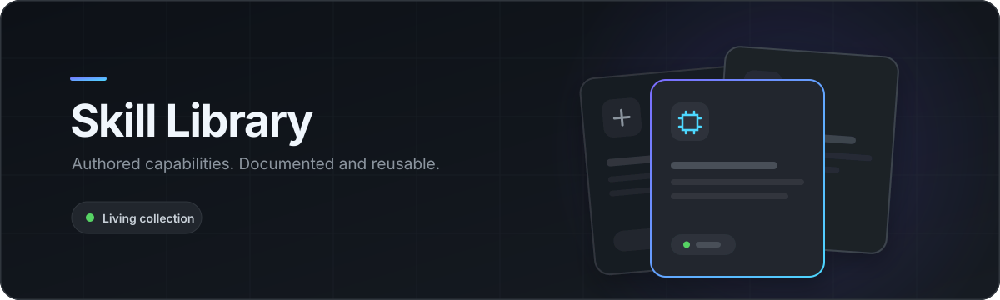

<p align="center">
  
</p>

# Skill Library

A living library of authored Copilot skills, source snapshots, and operating docs.

| Skill | Focus |
|---|---|
| [ado-workplan](skills/ado-workplan/README.md) | ADO sprint planning |
| [career-forensics](skills/career-forensics/README.md) | Engineering career knowledge |
| [clipfarm-leetcode](skills/clipfarm-leetcode/README.md) | Reviewed coding clips |
| [clipfarm-color-grading](skills/clipfarm-color-grading/README.md) | Current-checkout SDR grading |
| [clipfarm-code-camera-portrait](skills/clipfarm-code-camera-portrait/README.md) | Portrait code with camera |
| [clipfarm-code-only-portrait](skills/clipfarm-code-only-portrait/README.md) | Camera-free portrait code |
| [clipfarm-system-design-portrait](skills/clipfarm-system-design-portrait/README.md) | Portrait design explanations |
| [clipfarm-complete-solve-landscape](skills/clipfarm-complete-solve-landscape/README.md) | Complete landscape solves |
| [clipfarm-teaching-board-portrait](skills/clipfarm-teaching-board-portrait/README.md) | Causal camera-free teaching |
| [clipfarm-animated-camera-portrait](skills/clipfarm-animated-camera-portrait/README.md) | Teaching with moving source camera |
| [clipfarm-podcast-room-portrait](skills/clipfarm-podcast-room-portrait/README.md) | Full-room host strip |
| [clipfarm-podcast-closeup-portrait](skills/clipfarm-podcast-closeup-portrait/README.md) | Side-by-side host close-ups |
| [clipfarm-gesture-study-portrait](skills/clipfarm-gesture-study-portrait/README.md) | Near-arm motion study |
| [clipfarm-eye-study-portrait](skills/clipfarm-eye-study-portrait/README.md) | Blink/gaze/arm study |
| [clipfarm-chaptered-podcast-landscape](skills/clipfarm-chaptered-podcast-landscape/README.md) | Chaptered narration films |
| [clipfarm-vinyl-film-landscape](skills/clipfarm-vinyl-film-landscape/README.md) | Full-song picture-disc films |
| [clipfarm-vinyl-excerpt-portrait](skills/clipfarm-vinyl-excerpt-portrait/README.md) | Portrait vinyl excerpts |
| [clipfarm-source-fit-portrait](skills/clipfarm-source-fit-portrait/README.md) | Full-source portrait Fit |
| [clipfarm-native-grade-portrait](skills/clipfarm-native-grade-portrait/README.md) | Native portrait grade |
| [clipfarm-ab-review-landscape](skills/clipfarm-ab-review-landscape/README.md) | Matched grading review |
| [clipfarm-cinematic-music-video](skills/clipfarm-cinematic-music-video/README.md) | Fully reviewed cinematic song stories |
| [clipfarm-cinematic-music-draft](skills/clipfarm-cinematic-music-draft/README.md) | Early full-song cinematic drafts |
| [context-mesh](skills/context-mesh/README.md) | Cross-session context graph |
| [context-offload](skills/context-offload/README.md) | Durable context and personas |
| [dayplan](skills/dayplan/README.md) | Combined daily planning |
| [development-documentation-manual](skills/development-documentation-manual/README.md) | Living cross-project development and documentation manual |
| [documentation-mesh](skills/documentation-mesh/README.md) | Documentation intelligence |
| [folder-heatmap](skills/folder-heatmap/README.md) | Offline folder-size heatmaps and sortable space-review tables |
| [nse-advisor](skills/nse-advisor/README.md) | NSE paper-trading research |
| [speak](skills/speak/README.md) | Local Windows text-to-speech |
| [verona](skills/verona/README.md) | Opt-in local speaking face; skill copy only, separate Verona application required |

The inventory contains **30 definitions**. The default bulk install retains
its11existing entries;19additional ClipFarm copies require an explicit current
checkout. See [the complete20-skill ClipFarm family](skills/CLIPFARM.md) and
[its runtime setup](docs/CLIPFARM-SKILLS.md). Verona is an additional separate
skill copy; its application and models are not bundled.

**[Documentation](docs/README.md)** · **[Source inventory](source-inventory.json)**

Read the [development and documentation manual](skills/development-documentation-manual/MANUAL.md)
for the portfolio's TODO, journal, book, visual/media, report and publishing
techniques, with source limits, project-specific exceptions and reusable templates.

## Install on another Windows machine

The default runtime engines, tests, templates and supporting assets are included.
The complete current ClipFarm family instead requires a separate compatible
checkout; this mirror does not publish additional private application code.
Requires Windows x64, Python3.13 and Node.js18+.

```powershell
python .\scripts\verify_portable_payload.py
python .\scripts\install_skill_library.py --install-dependencies
```

For the complete current ClipFarm skill family, explicitly select its checkout:

```powershell
python .\scripts\install_skill_library.py --clipfarm-root "D:\Work\ClipFarm"
```

See **[portability and private restoration](docs/PORTABILITY.md)** for setup,
authentication boundaries and preserving identity/history. Private state,
recordings and internal zmem stay in a separate Git-ignored migration archive.
A clone alone does not restore accounts or private conversations.

Try the [fictional offline Context Mesh demo](examples/context-mesh/context-mesh.html)
for graph animation, Battleground, MeshBoard, avatars and threads.

```powershell
.\scripts\Validate-SkillLibrary.ps1
```
