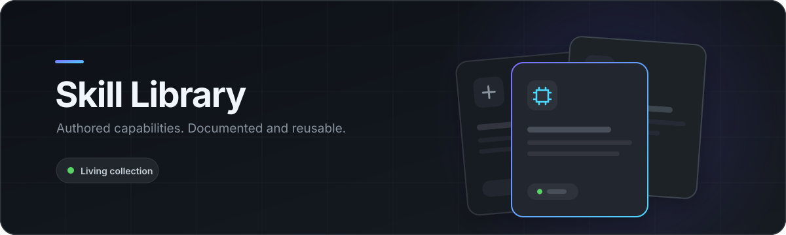

<p align="center">
  
</p>

# Skill Library

A living library of authored Copilot skills, source snapshots, and operating docs.

| Skill | Focus |
|---|---|
| [ado-workplan](skills/ado-workplan/README.md) | ADO sprint planning |
| [career-forensics](skills/career-forensics/README.md) | Engineering career knowledge |
| [clipfarm-leetcode](skills/clipfarm-leetcode/README.md) | Reviewed coding clips |
| [context-mesh](skills/context-mesh/README.md) | Cross-session context graph |
| [context-offload](skills/context-offload/README.md) | Durable context and personas |
| [dayplan](skills/dayplan/README.md) | Combined daily planning |
| [documentation-mesh](skills/documentation-mesh/README.md) | Documentation intelligence |
| [nse-advisor](skills/nse-advisor/README.md) | NSE paper-trading research |
| [speak](skills/speak/README.md) | Local Windows text-to-speech |

**[Documentation](docs/README.md)** · **[Source inventory](source-inventory.json)**

```powershell
.\scripts\Validate-SkillLibrary.ps1
```
