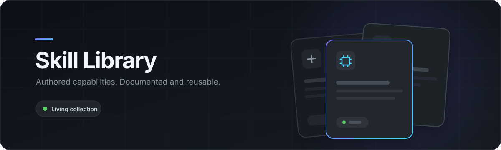

<p align="center">
  
</p>

# Skill Library

A living library of authored Copilot skills, source snapshots, and operating docs.

| Skill | Focus |
|---|---|
| [ado-workplan](skills/ado-workplan/README.md) | ADO sprint planning |
| [career-forensics](skills/career-forensics/README.md) | Engineering career knowledge |
| [clipfarm-leetcode](skills/clipfarm-leetcode/README.md) | Reviewed coding clips |
| [context-mesh](skills/context-mesh/README.md) | Cross-session context graph |
| [context-offload](skills/context-offload/README.md) | Durable context and personas |
| [dayplan](skills/dayplan/README.md) | Combined daily planning |
| [development-documentation-manual](skills/development-documentation-manual/README.md) | Living cross-project development and documentation manual |
| [documentation-mesh](skills/documentation-mesh/README.md) | Documentation intelligence |
| [nse-advisor](skills/nse-advisor/README.md) | NSE paper-trading research |
| [speak](skills/speak/README.md) | Local Windows text-to-speech |

**[Documentation](docs/README.md)** · **[Source inventory](source-inventory.json)**

Read the [development and documentation manual](skills/development-documentation-manual/MANUAL.md)
for the portfolio's TODO, journal, book, visual/media, report and publishing
techniques, with source limits, project-specific exceptions and reusable templates.

## Install on another Windows machine

The runtime engines, tests, templates and supporting assets are included, not
just skill prompts. Requires Windows x64, Python 3.13 and Node.js 18+.

```powershell
python .\scripts\verify_portable_payload.py
python .\scripts\install_skill_library.py --install-dependencies
```

See **[portability and private restoration](docs/PORTABILITY.md)** for setup,
authentication boundaries and preserving identity/history. Private state,
recordings and internal zmem stay in a separate Git-ignored migration archive.
A clone alone does not restore accounts or private conversations.

Try the [fictional offline Context Mesh demo](examples/context-mesh/context-mesh.html)
for graph animation, Battleground, MeshBoard, avatars and threads.

```powershell
.\scripts\Validate-SkillLibrary.ps1
```
