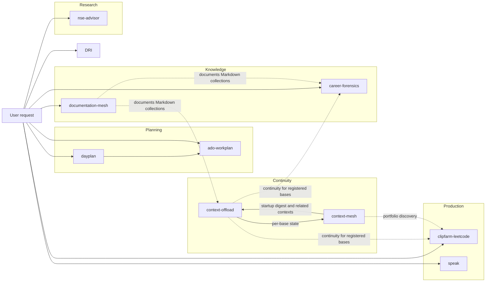

# Skill Relationships

## System map

## Routing relationships

### Planning family

The documented planning skills have deliberately different scopes:

- `ado-workplan` owns sprint work and excludes IcM/DRI scheduling.
- `dayplan` is the explicit composition layer and gives active incidents priority over sprint work.

The separately installed DRI-only skill is intentionally not archived in this library.

### Context family

`context-offload` is the writable per-base persistence protocol. `context-mesh` is the read-mostly portfolio index above those stores. The ownership boundary is central:

- a base writes only its own `.agent-context`;
- the mesh generator reads all stores and writes only generated mesh output;
- related sibling contexts are references, not writable extensions of the current base.

### ClipFarm integration

`clipfarm-leetcode` explicitly depends on registered-base continuity. It reads ClipFarm context at the beginning of work and only updates ClipFarm's own store when ClipFarm is the current base. This makes the context skills operational dependencies rather than optional documentation.

### Documentation Mesh distinction

`documentation-mesh` and `context-mesh` are separate systems:

- Context Mesh models sessions, personas, memories, and artifact provenance across work bases.
- Documentation Mesh models Markdown/MDX documents, links, entities, health, Git provenance, and offline documentation navigation.

They share evidence-first graph principles, but they have different source models, output locations, and write boundaries.

### Copilot Speak

`speak` is a thin routing skill over the Copilot Speak plugin. The skill decides when and how text should be spoken; the plugin's MCP server owns tool discovery, Windows SAPI invocation, voice enumeration, and error responses.

### Independent domain skills

`career-forensics` and `nse-advisor` do not route into the planning or media families. Their common requirement is evidence freshness:

- Career Forensics distinguishes artifact evidence, inference, and user recall.
- NSE Advisor requires current market data to support current-price recommendations and must identify stale data.

## Change-impact matrix

| Change | Review these skills |
|---|---|
| Workday hours, IST rules, weekend behavior | `ado-workplan`, `dayplan` |
| Shared schedule box layout or link formatting | `ado-workplan`, `dayplan` |
| IcM state/severity classification | `dayplan` |
| ADO status or note reconciliation | `ado-workplan`, `dayplan` |
| `.agent-context` schema or persona rules | `context-offload`, `context-mesh`, `clipfarm-leetcode` |
| Context freshness threshold | `context-offload`, `context-mesh` |
| Artifact provenance/evidence confidence | `context-mesh`, `documentation-mesh` |
| ClipFarm publishing/gallery schema | `clipfarm-leetcode` |
| Career report schema or score movement | `career-forensics` |
| Market-data or allocation rules | `nse-advisor` |
| Spoken-text routing or TTS defaults | `speak` and the Copilot Speak MCP implementation |
