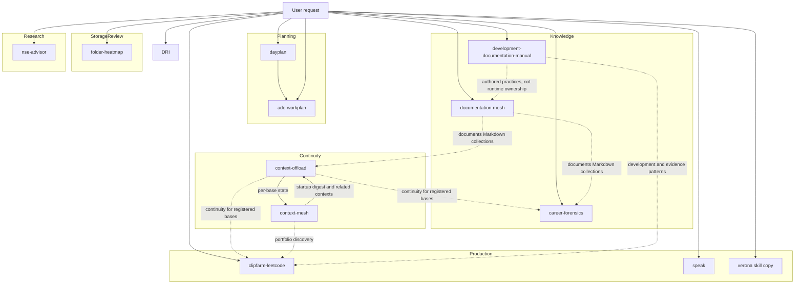

# Skill Relationships

## System map

## Routing relationships

### Planning family

The documented planning skills have deliberately different scopes:

- `ado-workplan` owns sprint work and excludes IcM/DRI scheduling.
- `dayplan` is the explicit composition layer and gives active incidents priority over sprint work.

The separately installed DRI-only skill is intentionally not archived in this library.

### Context family

`context-offload` is the writable per-base persistence protocol. `context-mesh` is the read-mostly portfolio index above those stores. The ownership boundary is central:

- a base writes only its own `.agent-context`;
- the mesh generator reads all stores and writes only generated mesh output;
- related sibling contexts are references, not writable extensions of the current base.

### ClipFarm integration

`clipfarm-leetcode` explicitly depends on registered-base continuity. It reads ClipFarm context at the beginning of work and only updates ClipFarm's own store when ClipFarm is the current base. This makes the context skills operational dependencies rather than optional documentation.

The [current ClipFarm family](CLIPFARM-SKILLS.md) has 20 copied entries:
two core routers, 16 layout/study/review procedures and two cinematic review
modes. These share a selected compatible ClipFarm checkout; the 19 additional
entries are not backed by a silently upgraded bundled application.

The installer keeps the legacy 11-entry default and accepts an explicit
`--clipfarm-root` for the complete 30-definition inventory. It validates/rebases
references but does not modify that checkout or grant context-store ownership.
Full cinematic review and early draft have different evidence gates; their
common full-song rule does not turn them into two additional video formats.
See [the complete family index](../skills/CLIPFARM.md).

### Documentation Mesh distinction

`documentation-mesh` and `context-mesh` are separate systems:

- Context Mesh models sessions, personas, memories, and artifact provenance across work bases.
- Documentation Mesh models Markdown/MDX documents, links, entities, health, Git provenance, and offline documentation navigation.

They share evidence-first graph principles, but they have different source models, output locations, and write boundaries.

### Copilot Speak

`speak` is a thin routing skill over the Copilot Speak plugin. The skill decides when and how text should be spoken; the plugin's MCP server owns tool discovery, Windows SAPI invocation, voice enumeration, and error responses.

### Living development and documentation manual

`development-documentation-manual` is a repository-authored synthesis and template
set, not another indexing or production engine. It explains how TODOs, journals,
books, source atlases, evidence, visual/media artifacts, reports and releases fit
together. `context-offload` still owns continuity; `context-mesh` owns portfolio
discovery; `documentation-mesh` owns its runtime; dedicated domain skills retain
their actual execution procedures. Local contracts override proposed defaults.

New source-backed techniques can enrich the manual through its evolution
procedure. This does not authorize rewriting sibling stores, copying private
sources or turning a historical project constraint into a universal requirement.

### Local storage review

`folder-heatmap` is independent of the context and documentation graph engines.
It scans metadata under an explicitly selected root and writes an offline
treemap, JSON and CSV outside that root. It does not read file contents, identify
duplicates or delete files. Its logical totals count hard-linked paths
separately; neither a large tile nor a source push proves recoverable disk space.

### Verona skill copy

`verona` routes explicitly opted-in speech through a separate local speaking-face
application, rather than the Speak MCP runtime. Its README documents the
external application prerequisite and session-owned head/shared-manager rules.
The copy is not part of the bulk installer, and neither voice skill authorizes
activating the other or changing another session's runtime.

### Independent domain skills

`career-forensics` and `nse-advisor` do not route into the planning or media families. Their common requirement is evidence freshness:

- Career Forensics distinguishes artifact evidence, inference, and user recall.
- NSE Advisor requires current market data to support current-price recommendations and must identify stale data.

## Change-impact matrix

| Change | Review these skills |
|---|---|
| Workday hours, IST rules, weekend behavior | `ado-workplan`, `dayplan` |
| Shared schedule box layout or link formatting | `ado-workplan`, `dayplan` |
| IcM state/severity classification | `dayplan` |
| ADO status or note reconciliation | `ado-workplan`, `dayplan` |
| `.agent-context` schema or persona rules | `context-offload`, `context-mesh`, `clipfarm-leetcode` |
| Context freshness threshold | `context-offload`, `context-mesh` |
| Artifact provenance/evidence confidence | `context-mesh`, `documentation-mesh` |
| ClipFarm publishing/gallery schema | `clipfarm-leetcode` |
| Career report schema or score movement | `career-forensics` |
| Market-data or allocation rules | `nse-advisor` |
| Spoken-text routing or TTS defaults | `speak` and the Copilot Speak MCP implementation |
| Speaking-face opt-in, head ownership or runtime prerequisites | `verona` copy and its separately maintained application |
| Directory scan coverage, logical size semantics or report schema | `folder-heatmap` and its synthetic scanner/browser tests |
| Shared TODO/journal/evidence templates or documentation technique | `development-documentation-manual` and affected local contracts |
| Manual source scope, new mode, counterexample or supersession | Manual, source register, case studies, templates and evolution log |
