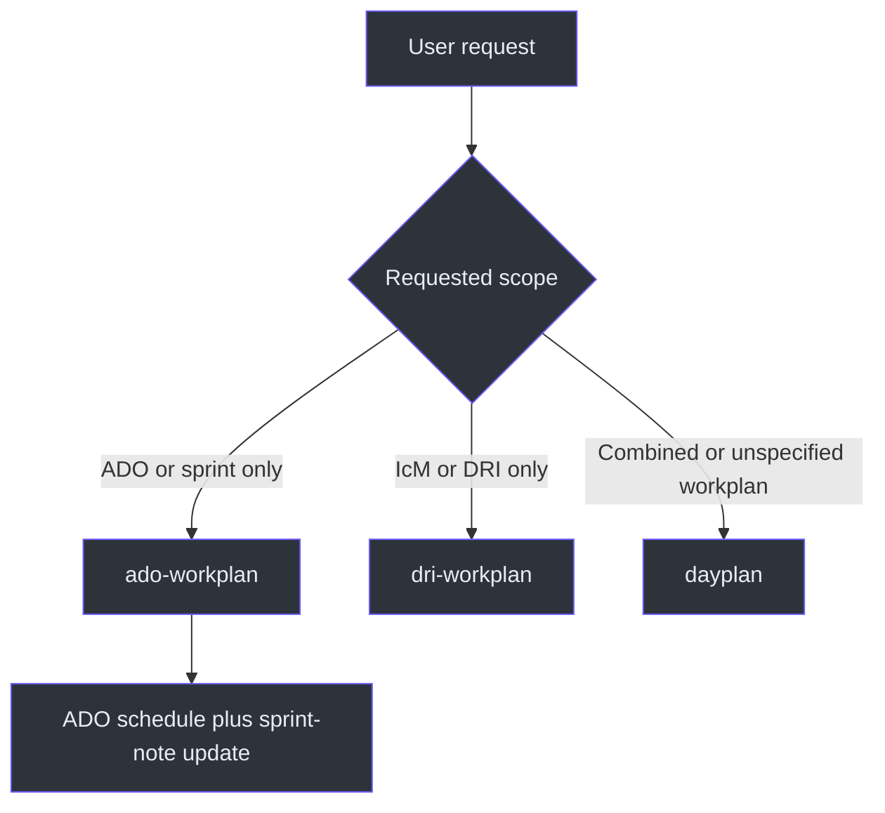
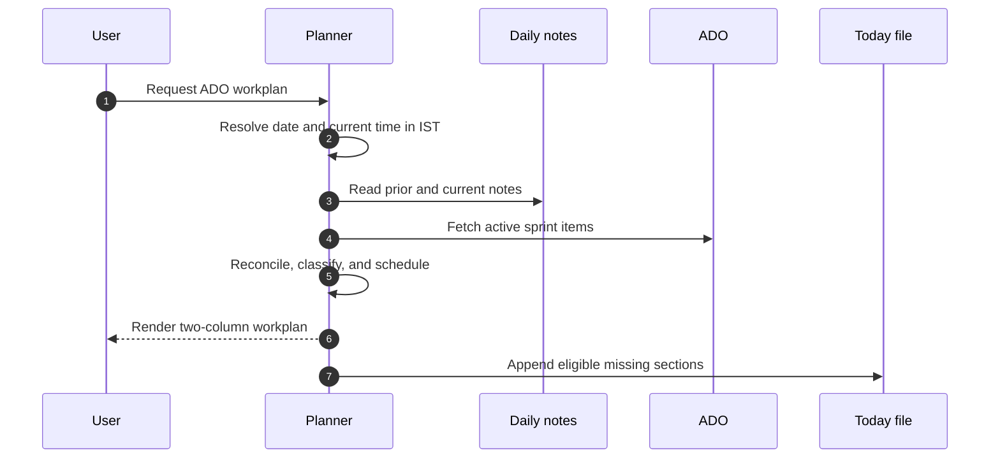

# ADO Workplan

## Purpose

`ado-workplan` turns the user's active Azure DevOps sprint work into a time-blocked
plan for the remainder of an IST workday. Its boundary is strict: it plans PBIs,
tasks, code reviews, and engineering work, but does not plan IcM or DRI work. A
combined request belongs to `dayplan`, while a livesite-only request belongs to
`dri-workplan`. Source: [SKILL.md](SKILL.md#ado-workplan-generator-sprint-tasks-only),
`SKILL.md:L7-L11`.

The skill is also a reconciliation workflow. Before scheduling, it reads the
previous daily note and today's existing note, preserves completion evidence,
compares that evidence with live ADO state, and then writes only eligible active
work back to today's Zettelkasten sprint log. Source:
[SKILL.md](SKILL.md#previous-day-completion-reconciliation-mandatory),
`SKILL.md:L19-L27`; [SKILL.md](SKILL.md#file-output--zettelkasten-sprint-log),
`SKILL.md:L132-L175`.

## At a glance

| Concern | Contract |
|---|---|
| Primary scope | ADO sprint work only |
| Default start | Current IST time |
| End of schedule | 18:00 IST |
| Weekend behavior | No work plan; return the recharge message |
| Primary live source | ADO MCP |
| Historical evidence | Yesterday's and today's Zettelkasten notes |
| Preferences | Session SQL `user_preferences` |
| Persistent side effect | Update today's sprint checklist file |
| Combined routing | Use `dayplan` |
| DRI-only routing | Use `dri-workplan` |

Source: [SKILL.md](SKILL.md#-critical-rules--date--time), `SKILL.md:L13-L17`;
[SKILL.md](SKILL.md#data-sources), `SKILL.md:L36-L41`;
[SKILL.md](SKILL.md#important-notes), `SKILL.md:L193-L199`.

## Routing architecture

Routing is supported by the explicit exclusion and cross-skill directions in
`SKILL.md:L9-L11`, plus the trigger list in `SKILL.md:L29-L34`.

## End-to-end lifecycle

The source orders these operations as date, preferences, notes, ADO fetch,
classification, rendering, source-date labeling, and file update.
Source: [SKILL.md](SKILL.md#workflow), `SKILL.md:L177-L191`.

## Documentation map

| Document | Use it for |
|---|---|
| [Architecture](docs/ARCHITECTURE.md) | Components, boundaries, data flow, and integrations |
| [Workflow](docs/WORKFLOW.md) | Detailed control flow and reconciliation rules |
| [Reference](docs/REFERENCE.md) | Complete rules, tables, URLs, fields, and quick reference |
| [Examples](docs/EXAMPLES.md) | Worked weekday, refresh, conflict, and weekend scenarios |
| [Operations and Testing](docs/OPERATIONS-AND-TESTING.md) | Validation, troubleshooting, safety, and maintenance |

## Core invariants

1. Resolve the date externally and represent displayed time in IST.
2. Begin at the current time and skip elapsed blocks.
3. Do not revive completed, removed, or otherwise finished work.
4. Do not mutate ADO state based on note checkboxes.
5. Preserve existing notes, checkmarks, edits, and wikilinks.
6. Write only Active, In Progress, or In Review items to today's note.
7. Keep console links outside code fences so they remain clickable.
8. On Saturday or Sunday, do not produce a work schedule.

Sources: [SKILL.md](SKILL.md#-critical-rules--date--time),
`SKILL.md:L13-L17`; [SKILL.md](SKILL.md#previous-day-completion-reconciliation-mandatory),
`SKILL.md:L21-L27`; [SKILL.md](SKILL.md#rules), `SKILL.md:L165-L175`;
[SKILL.md](SKILL.md#important-notes), `SKILL.md:L193-L199`.

## Evidence boundary

This suite documents only the checked-in `SKILL.md` snapshot. The snapshot names
ADO MCP operations and SQL tables, but does not define their schemas, authentication,
error payloads, retry policy, or exact tool invocation syntax. Those details must
not be inferred. See [Reference](docs/REFERENCE.md#known-limitations).
