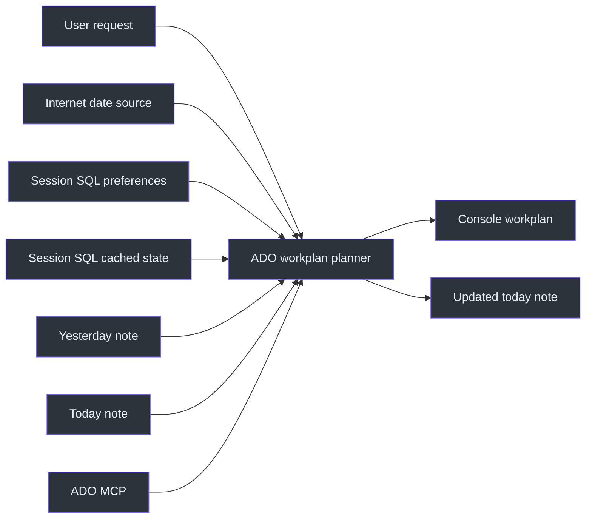
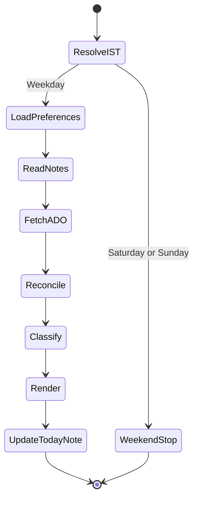
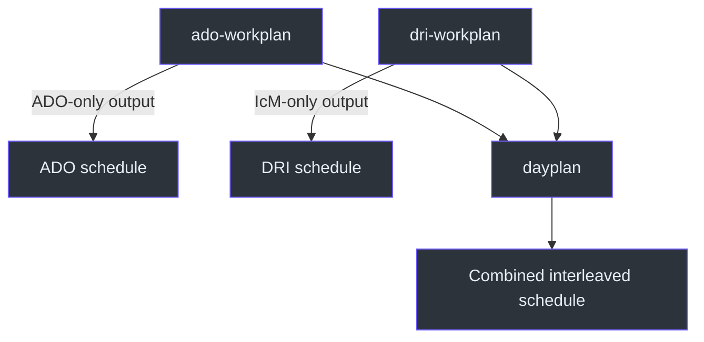

# ADO Workplan Architecture

## Overview

The architecture exists to solve two distinct problems without conflating them:
construct a useful remainder-of-day schedule from live ADO work, and preserve the
user's own completion evidence across daily notes. The skill is therefore both a
read/merge/render pipeline and a narrowly constrained file updater.
Source: [SKILL.md](../SKILL.md#previous-day-completion-reconciliation-mandatory),
`SKILL.md:L19-L27`; [SKILL.md](../SKILL.md#workflow), `SKILL.md:L177-L191`.

## System context

The named dependencies are the ADO MCP, session SQL preferences, optional cached
work-item state, and Zettelkasten notes. Source:
[SKILL.md](../SKILL.md#data-sources), `SKILL.md:L36-L41`.

## Component model

| Component | Responsibility | Evidence |
|---|---|---|
| Trigger router | Select this skill for workplan, schedule, sprint, and ADO requests | `SKILL.md:L29-L34` |
| IST clock gate | Resolve date, current time, and remaining blocks | `SKILL.md:L13-L17` |
| Preference reader | Read routine, style, and ADO hierarchy rules | `SKILL.md:L43-L52` |
| Note reconciler | Preserve checked work and carry forward only unfinished actions | `SKILL.md:L19-L27` |
| ADO reader | Fetch active sprint items and parent context | `SKILL.md:L38-L41`, `L182-L182` |
| Classifier | Map status and priority into focus or queue areas | `SKILL.md:L183-L187` |
| Renderer | Produce the shared two-column box layout | `SKILL.md:L53-L97` |
| Note writer | Append missing eligible sections without overwriting | `SKILL.md:L132-L175` |

## Internal state flow

The weekend branch is terminal because the source explicitly prohibits weekend
plans. The normal branch follows the workflow order. Source:
[SKILL.md](../SKILL.md#important-notes), `SKILL.md:L193-L199`;
[SKILL.md](../SKILL.md#workflow), `SKILL.md:L177-L191`.

## Data ownership and authority

The sources have different authority:

- The daily notes provide user-recorded action completion evidence. A checked
  action proves completion only for the action's stated scope.
- Live ADO status determines whether an item is still pending. Done, Closed, and
  Removed items are excluded.
- A disagreement is reported, not silently resolved by changing ADO.
- Existing note content remains authoritative for its own edits, checkmarks, and
  wikilinks.

Source: [SKILL.md](../SKILL.md#previous-day-completion-reconciliation-mandatory),
`SKILL.md:L21-L27`.

## Time model

The schedule template describes canonical blocks from 11:00 through 18:00 IST,
but actual output starts at the current IST time and excludes blocks that have
already elapsed. The template is therefore a block vocabulary, not a requirement
to print past blocks. Source: [SKILL.md](../SKILL.md#-critical-rules--date--time),
`SKILL.md:L13-L17`; [SKILL.md](../SKILL.md#schedule-template-ist--sprint-blocks),
`SKILL.md:L119-L130`.

## Rendering boundary

The console output is split intentionally:

1. Monospace box segments remain inside code fences.
2. Markdown link bullets sit outside those fences.
3. The final closing border appears in its own fence after queued links.

This design preserves both visual alignment and clickability.
Source: [SKILL.md](../SKILL.md#key-rules), `SKILL.md:L87-L97`.

## Integration with sibling skills

The ADO snapshot explicitly delegates livesite-only work to `dri-workplan` and
combined output to `dayplan`. It does not specify whether those sibling skills
reuse this skill as executable code or only share a conceptual format.
Source: [SKILL.md](../SKILL.md#ado-workplan-generator-sprint-tasks-only),
`SKILL.md:L7-L11`.

## Safety boundaries

- No ADO state update is authorized by a note checkbox.
- No existing note may be overwritten.
- No completed sibling action may be reopened because another child is unfinished.
- No Removed task may be recreated from historical note content.
- No new sprint-folder spelling may be invented when an existing name is present.

Source: [SKILL.md](../SKILL.md#previous-day-completion-reconciliation-mandatory),
`SKILL.md:L21-L27`; [SKILL.md](../SKILL.md#rules), `SKILL.md:L165-L175`.

## References

This architecture has one normative source file:
[SKILL.md](../SKILL.md). The documentation skill normally prefers multiple source
files, but this repository snapshot provides only that source for this component.
