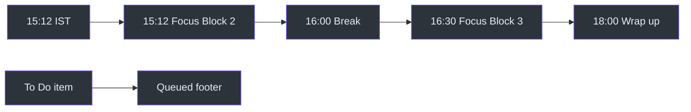
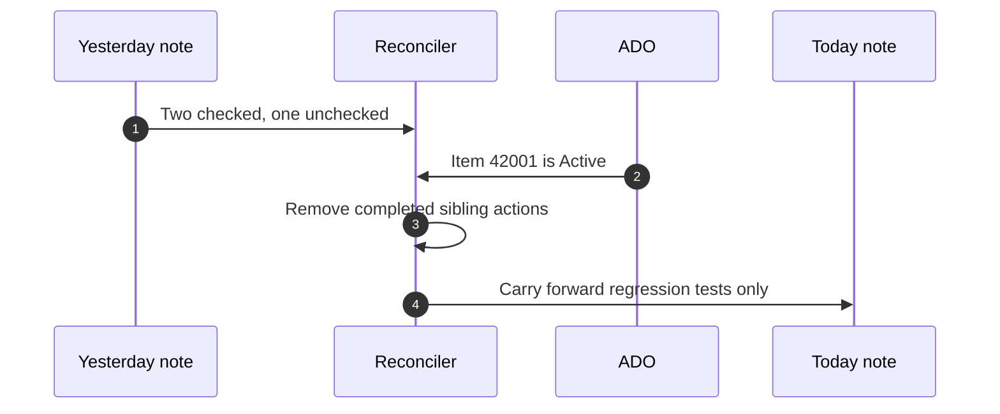

# ADO Workplan Examples

## Reading these examples

The examples illustrate the source rules but use fictional work-item IDs and
titles. They do not assert live ADO data or tool behavior. The normative behavior
comes from [SKILL.md](../SKILL.md#workflow), `SKILL.md:L177-L191`.

## Example 1: Weekday afternoon refresh

### Inputs

- Current time: 15:12 IST on a weekday.
- Item 41001: In Progress.
- Item 41002: In Review.
- Item 41003: To Do.
- The 11:00, 11:30, 12:00, and 14:00 blocks have passed.

### Expected allocation

| Item | Placement | Reason |
|---|---|---|
| 41001 | Next available focus block | In Progress is highest priority |
| 41002 | Later review/focus block | In Review follows In Progress |
| 41003 | `QUEUED` | To Do is not active note output |

Source: [SKILL.md](../SKILL.md#-critical-rules--date--time),
`SKILL.md:L15-L17`; [SKILL.md](../SKILL.md#workflow),
`SKILL.md:L183-L187`.



An abbreviated rendering could be:

```text
+-----------+-----------------------------------------+
| 15:12     | Focus Block 2                           |
|           | Continue highest-priority active task   |
+-----------+-----------------------------------------+
```

- [#41001](https://msazure.visualstudio.com/One/_workitems/edit/41001) - Continue runner configuration

```text
+-----------+-----------------------------------------+
| 16:00     | Break                                   |
| 16:30     | Focus Block 3                           |
|           | Review pending change                   |
+-----------+-----------------------------------------+
| Insight: finish active work before queued work.     |
| QUEUED                                              |
```

- [#41003](https://msazure.visualstudio.com/One/_workitems/edit/41003) - Future cleanup task

```text
+-----------------------------------------------------+
```

The actual skill uses the source's shared box characters and status markers.
This ASCII rendering focuses on placement and fence/link separation.

## Example 2: Partial completion carry-forward

Yesterday's note:

```markdown
# Improve deployment validation

[ADO #42001](https://msazure.visualstudio.com/One/_workitems/edit/42001)

- [x] Add input validation
- [ ] Add regression tests
- [X] Update error text
```

Live ADO still reports the item as Active.

Expected result:

- Do not reopen `Add input validation`.
- Do not reopen `Update error text`.
- Carry forward only `Add regression tests`.
- Keep the live item because it is still Active.

Source: [SKILL.md](../SKILL.md#previous-day-completion-reconciliation-mandatory),
`SKILL.md:L23-L25`.



## Example 3: Note and ADO disagreement

Yesterday says:

```markdown
- [x] Complete rollout validation
```

ADO still says In Progress. The output should identify that the note records the
action as complete while ADO remains In Progress. It must not change the ADO
state merely because the checkbox is checked. Source:
[SKILL.md](../SKILL.md#previous-day-completion-reconciliation-mandatory),
`SKILL.md:L24-L26`.

## Example 4: Missing yesterday note

If the expected prior-day file is absent:

1. Locate the most recent preceding sprint note.
2. Read it as carry-forward evidence.
3. Label completion with that file's actual date.
4. Do not call it "Completed yesterday" unless it truly is yesterday.

Source: [SKILL.md](../SKILL.md#previous-day-completion-reconciliation-mandatory),
`SKILL.md:L21-L26`.

## Example 5: Existing today file

Suppose today's note already contains ADO #43001 and user-edited checkmarks.
The planner also receives #43001 and #43002 from ADO.

- Preserve #43001 exactly.
- Do not append a second #43001 section.
- Append #43002 only if its state is Active, In Progress, or In Review.
- Preserve all existing wikilinks and backlinks.

Source: [SKILL.md](../SKILL.md#rules), `SKILL.md:L165-L175`;
`SKILL.md:L27-L27`.

## Example 6: Parent and child display

Given one PBI with two child tasks, display the PBI as a header and nest both
tasks. Given a PBI with no children, display it standalone. Hyperlink only the
numeric reference, not the title text. Source:
[SKILL.md](../SKILL.md#ado-display-rules), `SKILL.md:L113-L117`.

```text
PBI 44000 - Improve incident diagnostics
|- #44001 - Add correlation output
`- #44002 - Review telemetry naming
```

## Example 7: DRI-week capacity

If DRI week is active, the ADO plan still remains ADO-only, but the header notes
approximately 50 percent DRI overhead and the schedule reduces ADO expectations.
It does not add incident details; a combined incident/task output belongs to
`dayplan`. Source: `SKILL.md:L9-L11`; [SKILL.md](../SKILL.md#important-notes),
`SKILL.md:L198-L198`.

## Example 8: Friday

On Friday, the plan should put critical In Progress work first, avoid an
overloaded queue, and leave buffer time. Source:
[SKILL.md](../SKILL.md#important-notes), `SKILL.md:L199`.

## Example 9: Weekend

On Saturday or Sunday, return:

> It's the weekend! Time to recharge. No work scheduled.

Do not render the schedule or write a normal work plan. Source:
[SKILL.md](../SKILL.md#important-notes), `SKILL.md:L193-L195`.

## Example 10: File append

New section for an eligible item:

```markdown
# Add regression coverage

[ADO #45001](https://msazure.visualstudio.com/One/_workitems/edit/45001)

- [ ] Add focused unit tests
- [ ] Run the relevant test suite
```

This follows the H1, link, checklist, and blank-line contract in
[SKILL.md](../SKILL.md#file-content-format), `SKILL.md:L147-L175`.

## Edge-case matrix

| Scenario | Expected response |
|---|---|
| Current time before 11:00 | Source says start from current time; no separate pre-work policy is defined |
| Current time after 18:00 | Not defined in the snapshot; do not invent a schedule policy |
| No active ADO work | Render behavior is not fully specified; do not fabricate tasks |
| SQL cache absent | Use persisted WorkDesk preferences |
| Yesterday absent | Use latest preceding note and label actual date |
| ADO item is Removed | Exclude and do not recreate |
| Duplicate ADO ID in today's note | Preserve existing section; do not append duplicate |
| User says item completed today | It may appear as completed today if today's evidence supports it |
