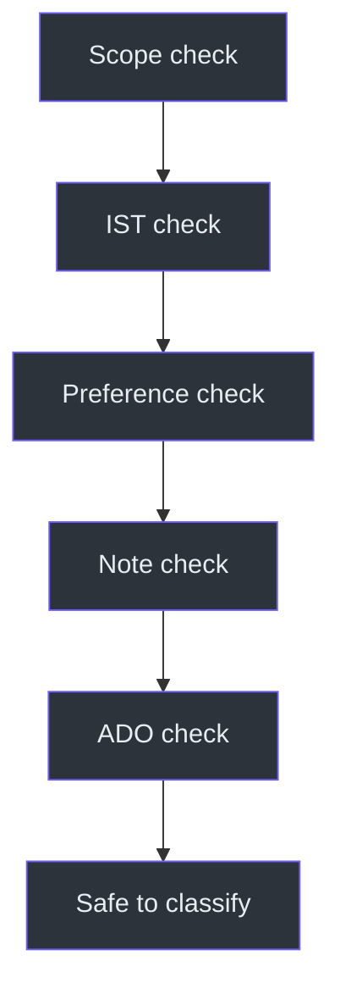
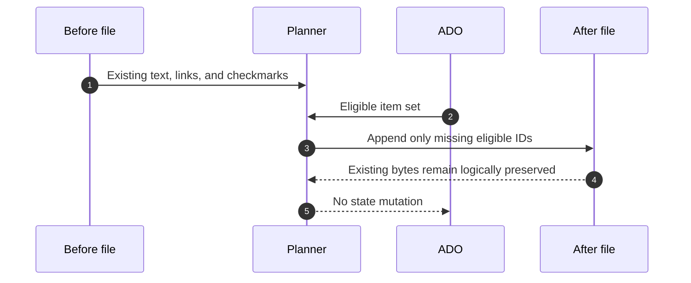

# ADO Workplan Operations and Testing

## Operational objective

An acceptable run produces an accurate remaining-day ADO schedule and safely
updates today's sprint note without changing ADO or damaging prior evidence.
Source: [SKILL.md](../SKILL.md#workflow), `SKILL.md:L177-L191`;
[SKILL.md](../SKILL.md#rules), `SKILL.md:L165-L175`.

## Pre-run checklist

1. Confirm the request is ADO-only.
2. Fetch the current date and time and normalize to IST.
3. Apply the weekend gate.
4. Read the three preference keys.
5. Identify the existing sprint-folder spelling.
6. Read the prior evidence note and today's note.
7. Fetch live ADO items and parent context.

Source: [SKILL.md](../SKILL.md#when-to-use-this-skill),
`SKILL.md:L29-L34`; [SKILL.md](../SKILL.md#workflow),
`SKILL.md:L177-L182`.

## Post-run validation

### Console

- Date is accurate for IST.
- No elapsed time blocks are shown.
- In Progress precedes In Review, To Do, and Parked.
- PBI/task hierarchy follows the child-task rule.
- Code-fenced box segments are short enough to avoid wrapping.
- Every link bullet is outside code fences.
- The footer has an actionable insight and queued work.
- Friday and DRI-week annotations appear only when applicable.

Sources: [SKILL.md](../SKILL.md#key-rules), `SKILL.md:L87-L97`;
[SKILL.md](../SKILL.md#ado-display-rules), `SKILL.md:L113-L117`;
[SKILL.md](../SKILL.md#important-notes), `SKILL.md:L193-L199`.

### Daily note

- Correct folder and filename are used.
- Existing content, checkmarks, and wikilinks remain unchanged.
- No ADO ID is duplicated.
- Only Active, In Progress, or In Review items were appended.
- Completed actions from prior notes were not reopened.
- Source-date labels are accurate.
- Carry-forward and `2 Areas` links were preserved or added as required.

Sources: [SKILL.md](../SKILL.md#previous-day-completion-reconciliation-mandatory),
`SKILL.md:L21-L27`; [SKILL.md](../SKILL.md#rules),
`SKILL.md:L165-L175`.

## Test scenarios

| ID | Scenario | Expected result |
|---|---|---|
| T01 | Monday at 11:00 with one In Progress item | Full remaining template; item in Focus Block 1 |
| T02 | Weekday at 15:12 | Earlier blocks omitted |
| T03 | Saturday | Recharge message; no normal plan |
| T04 | Checked and unchecked child actions | Only unchecked children carried |
| T05 | Checked note action, ADO In Progress | Discrepancy reported; no ADO mutation |
| T06 | ADO Done/Closed/Removed | Item excluded |
| T07 | Today file already has same ADO ID | No duplicate section |
| T08 | Today file has user checkmarks | Checkmarks preserved |
| T09 | Yesterday file missing | Latest preceding note used and dated accurately |
| T10 | In Review and To Do items | In Review scheduled; To Do queued |
| T11 | Friday | Critical-first guidance and buffer note |
| T12 | Active DRI week | Header notes reduced ADO capacity |
| T13 | PBI with children | Parent header plus nested tasks |
| T14 | PBI without children | Standalone PBI |
| T15 | Optional SQL cache unavailable | Persisted WorkDesk preferences used |

## Mutation-safety test

The source defines logical preservation, not a byte-for-byte implementation
requirement. Validation should therefore compare content semantics: existing
sections and marks must survive unchanged. Source:
[SKILL.md](../SKILL.md#rules), `SKILL.md:L165-L175`.

## Troubleshooting

| Symptom | Likely rule violation | Corrective action |
|---|---|---|
| Morning blocks appear in an afternoon refresh | Current-time filtering was skipped | Recompute using current IST and omit passed blocks |
| Completed child action reappears | Checklist scope was flattened | Carry only unchecked children |
| Removed item reappears | Historical note copied blindly | Exclude Removed and honor current note deletion |
| Link is not clickable | Link was placed inside a code fence | Move link bullet outside the fenced box |
| Box wraps in terminal | Lines exceed the approximate 55-character target | Shorten labels and details |
| Today's edits disappear | File was overwritten | Restore the existing file and append only missing IDs |
| Work item is duplicated | Deduplication ignored ADO ID | Match on ADO ID before append |
| Note says completed today incorrectly | Source date was lost | Label the actual note date |
| ADO state changed after checkbox read | Safety boundary violated | Revert unauthorized state change; checkbox is evidence only |

## Failure handling

Explicitly defined fallbacks:

- Missing yesterday note: use the latest preceding note and disclose its date.
- Optional SQL tables unavailable: use persisted WorkDesk preferences.

No fallback is defined for a failed ADO query or unavailable date source. A safe
implementation should report that required data could not be verified rather
than inventing live work or a date. The first two behaviors are sourced from
`SKILL.md:L21-L23` and `SKILL.md:L38-L41`; the final sentence is a safety
interpretation, not an additional source-defined mechanism.

## Maintenance guidance

When changing the skill:

1. Keep the ADO-only boundary aligned with `dayplan` and `dri-workplan`.
2. Update trigger phrases without making generic routing ambiguous.
3. Keep date/time rules and schedule blocks consistent.
4. Treat reconciliation and file-preservation rules as regression-sensitive.
5. If the file schema changes, update examples and deduplication tests together.
6. If new statuses are added, define both console placement and file eligibility.
7. Document any new fallback explicitly instead of relying on silent behavior.

The areas above correspond to the source sections at
[SKILL.md](../SKILL.md#when-to-use-this-skill), `SKILL.md:L29-L34`;
[SKILL.md](../SKILL.md#file-output--zettelkasten-sprint-log),
`SKILL.md:L132-L175`; and [SKILL.md](../SKILL.md#workflow),
`SKILL.md:L177-L191`.

## Release acceptance checklist

- [ ] `SKILL.md` remains unchanged.
- [ ] All source line citations still match the snapshot.
- [ ] Weekend behavior passes.
- [ ] Afternoon filtering passes.
- [ ] Partial-completion reconciliation passes.
- [ ] Existing-note preservation passes.
- [ ] ADO-ID deduplication passes.
- [ ] Status classification passes.
- [ ] PBI hierarchy rendering passes.
- [ ] Link placement and terminal-width checks pass.
- [ ] No test depends on undocumented MCP or SQL behavior.
