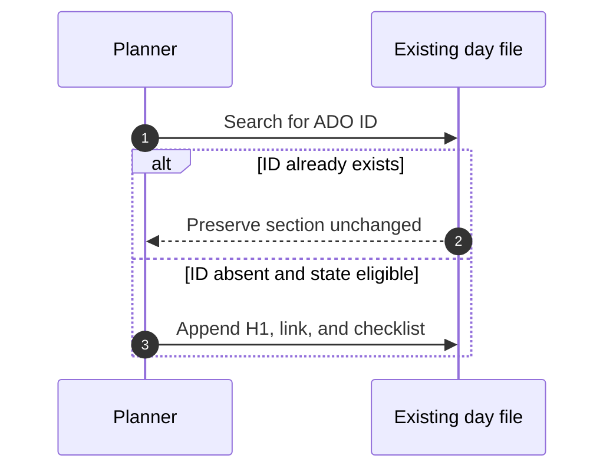

# ADO Workplan Reference

## Trigger reference

| Phrase or intent | Route |
|---|---|
| workplan, daily plan, schedule | `ado-workplan` when sprint scope is intended |
| what's on my plate, show plan | `ado-workplan` for ADO-only context |
| morning plan, afternoon refresh | `ado-workplan` |
| sprint tasks, ADO items | `ado-workplan` |
| IcM, livesite, DRI-only | `dri-workplan`, not this skill |
| combined ADO and DRI | `dayplan`, not this skill |

Source: [SKILL.md](../SKILL.md#when-to-use-this-skill), `SKILL.md:L29-L34`;
`SKILL.md:L9-L11`.

## Dependency reference

| Dependency | Required use | Source-defined fallback |
|---|---|---|
| Internet date source | Accurate IST date | None stated |
| ADO MCP | Active sprint tasks and batched item lookup | None stated |
| SQL `user_preferences` | Routine, style, hierarchy preferences | Persisted WorkDesk preferences if optional SQL tables are unavailable |
| SQL `work_items` | Cached item state | Optional; persisted preferences guidance applies |
| Zettelkasten notes | Completion evidence and today's existing content | Latest preceding note if yesterday is missing |

Source: [SKILL.md](../SKILL.md#data-sources), `SKILL.md:L36-L41`;
[SKILL.md](../SKILL.md#previous-day-completion-reconciliation-mandatory),
`SKILL.md:L21-L27`.

## Preference keys

| Key | Meaning |
|---|---|
| `daily_routine` | Work hours and blocks, documented as 11:00-18:00 IST |
| `workplan_style` | Exact visual formatting specification |
| `ado_display_rule` | PBI and task hierarchy display rules |

Source: [SKILL.md](../SKILL.md#user-preferences-from-sql),
`SKILL.md:L43-L52`.

## Date and time rules

| Rule | Required behavior |
|---|---|
| Date source | Fetch from internet; never guess |
| Time zone | IST, UTC+05:30 |
| Default start | Current time |
| Past blocks | Skip them |
| End | 18:00 IST |
| Saturday/Sunday | Return recharge message; no work plan |
| Friday | Add lower-energy guidance and buffer |

Source: [SKILL.md](../SKILL.md#-critical-rules--date--time),
`SKILL.md:L13-L17`; [SKILL.md](../SKILL.md#important-notes),
`SKILL.md:L193-L199`.

## Status and priority matrix

| ADO state/category | Console placement | Daily file | Relative priority |
|---|---|---|---|
| In Progress | Focus Block 1 | Include | 1 |
| Active | Active work block | Include | Active |
| In Review | Focus Block 2 | Include | 2 |
| To Do | `QUEUED` | Exclude | 3 |
| Low priority | `QUEUED` | Exclude | Lower |
| Parked | `QUEUED` with parked marker | Exclude | 4 |
| Done | Optional completed-today display only when today's evidence supports it | Exclude from pending | Finished |
| Closed | Exclude | Exclude | Finished |
| Removed | Exclude and never recreate | Exclude | Finished |

Source: [SKILL.md](../SKILL.md#link-emoji-legend), `SKILL.md:L99-L107`;
[SKILL.md](../SKILL.md#workflow), `SKILL.md:L183-L190`;
`SKILL.md:L169-L170`; `SKILL.md:L24-L26`.

## Schedule template

| Time | Canonical block |
|---|---|
| 11:00 | Start day: email and Teams triage |
| 11:30 | Standup |
| 12:00 | Focus Block 1: high-priority work |
| 14:00 | Lunch |
| 15:00 | Focus Block 2: reviews or continuation |
| 16:00 | Break |
| 16:30 | Focus Block 3: remaining work |
| 18:00 | Wrap up: update ADO and push code |

Source: [SKILL.md](../SKILL.md#schedule-template-ist--sprint-blocks),
`SKILL.md:L119-L130`.

## Rendering contract

| Element | Contract |
|---|---|
| Outer structure | Two-column time/content box |
| Box location | Inside code fences |
| Line length | Approximately 55 characters |
| Separators | Dashed row separators |
| Sub-items | Prefix with the source-defined arrow marker |
| Links | Markdown bullets outside code fences |
| Footer | Actionable insight plus `QUEUED` |
| Closing border | Its own final code fence |
| Work-item hyperlink | Link only `#number`; title remains plain text |
| PBI hierarchy | Parent header with nested child tasks when children exist |

Source: [SKILL.md](../SKILL.md#key-rules), `SKILL.md:L87-L97`;
[SKILL.md](../SKILL.md#ado-display-rules), `SKILL.md:L113-L117`.

## URL and file-path contracts

| Resource | Template |
|---|---|
| ADO item | `https://msazure.visualstudio.com/One/_workitems/edit/{id}` |
| Sprint folder | `C:\notedesk\zettelkasten\1 Project\SPRINT_{MONTH}_{YY}` |
| Day file | `{YYYY-MM-DD}.md` |

Source: [SKILL.md](../SKILL.md#url-format), `SKILL.md:L109-L111`;
[SKILL.md](../SKILL.md#folder-structure), `SKILL.md:L132-L145`.

## Daily-file schema

Each persisted work item has:

1. An H1 with a short task name.
2. An ADO link on its own line.
3. One or more short actionable unchecked checklist entries.
4. A blank line before the next work item.

The file writer matches ADO IDs to prevent duplicates and does not overwrite
existing content. Source: [SKILL.md](../SKILL.md#file-content-format),
`SKILL.md:L147-L175`.

## Reconciliation truth table

| Note state | Live ADO state | Result |
|---|---|---|
| Checked | Active | Report discrepancy; do not mutate ADO |
| Unchecked | Active/In Progress/In Review | Keep unfinished action |
| Checked sibling, unchecked sibling | Active | Keep only unchecked sibling |
| Any | Done/Closed/Removed | Exclude from pending work |
| Removed from current note | Historical record exists | Do not recreate blindly |
| Today's section already exists | Eligible | Preserve and deduplicate |

Source: [SKILL.md](../SKILL.md#previous-day-completion-reconciliation-mandatory),
`SKILL.md:L21-L27`; [SKILL.md](../SKILL.md#rules),
`SKILL.md:L165-L175`.

## Complete quick reference

| Question | Answer |
|---|---|
| What does it plan? | ADO sprint work only |
| What does it exclude? | IcM and DRI duties |
| When does it start? | Current IST time |
| What evidence is read first? | Prior note and today's existing note |
| What wins for pending state? | Live ADO excludes Done/Closed/Removed; discrepancies are reported |
| How are checked actions handled? | Completed for their stated scope only |
| What enters Focus Block 1? | In Progress, high-priority work |
| What enters Focus Block 2? | In Review |
| What is queued? | To Do, low priority, Parked |
| What is written to disk? | Active, In Progress, or In Review work-item sections |
| Does it overwrite today's note? | No; append missing ADO IDs only |
| Does it update ADO? | No automatic state change is authorized |
| What happens on weekends? | Recharge message and no schedule |
| What changes on Friday? | Critical-first planning with buffer |
| What changes during DRI week? | Header notes about 50 percent overhead and reduced ADO capacity |

## Known limitations

The snapshot does not specify:

- ADO MCP request/response schemas or authentication;
- SQL table schemas;
- retry and timeout behavior for ADO or SQL;
- the algorithm for inferring checklist subtasks from titles/context;
- exact backlink syntax for `2 Areas` notes;
- how current-time requests after 18:00 are rendered;
- how conflicting duplicate IDs across notes are resolved beyond deduplication.

These are intentionally left unspecified rather than invented. The only normative
source is [SKILL.md](../SKILL.md).
