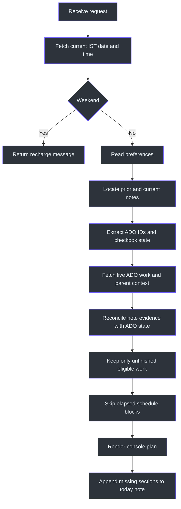
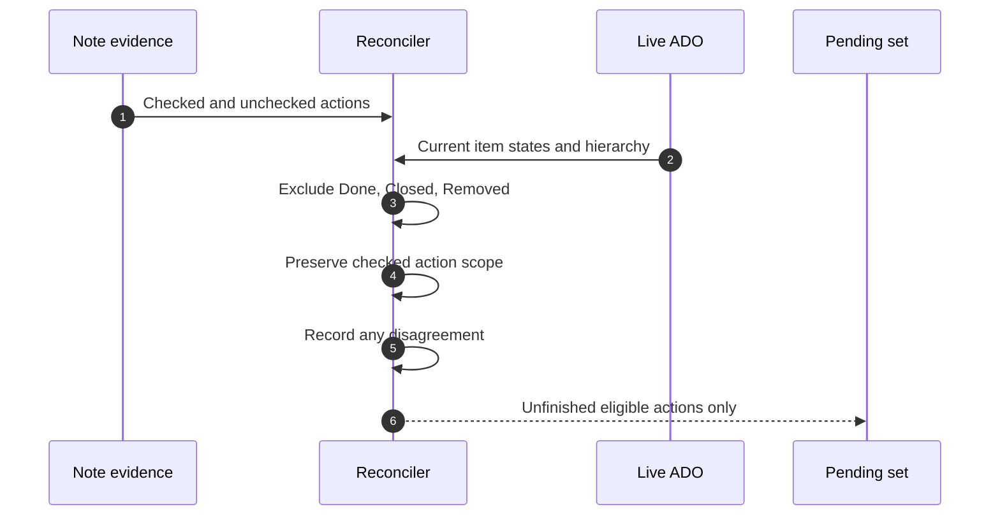
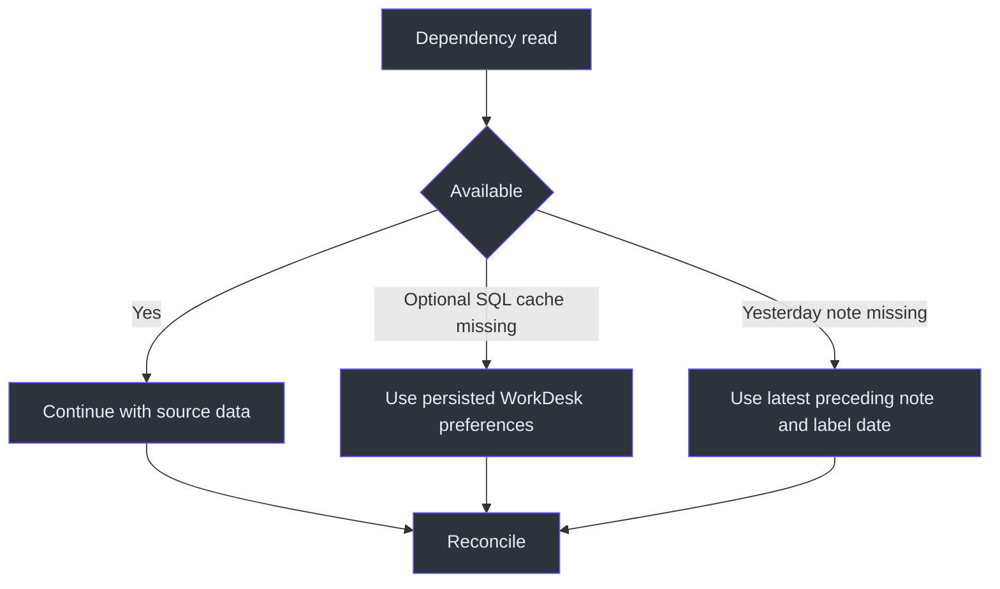

# ADO Workplan Workflow

## Overview

The workflow must prevent stale planning. It first establishes the correct IST
date and time, then reconciles user-edited notes with live ADO state, and only
then allocates unfinished work to remaining blocks. Source:
[SKILL.md](../SKILL.md#workflow), `SKILL.md:L177-L191`.

## Detailed control flow



### 1. Route the request

Use this workflow for requests centered on a workplan, daily plan, schedule,
current workload, morning start, afternoon refresh, or ADO sprint summary.
If the request is specifically livesite-oriented, route to `dri-workplan`; for a
combined picture, route to `dayplan`. Source:
[SKILL.md](../SKILL.md#when-to-use-this-skill), `SKILL.md:L29-L34`;
`SKILL.md:L9-L11`.

### 2. Establish date and time

Fetch the date from an internet source. Convert or interpret it as IST
(UTC+05:30), and ensure every displayed current time is IST. Do not infer the
date from conversational context. Source:
[SKILL.md](../SKILL.md#-critical-rules--date--time), `SKILL.md:L13-L17`.

If the date is Saturday or Sunday, stop normal planning and return:

> It's the weekend! Time to recharge. No work scheduled.

Source: [SKILL.md](../SKILL.md#important-notes), `SKILL.md:L193-L195`.

### 3. Read preferences

Read:

- `daily_routine` for working hours and standard blocks;
- `workplan_style` for the exact visual contract;
- `ado_display_rule` for PBI/task hierarchy.

Source: [SKILL.md](../SKILL.md#user-preferences-from-sql),
`SKILL.md:L43-L52`.

If optional SQL tables are unavailable, use persisted WorkDesk preferences
rather than constructing fictional cache data. Source:
[SKILL.md](../SKILL.md#data-sources), `SKILL.md:L38-L41`.

### 4. Select note evidence

Read yesterday's file and today's file when it exists. If yesterday is absent,
choose the most recent preceding note and state that note's actual date. Reuse
the existing sprint-folder spelling. Source:
[SKILL.md](../SKILL.md#previous-day-completion-reconciliation-mandatory),
`SKILL.md:L21-L24`.

### 5. Interpret checkboxes

| Note evidence | Interpretation |
|---|---|
| `[x]` or `[X]` | User-recorded completion for that exact action scope |
| `[ ]` | Unfinished action eligible for reconciliation |
| Mixed children | Carry forward unchecked children only |
| Removed from note | Do not recreate it merely from older history |

Source: [SKILL.md](../SKILL.md#previous-day-completion-reconciliation-mandatory),
`SKILL.md:L23-L26`.

### 6. Fetch and reconcile ADO

Fetch active sprint work with parent PBI context. Exclude items whose live state
is Done, Closed, or Removed. If a checked note action conflicts with ADO, show
the discrepancy but do not update ADO automatically. Source:
[SKILL.md](../SKILL.md#data-sources), `SKILL.md:L36-L41`;
[SKILL.md](../SKILL.md#previous-day-completion-reconciliation-mandatory),
`SKILL.md:L24-L26`.



### 7. Prioritize and allocate

Priority order is:

1. In Progress
2. In Review
3. To Do
4. Parked

Map In Progress to Focus Block 1, In Review to Focus Block 2, To Do or
low-priority work to `QUEUED`, and Parked work to the parked marker in
`QUEUED`. Source: [SKILL.md](../SKILL.md#workflow), `SKILL.md:L183-L187`;
[SKILL.md](../SKILL.md#important-notes), `SKILL.md:L197-L199`.

The canonical template contains 11:00, 11:30, 12:00, 14:00, 15:00, 16:00,
16:30, and 18:00 entries. Since this skill starts at the current time, omit
entries already passed. Source:
[SKILL.md](../SKILL.md#schedule-template-ist--sprint-blocks),
`SKILL.md:L119-L130`; `SKILL.md:L15-L17`.

### 8. Apply contextual adjustments

- During DRI week, state the approximately 50 percent overhead and reduce ADO
  capacity.
- On Friday, acknowledge expected lower energy, prioritize critical work, and
  preserve buffer.
- Use the standup structure `Yesterday / Today / Blocker`.

Source: [SKILL.md](../SKILL.md#important-notes), `SKILL.md:L196-L199`.

### 9. Render

Render the two-column box in short lines, split it around link bullets, include
an actionable insight, and end with a queued section and a separately fenced
closing border. Only the numeric work-item reference is linked; the title remains
plain text. Source: [SKILL.md](../SKILL.md#key-rules),
`SKILL.md:L87-L97`; [SKILL.md](../SKILL.md#ado-display-rules),
`SKILL.md:L113-L117`.

### 10. Persist today's note

Use:

`C:\notedesk\zettelkasten\1 Project\SPRINT_{MONTH}_{YY}\{YYYY-MM-DD}.md`

Create the sprint folder or day file if absent. If the day file exists, append
only work-item sections whose ADO IDs are not already present. Preserve current
content and checkmarks. Persist only In Progress, Active, or In Review items,
not queued items. Source:
[SKILL.md](../SKILL.md#file-output--zettelkasten-sprint-log),
`SKILL.md:L132-L175`.

Also preserve existing Obsidian wikilinks, link today's note to its carry-forward
source, and add return links to relevant `2 Areas` topic notes.
Source: [SKILL.md](../SKILL.md#previous-day-completion-reconciliation-mandatory),
`SKILL.md:L26-L27`.

## Pseudocode

```text
now = fetch_ist_datetime()
if now is weekend:
    return recharge_message

preferences = read_preferences()
prior_note = read_yesterday_or_latest_preceding()
today_note = read_today_if_present()
ado_items = fetch_active_ado_items_with_parents()

pending = reconcile(prior_note, today_note, ado_items)
pending = exclude_states(pending, Done, Closed, Removed)
blocks = remaining_template_blocks(now, end=18:00)
plan = allocate(pending, blocks, priority_order)

render(plan)
append_missing_active_sections(today_note, pending)
preserve_links_checkmarks_and_existing_text()
```

The pseudocode is a restatement of `SKILL.md:L177-L191`; it does not define
implementation APIs beyond those named in the source.

## Failure and fallback flow



Only two explicit fallbacks are defined: persisted preferences when optional SQL
tables are unavailable, and the latest preceding note when yesterday's note is
absent. The snapshot does not define a general ADO outage fallback.
