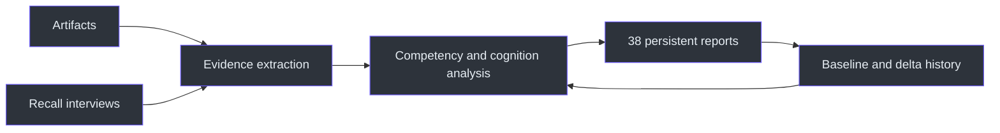
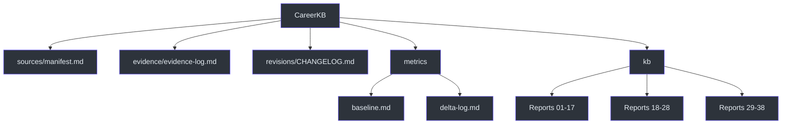

# Career Forensics

`career-forensics` is an evidence-first Engineering Career Operating System. It reconstructs technical work from fragmented artifacts, recovers forgotten knowledge through guided interviews, models recurring engineering reasoning, and persists every supported conclusion in a durable knowledge base. Its governing objective is truth rather than encouragement or résumé polish. (SKILL.md:L7-L24)

The system evolves through three layers:

1. **v1 — artifact analysis:** extract and synthesize what the engineer did.
2. **v2 — knowledge recovery:** expose dependencies, latent knowledge, gaps, identity, confidence, and counter-evidence.
3. **v3 — engineering cognition:** reconstruct reasoning, measure concept mastery, mine cross-project patterns, run active recall sessions, and track change over time. (SKILL.md:L18-L20, SKILL.md:L181-L229)

## Documentation map

| Document | Purpose |
|---|---|
| [Architecture](docs/ARCHITECTURE.md) | Persistent storage schema, evidence model, report system, and component boundaries. |
| [Workflow](docs/WORKFLOW.md) | End-to-end Stages 0–8 for document ingestion, synthesis, recall, and regeneration. |
| [Reference](docs/REFERENCE.md) | Complete 38-report catalogue, scoring rules, evidence taxonomy, and command semantics. |
| [Examples](docs/EXAMPLES.md) | Worked ingest, dedupe, contradiction, recall, vocabulary, and delta-tracking scenarios. |
| [Operations and Testing](docs/OPERATIONS-AND-TESTING.md) | Runbook, invariants, acceptance tests, failure handling, and optional book build. |

## Why the system exists

Human memory is an unreliable source of career history. The skill therefore replaces recollection-first storytelling with a structured evidence record capable of answering what work occurred, what skills accumulated, what knowledge became rusty, what engineering identity is emerging, what role-transition path is shortest, and how the engineer reasons. (SKILL.md:L33-L44)

The engineer's belief that they “learned nothing” is treated only as a hypothesis. Each run must update the evidence-against-impostor-syndrome report from the observed record; emotional agreement, reassurance, and motivational filler are explicitly excluded. (SKILL.md:L48-L53, SKILL.md:L137-L147)

## Durable knowledge base

The canonical root is `C:\Users\mishrad\CareerKB\`. It contains a source manifest, append-only raw evidence log, revision changelog, score baseline and delta history, and 38 synthesized reports under `kb\`. It lives on disk rather than in transient session state; if absent, it is scaffolded before ingestion. (SKILL.md:L57-L114)

## Non-negotiable invariants

- **Merge, never replace:** new documents expand the existing KB. (SKILL.md:L117-L120)
- **Never delete raw evidence:** `evidence-log.md` is append-only. (SKILL.md:L119-L120)
- **Deduplicate by SHA-256:** unchanged sources are skipped; changed files become revisions. (SKILL.md:L121-L122)
- **Make revisions explicit:** contradictions update affected reports and add `old claim → new claim → evidence` to the changelog. (SKILL.md:L123-L126)
- **Label uncertainty:** unsupported claims are `[INFERRED]` with lower confidence or moved to open questions. (SKILL.md:L127-L129, SKILL.md:L143-L147)
- **Keep recall identifiable:** interview answers use `SRC-Rxxx` and `[RECALL]`, remain self-reported, and carry less weight than artifacts such as manager text or pull requests. (SKILL.md:L130-L133)
- **Regenerate all 38 reports:** every ingest refreshes the complete report set, not only the visibly affected file. (SKILL.md:L230-L248)
- **Explain every score movement:** a changed score requires a named trigger in `metrics\delta-log.md`. (SKILL.md:L222-L228)

## Evidence and synthesis boundary

The raw evidence layer preserves chronology and source identity. The synthesis layer clusters evidence by competency and may infer only bounded, explicitly labeled implications. For example, Azure API Management exposure can support an inference about REST, routing, policies, or authentication, but cannot establish expert system-design ability. (SKILL.md:L127-L129, SKILL.md:L143-L147)

Impact scoring uses nine independently explained `/10` axes: technical difficulty, business impact, résumé value, interview value, architecture value, learning leverage, ownership, production exposure, and confidence. Competency confidence is separately scored `/10` according to evidentiary strength. (SKILL.md:L267-L274)

## Primary invocation modes

| User intent | Required behavior |
|---|---|
| “ingest”, “analyze”, “add to KB” | Scaffold if required, deduplicate, run Stages 1–6, update evidence/manifest/changelog, and report changes and gaps. (SKILL.md:L292-L301) |
| “show me”, “read my KB”, “where do I stand” | Read relevant persisted reports and summarize them. (SKILL.md:L303-L303) |
| “interview me”, “recover my memory” | Run a Report 37 battery, log `SRC-Rxxx`, update linked reports, scores, delta log, and changelog. (SKILL.md:L305-L307) |
| “what’s the word for…” | Serve Report 38 vocabulary recovery. (SKILL.md:L305-L307) |
| “résumé bullets”, “STAR”, “interview prep”, “heatmap”, “gaps” | Serve the appropriate reports and regenerate them from evidence when stale. (SKILL.md:L309-L310) |

## Source scope

This suite documents the single authoritative source snapshot, `SKILL.md`. No additional implementation files exist in this skill folder, so all behavioral claims intentionally cite that source rather than inventing external components.

