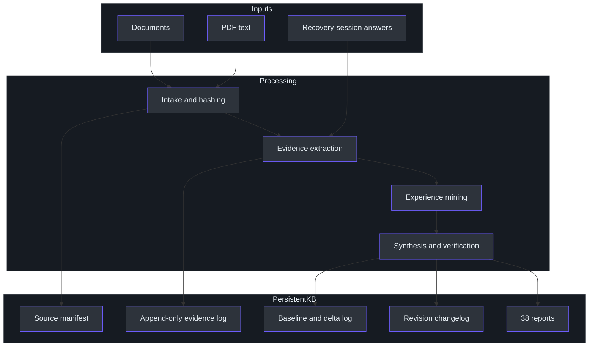
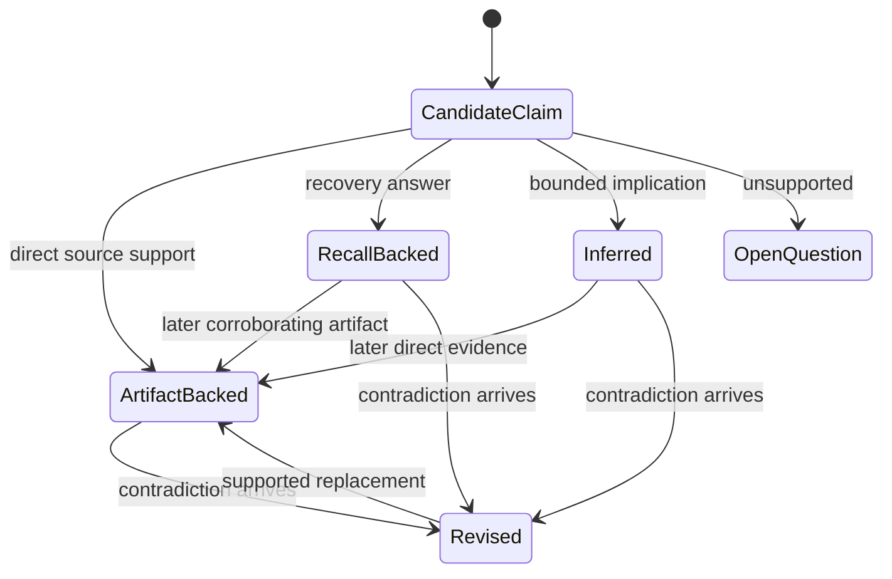
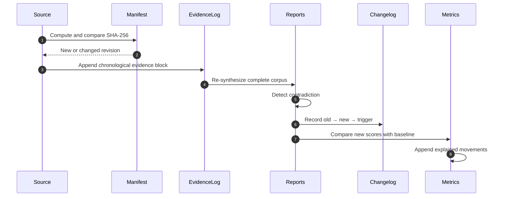

# Architecture

## Design objective

The architecture exists to convert fragmented career artifacts and self-reported recall into a durable, revisable, evidence-linked model of an engineer. It must preserve raw history, separate fact from inference, support active knowledge recovery, and expose how conclusions and scores change over time. (SKILL.md:L9-L20, SKILL.md:L42-L44)

## System context

Documents include manager connects, self-reviews, promotion packets, design documents, incident reports, résumés, sprint summaries, release notes, email, and project documentation. Recall sessions are an additional source class rather than a substitute for artifacts. (SKILL.md:L1-L3, SKILL.md:L130-L133)

## Persistent schema

The KB root and every declared durable object are prescribed by the source. (SKILL.md:L57-L114)

| Path | Role | Mutation rule |
|---|---|---|
| `README.md` | KB index, status, and operating explanation. | Refresh to reflect the current KB. |
| `sources\manifest.md` | Source ID, file, SHA-256, date, period, and evidence count. | Add new sources and revisions; use hash for dedupe. |
| `evidence\evidence-log.md` | Raw chronological evidence, one block per source. | Append only; never delete prior evidence. |
| `revisions\CHANGELOG.md` | Every KB update and contradiction-driven revision. | Append dated entries. |
| `metrics\baseline.md` | Current v3 score snapshot. | Replace the current snapshot only after computing a diff. |
| `metrics\delta-log.md` | Score-movement history and triggers. | Append only when a score moves. |
| `kb\01-...38-*.md` | Synthesized career, recovery, cognition, and verification reports. | Merge and regenerate from the complete evidence corpus. |

## Evidence model

The architecture has three evidence states:

| State | Meaning | Required handling |
|---|---|---|
| **Artifact evidence** | Claims directly supported by source documents such as manager text, design documents, incidents, or pull requests. | Cite the source and period wherever used. (SKILL.md:L127-L129) |
| **Recall evidence** | Engineer testimony captured during a recovery interview. | Allocate `SRC-Rxxx`, tag `[RECALL]`, retain lower artifact weight, and allow it to update reports and scores. (SKILL.md:L130-L133) |
| **Inference** | A bounded implication derived from evidence rather than explicitly stated. | Tag `[INFERRED]`, reduce confidence, and never elevate exposure into expertise. (SKILL.md:L143-L147) |

Unknowns are not evidence. Unsupported material belongs in Report 17, Open Questions, rather than in affirmative claims. (SKILL.md:L127-L129)

## Report topology

The 38 reports are divided into three generations while remaining one integrated model:

| Layer | Reports | Architectural concern |
|---|---:|---|
| Analysis | 01–17 | Timeline, inventory, competencies, architecture/production exposure, stories, recovery roadmap, impact, capital, positioning, gaps, evidence against the standing hypothesis, and open questions. (SKILL.md:L235-L240) |
| Knowledge recovery | 18–28 | Dependency and identity graphs, coverage/confidence matrices, recovery ordering, interview prompts, heatmap, counter-evidence, engineering DNA, and career-capital progression. (SKILL.md:L241-L244) |
| Engineering cognition | 29–38 | Reasoning narratives, concept mastery, patterns, architecture ladders, story graph, claim verification, future learning, deltas, recall sessions, and vocabulary recovery. (SKILL.md:L245-L248) |

### Important cross-report dependencies

- Report 24 prompts unanswered questions into Report 17. (SKILL.md:L194-L197)
- Report 29 marks missing options, trade-offs, and production issues as `[RECALL → 37]`. (SKILL.md:L207-L213)
- Report 33 links one project story to multiple interview themes. (SKILL.md:L219-L220)
- Report 34 evaluates claims against artifacts, metrics, design documents, pull requests, and recall, then identifies the fastest way to improve readiness. (SKILL.md:L222-L224)
- Report 35 starts from the target role and walks backward through prerequisites classified as Owned, Latent, or Gap. (SKILL.md:L225-L226)
- Report 36 owns score snapshots and explained deltas. (SKILL.md:L227-L228)
- Report 37 creates new recall evidence and updates Reports 29, 09, 33, 22, 34, and 07. (SKILL.md:L255-L263)
- Report 38 provides a two-way mapping between fuzzy remembered phrases and precise terminology. (SKILL.md:L107-L109, SKILL.md:L263-L263)

## Consistency mechanics

### Merge

Each ingestion operates against the complete existing KB. The architecture prohibits resetting from zero because prior evidence and synthesis remain part of the engineer's history. (SKILL.md:L117-L120)

### Deduplication and revision identity

The source manifest's SHA-256 is the identity check. An identical hash means “already ingested and unchanged”; a changed hash means a new revision rather than permission to overwrite the prior evidence block. (SKILL.md:L121-L122, SKILL.md:L153-L156)

### Contradiction handling

When new evidence conflicts with an earlier ownership, seniority, competency, strength, or gap claim, the affected report is revised and the changelog records the old claim, new claim, and triggering evidence. The evidence log still preserves both historical inputs. (SKILL.md:L123-L126)

## Scoring architecture

Impact is multi-dimensional rather than a single prestige score. Every notable work item receives nine `/10` axes, each with a one-line explanation: technical difficulty, business impact, résumé value, interview value, architecture value, learning leverage, ownership, production exposure, and confidence. Competency confidence is a separate `/10` measure of evidence strength. (SKILL.md:L267-L274)

Concept mastery adds a different scale: technology sub-concepts receive `★1–5` ratings while operational familiarity and conceptual mastery remain separate. This avoids mistaking “used it in production” for “can explain its mechanisms.” (SKILL.md:L212-L213)

## Safety and honesty boundary

The system must not invent work, inflate impact, fabricate metrics, guess ownership, assume architecture exposure, or use motivational reassurance. It challenges major conclusions through counter-evidence and reports the strongest evidence-backed account—nothing more and nothing less. (SKILL.md:L137-L147, SKILL.md:L199-L205, SKILL.md:L314-L317)

## References

- Persistent schema: `SKILL.md:L57-L114`
- Operating invariants: `SKILL.md:L117-L133`
- Inference and safety rules: `SKILL.md:L137-L147`
- Synthesis/report dependencies: `SKILL.md:L181-L248`
- Recall engine: `SKILL.md:L255-L263`
- Scoring: `SKILL.md:L267-L274`

