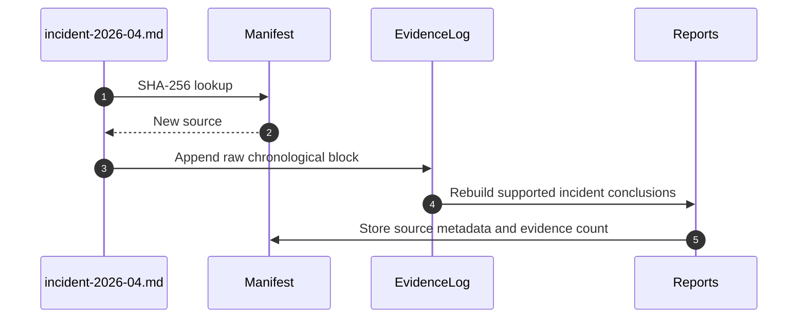
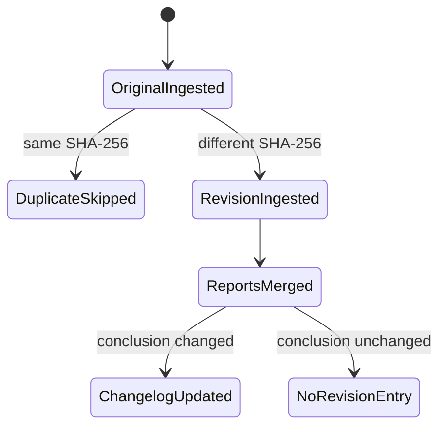
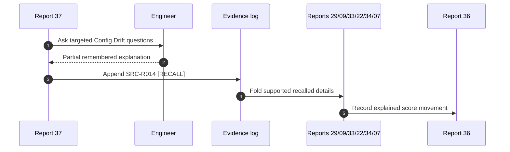

# Examples

These examples illustrate the source contract. Names and evidence snippets are deliberately fictional; they demonstrate mechanics and must not be inserted into a real KB as facts.

## Example 1 — ingest a new incident report

**Input:** `incident-2026-04.md`, not present in the manifest.

1. Compute the SHA-256 and allocate a source ID.
2. Extract chronology, incident symptoms, diagnostics, mitigations, systems touched, ownership language, and production outcome.
3. Append a raw source block to the evidence log.
4. Mine debugging, observability, reliability, production, communication, and ownership implications.
5. Add only directly supported claims; mark bounded implications `[INFERRED]`.
6. Refresh the entire 38-report corpus.
7. Add the source to the manifest and summarize the KB changes. This follows Stages 0–6 and the merge rule. (SKILL.md:L151-L179, SKILL.md:L230-L248)



### Illustrative evidence block

```markdown
## SRC-A042 — incident-2026-04.md
- Period: 2026-04
- Type: incident report
- Evidence:
  - The report states that the engineer correlated queue depth with retry storms.
  - The report attributes the mitigation script to the team, not to one person.
```

The first item can support incident-debugging evidence. The second prevents an individual-ownership claim. Guessing ownership is prohibited. (SKILL.md:L123-L129, SKILL.md:L137-L147)

## Example 2 — unchanged duplicate

**Situation:** The same file is submitted again with the same SHA-256.

**Correct result:** record no new evidence block, no duplicate report claims, and no artificial score movement. Stage 0 explicitly skips unchanged sources already present in the manifest. (SKILL.md:L121-L122, SKILL.md:L153-L156)

**Incorrect result:** append the same evidence twice and increase confidence merely because the duplicate appears twice.

## Example 3 — changed source revision

**Situation:** A self-review is edited after initial ingestion; its hash changes.

**Correct handling:**

1. Keep the original evidence block.
2. Ingest the edited file as a new revision.
3. Preserve chronology.
4. Reconcile changed statements.
5. Add a changelog entry if the revision changes a conclusion. (SKILL.md:L119-L129)



## Example 4 — contradiction and revision

**Earlier conclusion:** “The engineer owned the migration design.”

**New evidence:** a manager review says the engineer implemented validation tooling while another engineer owned the design.

**Required revision:**

```markdown
### 2026-10-04 — Ownership correction
- Old claim: Owned migration design.
- New claim: Implemented migration validation tooling; design ownership is not supported.
- Trigger: SRC-M018, manager review, 2026-H1.
- Affected reports: 05, 06, 08, 12, 29, 34.
```

This is the prescribed `old claim → new claim → triggering evidence` form. The old source remains in the evidence log; only the synthesis changes. (SKILL.md:L123-L126)

## Example 5 — bounded inference

**Evidence:** “Configured Azure API Management policies.”

**Allowed synthesis:** `[INFERRED] Exposure likely required HTTP routing, policies, authentication, and REST concepts; present explanatory confidence requires verification.`

**Forbidden synthesis:** “Expert distributed-systems architect.”

The source explicitly distinguishes these forms. (SKILL.md:L143-L147)

## Example 6 — active recall session

**Gap in Report 29:** why a configuration-drift detector chose polling rather than events.

**Question battery:**

1. What systems produced the configuration state?
2. Which event source was considered?
3. What constraints made polling acceptable or necessary?
4. What failure mode did the chosen interval create?
5. What would you change now?

If the engineer answers only questions 1 and 3:

- create `SRC-R014`;
- tag both answers `[RECALL]`;
- leave questions 2, 4, and 5 in Report 17 with scaffolds;
- update the relevant narrative and stories;
- adjust recall/readiness scores only where justified;
- add delta and changelog entries. (SKILL.md:L255-L263)



## Example 7 — vocabulary recovery

**Engineer:** “What was the term for preventing repeated failed calls from hammering a dependency?”

**Report 38 response:** propose “circuit breaker” as the likely term and distinguish it from retry, rate limiting, and bulkheading. If the engineer confirms using it historically, the confirmation is `[RECALL]` until an artifact corroborates it. This preserves the boundary between vocabulary assistance and historical proof. (SKILL.md:L107-L109, SKILL.md:L130-L133, SKILL.md:L263-L263)

## Example 8 — impact scoring

Illustrative work item: automated a deployment validation previously performed manually.

| Axis | Example score | Evidence-safe explanation |
|---|---:|---|
| Technical Difficulty | 6/10 | Evidence shows multi-system validation and error handling; no novel algorithm is documented. |
| Business Impact | 5/10 | Review states reduced manual checks; no supported time or money metric exists. |
| Resume Value | 7/10 | The item is concrete and technically explainable. |
| Interview Value | 7/10 | It supports automation, reliability, and trade-off discussion. |
| Architecture Value | 4/10 | Integration exposure is supported; architecture ownership is not. |
| Learning Leverage | 7/10 | The work spans deployment, validation, and failure analysis. |
| Ownership | 5/10 | Implementation is attributed; problem selection is not. |
| Production Exposure | 6/10 | It runs in a release path; direct incident handling is not shown. |
| Confidence | 8/10 | Multiple artifacts corroborate implementation. |

The exact values above are examples, not source-defined anchors. The normative requirement is nine `/10` axes with one-line explanations. (SKILL.md:L267-L274)

## Example 9 — delta tracking

**Previous baseline:** present recall for a project = `3/10`.

**New evidence:** `SRC-R014` supplies a supported constraint and decision rationale.

```markdown
| Date | Metric | Old | New | Trigger | Explanation |
|---|---|---:|---:|---|---|
| 2026-10-04 | Project X present recall | 3 | 5 | SRC-R014 [RECALL] | Engineer recovered the constraint and decision rationale; implementation detail remains incomplete. |
```

The change is modest because recall remains self-reported and incomplete. Every movement names its trigger, as required by Report 36. (SKILL.md:L130-L133, SKILL.md:L227-L228)

## Example 10 — evidence against the standing hypothesis

Avoid: “You are clearly an amazing engineer.”

Use: “The corpus contains repeated evidence of production debugging in three independent periods, but direct design ownership appears only once and current conceptual recall remains incomplete.”

This form investigates the “learned nothing” hypothesis using evidence and counter-evidence without comfort or exaggeration. (SKILL.md:L48-L53, SKILL.md:L137-L147, SKILL.md:L199-L205)

