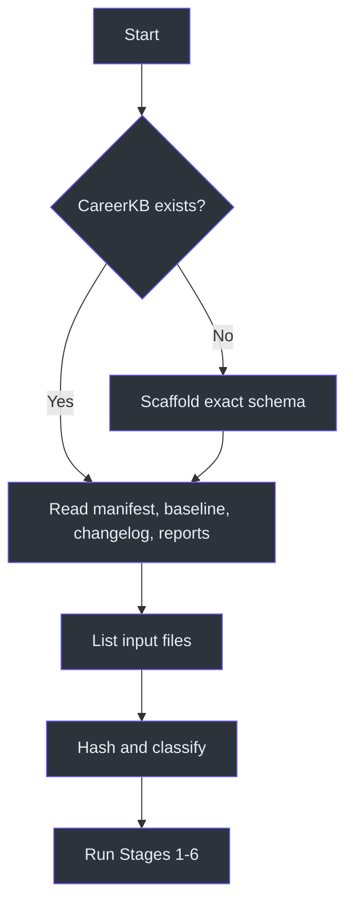
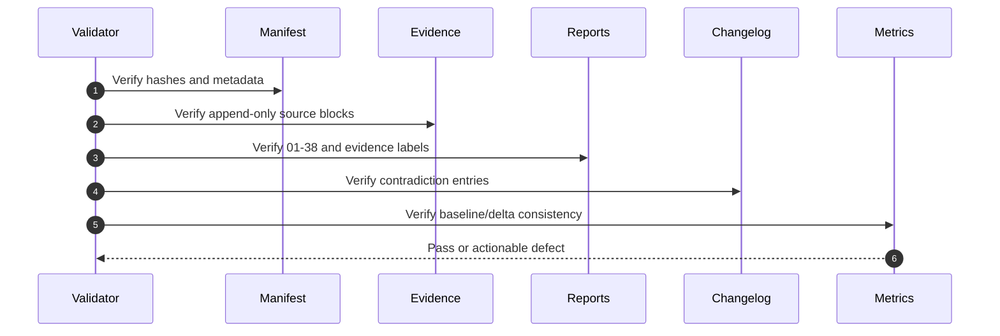

# Operations and Testing

## Operational preflight

Before ingestion:

1. Confirm the canonical root is `C:\Users\mishrad\CareerKB\`.
2. Scaffold the declared directory and file structure if it does not exist.
3. Read `sources\manifest.md`, `revisions\CHANGELOG.md`, `metrics\baseline.md`, and the relevant current reports.
4. Confirm the supplied source directory, otherwise use `C:\unprotectedDownloads\Connects\`.
5. Do not clear or recreate an existing KB. (SKILL.md:L57-L114, SKILL.md:L117-L120, SKILL.md:L153-L156)



## Transaction-style update order

The source does not define filesystem transactions, but its invariants imply a safe ordering:

1. Compute source identity and decide new/duplicate/revision.
2. Extract and stage evidence.
3. Append raw evidence.
4. Recompute synthesis from the full corpus.
5. Write all report updates.
6. Record contradictions.
7. Calculate and record score deltas.
8. Update the source manifest and KB index.
9. Verify all invariants before reporting completion. These steps operationalize the merge, append-only, contradiction, and delta requirements. (SKILL.md:L117-L133, SKILL.md:L227-L233)

## Acceptance-test matrix

| ID | Test | Procedure | Expected result | Source |
|---|---|---|---|---|
| CF-01 | Scaffold | Start with no `CareerKB\`; invoke ingest. | Exact root structure and all 38 report paths exist before ingest. | SKILL.md:L57-L114 |
| CF-02 | Duplicate source | Submit a file whose SHA-256 is already in the manifest. | No duplicate evidence block; source is skipped unchanged. | SKILL.md:L121-L122, SKILL.md:L153-L156 |
| CF-03 | Changed source | Modify a previously ingested file. | New revision is ingested; old evidence remains. | SKILL.md:L119-L122 |
| CF-04 | Chronology | Ingest evidence from an earlier historical period after newer material. | Evidence remains chronologically represented; synthesis remains competency-clustered. | SKILL.md:L129-L129 |
| CF-05 | Contradiction | Add manager evidence that disproves an ownership claim. | Report changes and dated `old → new → trigger` changelog entry. | SKILL.md:L123-L126 |
| CF-06 | Unsupported claim | Present a plausible but unsupported metric. | Metric is omitted or placed in Open Questions; never fabricated. | SKILL.md:L127-L147 |
| CF-07 | Inference label | Infer REST/auth exposure from APIM work. | Claim is marked `[INFERRED]` and lower-confidence. | SKILL.md:L143-L147 |
| CF-08 | Recall identity | Answer a Report 37 question. | New `SRC-Rxxx` block with `[RECALL]`; label persists in every use. | SKILL.md:L130-L133, SKILL.md:L255-L263 |
| CF-09 | “I don't remember” | Decline a recovery question. | Scaffolded item is added to Report 17; no answer is invented. | SKILL.md:L258-L260 |
| CF-10 | Full regeneration | Ingest one narrow source. | Reports 01–38 are all regenerated or refreshed. | SKILL.md:L235-L248 |
| CF-11 | Impact score shape | Score a notable item. | Nine `/10` axes, each with one-line explanation. | SKILL.md:L267-L274 |
| CF-12 | Competency semantics | Review a confidence score. | It describes evidence strength, not unsupported mastery. | SKILL.md:L273-L274 |
| CF-13 | Delta movement | Cause a justified score change. | Baseline changes and delta row names source and explanation. | SKILL.md:L227-L228 |
| CF-14 | No movement | Ingest evidence that changes no score. | No unexplained or synthetic delta row. | SKILL.md:L227-L228 |
| CF-15 | Counter-evidence | Assert a major strength. | Report 26 presents strongest rebuttal and revised confidence. | SKILL.md:L199-L200 |
| CF-16 | Narrative gap | Project options are absent from artifacts. | Report 29 marks `[RECALL → 37]`; no invented option set. | SKILL.md:L207-L213 |
| CF-17 | Pattern count | A pattern appears in several projects. | Each project is mined independently and frequency is countable. | SKILL.md:L214-L215 |
| CF-18 | Target-role planning | Generate future learning plan. | Graph starts at target role and walks backward through Owned/Latent/Gap prerequisites. | SKILL.md:L225-L226 |
| CF-19 | Safety language | Generate standing-hypothesis report. | No comfort, hype, invented work, or inflated impact. | SKILL.md:L48-L53, SKILL.md:L137-L147 |
| CF-20 | Completion message | Finish an ingest. | Concise summary lists ingested material, changes, contradictions, gaps, and next questions. | SKILL.md:L294-L301 |

## Structural validation

Verify:

- exactly 38 expected report files are represented;
- report numbering has no gaps or duplicates;
- manifest entries contain source ID, file, SHA-256, date, period, and evidence count;
- raw evidence blocks retain source and chronology;
- every competency, bullet, and score cites a source and period;
- every `[RECALL]` use remains labeled;
- every `[INFERRED]` use remains labeled;
- every score movement is explainable from the delta log;
- every contradiction has a changelog entry;
- no prior raw evidence was removed. These checks directly test the schema and operating rules. (SKILL.md:L63-L109, SKILL.md:L117-L133)



## Report-quality checks

### Evidence fidelity

- Direct claims must be traceable to artifacts.
- Recall-derived claims must name `SRC-Rxxx`.
- Inferences must remain narrower than the source evidence.
- Unsupported material must be an open question.
- Manager/reviewer and employee/self text must remain distinguishable when PDF content is extracted. (SKILL.md:L127-L147, SKILL.md:L153-L156)

### Analytical completeness

- Experience mining asks all prescribed questions for every evidence item.
- Competency synthesis covers both technical and cross-team/leadership dimensions where evidence exists.
- v2 reports recover dependencies, identity, coverage, recall, counter-evidence, and progression.
- v3 reports reconstruct reasoning, concepts, patterns, architecture progression, stories, claim readiness, future learning, deltas, sessions, and vocabulary. (SKILL.md:L165-L229)

### Honesty checks

Reject output containing:

- unverified metrics;
- individual ownership inferred from team language;
- architecture authority inferred from implementation exposure;
- “expert” labels unsupported by the corpus;
- emotional reassurance;
- a score increase with no trigger;
- recall content presented as artifact fact. (SKILL.md:L123-L147, SKILL.md:L227-L228)

## Recovery-session testing

Run a battery with complete, partial, and “I don't remember” responses. Confirm that complete and partial responses become labeled recall evidence, unanswered questions receive scaffolds, linked reports update selectively, and score deltas reflect only newly recovered material. (SKILL.md:L255-L263)

## Optional PDF-book operation

Only build the printable book on request. From `CareerKB\.book-build\`, execute:

```powershell
node build.js
node render.js
```

Confirm that all reports are registered in the `REPORTS` array and that the output includes the table of contents, Mermaid diagrams, and Chart.js charts required by the source. (SKILL.md:L250-L253)

## Failure handling

| Failure | Safe response |
|---|---|
| PDF extraction fails | Do not invent content; report the source as unprocessed and retry extraction. Stage 0 requires extracted text before evidence analysis. (SKILL.md:L153-L156) |
| Manifest missing in an existing KB | Restore/scaffold the declared file, then rebuild entries only from verifiable sources; do not discard the evidence log. (SKILL.md:L57-L114, SKILL.md:L119-L120) |
| Contradiction cannot be resolved | Preserve both evidence items, lower confidence, and add an open question rather than choosing a preferred story. (SKILL.md:L123-L129) |
| Score changed but trigger is unclear | Revert the unexplained movement until a source-linked reason exists. (SKILL.md:L227-L228) |
| Recall conflicts with artifact | Preserve and label recall, prefer the artifact for factual synthesis, and record the conflict for revision/counter-evidence analysis. This follows the lower recall weight and contradiction rules. (SKILL.md:L123-L133) |
| Book build fails | Keep the Markdown KB authoritative; the book is optional and must not block evidence persistence. (SKILL.md:L250-L253) |

## Completion gate

An ingest is complete only when evidence is appended, manifest and changelog are current, all 38 reports are refreshed, score changes are explained, labels are preserved, and the concise user summary identifies changes and open questions. (SKILL.md:L230-L248, SKILL.md:L292-L301)

