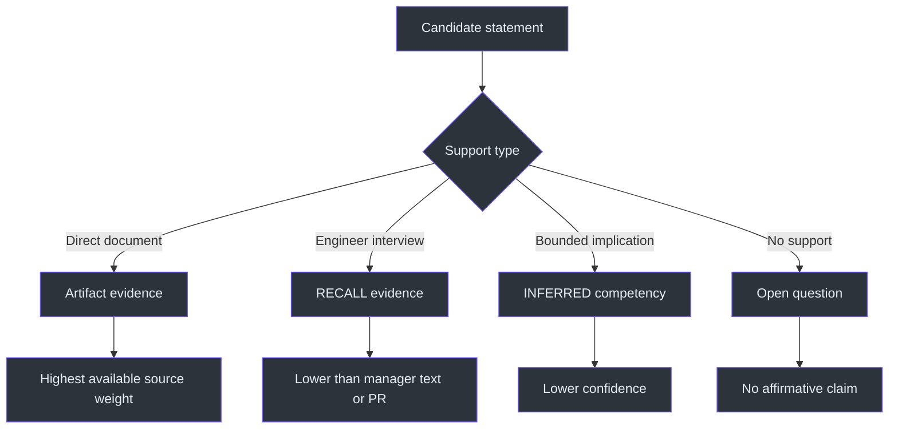
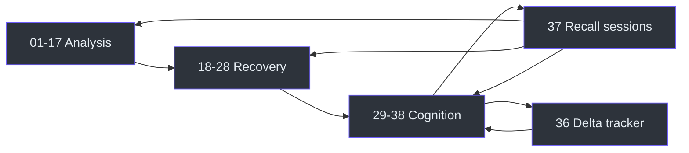

# Reference

## Canonical paths

| Item | Canonical value | Source |
|---|---|---|
| KB root | `C:\Users\mishrad\CareerKB\` | SKILL.md:L57-L60 |
| Default source directory | `C:\unprotectedDownloads\Connects\` | SKILL.md:L153-L155 |
| Source ledger | `sources\manifest.md` | SKILL.md:L63-L66 |
| Raw evidence | `evidence\evidence-log.md` | SKILL.md:L64-L66 |
| Revision history | `revisions\CHANGELOG.md` | SKILL.md:L66-L66 |
| Current scores | `metrics\baseline.md` | SKILL.md:L67-L67 |
| Score history | `metrics\delta-log.md` | SKILL.md:L68-L68 |
| Reports | `kb\01-...38-*.md` | SKILL.md:L69-L109 |
| Optional book pipeline | `CareerKB\.book-build\` | SKILL.md:L250-L253 |

## Evidence taxonomy

| Class | Identifier/label | Permitted use | Constraint |
|---|---|---|---|
| Artifact | Source ID from manifest | Supports competencies, claims, bullets, scores, timelines, and narratives. | Cite source document and period. (SKILL.md:L127-L129) |
| Recall | `SRC-Rxxx`, `[RECALL]` | Updates reports and can move scores. | Must remain visibly self-reported and weighted below manager text or a PR. (SKILL.md:L130-L133) |
| Inference | `[INFERRED]` | Captures likely underlying competency. | Must be bounded and lower-confidence; exposure cannot prove expertise. (SKILL.md:L143-L147) |
| Unknown | Open Questions | Records unresolved ownership, reasoning, metrics, or mechanisms. | Must not be converted into a claim. (SKILL.md:L127-L129) |

## Complete 38-report catalogue

The filenames and report roles below are prescribed by the KB schema and report-generation stage. (SKILL.md:L69-L109, SKILL.md:L235-L248)

### Part One — analysis

| # | File | Required content |
|---:|---|---|
| 01 | `01-executive-summary.md` | Evidence-backed current account of career scope and state. |
| 02 | `02-career-timeline.md` | Chronological career and project history. |
| 03 | `03-experience-inventory.md` | Detailed inventory of work items and systems. |
| 04 | `04-technology-inventory.md` | Technologies and services observed in evidence. |
| 05 | `05-engineering-competencies.md` | Competency, confidence `/10`, explanation, and evidence. |
| 06 | `06-architecture-exposure.md` | Demonstrated architecture exposure without assumed expertise. |
| 07 | `07-production-experience.md` | Incidents, operations, releases, deployments, and production responsibility. |
| 08 | `08-resume-bullet-library.md` | Evidence-grounded candidate bullets without invented ownership or metrics. |
| 09 | `09-star-story-library.md` | STAR narratives assembled from supported facts and marked recall gaps. |
| 10 | `10-knowledge-recovery-roadmap.md` | Tiered recovery plan and dependency sketch. |
| 11 | `11-skill-heatmap.md` | Relative evidence and recovery state across skills. |
| 12 | `12-impact-scores.md` | Nine `/10` impact axes per notable work item, each explained. |
| 13 | `13-career-capital.md` | Marketable engineering capital across experience, operations, architecture, debugging, cloud, infrastructure, ownership, communication, and problem solving. |
| 14 | `14-career-positioning.md` | Evidence-based market positioning. |
| 15 | `15-resume-gaps.md` | Missing evidence and weak claims. |
| 16 | `16-impostor-syndrome-evidence.md` | Evidence relevant to the standing “learned nothing” hypothesis, without comfort language. |
| 17 | `17-open-questions.md` | Questions whose answers are needed to resolve gaps. |

Reports 01–17 constitute the original analysis layer. (SKILL.md:L235-L240)

### Part Two — knowledge recovery

| # | File | Required content |
|---:|---|---|
| 18 | `18-engineering-dependency-graph.md` | Technology-to-prerequisite chains with Owned/Latent/Gap status. |
| 19 | `19-engineering-identity-graph.md` | Repeated behaviors combined into supported identity hypotheses. |
| 20 | `20-resume-coverage-matrix.md` | Evidence-justified coverage by engineering discipline. |
| 21 | `21-knowledge-recovery-graph.md` | Technology, concepts, revisit topics, and learning order. |
| 22 | `22-resume-confidence-matrix.md` | Separates worked-on exposure from present explanatory ability and flags recovery needs. |
| 23 | `23-interview-attack-map.md` | Likely interview questions with High/Medium/Low probability. |
| 24 | `24-memory-recovery-prompts.md` | Project-specific prompts that trigger memory rather than merely summarize. |
| 25 | `25-career-timeline-heatmap.md` | Yearly effort intensity across dimensions. |
| 26 | `26-counter-evidence-analysis.md` | Strongest rebuttal to each major claim and revised confidence. |
| 27 | `27-engineering-dna.md` | Repeated engineering instincts based only on recurring evidence. |
| 28 | `28-career-capital-evolution.md` | Ownership, production, debugging, architecture, communication, complexity, and operations over time. |

Reports 18–28 implement the v2 recovery engine. (SKILL.md:L181-L205, SKILL.md:L241-L244)

### Part Three — engineering cognition

| # | File | Required content |
|---:|---|---|
| 29 | `29-engineering-narrative-reconstruction.md` | Problem → Constraints → Options → Decision → Trade-offs → Implementation → Production Issues → Lessons. |
| 30 | `30-concept-mastery-levels.md` | Sub-concept `★1–5`, with operational and conceptual mastery separated. |
| 31 | `31-cross-project-pattern-mining.md` | Independent project mining, frequency counts, and dominant/occasional ranking. |
| 32 | `32-architecture-progression-map.md` | Operational ladder versus design-architecture ladder and missing rungs. |
| 33 | `33-interview-story-graph.md` | Themes linked to reusable STAR stories. |
| 34 | `34-resume-claim-verifier.md` | Evidence-category checks, interview-ready percentage, and fastest readiness raiser. |
| 35 | `35-future-learning-graph.md` | Target-role-backward prerequisites marked Owned/Latent/Gap and shortest critical path. |
| 36 | `36-career-delta-tracker.md` | Baseline mechanism, score changes, and triggers. |
| 37 | `37-forgotten-knowledge-recovery-sessions.md` | Active interview batteries that generate recall evidence. |
| 38 | `38-engineering-vocabulary-recovery.md` | Fuzzy phrase ↔ precise terminology index. |

Reports 29–38 implement v3 cognition, verification, recovery, and evolution tracking. (SKILL.md:L207-L229, SKILL.md:L245-L248)

## Scoring reference

### Impact axes

Each notable work item receives `/10` plus a one-line explanation for:

1. Technical Difficulty
2. Business Impact
3. Resume Value
4. Interview Value
5. Architecture Value
6. Learning Leverage
7. Ownership
8. Production Exposure
9. Confidence (SKILL.md:L267-L271)

The source defines the axes and explanation requirement but does not define numeric anchor bands. Implementations must therefore avoid presenting undocumented universal meanings such as “8 always equals Staff-level”; the score must be explained in the context of the observed evidence.

### Competency confidence

Competency confidence is `/10` and measures how strongly evidence supports a competency. It is not the same as proficiency, mastery, seniority, or market value. (SKILL.md:L273-L274)

### Concept mastery

Report 30 uses `★1–5` at the sub-concept level and explicitly distinguishes operational familiarity from conceptual mastery. (SKILL.md:L212-L213)

### Coverage, readiness, and capital

- Coverage bars must be justified by evidence. (SKILL.md:L188-L189)
- Claim verification yields an interview-ready percentage and a fastest improvement action. (SKILL.md:L222-L224)
- Career capital estimates marketable accumulated exposure rather than declaring “how skilled” the engineer is. (SKILL.md:L285-L288)

## Merge, dedupe, revision, and delta rules

| Mechanic | Normative rule |
|---|---|
| Merge | Never restart; integrate new evidence into the existing corpus. (SKILL.md:L117-L120) |
| Raw retention | Never delete previous evidence. (SKILL.md:L119-L120) |
| Dedupe | SHA-256 identical source → skip unchanged re-ingestion. (SKILL.md:L121-L122) |
| Changed source | Changed hash → ingest as a new revision. (SKILL.md:L121-L122) |
| Contradiction | Update affected report and append dated old → new → trigger. (SKILL.md:L123-L126) |
| Chronology | Preserve chronological order in evidence; cluster synthesis by competency. (SKILL.md:L129-L129) |
| Delta | Compare current scores with prior baseline and log all movements with triggers. (SKILL.md:L227-L228) |

## Prohibited outputs

The skill forbids invented work, inflated impact, fabricated metrics, guessed ownership, unsupported architecture exposure, motivational filler, comfort language, and unsupported certainty. (SKILL.md:L137-L147)

## Optional book

On request, `CareerKB\.book-build\` renders the Markdown corpus into a paginated PDF with a table of contents, Mermaid diagrams, and Chart.js charts. Run `node build.js; node render.js`; newly added reports must also be registered in the `REPORTS` array and receive any required diagrams/charts. (SKILL.md:L250-L253)

