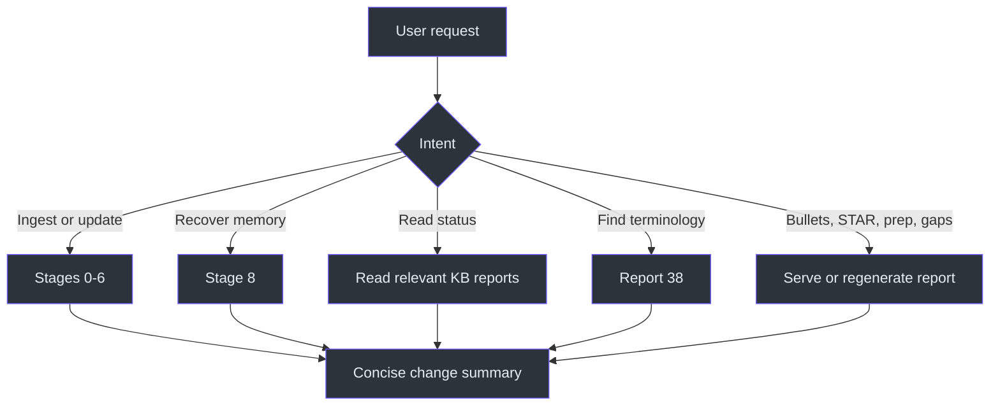
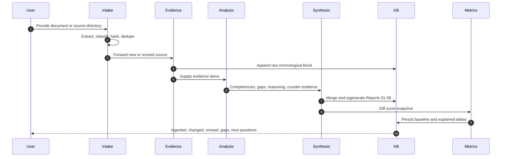
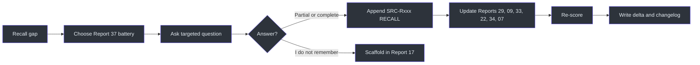

# Workflow

## Entry routing

The user intent determines whether the system ingests evidence, reads existing reports, runs an active recall session, performs vocabulary recovery, or serves a specialized output such as résumé bullets or STAR stories. Ingestion always uses the complete pipeline; report-reading requests may summarize persisted files; stale specialized reports are regenerated from evidence. (SKILL.md:L292-L310)



## Document-ingestion pipeline

Every document must pass every stage; skipping stages is prohibited. (SKILL.md:L151-L152)

### Stage 0 — intake and dedupe

1. Enumerate files from the supplied directory or the default `C:\unprotectedDownloads\Connects\`.
2. For PDFs, extract text with Python and PyPDF2.
3. Distinguish employee/self-authored text from manager/reviewer text.
4. Compute each file's SHA-256.
5. Compare the hash with `sources\manifest.md`.
6. Skip an unchanged file; treat changed content as a new revision. (SKILL.md:L153-L156)

**Output:** a classified set of new or changed sources, with duplicates removed before evidence extraction.

### Stage 1 — evidence extraction

Extract technical content comprehensively and approximately verbatim while preserving chronology. The extraction scope includes features, bug fixes, production support, incidents, ownership, architecture, infrastructure, dashboards, automation, documentation, reviews, deployments, cloud, containers, APIs, databases, networking, monitoring, security, CI/CD, scripts, performance, and scalability. Append the result to the raw evidence log without prematurely summarizing it. (SKILL.md:L158-L163)

**Output:** Raw Experience Inventory plus a new chronological source block in `evidence\evidence-log.md`.

### Stage 2 — experience mining

For every evidence item, identify what was built, systems and technologies touched, reasoning and debugging required, production and architecture exposure, likely interview topics, résumé value, knowledge gaps, and hidden strengths. (SKILL.md:L165-L168)

**Output:** evidence-linked analytical facets for later competency and report synthesis.

### Stage 3 — engineering analysis

Map evidence into competencies including application disciplines, cloud, containers, Kubernetes, observability, networking, performance, distributed systems, reliability, DevOps, developer productivity, API/auth/security, data systems, architecture, testing, monitoring, CI/CD, infrastructure, RCA, communication, leadership, ownership, documentation, and design thinking. Assign an evidence-backed confidence `/10` to each supported competency. (SKILL.md:L170-L175)

**Output:** competency claims with explicit evidence and explained confidence.

### Stage 4 — career synthesis

Cluster by competency rather than chronology. Refresh engineering identity, strengths, weaknesses, blind spots, leverage, positioning, recovery areas, architecture exposure, depth, résumé readiness, and interview readiness. The central question is “What engineer has emerged?”, not “What jobs exist?” (SKILL.md:L176-L179)

### Stage 4b — knowledge recovery and identity

Produce the recovery layer:

- prerequisite chains and Owned/Latent/Gap status;
- behavior-to-identity graph;
- evidence-justified discipline coverage;
- per-technology recovery order;
- “worked on it” versus “can explain today” confidence;
- likely interview questions;
- project-specific memory prompts;
- yearly effort heatmap;
- strongest rebuttal to each major claim;
- repeated-evidence engineering instincts;
- seven-dimensional career-capital progression. (SKILL.md:L181-L205)

### Stage 4c — engineering-cognition synthesis

Reconstruct project reasoning from problem through lessons; separate operational familiarity from conceptual mastery; mine and rank recurring patterns across all projects; compare operational and design architecture ladders; and connect STAR stories to reusable interview themes. Missing options, trade-offs, and production issues are marked for Report 37 recall rather than fabricated. (SKILL.md:L207-L220)

### Stage 4d — verification and forward planning

Verify each résumé bullet against evidence categories and calculate interview readiness; derive the shortest prerequisite path backward from the target role; snapshot scores, compare with the previous baseline, and log every movement with its trigger. (SKILL.md:L222-L228)

### Stage 5 — KB update

Merge Stages 1–4d into the persistent files. Update the manifest and changelog, preserve recall labels, and update baseline/delta files when scores move. (SKILL.md:L230-L233)

### Stage 6 — report regeneration

Regenerate all 38 reports in all three groups. This is an all-report consistency pass, not a request to update only the report most directly affected by the source. (SKILL.md:L235-L248)



## Active recovery workflow

Stage 8 makes the system proactive. It runs when the user requests memory recovery or when Reports 29 or 34 expose `[RECALL]` gaps. (SKILL.md:L255-L257)

1. Select a Report 37 question battery, beginning with the flagship Config Drift battery unless another gap is more relevant.
2. Ask targeted questions and accept partial answers.
3. If the engineer says “I don't remember,” add a scaffolded question to Report 17 rather than manufacturing an answer.
4. Create a new `SRC-Rxxx` block in the evidence log and mark every answer `[RECALL]`.
5. Update Report 29's reasoning arc, Reports 09 and 33's stories, Report 22's present recall, Report 34's readiness, and Report 07's production record.
6. Re-score affected claims.
7. Write score movements to Report 36 and `metrics\delta-log.md`.
8. Add a changelog entry. (SKILL.md:L255-L263)



## Vocabulary recovery workflow

When the engineer remembers a fuzzy phrase but not the precise term, Report 38 maps the phrase to likely engineering vocabulary. The report is a two-way index, supporting fuzzy-to-precise recovery and precise-to-context recall. (SKILL.md:L107-L109, SKILL.md:L263-L263)

Vocabulary recovery must not turn a plausible term into a historical fact. If the engineer confirms the term during a session, the confirmation remains recall evidence until corroborated by an artifact. This follows the required recall and inference boundaries. (SKILL.md:L130-L133, SKILL.md:L143-L147)

## Delta workflow

```text
new_snapshot = calculate_scores(all_current_evidence)
old_snapshot = read(metrics/baseline.md)
for each score:
    if new_snapshot[score] != old_snapshot[score]:
        append metrics/delta-log.md with:
            old value, new value, date, triggering source, explanation
write metrics/baseline.md = new_snapshot
```

This pseudocode directly represents the requirement that the current baseline be diffed and every movement have a named trigger. (SKILL.md:L227-L228)

## Completion response

After ingestion, the user-facing response stays concise because detail belongs in the KB. It reports what was ingested, what changed, contradictions resolved, new gaps, and the highest-priority next questions. (SKILL.md:L294-L301)

## References

- Pipeline requirement and Stages 0–4: `SKILL.md:L151-L179`
- Recovery and cognition synthesis: `SKILL.md:L181-L229`
- Persistence and regeneration: `SKILL.md:L230-L248`
- Active recall: `SKILL.md:L255-L263`
- Operational routing: `SKILL.md:L292-L310`

