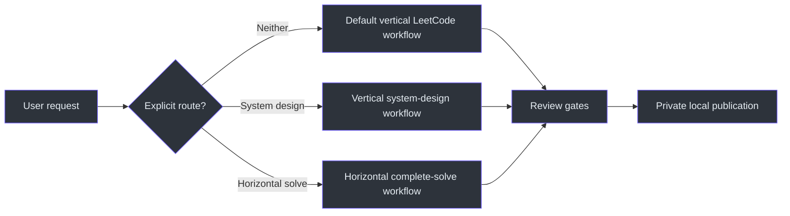
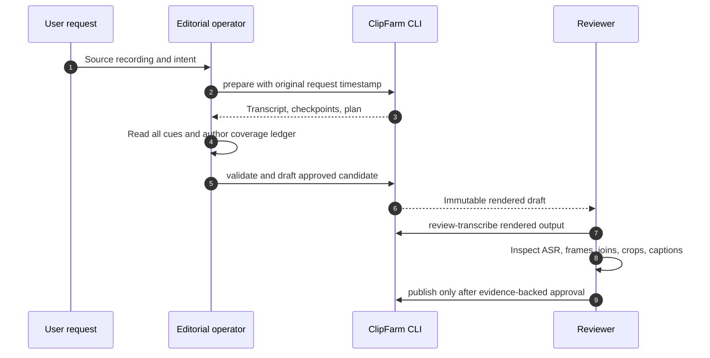

# ClipFarm LeetCode Skill

## Overview

This skill is an editorial and delivery contract for turning private source recordings into reviewed coding clips. It is not a generic video generator: semantic selection and final review remain the operator's responsibility, while the CLI supplies deterministic preparation, inspection, validation, rendering, output transcription, and publication stages (`SKILL.md:L501-L519`).

The installed working repository and pinned Python executable are fixed, and repository-relative paths in the contract refer to `C:\devdesk\homedesk\ClipFarm`, not to the directory from which the skill is invoked (`SKILL.md:L8-L17`).

The contract has three routes:

| Route | Trigger | Layout | Primary deliverable |
|---|---|---|---|
| Vertical LeetCode | Default coding-clip request | 1080×1920 editorial montage | Coverage-first topic, solve/debug, submission, or humor clips |
| Vertical system design | Explicit `--workflow system-design` | 1080×1920 diagram/slide/code crop | Explanation or funny clips, without fabricated LeetCode evidence |
| Horizontal complete solve | Explicit request for horizontal stream solutions | Native landscape frame | One chronological complete-solve video per completed problem |

Vertical remains the default; horizontal routing must be explicit, and horizontal system design is unsupported (`SKILL.md:L237-L251`, `SKILL.md:L516-L519`).

## Non-negotiable operating model

1. Preserve source media and filenames; never upload media or transcripts to an external service (`SKILL.md:L253-L257`).
2. Recover the timestamp of the **original clip-creation prompt**. Never substitute work-start time; label bare CLI time honestly if no prompt time exists (`SKILL.md:L262-L267`).
3. Read every transcript cue in bounded blocks and maintain a coverage ledger; keyword ranking or an opening excerpt is not full review (`SKILL.md:L275-L284`).
4. Inspect real source frames and OCR before selecting crops. Detection failure cannot prove camera absence (`SKILL.md:L285-L295`).
5. Render immutable drafts, transcribe the rendered output, inspect returned pixels, and fill review evidence only after substantive review (`SKILL.md:L352-L370`).
6. Publish only approved drafts. Publication is a local export operation, not an Instagram or YouTube upload (`SKILL.md:L371-L386`).

## Chronology and supersession

The top of `SKILL.md` is a change log expressed as active contract clauses. Newer dated clauses override older clauses only where they conflict:

- **October 2 02:56:** authored posting captions use a grounded first-person creator voice. The final overrides in the named posting revision supersede the October 2 01:33 prose, while subtitles, objective alt text, attribution, folder navigation, and upload-only structure retain their own rules (`SKILL.md:L21-L32`).
- **October 2 02:00:** cards sort by actual export-folder name and expose the exact folder name/location; wording-only updates must not rename folders or rerender media (`SKILL.md:L34-L44`).
- **October 1 21:40:** the current moving-avatar target is the 364×312 aspect-contained crop at `(620,300)`, approximately 30% larger than the earlier batch. Do not compound another 30%; the 280×240 values are historical starting geometry (`SKILL.md:L59-L68`).
- **October 1 20:54:** animated thumbnails use one thin blue-grey camera frame and no second frosted panel; this is not a global renderer migration (`SKILL.md:L70-L79`).
- **September 30:** future gallery cards separate Caption, Hashtags, Thumbnail alt text, and Credits, each with a genuine one-click copy action. The current hashtag rule is at most five unique lowercase tags and at most 1,000 characters (`SKILL.md:L122-L133`).
- **September 28 20:37:** all essential vertical-thumbnail content must fit the centered 3:4 safe area inside the full 9:16 file (`SKILL.md:L152-L162`).
- **September 27 03:19:** ordinary new clips receive music recommendations only; embedded or verified-trend music requires an explicit different mode (`SKILL.md:L175-L190`).

See [Architecture](docs/ARCHITECTURE.md) for precedence modeling and [Reference](docs/REFERENCE.md) for the consolidated current values.

## Documentation map

| Page | Purpose |
|---|---|
| [Architecture](docs/ARCHITECTURE.md) | Contract layers, routing, evidence, artifacts, and immutable-boundary design |
| [Workflow](docs/WORKFLOW.md) | End-to-end vertical, system-design, horizontal, review, and publication procedures |
| [Reference](docs/REFERENCE.md) | Commands, current policies, fields, limits, visual rules, and deliverables |
| [Examples](docs/EXAMPLES.md) | Evidence-safe scenarios and plan/review examples |
| [Operations and Testing](docs/OPERATIONS-AND-TESTING.md) | Review gates, regressions, failure recovery, and maintenance |

## Authority and evidence note

This suite documents the supplied immutable `SKILL.md` snapshot. It deliberately does not claim implementation behavior beyond that contract. Because the supplied snapshot is the sole permitted ClipFarm source for this task, the usual five-source-per-page documentation target cannot be met without inventing or importing unapproved evidence.

