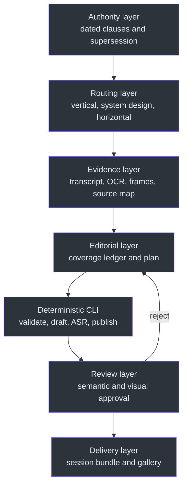
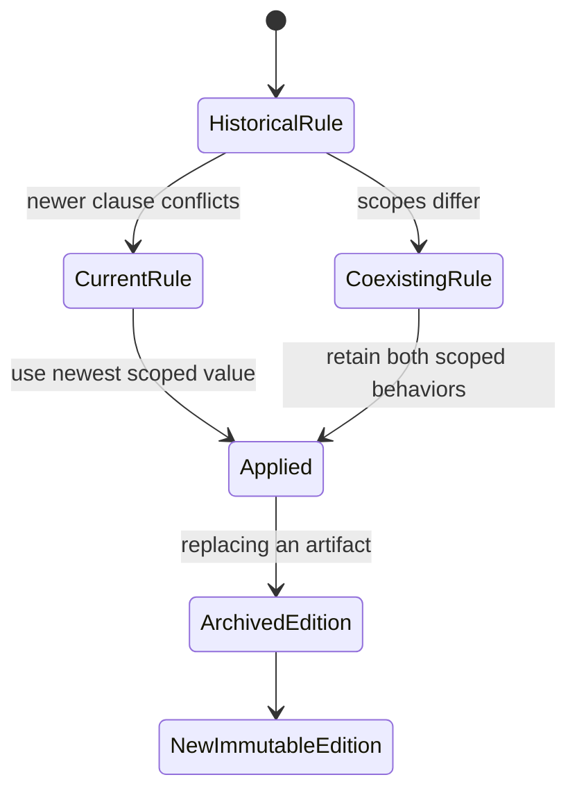
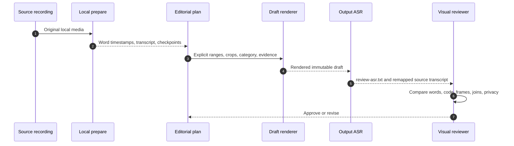

# ClipFarm Editorial Architecture

## Overview: why this is a contract, not a preset

Clip creation combines deterministic media operations with judgments that cannot safely be automated: whether a passage is complete, whether a joke has context, whether a crop exposes private data, whether a correction is accurate, and whether the rendered output still means what the source meant. The contract therefore separates **CLI mechanics** from **semantic selection and review** (`SKILL.md:L516-L519`).

The central design principle is provenance preservation: source material remains local and immutable, timestamps trace a delivery to the initiating request, draft revisions remain immutable, and publication copies only approved bundles into a single timestamped session (`SKILL.md:L253-L274`, `SKILL.md:L367-L380`).

## Architectural layers



| Layer | Responsibility | Hard boundary |
|---|---|---|
| Authority | Apply dated current policy and retain non-conflicting older rules | Never revive superseded prose or geometry |
| Routing | Select the correct workflow before preparation | Horizontal requires explicit request; system design requires explicit mode |
| Evidence | Capture local transcript, source frames, OCR, result scenes, timing | Generated ASR is fallible and cannot be treated as ground truth |
| Editorial | Map substantive source points to useful cuts | No filler, invented narration, or automatic A/B/combined expansion |
| CLI | Execute reproducible stages | No hidden LLM selection or guaranteed seamless edit |
| Review | Inspect output ASR, frames, joins, captions, and special effects | Encoder success is not approval |
| Delivery | Publish approved artifacts to one session gallery | Export is not platform upload |

Routing rules are explicit at `SKILL.md:L237-L251`; transcript and source-evidence rules are at `SKILL.md:L253-L295`; CLI/reviewer separation is at `SKILL.md:L501-L519`.

## Authority and supersession model

Treat a dated clause as a scoped patch:

1. Apply the newest clause to the behavior it names.
2. Preserve older clauses outside that scope.
3. Preserve historical artifacts even when current policy changes.
4. Never infer that a new gallery-text policy authorizes media rerendering.



### Important precedence examples

| Subject | Current rule | Superseded or limited rule |
|---|---|---|
| Posting voice | Grounded first-person authored captions (`SKILL.md:L21-L32`) | October 2 01:33 natural prose remains background guidance but not the final override |
| Vertical expansion | Combine related topics; no automatic standalone A/B/combined expansion (`SKILL.md:L320-L329`) | Earlier maximize-variants request |
| Hashtags | ≤5 unique lowercase tags and ≤1,000 characters (`SKILL.md:L401-L425`) | September 28 10+ minimum |
| Moving avatar | 364×312 aspect-contained target with current placement (`SKILL.md:L59-L68`) | 280×240 initial target at `SKILL.md:L81-L98` |
| Gallery opening | Browser directory link, not File Explorer/custom handler (`SKILL.md:L111-L120`) | September 30 native action |
| Music | Recommendations only for ordinary delivery (`SKILL.md:L175-L190`) | Mixing/trend modes only when explicitly requested |

## Route architecture

### Default vertical LeetCode

The route produces useful, bounded clips rather than exhaustive variants. The ceiling is `max(1, floor(source_seconds / 120))`, capped at five core clips per ten source minutes, plus at most two genuine humor bonuses per recording (`SKILL.md:L320-L325`). Every substantive point must map to a retained passage, a delivered clip, or a disclosed blocker (`SKILL.md:L326-L340`).

### Vertical system design

System-design mode keeps vertical review and publication gates but replaces the LeetCode problem ledger with a topic/design coverage ledger. It accepts reviewed diagrams, slides, and code-content crops, and it must not fabricate submissions, result views, complexity covers, or runtime evidence (`SKILL.md:L244-L251`).

### Horizontal complete solve

Horizontal mode preserves native landscape framing and creates one chronological solution cut per completed problem. It retains introduction, explanation, implementation, corrections, and genuine completion; missing completion blocks a “complete solve” claim (`SKILL.md:L443-L453`).

## Evidence architecture



Evidence must be layered rather than substituted:

- Generated transcript assists navigation but is fallible (`SKILL.md:L268-L274`).
- Full cue reading establishes semantic coverage (`SKILL.md:L275-L284`).
- Source-frame/OCR inspection establishes visual regions and camera declarations (`SKILL.md:L285-L295`).
- Output ASR and actual returned pixels establish rendered-output behavior (`SKILL.md:L355-L366`).
- `review.json` records evidence and limitations only after review (`SKILL.md:L367-L370`).

## Artifact and immutability boundaries

| Artifact | Mutability policy | Evidence |
|---|---|---|
| Original video/transcript | Preserve; never externally upload | `SKILL.md:L253-L257` |
| Preparation run | Resume with printed run ID and identical root/model/language options | `SKILL.md:L262-L274` |
| `plan.json` | Once present, resume editorial stages; never prepare over it | `SKILL.md:L272-L274` |
| Draft | Rejection creates a new immutable draft | `SKILL.md:L367-L370` |
| Published bundle | Archive/hash before replacement; do not overwrite conflicting images | `SKILL.md:L387-L399` |
| Session gallery | One accumulated index per original prompt timestamp | `SKILL.md:L371-L380` |
| Legacy captions | Preserve unless wording revision is explicitly authorized | `SKILL.md:L46-L57` |

## Visual composition architecture

Vertical plans use explicit `code_region` and per-segment `content_region`; camera-absent plans must declare `profile.camera_mode: "absent"` and omit every `face_region` (`SKILL.md:L285-L295`). Results scenes switch to `view: "results"` and require slow zoom plus surrounding dimming while subtitles and camera remain bright (`SKILL.md:L341-L347`).

Moving-avatar footage is source-derived and synchronized through the same source-time edit map. Still portraits, unrelated loops, and artificial mouth animation are prohibited (`SKILL.md:L81-L95`). The latest current target modifies the size and placement for the named collection without creating a shared default migration (`SKILL.md:L59-L79`).

## Delivery architecture

Approved bundles publish beneath:

```text
C:\devdesk\homedesk\ClipFarm\results\session_<timestamp>\<clip-folder>\
```

The session contains one index, retains prior cards when later clips publish, and disambiguates duplicate cut IDs. Direct children share the same original-request timestamp; per-source and per-clip indexes are prohibited (`SKILL.md:L371-L380`).

The gallery is a handoff surface, not proof of platform acceptance. It provides copyable posting fields, download/poster links, optional hash-bound posting records, and a music recommendation where required, but it does not upload or repair already-posted captions (`SKILL.md:L400-L436`).

## Architectural limitations

- Sampling cannot prove frame-exhaustive review (`SKILL.md:L348-L351`).
- Output transcription cannot prove direct listening or perfect recognition (`SKILL.md:L355-L359`).
- Clipboard success cannot prove Instagram acceptance (`SKILL.md:L431-L433`).
- Trend links identify candidates, not current regional availability or monetization rights (`SKILL.md:L201-L218`).
- The standalone CLI does not perform semantic selection or hidden web/LLM lookup (`SKILL.md:L472-L473`, `SKILL.md:L516-L519`).

## Source note

All claims on this page derive from the single supplied immutable `SKILL.md` snapshot; no additional ClipFarm source was authorized for this documentation task.

