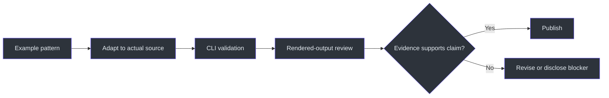
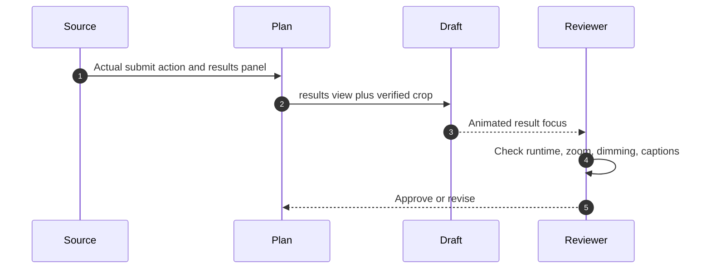

# ClipFarm Workflow Examples

## How to use these examples

These are contract-shaped examples, not proof of exact repository schemas beyond fields explicitly named in `SKILL.md`. Replace placeholders with evidence from the actual source and generated plan. Never copy a positive review claim without performing the review.



## Example 1: default vertical LeetCode clip

**Request:** “Create clips from this LeetCode recording.”

**Routing:** Default vertical. Do not choose horizontal without an explicit horizontal request (`SKILL.md:L237-L242`).

**Operator actions:**

1. Recover the original prompt timestamp.
2. Prepare the video locally.
3. Read every cue.
4. Record a ledger entry for the solved problem and each substantive point.
5. Inspect frames for avatar, code, problem statement, test panels, BRB, and result scene.
6. Author a combined useful topic instead of automatic A/B/combined variants (`SKILL.md:L262-L295`, `SKILL.md:L320-L329`).

Illustrative plan fragment:

```json
{
  "clip_policy": "coverage-first-v1",
  "profile": {
    "show_question_title": true
  },
  "cut": {
    "problem": "Actual Problem Title",
    "category": "explanation",
    "headline": "The specific reviewed takeaway"
  }
}
```

The actual problem title is distinct from the promotional topic (`SKILL.md:L296-L305`).

## Example 2: camera-absent source

**Observed evidence:** Every retained source scene lacks the camera/avatar after actual frame inspection.

```json
{
  "profile": {
    "camera_mode": "absent",
    "show_question_title": true
  },
  "segments": [
    {
      "content_region": [120, 260, 960, 1260]
    }
  ]
}
```

Do not include `face_region`. The thumbnail is text-only and omits the second separator; code or diagrams are not substitutes for camera imagery (`SKILL.md:L285-L295`, `SKILL.md:L313-L319`, `SKILL.md:L387-L394`).

## Example 3: system-design recording

**Request:** “Make vertical clips from my system-design explanation.”

**Routing:** Explicit system-design workflow.

**Coverage ledger:**

| Topic | Source range | Visual evidence | Candidate |
|---|---|---|---|
| Capacity assumptions | actual range | slide crop | Explanation |
| Queue bottleneck | actual range | diagram crop | Explanation |
| Genuine joke | actual range | source context | Humor |

Do not add a LeetCode submission, runtime, results zoom, or complexity cover. Use a question title containing only the design question (`SKILL.md:L244-L251`, `SKILL.md:L296-L300`).

## Example 4: actual submission moment

Use a submission clip only when the source shows the action and the resulting Accepted/runtime panel. Verify the submission runtime, not a separate test-run runtime. Switch that segment to `view: "results"` and review slow zoom, dimming, and bright camera/subtitles at early, middle, and end frames (`SKILL.md:L341-L347`).



## Example 5: explicit editor correction

Use only when the user authorizes retaining the inaccurate source explanation:

```json
{
  "correction": {
    "text": "EDITOR CORRECTION: concise verified correction under 180 characters.",
    "sources": [
      "https://reputable.example/reference"
    ]
  },
  "subtitle_y": 0.84
}
```

Preserve original speech and spoken subtitles. Inspect timing, full text, source accuracy, and separation before setting the review flag (`SKILL.md:L330-L335`).

## Example 6: horizontal complete solve

**Request:** “Create horizontal complete solution videos from my stream.”

**Routing:** Explicit horizontal.

Required evidence:

- Introduction.
- Important explanation/diagram.
- Implementation.
- Genuine completion, including silent submission if present.
- Verified subtitle space.
- Demonstrated complexity or a researched optimum clearly distinguished from the demonstrated algorithm.

The native full frame remains; there is no vertical crop, result dimming, or music (`SKILL.md:L443-L462`).

Illustrative cover evidence record:

```json
{
  "problem": "123. Exact Problem Title",
  "horizontal": {
    "artwork": {
      "technique": "Technique demonstrated by the code",
      "rights": "verified permitted source",
      "sha256": "<actual local hash>"
    }
  }
}
```

The Python stage does not perform hidden web searches or downloads; rights research is an explicit operator task (`SKILL.md:L463-L473`).

## Example 7: ordinary music recommendation

Ordinary delivery does **not** embed music:

```json
{
  "mode": "recommendation-only",
  "song": "Exact song",
  "artist": "Exact artist",
  "version": "Exact version",
  "reference": "https://real.example/link",
  "reason": "Specific fit for this reviewed clip",
  "mixGuidance": "Keep beneath speech; final listening remains with the user",
  "videoSha256": "<actual approved-video hash>",
  "recommendedAt": "<timezone-aware date>"
}
```

Unknown trend status, account availability, offset, or excerpt must remain unknown (`SKILL.md:L175-L190`).

## Example 8: posting fields

```text
Caption
I kept the boundary update separate so the loop stays easy to reason about.

Hashtags
#leetcode #arrays #coding

Thumbnail alt text
Cream Consolas title above a retained camera frame on a blurred blue coding backdrop.

Credits
Artwork: ...; Music recommendation: ...; required licence placement: ...
```

The first-person statement must be supported by the recording. Hashtags are separate, lowercase, unique, no more than five, and within 1,000 characters. Alt text describes actual imagery (`SKILL.md:L21-L32`, `SKILL.md:L401-L426`).

## Example 9: rejection and revision

**Observed:** Output ASR invents a key word, a join changes the meaning, and the question title wraps over the feed.

Correct response:

1. Do not set approval flags.
2. Compare the ASR with source speech/code.
3. Adjust plan timing/layout.
4. Render a new immutable draft.
5. Run `review-transcribe` again.
6. Reinspect every affected boundary and title placement (`SKILL.md:L355-L370`).

Incorrect response: approving because encoding and transcription completed.

## Example 10: publication report

```text
Route: vertical LeetCode
Original request timestamp: <recovered timezone-aware value>
Published clips: <count and paths>
Session gallery: C:\devdesk\homedesk\ClipFarm\results\session_<timestamp>\index.html
Coverage: <problems/topics delivered>
Blocked: <specific missing narration/completion/rights evidence>
Review limitations: <ASR ambiguity, non-exhaustive sampling, unverified platform acceptance>
```

This report keeps publication distinct from upload and reconciles unmet requests before claiming completeness (`SKILL.md:L371-L386`).

## Source note

Examples are bounded by the supplied immutable `SKILL.md`; placeholder structures must be validated against the actual generated plan.

