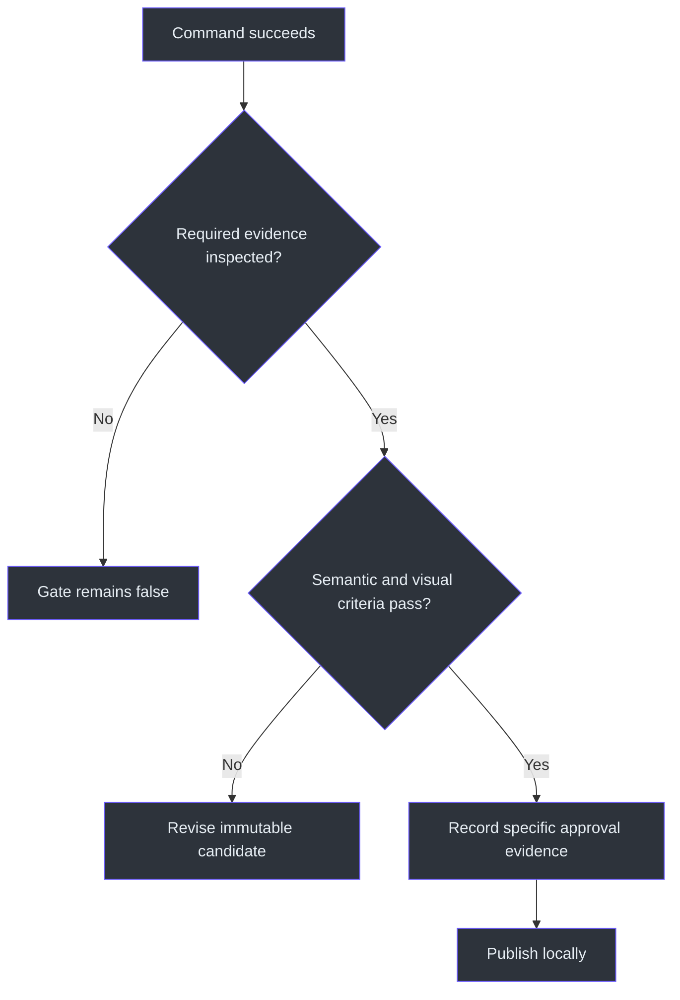
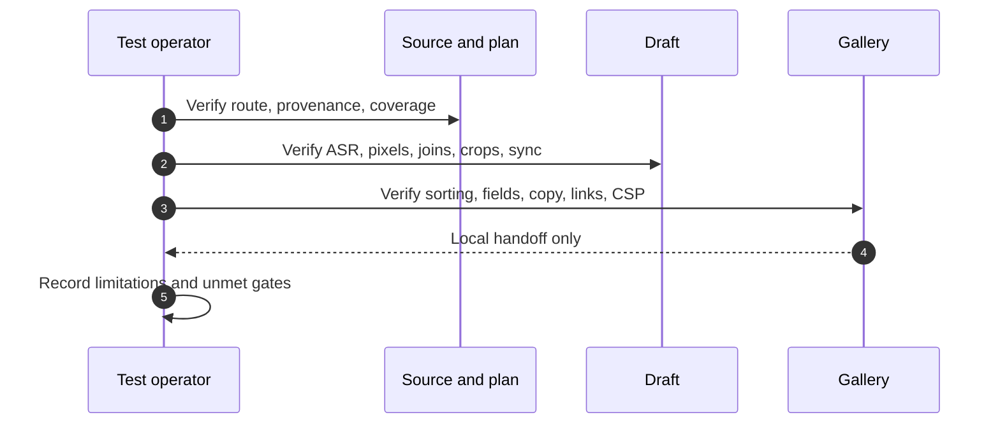

# ClipFarm Operations and Testing

## Operational principle

ClipFarm quality is established by accumulated evidence, not by command success. A passing encoder, ASR process, frame-capture API call, clipboard write, or gallery render proves only that operation. It does not prove semantic correctness, visual review, direct listening, user approval, platform acceptance, or rights eligibility (`SKILL.md:L355-L370`, `SKILL.md:L431-L433`).

## Gate matrix

| Gate | Evidence required | Must not be inferred from |
|---|---|---|
| Preparation complete | Transcript/checkpoints/plan artifacts and correct request timestamp | Work-start time |
| Coverage complete | Every cue read; every substantive point mapped or blocked | Keyword ranking |
| Camera declaration | Actual source-frame inspection | Detector failure |
| Draft valid | CLI validation plus generated draft | Plan appearance alone |
| Output transcript reviewed | Entire `review-asr.txt` compared with source/code | ASR command exit code |
| Visual review complete | Actual returned pixels at joins and special scenes | Capture call with image-limit message |
| Question title reviewed | Full text, wrap, contrast, persistence, separation | Static plan coordinates |
| Correction reviewed | Accuracy, sources, timing, complete text, spacing | Presence of correction object |
| Publication approved | Substantive `review.json` evidence | Bulk-set booleans |
| Clipboard behavior | Full text copied in supported browser | Manual selection |
| Platform acceptance | Actual platform result | Clipboard or local gallery success |

Evidence basis: `SKILL.md:L285-L295`, `SKILL.md:L330-L370`, `SKILL.md:L400-L433`.

## Regression test suites

### 1. Routing regression

- An ordinary clip request selects vertical LeetCode.
- Explicit system design selects vertical system design.
- Explicit horizontal solution request selects horizontal.
- Horizontal system design remains rejected/unsupported.
- Whole-source/privacy/review gates remain active for every route (`SKILL.md:L237-L251`, `SKILL.md:L516-L519`).

### 2. Provenance regression

- Source bytes and original filenames are unchanged.
- No external upload occurs.
- Original request timestamp is used for every source in the request.
- A missing timestamp is not fabricated.
- Interrupted preparation resumes by run ID.
- Existing `plan.json` is never overwritten by preparation (`SKILL.md:L253-L274`).

### 3. Editorial coverage regression

- Every transcript cue appears in the coverage ledger.
- Every substantive point has a candidate, published path, or blocker.
- Ceilings are not treated as quotas.
- Related topics are combined where appropriate.
- Rejected versions do not erase solved-problem coverage.
- Missing narration causes rejection, not invention (`SKILL.md:L275-L284`, `SKILL.md:L320-L340`).

### 4. Camera and crop regression

- Camera presence/absence follows frame evidence.
- Camera-absent plans contain no `face_region`.
- Normal code crops exclude problem text, unrelated browser UI, and testcase panels.
- Moving footage uses the same source-time map as the edit.
- Start/middle/end and every join preserve sync.
- Latest 364×312 target is not enlarged again.
- Ordinary/horizontal assets are not migrated by the named animated refinements (`SKILL.md:L59-L98`, `SKILL.md:L285-L295`).

### 5. Results and animation regression

- Submission clip includes actual action and result.
- Submission runtime is not confused with test runtime.
- Results zoom changes over time.
- Surroundings dim while camera/subtitles remain bright.
- Animated explainers contain meaningful intermediate action, not only fades/pulses/caption swaps.
- Fresh output ASR is read (`SKILL.md:L100-L109`, `SKILL.md:L341-L347`).

### 6. Thumbnail regression

- Full file is 1080×1920 for vertical.
- Essential content fits exact 3:4 safe area.
- Problem/design question and topic are complete.
- Camera-present hierarchy uses the genuine camera shot.
- Camera-absent hierarchy omits camera and second separator.
- Sharp text/camera is not grained.
- Horizontal cover uses exact numbered title, demonstrated technique, correct O-ring geometry, and rights-cleared artwork (`SKILL.md:L152-L162`, `SKILL.md:L296-L319`, `SKILL.md:L474-L491`).

### 7. Posting/gallery regression

- Cards sort by actual export-folder name.
- Folder names retain suffixes.
- Session link uses relative `./`, new browser tab, and safe rel attributes.
- Caption, Hashtags, Alt text, and Credits are distinct.
- Each copy button copies its full field in one click.
- Hashtags are lowercase, unique, ≤5, ≤1,000 characters, and absent from Caption.
- Music credits remain outside Caption.
- Existing galleries preserve authorized overrides and CSP (`SKILL.md:L34-L57`, `SKILL.md:L111-L145`, `SKILL.md:L400-L436`).

### 8. Publication regression

- Only approved drafts publish.
- Output lands under one timestamped session.
- Exactly one session index exists.
- Earlier cards remain after later publication.
- Duplicate cut IDs are disambiguated.
- Results remain Git-ignored.
- Delivery uses result paths, not `.clipfarm` work paths.
- No upload occurs (`SKILL.md:L371-L386`).

## Failure recovery

### Preparation failure

Surface missing dependencies or downloads. Use setup-only support, preserve local inference, and avoid interfering with other running sessions (`SKILL.md:L258-L261`).

### Transcript failure

Retry essential recognition with an explicit language and/or small model. Keep uncertainty recorded; never rewrite source meaning to match ASR (`SKILL.md:L268-L274`, `SKILL.md:L355-L359`).

### Visual evidence unavailable

Do not count images that were not returned. Reduce inspection scope or repeat a bounded capture; the review gate remains false until pixels are inspected (`SKILL.md:L360-L366`).

### Candidate fails review

Revise the plan, render a new immutable draft, rerun output transcription, and rereview all affected regions. Do not mutate the rejected draft in place (`SKILL.md:L367-L370`).

### Rights evidence missing

Do not embed the asset. For horizontal artwork, obtain a permitted/public-domain/licensed/original image; for music, keep recommendation or trend eligibility explicitly unverified as appropriate (`SKILL.md:L175-L235`, `SKILL.md:L463-L473`).

### Browser copy fails

Do not report “Copied.” Manual selection is only recovery. Fix the supported browser-copy behavior and retest the exact full field (`SKILL.md:L135-L145`, `SKILL.md:L400-L425`).

## Maintenance protocol

1. Read new dated clauses before changing helpers or docs.
2. Identify the exact scope they supersede.
3. Preserve unrelated historical behavior and immutable editions.
4. Update consolidated values in this suite without editing the source `SKILL.md`.
5. Add regression cases for the changed scope.
6. Never convert a one-batch exception into a shared default.
7. Archive/hash before replacing published bundles or HTML.
8. Update repository TODOs and the development ledger with actual outcomes only; explicit user approval remains open until recorded (`SKILL.md:L437-L441`).

## Release/readiness checklist

- [ ] Correct route and workflow docs read.
- [ ] Original prompt timestamp recovered.
- [ ] Source preserved and kept local.
- [ ] Full transcript coverage ledger complete.
- [ ] Source frames/OCR inspected.
- [ ] Current supersession rules applied.
- [ ] CLI validation passes.
- [ ] Immutable draft generated.
- [ ] Rendered-output ASR fully read.
- [ ] Required pixels inspected.
- [ ] `review.json` contains specific evidence and limitations.
- [ ] Thumbnail safe area and route-specific cover rules pass.
- [ ] Gallery navigation, copy fields, hashtags, credits, and CSP pass.
- [ ] Coverage reconciled; blockers disclosed.
- [ ] Approved bundle published to one session.
- [ ] No social upload or user-approval claim made.

## Known limitations to report

- Visual sampling is not frame-exhaustive (`SKILL.md:L348-L351`).
- ASR and language detection remain fallible (`SKILL.md:L268-L274`, `SKILL.md:L355-L359`).
- Native music previews cannot audition final in-app tracks (`SKILL.md:L231-L234`).
- Public trend lists do not prove current India/account availability (`SKILL.md:L201-L218`).
- Local copy success does not establish platform acceptance (`SKILL.md:L431-L433`).
- The CLI cannot guarantee a perfectly seamless or viral edit (`SKILL.md:L516-L519`).

## Source note

Testing and maintenance guidance is derived solely from the supplied immutable `SKILL.md`.

