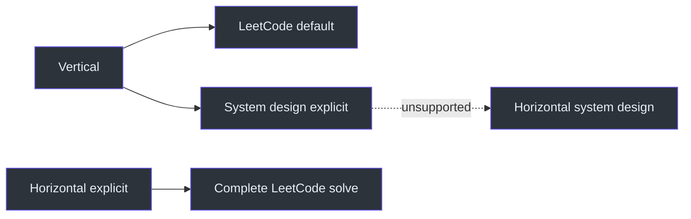
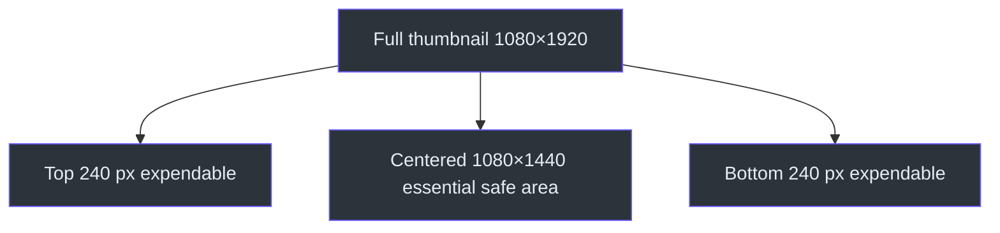

# ClipFarm Contract Reference

## Route matrix

| Dimension | Vertical LeetCode | Vertical system design | Horizontal LeetCode |
|---|---|---|---|
| Selection | Default | Explicit `--workflow system-design` | Explicit `--format horizontal` |
| Canvas | 1080×1920 | 1080×1920 | Native landscape |
| Ledger | Per-problem coverage | Topic/design coverage | Per-problem complete-solve coverage |
| Results evidence | Allowed when genuine | Do not fabricate/require | Genuine completion required |
| Music | Recommendation by default; explicit modes only | Same vertical policy | No added music |
| Thumbnail | Problem/topic/camera hierarchy | Design-question/topic hierarchy | Numbered black cover with technique, complexity, permitted artwork |

Routing authority: `SKILL.md:L237-L251`, `SKILL.md:L443-L499`, `SKILL.md:L516-L519`.



## CLI reference

All stages except `prepare` require `--plan ABSOLUTE_PLAN_PATH` (`SKILL.md:L501-L504`).

```powershell
# Default vertical preparation
& 'C:\devdesk\homedesk\ClipFarm\.venv\Scripts\python.exe' -m clipfarm workflow prepare --video VIDEO --session-timestamp REQUEST_TIMESTAMP

# Explicit horizontal preparation
& 'C:\devdesk\homedesk\ClipFarm\.venv\Scripts\python.exe' -m clipfarm workflow prepare --video VIDEO --format horizontal --session-timestamp REQUEST_TIMESTAMP

# Source inspection
& 'C:\devdesk\homedesk\ClipFarm\.venv\Scripts\python.exe' -m clipfarm workflow inspect --plan PLAN --start 0 --end END_SECONDS --step 60

# Gates
& 'C:\devdesk\homedesk\ClipFarm\.venv\Scripts\python.exe' -m clipfarm workflow validate --plan PLAN
& 'C:\devdesk\homedesk\ClipFarm\.venv\Scripts\python.exe' -m clipfarm workflow draft --plan PLAN --cut CUT_ID
& 'C:\devdesk\homedesk\ClipFarm\.venv\Scripts\python.exe' -m clipfarm workflow review-transcribe --plan PLAN --cut CUT_ID
& 'C:\devdesk\homedesk\ClipFarm\.venv\Scripts\python.exe' -m clipfarm workflow publish --plan PLAN --cut CUT_ID
```

These commands are quoted from `SKILL.md:L505-L514`.

## Source and provenance rules

| Rule | Current requirement |
|---|---|
| Required input | Video; transcript is optional |
| Automatic LeetCode routing | Requires `[LeetCode]` or `[ LeetCode ]` |
| External processing | Prohibited for media/transcripts |
| Original filenames | Preserve |
| Session timestamp | Original clip-creation prompt’s timezone-aware time |
| Missing timestamp | Recover from history; do not invent |
| Preparation resume | Printed run ID plus same root/model/language |
| Existing plan | Never prepare over `plan.json` |

Evidence: `SKILL.md:L253-L274`.

## Editorial fields and concepts

| Field/concept | Required meaning |
|---|---|
| `clip_policy` | New vertical plans use `"coverage-first-v1"` |
| `profile.show_question_title` | Preserve `true` in new vertical preparation |
| `cut.problem` / `cut.question_title` | Actual LeetCode problem title, not promotional headline |
| System-design `question_title` | Design question only |
| `profile.camera_mode` | Explicitly `"absent"` when every retained scene lacks camera/avatar |
| `code_region` | Explicit normal code crop |
| `content_region` | Explicit per-segment code/diagram/content crop |
| `view: "results"` | Genuine result/submission focus only |
| `correction` | `{text, sources}` with explicit authorization |
| `horizontal.preserve_ranges` | Meaningful silent horizontal work |

Evidence: `SKILL.md:L285-L335`, `SKILL.md:L341-L347`, `SKILL.md:L450-L456`.

## Current vertical visual values

### Moving avatar

| Property | Current named target |
|---|---|
| Crop fit | Aspect-contain complete source crop |
| Size | 364×312 at 1080p |
| Position | Top-right `(620,300)` |
| Inner padding | 16 px |
| External teaching/text clearance | 48 px |
| Canvas-right margin | 80 px |
| Border color | `#78a9ff` |
| Captions | 40 px retained |

These values are the October 1 21:40 refinement and supersede the earlier 280×240 starting geometry for the affected moving-avatar policy; they are not permission to repeatedly enlarge by 30% (`SKILL.md:L59-L68`, `SKILL.md:L81-L98`).

### Question heading and thumbnail

- Question title uses the actual problem name and appears above the feed throughout the video.
- Both vertical routes use problem/design question, separator, specific clip topic, separator, then camera/avatar when present.
- Text uses plain Consolas.
- Camera-present maximum text sizes are 64 px problem and 68 px topic at 1080×1920.
- Camera centers around `y=57.5%`.
- Camera border is `#45616a`; separator color is distinct.
- Backdrop grain is deterministic Gaussian, sigma 1.2, clipped to 4/255, and never applied to sharp camera/text.
- Camera-absent covers omit the image and second separator (`SKILL.md:L296-L319`).

### Thumbnail safe area

The file remains 1080×1920, but every essential subject, text block, and artwork element must fit within `(0,240,1080,1680)`, the centered 1080×1440 3:4 crop. The top and bottom 240 px are expendable decoration (`SKILL.md:L152-L162`).



## Horizontal cover reference

| Element | Requirement |
|---|---|
| Background | Black |
| Title | Exact numbered problem title in genuine Consolas |
| Technique | Demonstrated data structure/algorithm, lime-yellow `#dfff00`, 3 px smaller than title |
| Complexity | Bare green expression, evidence-backed |
| O ring | 216 px diameter, 5 px outline at 1280×720, lower-left around 70% height |
| Artwork | Rights-verified image bottom-right; no invented meme text |
| Intro | 1 s static hold, then 4 s dissolve over first body footage |
| Attribution | Metadata/credits, not on-image |

Evidence: `SKILL.md:L458-L491`.

## Captions, hashtags, alt text, and credits

### Authored caption voice

Write as the creator using grounded “I/my/me” only where the recording supports it. Do not invent emotion, unaided authorship, a team, or achievements. This does not apply to spoken subtitles, objective alt text, or mandatory attribution (`SKILL.md:L21-L32`).

### Gallery fields

Every future card requires independent:

1. Caption.
2. Hashtags.
3. Thumbnail alt text.
4. Credits.

Each field needs its own one-click copy action. Manual text selection is recovery, not a passing copy test (`SKILL.md:L122-L145`, `SKILL.md:L400-L425`).

### Hashtags

- Maximum five total.
- Unique, lowercase, relevant.
- Maximum 1,000 characters including `#` and spaces.
- One space-separated block.
- Never append to Caption.
- Fewer than five is acceptable.
- `caption_paste_length` is not a hashtag-count proxy (`SKILL.md:L401-L425`).

### Alt text and credits

Describe the actual thumbnail; never invent imagery. Keep music and artwork credits outside Caption and preserve required posting-placement guidance (`SKILL.md:L426-L436`, `SKILL.md:L135-L145`).

## Gallery navigation

| Behavior | Requirement |
|---|---|
| Card sorting | Actual export-folder name, ascending case-insensitively |
| Export-folder field | Exact parent folder, preserving version suffix |
| Nested/cross-session item | Show relative location |
| Session header | “Open session folder” immediately below heading |
| Link form | Relative `./`, same browser new tab, `noopener noreferrer` |
| Forbidden behavior | Windows File Explorer/custom handler |
| Existing HTML update | Archive first; preserve media, captions, controls, CSP |

Evidence: `SKILL.md:L34-L44`, `SKILL.md:L111-L120`.

## Music modes

### Ordinary current delivery

Provide one clip-specific recommendation: warmer/less-somber Snowfall-like instrumental, exact recording identity, real reference link, reason, and quiet mix guidance. Bind `music-recommendation.json` to the approved video hash after publication and republish the gallery without re-encoding (`SKILL.md:L175-L190`).

### Explicit licensed embedded exception

The September 27 named batch required distinct quiet Creative Commons instrumentals embedded beneath narration, with reviewed license, source proof hash, attribution, speech-first mix, and fresh review. That exception does not change ordinary delivery (`SKILL.md:L164-L173`).

### Explicit stylized/trend modes

Three explicit modes exist: current song with unchanged timing, track-first content-safe editing, or original audio plus an exact recommendation. Trend, account, region, excerpt, offset, and rights evidence must be genuine and dated; library access on one platform is not a license for another (`SKILL.md:L192-L235`).

## Publication outputs

```text
results\
  session_<YYYYMMDD_HHMMSS_ffffff Asia-Kolkata>\
    index.html
    <clip-folder>\
      <approved media and metadata bundle>
      thumbnail.jpg
      optional posting.json
      optional music-recommendation.json
```

The precise local publication and one-gallery rules are at `SKILL.md:L371-L400`.

## Review flags are evidence claims

Flags such as correction review, question-title review, horizontal evidence checks, and final approval must be set only after actual inspection. They cannot be inferred from encoding success, a capture call that returned no pixels, source-map arithmetic, or ASR completion (`SKILL.md:L330-L370`, `SKILL.md:L492-L496`).

## Source note

This consolidated reference uses only the supplied immutable `SKILL.md`.

