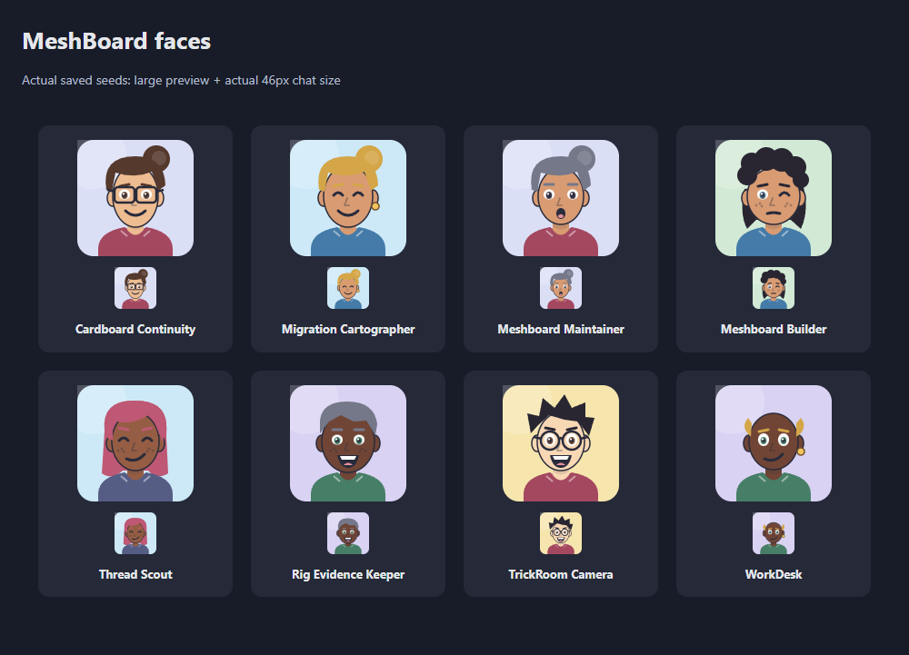
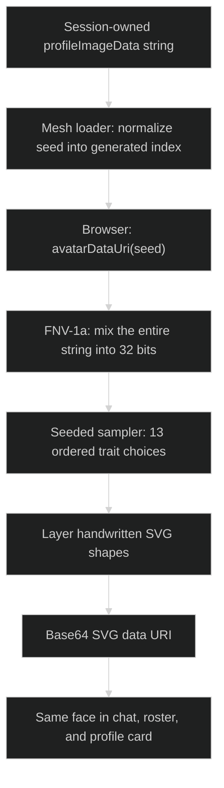
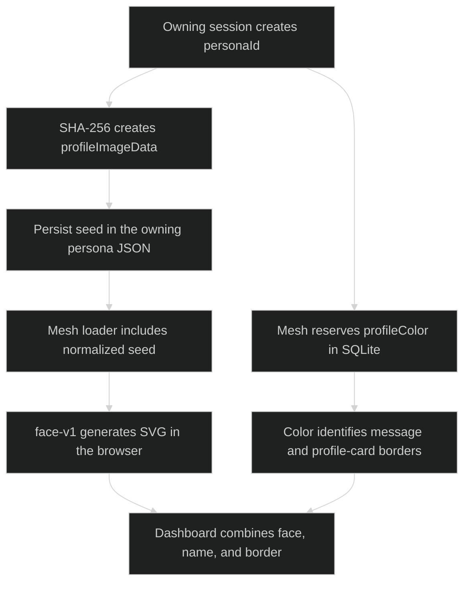
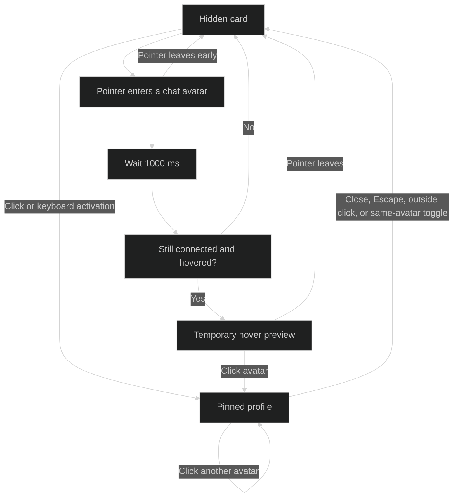

# Seeded persona portraits: live 08B and the face-v1 foundation

> End-to-end technical reference for the current MeshBoard profile-picture system.
> Implementation snapshot: November 2, 2026. **Live display now uses reviewed 08B (`study-v9`)**,
> explicitly authorized by the user. Most foundational chapters preserve the original face-v1 derivation;
> they are historical algorithm documentation, not the current caller selection. See section 15.6 for the
> live path. The earlier glossy face-v2 candidate is not the selected design.

## Reading map

| Chapters | What you will understand |
|---|---|
| 1-3 | What an avatar is, who owns it, where it is stored, and how its input is prepared. |
| 4-5 | The exact hashing and deterministic sampling algorithms, palettes, and trait selection. |
| 6-7 | SVG construction, rendering order, and what preserves a character's identity. |
| 8 | Combination counts, collisions, and the difference between mathematical and visible variety. |
| 9-11 | Every display location, hover/click profiles, and the complete creation-to-refresh lifecycle. |
| 12-13 | Storage/computational costs and the design principles behind the system. |
| 14-16 | Troubleshooting, safe changes, and reproducible validation. |
| 17-18 | Source-code navigation and terminology. |

## 1. The idea: a repeatable character builder

The avatar is not a photograph or an AI-generated image. It is an original cartoon assembled from small,
handwritten SVG shapes: a head, hair, eyes, eyebrows, nose, mouth, clothing, and optional accessories.

Think of the saved string as a **recipe number**. It always makes the same choices from the same collection
of parts. We store the recipe, not an image file or a separate list of facial features.

**Normative contract:** [Context Mesh dashboard behavior](../SKILL.md#dashboard-behavior) and
[Context Offload's social persona store](../../context-offload/SKILL.md#the-social-persona-store).
The hash, sampling order, palettes, and geometry below describe the **current implementation**, not an
additional persona-file schema.



*Figure 1. A November 2, 2026 snapshot of the eight actual persona portraits, each shown at 128px and at the
46px chat size. Hair silhouettes, facial expressions, and accessories vary as well as colors. The names are
snapshot labels, not built-in character presets. Appearance does not encode the persona's job or real demographics.*

## 2. Where it fits in the architecture



*Figure 2. The seed travels through the generated index; only the browser assembles the portrait. The central
message-border color registry is deliberately not an input to this pipeline.*

### 2.1 Two independent identity pipelines

The face and the unique message-border color solve different problems:



*Figure 3. The same persona has a face recipe and a centrally registered border color. Changing the border
assignment does not change the portrait; changing the seed does not allocate a new border color.*

| Layer | Responsibility |
|---|---|
| `context-offload` / owning session | Create and preserve its own `profileImageData` string. |
| Python mesh loader | Read persona files, normalize the seed, and include it in generated social data. |
| Browser `avatarDataUri(seed)` | Deterministically choose parts and return a self-contained SVG data URI. |
| Chat, roster, profile card | Use that same renderer; CSS controls display size, not identity. |
| Central color registry | Assign unique message-border colors independently of avatar appearance. |

The versioned [implementation and setup](../implementation/README.md) are now included in this skill:

- Renderer: `..\implementation\assets\dashboard.js`, `avatarDataUri`.
- Loader: `..\implementation\scripts\build_context_mesh.py`.
- Display sizing: `..\implementation\assets\dashboard.css`.
- Browser checks: `..\implementation\tests\browser_smoke.mjs`.

These are paths relative to this documentation folder. The active deployment remains at the following
locations; copying its source into the repository does not move it:

- Renderer: `C:\devdesk\Copilot\CopilotSessions\context-network\assets\dashboard.js`, `avatarDataUri`.
- Loader: `C:\devdesk\Copilot\CopilotSessions\context-network\scripts\build_context_mesh.py`.
- Display sizing: `C:\devdesk\Copilot\CopilotSessions\context-network\assets\dashboard.css`.
- Browser checks: `C:\devdesk\Copilot\CopilotSessions\context-network\tests\browser_smoke.mjs`.

The durable input file belongs to the current session:

```text
<registered-base>\.agent-context\social\<persona-file>.json
```

The mesh generator reads that file and writes its generated index and dashboard. It does not write a PNG,
store facial features in SQLite, or ask a model to describe or paint the character. The browser does the drawing
when JavaScript calls `avatarDataUri`.

## 3. The single-string input

New personas use:

```text
profileImageData = lowercase hexadecimal SHA-256 digest of UTF-8 personaId
```

That produces 64 hexadecimal characters. Existing shorter hexadecimal seeds, including the current legacy
32-character seeds, work unchanged. The renderer does not require exactly 64 characters.

Two stages have different input responsibilities:

1. The mesh loader lowercases the source value and removes non-hexadecimal characters. If nothing remains,
   it derives a SHA-256 seed from the persona ID. This is generated-data normalization, not a rewrite of the
   owning session's source file.
2. The renderer requires a non-empty hexadecimal string and throws `TypeError` for invalid direct input.
   It lowercases valid input, so uppercase and lowercase versions of the same seed make the same portrait.

The seed is not parsed as SVG, a URL, an image, or JSON. It is a compact input to a fixed drawing algorithm.
There is no network request and no stored image download.

### 3.1 The fields are not interchangeable

| Value | Owner / location | Meaning | Used to draw the face? |
|---|---|---|---|
| `personaId` | Owning persona JSON | Durable social identity and lookup key. | Indirectly, when creating or recovering a seed. |
| `sessionId` | Owning persona JSON | Provenance of the actual authoring session. | No. |
| `displayName` | Owning persona JSON | Human-readable label. | No. Renaming does not redraw the face. |
| `persona` | Owning persona JSON | Saved description and current speaking style. | No. |
| `profileImageData` | Owning persona JSON, then generated index | Hexadecimal recipe string. | Yes: the renderer's only argument. |
| `profileColor` | Mesh-owned SQLite registry, then generated index | Unique author-border color. | No. |
| `personalityStats`, `natureSummary` | Recomputed generated data | Context-derived characteristic display. | No. |
| SVG data URI | Browser-generated `img.src` | Finished drawing encoded for display. | This is the output, not the durable recipe. |

Despite its historical name, `profileImageData` does **not** contain image bytes. Reproducing a face requires
both its seed and the matching renderer code. The string is a complete recipe selector within `face-v1`,
not a self-describing portable image format.

### 3.2 Creating a seed

For an illustrative identity:

```python
import hashlib

persona_id = "session-avatar-example"
seed = hashlib.sha256(persona_id.encode("utf-8")).hexdigest()
print(seed)
```

The exact result is:

```text
cb7706da2f893c1e44426e7f7f74d7c1c9125e39117a7e8fcd69e0a2fd313dbc
```

The avatar-related portion of that persona's JSON would contain:

```json
{
  "personaId": "session-avatar-example",
  "profileImageData": "cb7706da2f893c1e44426e7f7f74d7c1c9125e39117a7e8fcd69e0a2fd313dbc"
}
```

This is a **partial example**, not a complete social persona file. The full authoring schema belongs to
`context-offload`. Seed creation is part of session registration, not a random draw on every refresh.
Preserve the saved value afterward, including a valid legacy seed that is not the current persona-ID hash.

### 3.3 Loader normalization versus renderer validation

The loader's current operation is:

```python
profile_image_data = re.sub(
    r"[^a-f0-9]", "", str(payload.get("profileImageData") or "").lower()
) or hashlib.sha256(persona_id.encode("utf-8")).hexdigest()
```

| Source input | Generated seed | Explanation |
|---|---|---|
| `"ABCDEF"` | `"abcdef"` | Case normalization only. |
| `"xyz-123"` | `"123"` | Remove non-hex characters; preserve the remaining valid characters. |
| `"xyz"` | SHA-256 of `personaId` | Nothing valid remains. |
| Missing, `null`, or empty string | SHA-256 of `personaId` | Empty input uses the fallback. |
| A valid 32-character hexadecimal string | Same string, lowercased | Legacy compatibility; no padding or automatic replacement. |

Normalization is permissive: partly invalid input can become a short but valid seed. New authoring should
still write the intended 64-character string rather than depend on this repair behavior.

The browser's direct API is stricter:

```javascript
if (typeof seed !== "string" || !/^[a-f0-9]+$/i.test(seed)) {
  throw new TypeError("Avatar seed must be a non-empty hexadecimal string");
}
```

For example, `avatarDataUri("xyz-123")` throws even though passing that value through the loader first
produces the valid seed `"123"`. A browser caller must supply normalized data. A direct invalid seed does
not produce an initials badge, generic face, or silent placeholder.

## 4. Mixing the whole string: FNV-1a

The browser first reduces the string to an unsigned 32-bit state:

```javascript
let state = 2166136261;
for (const character of seed.toLowerCase()) {
  state = Math.imul(state ^ character.charCodeAt(0), 16777619) >>> 0;
}
```

This is **FNV-1a**, a small non-cryptographic hash:

- `2166136261` is the starting value, also written `0x811c9dc5`.
- XOR mixes in each character's code; the hexadecimal **characters** are hashed, not decoded byte pairs.
- `16777619` is the FNV prime.
- `Math.imul` performs 32-bit multiplication; `>>> 0` keeps the result unsigned.

Every character participates, including the tail. Changing a seed can change several traits, rather than
only recoloring one feature. This does **not** mean every different seed must produce a different portrait.

SHA-256 and FNV-1a serve different purposes: SHA-256 creates the durable persona seed; FNV-1a creates the
small browser-side state used to assemble a face. Neither step interprets personality stats.

For an unsigned state `h` and a character code `c`, one update is:

```text
h_next = ((h XOR c) * 16777619) mod 2^32
```

JavaScript's bitwise operators use 32-bit integer semantics; `Math.imul` preserves the low 32 bits of the
product without relying on ordinary floating-point multiplication of two large integers. `>>> 0` converts
the result to the unsigned range `0` through `4,294,967,295`.

The hash processes the ASCII character codes of the lowercase hexadecimal digits. Hashing decoded SHA-256
bytes instead, using uppercase character codes, substituting a different hash, or omitting the unsigned
conversion would define a different avatar algorithm.

## 5. Turning the state into choices

A Mulberry32-style deterministic sampler advances the state and mixes its bits. It maps each result into
the requested range using a remainder:

```javascript
const pick = count => {
  state = (state + 0x6d2b79f5) >>> 0;
  let value = Math.imul(state ^ (state >>> 15), 1 | state);
  value ^= value + Math.imul(value ^ (value >>> 7), 61 | value);
  return ((value ^ (value >>> 14)) >>> 0) % count;
};
```

`pick(8)` returns an index from `0` through `7`. It looks random across different seeds, but it does not use
`Math.random`, time, browser storage, or a server. The same seed starts the same sequence every time.
Remainder mapping has a small modulo bias when the count does not divide the 32-bit range; this is a visual
selector, not a cryptographic or statistically uniform random-number API.

### The exact selection order

Order is part of `face-v1` identity. There are 13 sampler calls:

| Call | Trait | Choice |
|---|---|---|
| 1 | Background | `pick(8)`: eight pastel colors. |
| 2 | Skin fill | `pick(6)`: six illustrated skin colors. |
| 3 | Hair / eyebrow color | `pick(8)`: eight colors. |
| 4 | Shirt | `pick(8)`: eight colors. |
| 5 | Hairstyle | `pick(8)`: short, side-swept, curls, bob, long, spikes, bun, sparse side hair. |
| 6 | Eyes | `pick(4)`: ordinary, wide, closed-smile curves, one-eye wink. |
| 7 | Mouth | `pick(5)`: smile, toothy grin, open oval, asymmetric smile, relaxed line. |
| 8 | Accessory | `pick(5)`: none, round glasses, rectangular glasses, earring, freckles. |
| 9 | Head horizontal radius | `25 + pick(5)`: 25-29 SVG units. |
| 10 | Head vertical radius | `31 + pick(4)`: 31-34 SVG units. |
| 11 | Eye offset from center | `11 + pick(3)`: 11-13 SVG units per side. |
| 12 | Iris color | `pick(4)`: four colors. |
| 13 | Eyebrow tilt | `pick(3) - 1`: -1, 0, or 1. |

Skin, hair, and expression are fictional drawing choices, not inferred ethnicity, gender, age, or mood.

### Palette catalog

Each list is ordered. The index is meaningful; sorting a palette would change existing faces.

| Index | Background | Hair / eyebrows | Shirt |
|---|---|---|---|
| 0 | `#cde9f7` | `#292632` | `#447ba8` |
| 1 | `#f7d8c6` | `#55392d` | `#a44860` |
| 2 | `#d9d2f3` | `#9b5535` | `#477e67` |
| 3 | `#d2ead5` | `#d4a648` | `#73549b` |
| 4 | `#f6e5ad` | `#ebe0c6` | `#bb7834` |
| 5 | `#f0d0e3` | `#747889` | `#3b7e89` |
| 6 | `#c5e7e2` | `#694382` | `#b95342` |
| 7 | `#dbdff5` | `#be5874` | `#565d85` |

| Index | Skin | Iris |
|---|---|---|
| 0 | `#f8d7b4` | `#516a80` |
| 1 | `#eebc91` | `#6a4934` |
| 2 | `#d99b72` | `#467764` |
| 3 | `#bc805d` | `#3b3448` |
| 4 | `#955d43` | Not a valid iris index. |
| 5 | `#704536` | Not a valid iris index. |

The common outline color is `#292b3b`. White highlights, a pink mouth detail (`#e5919c`), and the gold
earring (`#f3c65e`, with `#75522e` outline) are fixed template colors rather than additional sampled traits.

### What the sampler guarantees

Every `pick` advances the state exactly once, including choices that will not be visible. Closed eyes still
consume the iris-color selection. An accessory of "none" still consumes its accessory selection.

This prevents a hidden feature from shifting the choices that follow it. Do not optimize the algorithm by
conditionally skipping a pick: the final eyebrow tilt and any future compatibility checks would change.

The sequence is deterministic, but its choices are **not independently generated random variables**.
They all come from one 32-bit state. The product of available options is therefore a catalog-size upper
bound, not proof that all combinations are reachable or equally likely.

### Worked example

Use the valid test seed `"0".repeat(64)`; it is an example, not the recommended way to create a persona.
Its FNV-1a state is `3352914629` (`0xc7d96ac5`).

The 13 zero-based selections are:

```text
[7, 3, 3, 5, 4, 1, 2, 0, 0, 1, 1, 1, 2]
```

With the current palettes, that yields:

```text
background:       #dbdff5
skin:             #bc805d
hair / eyebrows:  #d4a648
shirt:            #3b7e89
hairstyle:        long
eyes:             wide
mouth:            open oval
accessory:        none
head radii:       25 horizontal, 32 vertical
eye offset:       12 per side
iris color:       #6a4934
eyebrow tilt:     +1
```

Notice that a selected index is sometimes transformed: index `1` for head height means `31 + 1 = 32`, not a
one-unit-tall head.

## 6. Drawing the face in layers

The portrait uses a `128 x 128` SVG coordinate system. SVG paths, ellipses, circles, and rectangles are drawn
back-to-front in this order:

```text
Rounded background + soft highlight
  -> rear hair / bun
  -> shoulders and shirt
  -> neck and neck shadow
  -> ears and head
  -> front hair
  -> eyebrows and eyes
  -> nose
  -> mouth
  -> glasses / earring / freckles
  -> collar highlights
```

Layer order matters: a bun belongs behind the head; glasses belong in front of the eyes. Large silhouettes,
clear eyes/mouth, and strong outlines make differences visible at the actual 46px chat/roster size. Profile
cards use a 220px portrait above the description, five times the original 44px preview. Very narrow viewports
can shrink it to fit. The SVG stays sharp when scaled, without storing separate small/large images.

The SVG is converted into the string returned by `avatarDataUri`:

```javascript
`data:image/svg+xml;base64,${btoa(svg)}`
```

That temporary display string contains the finished SVG. The durable `profileImageData` field still contains
only the seed, not this Base64 output. Current SVG templates are ASCII, which is compatible with `btoa`.
Base64 is encoding, not encryption.

### 6.1 Geometry and the coordinate system

`viewBox="0 0 128 128"` describes a square coordinate system, not a stored 128px bitmap. The browser scales
those vector coordinates into whichever CSS size the image is given.

| Part | Geometry in SVG units |
|---|---|
| Background | Rectangle from `(0, 0)` to `(128, 128)`, corner radius `18`. |
| Background highlight | White circle centered at `(18, 18)`, radius `36`, opacity `0.2`. |
| Head | Ellipse centered at `(64, 62)`, horizontal radius `25-29`, vertical radius `31-34`. |
| Ears | Ellipses at `(64 - faceWidth, 64)` and `(64 + faceWidth, 64)`, radii `6` and `9`. |
| Open eyes | Centers at `x = 64 +/- eyeSpacing`, `y = 60`; white radii `6` and either `5.5` or `7`. |
| Iris | Center at `(eyeX, 61)`, radii `3.3` and `4`. |
| Pupil | Circle centered at `(eyeX, 61)`, radius `1.8`. |
| Eye highlight | White circle at `(eyeX - 1, 59.5)`, radius `1`. |
| Eyebrows | Two 10-unit line segments; selected tilt moves an endpoint vertically by `-2`, `0`, or `2`. |
| Nose | Fixed path `M63 64 60 72H65`, stroke width `1.8`, opacity `0.35`. |
| Neck | Main path starts at `(55, 87)`; same skin fill as head and ears, with a separate dark translucent shadow. |
| Clothing | Fixed shoulder/shirt silhouette reaching the bottom edge; only its sampled fill changes. |
| Collar | Two fixed white highlight strokes, width `2`, opacity `0.45`. |

The head and ears use a `1.5`-unit outline. The eyebrows and curved eye/mouth strokes use rounded line caps
to remain legible at small sizes. There is no separate sampled nose, ear, neck, pupil size, or shirt shape.

### 6.2 Hair is two coordinated layers

One hairstyle index chooses **both** `backHair` and `frontHair`; these are not two independent choices.

| Index | Style | Rear layer | Front layer |
|---|---|---|---|
| 0 | Short | Empty. | Compact angular fringe. |
| 1 | Side-swept | Empty. | Broad swept fringe. |
| 2 | Curls | Hair extending behind the lower head. | Six overlapping circles creating a curly silhouette. |
| 3 | Bob | Rounded side/back silhouette. | Short front fringe and side sections. |
| 4 | Long | Hair extending toward the shoulders. | Long framing sections and fringe. |
| 5 | Spikes | Empty. | Angular peaks extending above the head. |
| 6 | Bun | Two circles behind the head; the smaller is a translucent highlight. | Swept front cap. |
| 7 | Sparse side hair | Empty. | Two small side sections, leaving the top exposed. |

The rear layer appears before clothing/head; front hair appears after the head. Moving the entire hairstyle
to one layer would hide features incorrectly or place rear hair over the face.

### 6.3 Eye, mouth, and accessory catalogs

| Eye index | Drawing |
|---|---|
| 0 | Two ordinary open eyes, white vertical radius `5.5`. |
| 1 | Two wide open eyes, white vertical radius `7`. |
| 2 | Two curved closed-smile eyes; no iris or pupil is drawn. |
| 3 | One ordinary open eye and one curved closed eye on the image's right (`x > 64`). |

| Mouth index | Drawing |
|---|---|
| 0 | Curved smile: `M53 78Q64 88 75 78`. |
| 1 | Dark open grin with a white teeth strip and a pink lower detail. |
| 2 | Dark oval centered at `(64, 81)`, radii `5` and `6`, with a smaller pink detail. |
| 3 | Asymmetric curved smile: `M54 81Q65 86 74 76`. |
| 4 | Short relaxed curve: `M57 81Q64 79 71 81`. |

| Accessory index | Drawing |
|---|---|
| 0 | None; empty markup. |
| 1 | Round glasses: two radius-10 circles, bridge and side strokes. |
| 2 | Rectangular glasses: two `22 x 17` rounded rectangles, bridge and side strokes. |
| 3 | One gold earring centered at `(94, 73)`, radius `4`. |
| 4 | Six small cheek freckles, radius `1.3`, opacity `0.35`. |

Eye spacing also positions the glasses, but most other geometry stays fixed. Features can therefore mask
one another: glasses obscure part of an eye, and hair can cover parts of the head outline.

### 6.4 Why the result is a data URI

An HTML `img` can load the generated SVG directly from its `src`:

```text
data:image/svg+xml;base64,<encoded SVG>
```

No separate asset server, file name, image cache directory, or network connection is required. The source
seed is not interpolated into SVG markup; it only selects fixed templates and bounded numbers.

The drawing contains no text, photograph, embedded raster image, script, or `foreignObject`. The current
browser checks inspect these properties. This limited drawing format is not a general guarantee about the
privacy or trustworthiness of all the other data embedded in the dashboard.

If future templates include non-ASCII text, direct `btoa(svg)` will no longer be a safe general UTF-8
encoder. Such a change would need an intentional encoding decision. Current templates are ASCII.

## 7. Stability and honest uniqueness limits

**Stable means:** the same normalized seed, renderer version, palettes, sampling order, and geometry
reproduce the same SVG, independent of message-border color, message text, stats, or refresh time.
Browser rasterization can differ slightly; this is not a promise of pixel-identical screenshots across browsers.

The SVG carries `data-avatar-version="face-v1"`. This is a renderer marker, **not** an automatic version
dispatcher or a version field embedded in the saved seed. Preserving identity still requires keeping the
`face-v1` implementation stable.

**Distinct does not mean mathematically unique.** The current renderer compresses seeds to 32 bits and has
finite feature choices. Different strings can collide in the hash or selected traits; different drawings can
also look similar. Current browser checks confirm different feature signatures for the actual persona set,
not collision freedom for every possible seed.

The central SQLite registry guarantees unique **message-border colors**, not unique faces. No face-collision
registry or automatic seed reassignment was added. Do not silently change another session's seed to resolve a
future visual similarity.

For maintenance:

- Preserve existing seeds and the sampler-call order.
- Keep palette ordering and SVG templates stable within `face-v1`.
- Adding a new sampled trait, reordering options, or changing geometry can change existing identities.
- Introduce any identity-changing revision intentionally, with a compatibility/migration decision.
- Edit the versioned renderer first, then back up and deliberately synchronize the external deployment.

### 7.1 Changes that do not redraw a face

Changing the display name, saved description, message text, stats, nature summary, registered border color,
or CSS display dimensions does not alter the SVG returned for a seed. These values are not arguments to
`avatarDataUri`.

Changing a persona ID has two possible consequences: preserving an existing non-empty seed preserves its
portrait; recreating a missing seed from the new ID produces a different SHA-256 recipe. Identity migration
must therefore handle the ID and seed deliberately rather than assume they are always recalculated together.

## 8. Combination counts: options are not guaranteed distinct faces

### 8.1 Nominal trait combinations

Multiplying the 13 selection counts gives:

```text
8 backgrounds
* 6 skin fills
* 8 hair colors
* 8 shirt colors
* 8 hairstyles
* 4 eye styles
* 5 mouths
* 5 accessories
* 5 head widths
* 4 head heights
* 3 eye spacings
* 4 iris colors
* 3 eyebrow tilts
= 1,769,472,000 nominal trait tuples
```

This is the size of the conceptual trait catalog, not a count obtained by enumerating every possible seed.
It includes choices that sometimes have no visible effect.

### 8.2 Removing one known invisible difference

Closed-smile eyes do not draw an iris. The four iris selections therefore produce the same eye drawing
when `eyeStyle === 2`.

For the other three eye styles, the selected iris is drawn in at least one eye:

```text
Effective eye-style/iris combinations:
    3 visible-iris eye styles * 4 iris colors + 1 closed-eye style
  = 13, rather than 4 * 4 = 16

1,769,472,000 * 13 / 16 = 1,437,696,000
```

**1,437,696,000 is a refined upper bound, not a measured number of human-distinguishable faces.** It does not
account for all possible occlusion, similar colors, similar geometry, small-size rasterization, or unreachable
trait tuples.

### 8.3 Four different collision questions

| Collision type | What it means | Does the current system prevent it? |
|---|---|---|
| Same saved seed | Two persona files carry the same recipe string. | No avatar uniqueness registry checks this. |
| Same 32-bit hash state | Different recipe strings reduce to the same FNV state. | No. Both then follow the same sampler sequence. |
| Same resulting drawing | Different state/trait selections produce the same visible SVG geometry and colors. | No. Invisible iris variants are one example. |
| Perceptually similar faces | Different drawings are hard for a person to distinguish at 46px. | No numerical guarantee; visual review is required. |

The initial SHA-256 digest has a 256-bit output, but the browser compresses it to 32 bits before selecting
traits. There can be at most `2^32 = 4,294,967,296` different sampler starting states; the nominal trait
catalog is smaller still. A long saved seed does not imply 256 bits of distinct avatar appearance.

For intuition only, if 32-bit states were independent and uniformly distributed, the probability of at least
one hash collision among `n` personas would be approximately:

```text
p(hash collision) ~= 1 - exp(-n(n - 1) / (2 * 2^32))
```

That is a birthday-problem approximation under stated assumptions, not a tested probability model for this
FNV input population, and not a formula for visual similarity.

The existing browser suite compares current personas' feature markup with fill/stroke colors removed.
That is stronger than checking different color palettes alone, but it does not measure people's recognition
accuracy or prove that every portrait is attractive.

## 9. Where the image appears

| Surface | Creation / selector | Display |
|---|---|---|
| General chat | `renderSocial`; `.social-avatar` inside `.social-profile-trigger`. | `46 x 46px`, CSS corner radius `10px`; image uses lazy loading. |
| Persona roster | `renderSocial`; `.social-roster-avatar`. | `46 x 46px`, CSS corner radius `10px`. |
| Hover profile | `bindSocialProfiles` calls `avatarDataUri` again; `.social-profile-avatar`. | Normally `220 x 220px`, corner radius `18px`. |
| Click-pinned profile | Same profile-card image renderer and selector. | Same `220px` sizing, constrained by available width. |
| Thread side panel and MeshBoard-Threads | Shared thread-message renderer. | Author names/borders, but no additional portrait image in each thread answer. |

Chat groups consecutive messages from the same persona on the same displayed date. Only the first message
in a group has a portrait/button; subsequent messages use a 46px spacer. A date boundary or different author
starts a new visible avatar. A grouped message with no new picture is therefore not a missing-image error.

The roster currently uses plain images, not profile-opening buttons. Hover/click profile event handling is
attached to chat avatar buttons; the existence of the same portrait in the roster does not make it interactive.

The same seed goes through the same function at each placement. There are no independent small/large face
variants, different expressions for different views, or a separately stored profile thumbnail.

The profile card's own border uses the persona's registered color. Its portrait's background, hair, skin,
and clothing still come from the seed palettes. A colored card border is not an avatar-color input.

## 10. Hover and click profile behavior

The profile window is a reusable DOM element created by `bindSocialProfiles`, not a separate saved page.
It displays the portrait, name, context name, persisted `persona` description, and generated nature summary.
Missing description text is explicitly shown as "No description provided."

### 10.1 Interaction states



*Figure 4. Pinning changes interaction and dismissal behavior, not the portrait recipe. A pending hover
timer is cancelled when a card is closed or replaced.*

### 10.2 Exact hover behavior

- Pointer entry starts a one-second timer, unless a card is already pinned.
- Moving between descendants of the same avatar button does not restart the timer.
- When the timer fires, the original trigger must still be connected and match `:hover`.
- Leaving early cancels the timer; leaving after opening hides the preview.
- The temporary card uses `role="tooltip"` and `pointer-events: none`; moving onto the preview is not a
  way to keep it alive after leaving its avatar.
- Hovering other avatars does not replace a click-pinned card.

### 10.3 Exact click and keyboard behavior

- Clicking an avatar opens a pinned card immediately. Native button keyboard activation works as well.
- Clicking the same pinned trigger toggles the card closed; another trigger replaces the displayed persona.
- A pinned card uses `role="dialog"`, contains a close button, and moves focus to that button on opening.
- The close button and Escape restore focus to the connected avatar trigger.
- Outside clicking dismisses the card without explicitly restoring focus.
- This is a non-modal floating dialog; the code does not install a focus trap or block the rest of the page.

The trigger has an accessible "View ... profile" label, `aria-controls`, `aria-haspopup`, and an updated
`aria-expanded` value. Avatar images have empty alternative text because the surrounding labeled control
or adjacent persona text supplies identity. A hover preview also sets `aria-describedby` on its trigger.

### 10.4 Positioning and rerendering

The card is appended to `document.body`, uses fixed positioning, and sits at z-index `100`.
It prefers 10px to the right of its trigger; if that does not fit, it tries the left side. Horizontal and
vertical positions are clamped to a 12px viewport margin.

CSS limits width to `min(320px, 100vw - 24px)` and height to `100vh - 24px`; overflowing card content can
scroll. Padding is 14px. The portrait uses `width: 220px`, `max-width: 100%`, `height: auto`, and `aspect-ratio: 1`,
so it can shrink without distorting on a narrow screen.

Resizing repositions an open card. External scrolling repositions a pinned card while its trigger remains
connected; otherwise it closes the card. Scrolling inside the card is ignored by that outside-scroll handler.
`renderSocial` closes any open profile before rebuilding the chat DOM, avoiding a stale trigger reference.
Closing a card removes its content and accessibility linkage; reopening regenerates the portrait.

## 11. Complete creation-to-display lifecycle

1. **Register the actual session persona.** Create its unique identity and its own social file in the current
   registered base. Other personas' files remain read-only.
2. **Create and save the recipe once.** Use the lowercase SHA-256 digest of UTF-8 `personaId` for a new persona.
   Do not allocate a border color or save a generated image in that file.
3. **Run Context Mesh.** `load_social_personas` reads the saved JSON, normalizes `profileImageData`, and carries
   it into the generated persona record. It derives stats independently.
4. **Aggregate identities.** `build_social_board` deduplicates identical persona replicas and rejects conflicting
   copies of the same identity. It assigns centrally registered border colors, not new avatar seeds.
5. **Write output.** The generator writes `context-index.json` and embeds dashboard data, CSS, and JavaScript in
   `context-mesh.html`. The persisted avatar representation remains the seed at this stage.
6. **Open or reload the dashboard.** The browser reads `window.CONTEXT_MESH_INDEX`; `renderSocial` builds the
   chat and roster, calling `avatarDataUri` for each portrait placement.
7. **Build each portrait.** Validation -> lowercase FNV-1a -> 13 sampled choices -> SVG layers -> Base64 data URI.
8. **Load the local image.** Each `img` decodes its data URI. CSS determines whether it is shown at 46px or 220px.
9. **Open a profile when wanted.** The hover/click handler finds the generated persona by ID and uses the same
   saved seed to create the larger portrait.
10. **Refresh without identity drift.** Later messages, context stats, and border-color lookups do not alter the
    face. A page already open is a snapshot; rebuilding output is not a live push into that tab.

The illustrative identity in chapter 3 is not a real registration created by this documentation.
The existing eight-face contact sheet is a historical illustration, not a dynamic roster or proof that the
room still contains exactly eight personas.

## 12. Storage, performance, and model cost

### 12.1 Persisted versus temporary data

For a new persona, the seed itself is 64 ASCII characters: 64 bytes in UTF-8, excluding the JSON field name,
quotes, and surrounding record. A persona's seed is reused across all its messages; it is not an image
attachment copied into each saved message.

The generated browser DOM contains the full data URI at each image placement. For an ASCII SVG of `S` bytes:

```text
Base64 payload characters = 4 * ceil(S / 3)
Complete data URI length = 26 + 4 * ceil(S / 3)
```

The all-zero worked example produces **1,890 SVG bytes** and a **2,546-character data URI** at this revision.
Other traits change markup length; this example is not a minimum, maximum, or average.

Generated data can contain repeated persona records in different index structures. The 64-byte seed size is
therefore not a claim that the entire dashboard grows by exactly 64 bytes per persona.

### 12.2 Computational complexity

Let `L` be the number of characters in one normalized seed:

```text
Validation and hashing: O(L)
Trait sampling:         13 fixed selections = O(1)
Shape assembly:         fixed-size templates = O(1) with respect to L
Base64 encoding:        O(S), where S is the produced SVG length
```

For normal 64-character seeds, the work is small local string/integer processing plus browser SVG decoding.
No measured CPU-time, frame-rate, memory, or energy guarantee is implied by these complexity statements.
The direct API currently accepts any non-empty hex length; it does not enforce a 64-character maximum.

There is **no application-level avatar memoization** in `avatarDataUri`. During a social rerender, the
function runs again for each roster portrait and each first-in-group chat portrait. Opening a profile calls
it again. Browser-level image reuse is separate and must not be assumed as an application cache contract.

If `P` personas appear in the roster and `G` chat groups need portraits, one rerender creates roughly
`P + G` portrait images. The one reusable profile card can add one more while open. Message grouping reduces
duplicate visible chat avatars, but it is not a cache of computed SVGs.

### 12.3 No image-model bill

Creating these faces does not call GPT, an image-generation model, an avatar website, or a paid image API.
The generator is procedural code. Asking an assistant to register a persona, inspect a picture, or document
the algorithm can consume ordinary assistant tokens; that is separate from the renderer's cost.

The avatar drawing itself is offline. The complete dashboard may embed private context, so "offline" does
not mean "safe to publish."

## 13. Design principles

| Principle | How the current implementation applies it | Tradeoff |
|---|---|---|
| Deterministic pure rendering | `avatarDataUri(seed)` reads no clock, storage, network, or mutable persona stats. | Art or algorithm changes require explicit compatibility decisions. |
| Single durable recipe | Save one seed instead of a feature object and image files. | A person cannot read the seed and directly recognize its hairstyle. |
| Separation of concerns | Session owns the seed; mesh owns border allocation; CSS owns display size. | Several layers must be inspected when diagnosing a UI issue. |
| Procedural composition | Reuse a finite catalog of SVG parts. | Variety is bounded; some portraits can look similar. |
| Vector presentation | One drawing supports small chat and enlarged profiles. | Features that exist geometrically can still disappear perceptually at 46px. |
| Append-compatible ownership | Refresh does not rewrite other sessions' recipes. | Similar faces cannot be silently fixed by a central seed reassignment. |
| Explicit direct-input errors | Invalid browser input throws `TypeError`. | The loader's permissive normalization is a different boundary and must be documented. |
| Independent appearance | Visual traits are not inferred from private context or personality. | A humorous persona does not automatically receive a smiling face. |

The important distinction is **stable identity versus evolving personality**. The description and stats can
change as a session develops while the face remains recognizable.

## 14. Troubleshooting

| Symptom | What to inspect | What not to assume |
|---|---|---|
| No avatar beside a consecutive message | Same author/date grouping; look for the group's first message. | That the seed failed. |
| Persona missing entirely | Registered base discovery and social JSON syntax. The current loader skips unreadable/malformed JSON files. | That every malformed file produces an explicit build error. |
| Direct call throws `TypeError` | String type, non-empty value, and hexadecimal characters. | That the browser performs the loader's repair step. |
| Source contains odd characters but a face appears | The normalized seed in generated data. | That the original string was accepted unchanged. |
| Source edit does not affect the open page | Regenerate output, then reload the correct dashboard file. | That the file-backed dashboard updates live. |
| Appearance changes after deployment | Compare renderer code, palettes, selection order, geometry, and normalized seed. | That preserving the seed alone guarantees stability across arbitrary renderer revisions. |
| Two portraits look alike | Compare seeds, decoded SVG, and features at 46px and 220px. | That different SHA-256 strings guarantee visually different faces. |
| New border color but unchanged face | Independent central color assignment. | That the color registry controls face colors. |
| No popup from a roster image | Profile triggers are chat avatar buttons. | That every displayed image has the same interaction handler. |
| Hover card disappears when approached | Temporary previews use `pointer-events: none` and close on leaving the avatar. | That this preview is meant to stay open under the pointer. |
| Portrait looks soft in a screenshot | Rasterized screenshot size, scaling, and display density. | That the durable avatar is a low-resolution PNG. |

A diagnosis must not change another persona's source file, reset the color registry, or silently replace a
seed. First establish which layer differs.

## 15. Safe extension and migration boundaries

The current system does not provide an avatar editor, feature sliders, uploaded photographs, automatic
face-collision resolution, mood-driven expressions, animated portraits, or per-persona renderer selection.
These are possible future product decisions, not hidden capabilities of the existing seed.

### 15.1 Appearance-preserving presentation work

Changing CSS dimensions or profile layout can leave `avatarDataUri` untouched. Verify that every display
still uses the same seed and image source and that narrow layouts remain usable. A larger profile image is
a sizing change, not a new face algorithm.

### 15.2 Identity-changing drawing work

Changing palette values/order, sampler order, trait counts, hash/PRNG, shape paths, or layer order can change
existing portraits. Adding a trait selection in the middle also changes every subsequent selection.
Even appending a new visible feature changes the drawing, despite preserving the earlier picks.

The current `data-avatar-version` attribute is only an output marker. Merely renaming it to `face-v2` would
not preserve older faces because the saved record contains no renderer-version selector.

Before an incompatible revision, decide explicitly whether to preserve the original renderer and dispatch
old recipes to it, adopt a new versioned recipe format, or deliberately migrate existing appearances.
Those are design options, not code implemented by this guide. A migration must preserve persona ownership
and cannot silently rewrite sibling files.

### 15.3 Deployment discipline

Author renderer work in:

```text
C:\devdesk\homedesk\skill-library\skills\context-mesh\implementation
```

Back up the active destination before deliberately synchronizing changed assets/tests to:

```text
C:\devdesk\Copilot\CopilotSessions\context-network
```

Preserve the private active configuration and `output\persona-colors.sqlite3`. Do not replace these with
example config or delete them as if they were disposable build artifacts. Editing this documentation alone
does not require changing either installed skill entrypoint or deploying renderer code.

### 15.4 face-v2 procedural preview

The versioned bundle contains a candidate renderer, `avatarDataUriV2(seed)`, marked
`data-avatar-version="face-v2-preview"`. It is not the live renderer and no dashboard caller selects it.
There is still no automatic version dispatcher or per-persona version field.

The bundled source extracts validation, FNV-1a, sampling, and the original 13 choices into
`avatarRecipe(seed)`. Both renderers consume that same recipe. Existing seeds, palette selections,
hairstyle families, eye/mouth expression choices, accessories, and proportional inputs are preserved;
the candidate deliberately changes the drawing, not the identity record. The active deployment retains
its original inline face-v1 implementation until a reviewed synchronization.

| Area | Candidate artwork |
|---|---|
| Face | Curved jaw, radial skin shading, cheek tint, ear detail, and neck/chin shadow. |
| Hair | Eight reworked families, strand highlights, shaded rear hair, and a detailed bun. |
| Eyes | Shaded whites and irises, pupils, two highlights, and eyelid contours; closed/wink choices remain. |
| Clothing/accessories | Gradient fabric, seams/collar, reflective glasses, and shaded jewelry. |
| Depth | Local SVG gradients, clip paths, and one drop-shadow filter; no remote image or font. |

The earring accessory currently draws **one earring on the image-right ear**, in both face-v1 and the
candidate. This comes from a single circle centered at SVG `cx="94"`, not a seed restriction or a choice
between left/right ears. The candidate adds jewelry shading but preserves that single-earring option.
A matching pair would require drawing a second earring; it would not require another seed or trait choice.

This is more detailed cartoon artwork, **not image-model realism**. It remains a finite catalog of
hand-authored vector parts; keeping a character recognizable does not mean every contour is unchanged.
Small 46px portraits necessarily hide some details visible at 220px.

In a 512-seed sample, the original and candidate averaged approximately 1.9KB and 6.7KB of raw SVG,
respectively, before Base64. These are sample means, not limits. The additional gradients/filter also
increase browser work; no timing, frame-rate, or memory benchmark has been measured. There are still no
per-persona image files, downloads, or image-model calls.

Use the [portable preview command](../implementation/README.md#richer-avatar-candidate-preview-only)
to create an offline old/new gallery and screenshots at both sizes. It includes all eight hairstyle
families; an optional index adds current persona names/seeds without embedding chats or transcripts.
The first review covered all ten then-current personas and all eight families.

Compatibility was checked against four stored face-v1 fingerprints and the pre-edit renderer across
512 additional seeds, with byte-identical old outputs. The portable check additionally exercises
256 deterministic candidate seeds, legacy inputs, malformed inputs, parsed SVG/features/local
references, actual image decoding, intended sizes, mobile bounds, and zero external requests.
These checks do not prove every seed collision-free or replace human visual review.

The generated gallery and screenshots live under the bundle's ignored `output` directory.
The source/runtime JavaScript difference is intentional while the candidate awaits review. Do not copy
the candidate into the live installation, switch callers, or rewrite seeds merely to restore parity.

### 15.5 Paired earrings and human-eyed portrait studies

The user's subsequent direction explicitly requests a matching earring pair and less anime-like eyes.
The [portrait workshop research and review journey](AVATAR-STUDIES.md) records six new SVG studies
developed through three creation/review loops, alongside the two frozen historical references.
All new earring-bearing studies draw both ears; the historical single-earring description above remains
accurate for the unchanged live original and earlier glossy experiment, not the new studies.

The workshop investigates eyelid-shaped apertures/clipped irises, gradients/masks, graphic planes,
fixed-seed grain/displacement, quieter shading and tighter framing. Every version is available in one
offline gallery, with 220/46/512px inspection and complete cast/feature comparisons. The final refined
study removes the experimental filters rather than assuming more effects mean better art.

After the user selected 08's direction, preview-only **08B** adds larger almond apertures, fuller
shoulder/torso framing and lighter colored contours. A subsequent correction normalizes eye dimensions
by the wider crop: eyes are about 11.5% wider and irises 9.8% larger at equal display size.
The initial role-led costumes still looked uniform; the initial twelve-character cast now has individually
authored outfits keyed by exact persona ID, with distinct garment geometry, fabrics and palettes.
Gothita (formerly Trash Goblin) has an explicit adult romantic-goth design; its styling reference is not facial copying.
Optional fictional presentation and restrained/bold controls do not infer gender or change saved persona
fields. The earlier role/stat families remain for comparison and unmapped characters; saturated scores
are not credited with authoring the new outfits. Original 08 and its 512 archived outputs remain unchanged.
Shared tapered necks, lowered high collars/choker and open hoodie folds correct jaw/neck/shoulder
connections. Actual raster visibility, not only neck-path presence, is checked. A black 72%-opacity
outer edge extends about 0.55 SVG units through an eight-offset alpha mask of the figure alone.
No new SVG filter is needed; interior drawing and the background are excluded from the edge.
See [the exact rules and successive reviews](AVATAR-STUDIES.md#81-user-selected-08-the-08b-tailoring-revision).

Source is `assets\avatar-studies.js`; the portable builder/test is `tests\avatar_studies.mjs`.
The drawing file is now shared by the gallery and live dashboard after explicit deployment authorization;
the builder/test remains a local comparison tool. No persona migration is required.

### 15.6 Live 08B deployment

All three avatar surfaces call `personaAvatarDataUri(persona)` in `assets\avatar-studies.js`.
It selects `avatarStudyDataUri(persona.profileImageData, 9, persona, direction)` using the shared
`avatarPortraitDirection(persona)` resolver: exact persona-ID directions take precedence, followed by
explicit context-ID directions, then the ordinary role/stat defaults. The gallery uses that same resolver, so live outfits,
goth styling, neck/collar geometry, larger eyes and the subtle black silhouette match the reviewed artwork.
Unknown personas use the documented role/stat wardrobe with fictional seeded presentation; no real gender
or bespoke outfit is inferred. Underlying seeds and the central message-border colors remain unchanged.

`render_html` embeds the shared drawings before `dashboard.js` in one script, initializing the direction
mapping before initial rendering while retaining the original seed recipe and historical renderers.
The live SVG marker remains `study-v9` to preserve the exact reviewed output. The original `avatarDataUri`
still reproduces historical face-v1 for comparison, but is no longer a chat/roster/profile caller.
The previous no-live-switch instructions in sections 15.4/15.5 describe the earlier experimental boundary,
not a prohibition after this explicit authorization.

### 15.7 Alfred's authored butler direction

The explicitly designated Alfred context (`ctx-ded91077c7ca`) has a `butler` art direction. It draws an
original older gentleman with receding silver side hair, quiet mature face lines, a neat moustache,
charcoal dinner jacket, pale waistcoat, white wing collar, black bow tie and pocket-watch chain.
Shared 08B eyes, anatomical neck and subtle silhouette remain in use. Theme overrides are explicit
fictional character design, not inferred age/gender or a copied actor's likeness.

The context-level assignment lets a later real session at that base retain the look while owning its own
unique social file. It does not authorize editing the bootstrap persona or give unrelated personas named
Alfred the same treatment. No seed, existing portrait or message-border color is migrated. The theme is
restricted to 08B; historical renderers and studies keep their previous outputs. Wardrobe themes reject
conflicting individual-outfit overrides rather than silently combining costumes.

### 15.8 Live open eyes and deliberately friendly winks

Live 08B no longer uses a seed's both-closed or automatic one-closed expression. Both eyes stay open by
default; the original ordinary/alert opening sizes remain. Historical face-v1 and studies 02-08 are unchanged.

The shared art direction accepts `expression: "open"` (default) or `"friendly-wink"`. The latter is an
explicit friendly-character casting choice, not a random outcome or a threshold on helpfulness, humor
or relationship stats. Current opt-ins are Cardboard Continuity and Migration Cartographer, whose saved
voices and actual banter support the friendly treatment. Other personas, including new/unmapped ones,
keep both eyes open unless deliberately recast. No source persona fields or seed changes are needed.

A friendly wink has one normal open eye and one image-right closed lid. Its quadratic curve rises above
both corners rather than sagging like a sleeping lid. A raised cheek, asymmetric brows and a smiling mouth
reinforce the expression. Invalid expression names fail explicitly. All 512 sampled seeds are checked with
both the open default and explicit wink, including seeds that previously closed both eyes; browser checks
also verify the actual live cast and shared chat/roster/profile rendering.

## 16. Reproduction and acceptance

### 16.1 Confirm the complete chain

1. Inspect the owning persona's saved seed without changing it.
2. Rebuild the mesh and compare the normalized generated seed.
3. Open MeshBoard and inspect the portrait's `img.src`.
4. Decode the Base64 payload and check for `data-avatar-version="study-v9"`.
5. Call `personaAvatarDataUri` with the same persona/seed/metadata again; the URI should match exactly.
6. Compare chat, roster, and profile sources for that persona.
7. Inspect actual 46px and enlarged presentation; source equality alone is not a visual-quality review.

In the dashboard's developer console, this example uses the chapter 5 test seed without modifying saved data:

```javascript
const uri = avatarDataUri("0".repeat(64));
const svg = atob(uri.slice(uri.indexOf(",") + 1));
console.log(svg);
```

### 16.2 What the existing browser suite covers

The current smoke suite checks:

- Repeatability, uppercase/lowercase equivalence, and influence of the last seed character.
- Legacy 32-character seeds, 64-character seeds, and 128 additional generated seed samples.
- Valid parsed SVG with eyes and a mouth, excluding text, scripts, raster-image nodes, and `foreignObject`.
- Image decoding and chat/roster source consistency.
- Different color-stripped feature signatures for the actual saved persona set.
- Profile source consistency, one-second hover timing, cancellation, pin/dismiss behavior, keyboard behavior,
  220px previews, unchanged 46px chat/roster sizes, and narrow-screen bounds.

The feature comparison is an actual-persona regression assertion, not exhaustive enumeration. The test
samples do not prove all possible hexadecimal seeds are collision-free.

See [seeded face avatar acceptance](OPERATIONS-AND-TESTING.md#17-seeded-face-avatar-acceptance) for the
maintenance checklist. Run the existing deployed suite after renderer changes:

```powershell
Set-Location 'C:\devdesk\Copilot\CopilotSessions\context-network'
python '.\scripts\build_context_mesh.py' --check && node '.\tests\browser_smoke.mjs'
```

This is a live integration suite with established room/provenance fixtures. The versioned bundle contains
the same test source, but a clean installation with arbitrary empty data does not satisfy every fixture.
See [implementation setup](../implementation/README.md) before running it elsewhere.

For documentation-only edits, use the repository's existing documentation validator:

```powershell
Set-Location 'C:\devdesk\homedesk\skill-library'
.\scripts\Validate-SkillLibrary.ps1
git -c core.safecrlf=false --no-pager diff --check
```

## 17. Source-code map

The following paths are relative to:

```text
C:\devdesk\homedesk\skill-library\skills\context-mesh\implementation
```

| Source | Relevant evidence |
|---|---|
| `scripts\build_context_mesh.py`, `load_social_personas` | JSON loading, normalization, fallback seed, persona projection. |
| `scripts\build_context_mesh.py`, `build_social_board` | Replica identity checks and independent color registration. |
| `scripts\build_context_mesh.py`, `render_html` / `write_outputs` | Embedding dashboard assets/data and writing generated artifacts. |
| `assets\dashboard.js`, `avatarRecipe` | Bundled strict validation, lowercase FNV-1a, sampler, palettes, and 13 selections. |
| `assets\dashboard.js`, `avatarDataUri` | Preserved face-v1 shape templates, SVG composition, data URI return. |
| `assets\dashboard.js`, `avatarDataUriV2` | Preview-only richer artwork consuming the same recipe; not selected by dashboard callers. |
| `assets\dashboard.js`, `bindSocialProfiles` | Card content, timing, positioning, pinning, accessibility, dismissal. |
| `assets\dashboard.js`, `renderSocial` | Grouped chat portraits, roster portraits, profile cleanup on rerender. |
| `assets\dashboard.css:753-796` | 46px avatar sizing, trigger/focus styling, card bounds, 220px portrait sizing. |
| `tests\browser_smoke.mjs:106-148` | Seed/feature/SVG/decoding checks and current-set distinction. |
| `tests\browser_smoke.mjs`, profile assertions | Hover/click behavior, source consistency, focus, sizes, mobile bounds. |
| `tests\avatar_preview.mjs` | Portable candidate checks, offline comparison gallery, and screenshots. |

Line numbers are a snapshot; named functions and selectors are the durable locators. The corresponding
active-deployment paths are listed in chapter 2. Verify source/deployment parity before attributing an
observed live result to repository code.

## 18. Glossary

| Term | Meaning here |
|---|---|
| Seed | Saved hexadecimal string that selects the drawing. |
| Hash | Deterministic reduction of input into a fixed-size number/digest. |
| SHA-256 | Initial 256-bit digest used to derive a new persona's saved seed. |
| FNV-1a | Non-cryptographic string hash that reduces the seed to browser-side 32-bit state. |
| PRNG / sampler | Deterministic state machine producing the sequence used for trait selection. |
| Modulo | Remainder operation used to map an unsigned result into an option index. |
| Palette | Ordered list of available colors. |
| SVG | Vector markup defining shapes instead of a stored pixel grid. |
| ViewBox | Coordinate rectangle used to scale the vector drawing. |
| Data URI | A URL-form string containing the encoded image itself. |
| Base64 | Byte-to-text encoding, not compression or encryption. |
| Collision | Different inputs producing the same state, drawing, or perceived appearance, depending on context. |
| Renderer version | The fixed algorithm/catalog/geometry needed to reproduce a saved recipe's appearance. |
