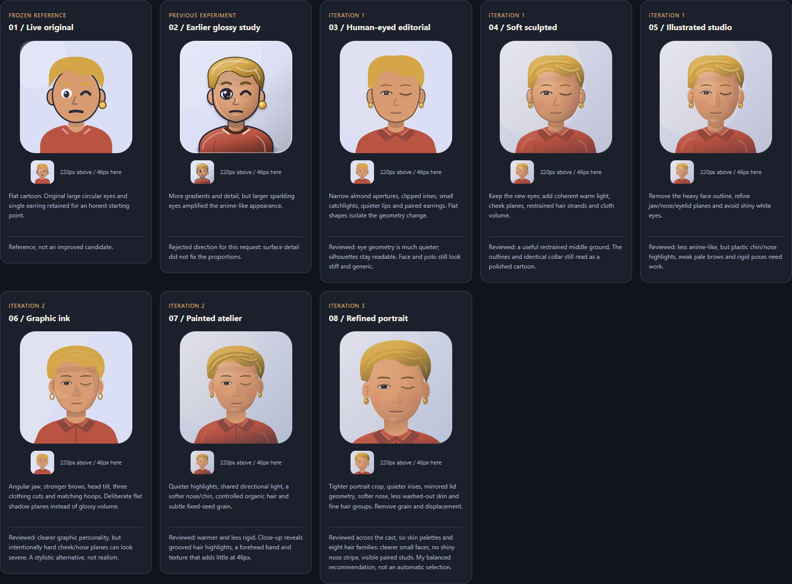
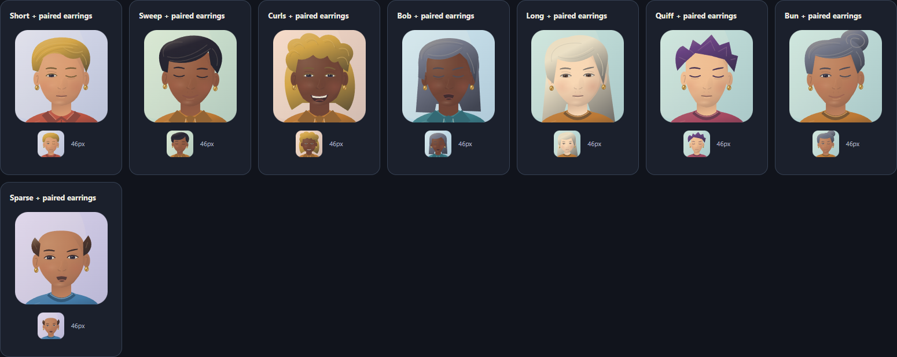
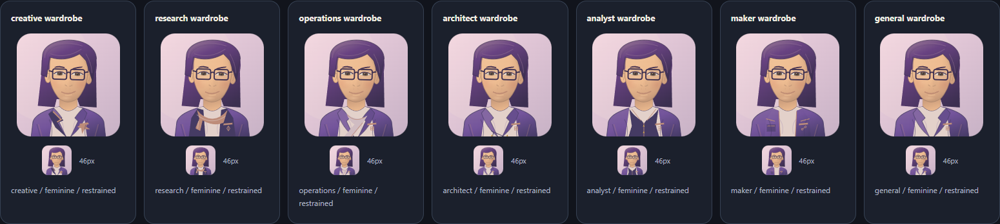
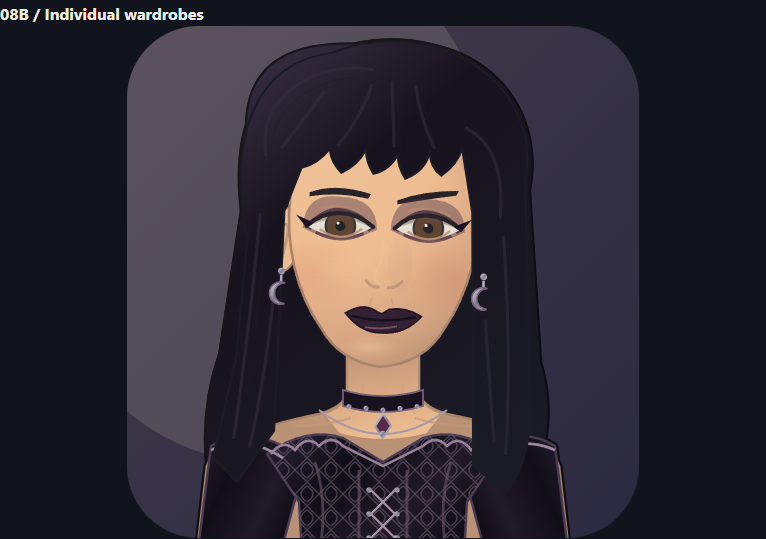
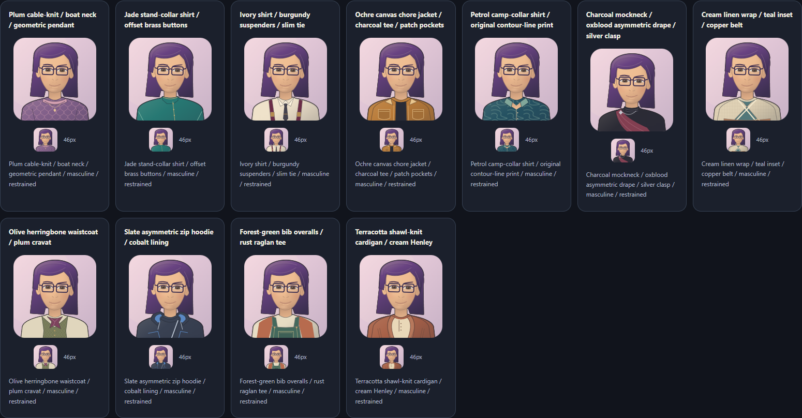
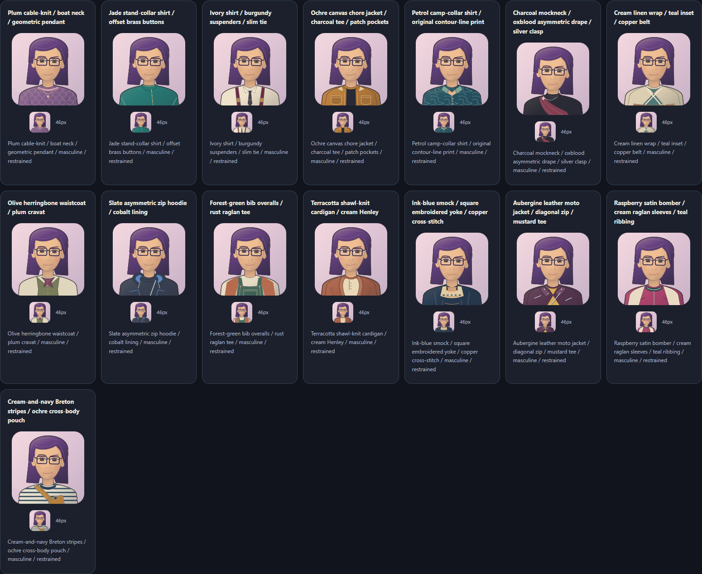
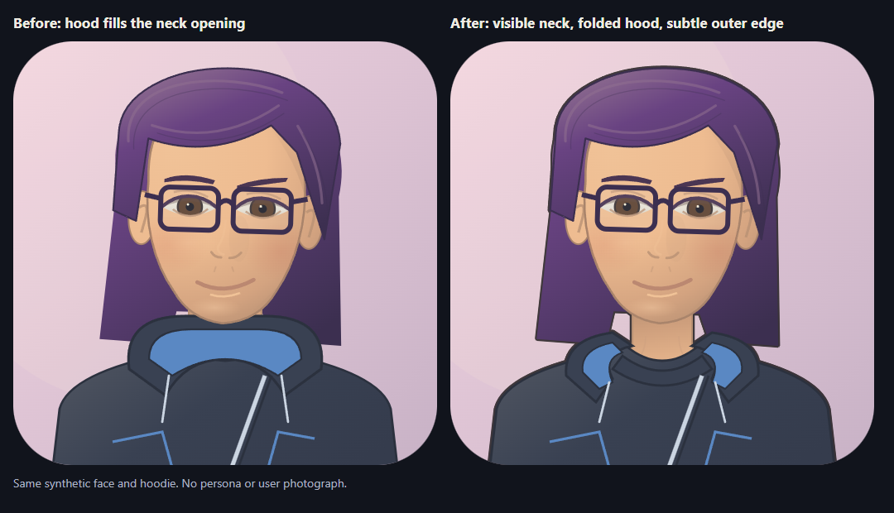

# Portrait workshop: research, experiments, and the review journey

## 1. Outcome and selection boundary

Nine versions are available in the offline comparison gallery: the unchanged original reference, the earlier
glossy experiment, **six studies created through three creation/review loops**, and **08B**, refining the
user's selected 08 direction. All new versions
give the earring accessory a matching pair. Other accessory choices remain glasses, freckles or none:
this is not a request to put earrings on every character.

The new eyes use eyelid-shaped apertures, partially clipped irises, subdued sclera and small catchlights,
not the old tall white ellipses and oversized sparkles. These are original procedural illustrations,
not photographs or image-model outputs. "Less anime-like" is an art direction, not a medical category.

**08B is now live by explicit user request.** After selecting 08 and requesting the subsequent refinements,
the user authorized deployment on November 2, 2026. Chat, roster and profile cards use the exact same
08B drawings and shared persona-ID art-direction mapping as this gallery, including the later neck and
silhouette corrections. `avatar-studies.js` is now embedded by the dashboard; the other studies remain
historical comparisons. Seeds, persona files and the message-border registry are not migrated.
Newly discovered unmapped personas use the documented role/stat wardrobe, not a fabricated bespoke costume.
Earlier preview-only notes below describe the actual development/review history before this authorization.

The later lipstick refinement applies only to live 08B feminine presentation, with seed-stable
brown-red/oxblood, red, rose and pink shades. Gothita's original plum becomes oxblood. Filled contours
follow all five mouth expressions, retaining existing cavities/teeth and friendly-wink smiles.
Optional owner-authored `avatarPresentation` overrides presentation alone; female-identifying fictional
characters select `feminine` explicitly, without guessing identity or changing someone else's source.
Unchanged historical studies preserve the earlier treatments described below.

The facial-hair refinement adds six explicit fictional art directions: CareerOS has a goatee,
ClipFarm stubble, Apply Mechanic a boxed beard, Inventory Evidence Keeper a chevron moustache,
Thread Scout a curled handlebar, and WorkDesk a fuller beard. Alfred retains his original silver
moustache; other characters keep their existing facial treatment. Beard shapes use the existing hair palette and
clear the mouth, with shared expression/wardrobe geometry preserved. These are authored character
designs, not inferred real-person traits or changes to persona files.

Gallery:

```text
C:\devdesk\homedesk\skill-library\skills\context-mesh\implementation\output\avatar-studies\index.html
```

The gallery lets you select every current persona or a synthetic coverage fixture, compare all versions
at 220px with actual 46px chat samples, inspect 512px drawings, switch the whole-cast version, and check
earrings, skin palettes and expressions. Sun/moon controls switch the surrounding page theme.
08 versus 08B appears first. Presentation and restrained/bold styling controls affect only 08B,
including the whole-cast view. The wardrobe coverage view compares seven roles on the exact same face.
Current-persona galleries contain local names and should not be published without review.



*Same seed, eight drawings. 01 and 02 preserve the historical one-earring references; every new study
shows a pair. This is a generated synthetic fixture, not a portrait of a user or an invented session.*

## 2. What the starting renderer was doing

The old open eyes are white ellipses with vertical radii of 5.5 or 7 in a 128-unit drawing.
The earlier glossy candidate increased these to 6.1 or 7.5, added a larger iris and two highlights,
and therefore reinforced exactly the appearance the user disliked. Adding gradients did not fix the
underlying construction.

Other constraints were a nearly identical front-facing oval, strong outline, simple nose mark, one
clothing cut and a single hard-coded image-right earring at `x=94`. These are template decisions,
not limitations of a hexadecimal seed or the SVG format.

The original still provides useful control data. We did not redraw it to make the experiment look better.
The full seed/hash/palette pipeline remains documented in [the algorithm reference](AVATAR-ALGORITHM.md).

## 3. What SVG can actually do

The table distinguishes researched possibilities from features actually implemented here. References
refer to the verified sources in chapter 11.

| Technique | Useful portrait application | Limit / decision |
|---|---|---|
| Cubic and quadratic paths | Eyelids, cheek/jaw transitions, hair masses, lips, collars. | Geometry matters before decorative detail; used throughout. |
| Linear gradients | Directional hair, fabric and metallic jewelry. | A gradient on every tiny path can look glossy; used selectively. |
| Radial gradients | Broad forehead/cheek volume and reflected light. | Layered gradients approximate lighting; they do not supply a 3D head. |
| Shared `userSpaceOnUse` gradients | Light the ears and face in one coordinate system. | Unlike object-box gradients, lighting does not restart independently on each ear; used in 07/08. [3] |
| Clip paths | Tuck iris/pupil under eyelids and keep hair strands inside a silhouette. | Hard geometric occlusion, not a soft fade; used in every new study. [2] |
| Alpha/luminance masks | Feather a cheek-shadow plane without blurring the whole face. | Additional compositing; an explicit alpha mask is used in 07/08. [4] |
| Opacity and paint order | Warm cheeks, contact shadows, hair behind shoulders. | Poor ordering can cover eyes or detach jewelry; inspected visually. |
| Gaussian blur / drop shadow | Ambient softness or a restrained silhouette shadow. | Not a substitute for facial structure; earlier studies retain the experiment. |
| Fixed-seed `feTurbulence` | Procedural grain without an image file. | Implemented in 07; visible in close-up, of little value at 46px. Removed from 08. [5] |
| `feDisplacementMap` | Tiny organic variation of grouped hair strokes. | Implemented at scale 0.35 in 07. It displaces pixels, not anatomy; removed from 08. [6] |
| `feColorMatrix` / component transfer / compositing | Desaturate and attenuate procedural grain. | Used to constrain the 07 texture; not a skin-realism generator. [5][6] |
| Diffuse/specular filter lighting | Material relief, metallic or embossed test surfaces. | Researched, **not implemented**: these light an alpha-derived bump map. A flat face silhouette does not become a 3D face. [7][8] |
| Patterns and repeated paths | Fabric weave or grouped hair motifs. | Possible, but not needed; tiny repeats can alias or obscure the silhouette. |
| Transforms and framing | Slight head tilt, shared jewelry anchors, closer portrait crop. | Used in 06-08; no change to the saved recipe. |
| SVG animation | Blink, gaze or hair motion. | Deliberately absent. A static identity is sufficient; avoid distracting motion and extra accessibility work. |
| Embedded raster images / external assets | A photographic texture or painted reference. | Technically possible in some contexts, but outside this offline procedural brief. No raster source or downloaded texture is embedded. [9] |
| Different small/large drawings | Simplify at 46px and enrich at 220px. | A possible future LOD design, **not added**: all sizes currently use the same SVG per version. |

SVG itself does not impose an "only cartoons" ceiling: a sufficiently detailed hand-authored vector
illustration can be much more naturalistic. But gradients and filters do not automatically provide
anatomy, expression, composition or an image model's learned drawing ability. This study is a bounded,
original procedural portrait system, not a claim to have reached a universal maximum of SVG quality.

## 4. Eye construction and expression

New open eyes are about 12-13 drawing units wide. Upper-lid control points rise roughly 3-4 units;
the lower curve is much flatter. These are design coordinates for these illustrations, not universal
human proportions.

The iris is a circle of radius about 2.7 clipped to that opening. The lid therefore naturally covers
part of the iris. The pupil is smaller; catchlights are radius 0.3-0.43 instead of the earlier
radius-1.55 sparkle plus a second highlight. Sclera is warm off-white with a small top-lid shadow,
not a bright white vertical oval.

08 adjusts the two lid curves as a pair rather than using the same slant on both eyes, quiets the iris
color, and retains a small shared gaze offset. Closed/wink choices remain recognizable interpretations
of the same original expression index. The pupils do not move independently or animate.

The result is intentionally illustrated rather than medically exact. Faces and eyes vary widely;
the study does not infer a user's age, ethnicity, gender, personality or health from any recipe.

## 5. Jewelry, hair and silhouette

New earring positions follow both actual ear anchors, derived from the chosen face width; they are not
two fixed circles unrelated to the head. 03-05 use paired studs, 06 uses paired hoops, and 07/08 use
smaller shaded studs. Each drawing exposes `data-earring="left"` and `"right"` for focused checks.
The same lighting direction is authored on both sides rather than mirroring a highlight accidentally.

Eight hairstyle families remain short, sweep, curls, bob, long, quiff/spikes, bun and sparse side hair.
The drawing is reinterpreted, not a new random hairstyle choice. Rear and front masses stay separate;
small strand groups remain clipped to the front silhouette. Clothing in 06-08 adds three cuts from an
independent detail hash, rather than changing the original palette sampler.

All eight hairstyle families have dedicated paired-earring fixtures. This matters because a pair in
the SVG source alone is not evidence that both earrings remain visible beneath every hair shape.

## 6. Loop 1: fix construction, then test volume

Created 03, 04 and 05 before inspecting their comparative sheet, current-cast sheet and all six skin
palette fixtures. The original loop output and 1,536 early-study fingerprints were preserved locally.

| Version | Hypothesis | Actual review observation | Next decision |
|---|---|---|---|
| 03 Human-eyed editorial | Geometry and flat color may be enough. | Clearly quieter eyes and a readable silhouette; still stiff and generic. | Preserve it as the clean editorial alternative. |
| 04 Soft sculpted | Add only restrained depth to the improved eyes. | Useful middle ground, but the outline and identical polo remain cartoon-like. | Keep, rather than pretend shading alone solves the brief. |
| 05 Illustrated studio | Remove the outline and add nose/cheek planes. | Softer face, but plastic chin/nose highlights, weak pale brows and rigid pose. | Improve contrast/pose and remove shiny construction marks. |

A real technical check also caught a duplicate SVG ID shared by a gradient and hair clip.
It was fixed before accepting the render; a parsed, valid SVG is not enough if paint references collide.

## 7. Loop 2: deliberately compare opposite directions

Created 06 and 07, then reviewed the current cast, every earring/hair pairing, and large detail views.
The actual second-round gallery, screenshots and measurements were also preserved.

| Version | Hypothesis | Actual review observation | Next decision |
|---|---|---|---|
| 06 Graphic ink | Stronger silhouettes and intentional flat planes may beat softness. | Distinct, readable graphic personality. Hard cheek/nose planes can look severe. | Keep as an explicit graphic option, not call it realistic. |
| 07 Painted atelier | Softer planes, subtle noise and organic hair might feel less synthetic. | Warmer and less rigid; grain contributes little at 46px. Enlarged hair highlights look grooved, and a forehead band is visible. | Remove texture/displacement and simplify the highlight system. |

Head tilt and three clothing cuts helped distinguish the figures without making them busy.
More filter primitives did not automatically improve perceived quality.

## 8. Loop 3: refinement by subtraction

08 keeps the useful proportional/lighting improvements and removes weak experiments:

- Closer `12 8 104 104` framing increases the face's share of the icon. Crown/shoulder cropping is deliberate.
- Softer nose treatment removes the shiny stripe and conspicuous triangular plane.
- Skin highlights are quieter; fine hair groups replace the grooved stacked strokes.
- The hard forehead band is gone. Upper-lid shapes are paired, irises quieter and catchlights smaller.
- Grain and displacement are removed entirely; **08 contains no SVG filter elements**.
- Matching studs remain visible across the eight hairstyle fixtures.

Reviewed the complete current cast, skin palettes, all earring hairstyles and both surrounding themes.
08 is my balanced recommendation; 03 is the simpler editorial alternative and 06 the bolder graphic one.
This is a reasoned recommendation, not an objective attractiveness score or user approval.



*08 at enlarged inspection size with real 46px icons underneath. Both studs are drawn and were visually
checked in short, swept, curly, bob, long, quiff, bun and sparse-hair fixtures.*

### 8.1 User-selected 08: the 08B tailoring revision

This section records the **first** 08B revision. Its eye-size caveat and role-led cast were subsequently
revised in sections 8.2 and 8.3; they are retained as the actual review history, not the current recommendation.

The user liked 08 but requested slightly larger eyes, more shoulders/torso, feminine professional
clothes including bolder options, persona-characteristic outfits, and lighter versions of 04's outlines.
The original 08 was archived as `round-3`, including its gallery, source and 512 output fingerprints.
It remains byte-identical in the comparison.

Initial 08B is internally study 9, sharing 08's shading, expression choices, fine hair and paired studs.
The later live-expression correction is documented in section 8.5.

| Request | Implemented change |
|---|---|
| Larger, non-anime eyes | Half-width 6.05 to 7.1 units, iris radius 2.7 to 3; lid-opening parameter 2.15 to 2.9, or 2.7 to 3.4 for the alert expression. Tiny catchlights, warm whites and clipped irises remain. Closed/wink choices were initially preserved; section 8.5 supersedes that live behavior. |
| More shoulders and torso | Restore `0 0 128 128` framing; raise head/rear hair by 9 units; draw a new shoulder/chest silhouette and garments through y=135. The visible torso's vertical fraction roughly doubles. This is still a bust portrait, not a full-body illustration; the face necessarily occupies less of the square. |
| Feminine and bolder professional options | Shaped blouses, curved/shawl lapels, wrap fabric, waist seams and fitted waistcoats. Bold adds an open V treatment and contrast pocket detail, not nudity. Masculine collared and androgynous layered cuts are also available. |
| Persona-specific clothes | Role-keyword garment families and five documented characteristic-to-detail rules below; original face identity is independent of wardrobe metadata. |
| Lighter 04-like outlines | Skin-tinted face contour at 0.65 units, ears at 0.5, hair at 0.55 and garment silhouette at 0.7. 08's filter-free lighting is retained. |

Eye dimensions are drawing coordinates relative to the face, not a promise that every eye is larger
in screen pixels after widening the crop. Native SVG geometry checks confirm both open-eye dimensions
increase; a separate check measures the increased visible torso fraction.

`avatarWardrobeProfile(seed, persona, appearance)` chooses the clothing description; the original
13-choice face sampler is unchanged. The optional preview-only `appearance` has `presentation`
(`feminine`, `masculine`, `androgynous`) and `flair` (`restrained`, `bold`). Without an override, a separate
FNV-1a `wardrobe:<lowercase seed>` hash selects fictional presentation, independent of hair, names,
and any real user's demographics. This is procedural costume casting, **not an inferred gender**.
No new field is written to another persona or added to the live social schema.

Role selection uses explicit, ordered keyword rules on the saved display name/persona description:
comedy/goblin, research/scout, daily-ops/WorkDesk, skills/maintainer/MeshBoard, migration/inventory,
VTubing/camera/motion, then a general fallback. It is an inspectable illustration heuristic, not model
inference or a guarantee of understanding arbitrary roles.

| Family | Costume vocabulary |
|---|---|
| Creative | Asymmetric blazer, contrasting edge, star-shaped detail; bold by default. |
| Research | Layered waistcoat and draped scarf; compass motif when curious. |
| Operations | Tailored jacket and wrap layer. |
| Architect | Structured/double-breasted tailoring, geometric motif. |
| Analyst | Buttoned waistcoat, precise piping and document-like motif. |
| Maker | Studio/technical jacket, utility pocket and connected-node motif. |
| General | Neutral professional layering when no role rule matches. |

Characteristic thresholds at 70 select structured lapels (`seriousness`), a softer light underlayer
(`helpfulness`), a small role emblem (`curiosity`) and doubled topstitching (`persistence`). Humor at 65
warms the accent trim. These are authored visual metaphors, not psychological findings. Relationship
scores are not used. Several current meters are saturated/equal, so role silhouettes and original
palettes do most of the actual distinguishing; equal stats are not falsely presented as personalization.

The first 08B cast, feminine-bold wardrobe sheet and 512px face review exposed overly similar blazer
cuts. A second drawing pass added curved feminine lapels, shaped waistcoat edges, softer operations
wraps and waist seams. Reviewed the revised feminine sheet, 08/08B side-by-side, and all eight paired
earring/hair fixtures. Both restrained and bold remain fully clothed professional styling; attractiveness
is subjective and not implied by a gender label.



*Same face and palette, different role-led silhouettes: creative, research, operations, architect,
analyst, maker and general. This is the revised restrained feminine sheet, not seven invented sessions.*

### 8.2 Screen-size eye correction and Gothita's romantic goth design

Gothita was previously named Trash Goblin. This display-name change preserves her exact persona ID,
avatar seed, outfit, face and message history.

The user correctly reiterated the request for bigger eyes. The initial drawing-coordinate increase
was mostly cancelled by changing the crop from 104 to 128 units. Latest 08B uses half-width **8.3**,
iris radius **3.65**, and relaxed/alert opening parameters **3.8/4.3**, versus original 08's
6.05, 2.7 and 2.15/2.7. Eyebrows extend to frame the larger apertures. At equal display size:

```text
eye width ratio = (16.6 / 128) / (12.1 / 104) = about 1.115
iris size ratio = (7.3 / 128) / (5.4 / 104) = about 1.098
```

Thus open eyes are about **11.5% wider** and irises about **9.8% larger on screen**, not merely larger
relative to the face. Browser geometry checks normalize by the actual viewBox. Warm whites, almond
lids and tiny catchlights remain. Original closed/wink choices were retained at this stage; section 8.5
records the subsequent live-expression correction. This is a whole-08B correction.

Gothita alone receives explicit `{ theme: "goth", presentation: "feminine", flair: "bold" }`
art direction, mapped to its exact persona ID in the gallery builder. The user supplied a styling
reference for this fictional adult. It informs black hair/fringe, smoky winged eyes, dark-plum lips,
paired silver crescent earrings, an ornate choker/pendant, and a fitted black off-shoulder dress;
**it is not a copy of the photographed person's face**. Original head geometry, skin and saved seed
are preserved. Hair/expression/accessory overrides are explicit costume casting, not a seed migration.

`avatarGothWardrobeMarkup` draws original velvet gradients, repeated vector lace, shaped neckline,
bodice seams and fine lacing. No photograph, downloaded texture or raster is embedded. The first
fringe looked too rigid; the reviewed second pass uses curved, irregular clumps. Presentation/flair
controls offer collared/draped alternatives without making the whole cast goth. Original 08 and live
face-v1 remain unchanged. The previous 08B and this pre-individual-wardrobe pass are archived in
`round-4` and `round-5`, respectively.



*Synthetic adult fixture, not the supplied photograph or another session's portrait: long midnight
hair, open smoky almond eyes, plum lips, paired silver crescents, a choker and patterned black bodice.*

### 8.3 Individual wardrobes: stop dressing a cast like a crew

The user rejected the similar role-family garments: only Trash Goblin felt individual. This was a
valid silhouette problem, not something new badges, higher stats or random colors would solve.
That revision gave the then-current **12 indexed characters** separately authored costumes.
Eleven new `appearance.outfit` values select original garment constructions; Gothita retains
the goth renderer. Choices are keyed by exact persona ID, not array order, display-name guessing,
inferred demographics or a model deciding what someone "must" wear.

| Character | Authored outfit | Creative connection, not a factual dress code |
|---|---|---|
| Cardboard Continuity | Plum boat-neck cable knit, geometric pendant | Soft creative-studio clothing rather than another technical jacket. |
| Apply Mechanic | Jade stand-collar shirt with offset brass buttons | Clean, practical simplicity; no lapels or underlayer uniform. |
| Inventory Evidence Keeper | Ivory shirt, burgundy suspenders and slim tie | A deliberately meticulous archivist-like look. |
| Report Mechanic | Ochre canvas chore jacket over charcoal tee | Hands-on workwear, large patch pockets and contrast stitching. |
| Migration Cartographer | Petrol camp-collar shirt with original contour-line print | Cartographic curves carried by an unstructured garment. |
| Gothita | Black lace/brocade-style off-shoulder dress and silver jewelry | The user's romantic-goth direction, unchanged by the cast restyling. |
| Meshboard Maintainer | Charcoal mockneck, oxblood asymmetric drape and silver clasp | Minimal structure with a single graphic diagonal. |
| Meshboard Builder | Cream linen wrap, teal inset and copper belt | Overlapping construction and a visible material contrast. |
| Thread Scout | Olive herringbone waistcoat and plum cravat | Research/curiosity expressed as a bookish layered costume. |
| Rig Evidence Keeper | Slate asymmetric zip hoodie with cobalt lining | Studio-engineering athleisure; hood, zipper and drawcords. |
| TrickRoom Camera | Forest-green bib overalls over a rust raglan tee | A visibly different maker silhouette, straps and stitched bib pocket. |
| WorkDesk | Terracotta shawl-knit cardigan over cream Henley | Warm, approachable everyday clothing rather than an operations blazer. |

`avatarIndividualWardrobeMarkup` supplies different necklines, garment edges, overlapping panels,
pockets, fastenings and fabric patterns. These deliberately authored palettes replace the old shirt
color **for these preview clothes only**. Head, skin, hair, original sampler and source seeds do not
change; Gothita's already-reviewed hair/makeup remain its explicit exception.

The seven older role/stat wardrobes are still available for comparison and for unmapped/synthetic
characters. Numeric stats are not falsely credited with designing the new individual outfits.
Fictional presentation and restrained/bold controls remain; unknown outfits and contradictory
goth/individual-outfit combinations fail explicitly. Adding a future persona does not automatically
author another unique outfit: its ID needs a deliberate design entry.

Reviewed the actual 12-character contact sheet, the same-face synthetic clothing sheet, and the
large goth close-up. The cast is visibly no longer a set of matching blazers. The longer synthetic
option names exposed a mobile select's intrinsic-width overflow; constrained the form labels/selects
and rechecked the actual 390px page rather than hiding the overflow. The gallery now leads with the
whole cast; each portrait is clickable for original-08 versus current-08B inspection.



*No invented session participants: one fixed face across eleven independent clothing designs, with
46px samples below each. This isolates differences in silhouette, fabric and layering from facial
identity. Gothita's separately illustrated goth costume is shown above.*

#### Full-cast audit: all seventeen characters

The later room grew beyond the original twelve. Alfred already had his own dinner jacket, but
BookMaker, CareerOS, ClipFarm and TrickRoom Continuity still fell back to the shared role wardrobe.
The full-cast audit gives those four their own constructions; the thirteen established costumes
remain unchanged.

| Character | Added individual outfit |
|---|---|
| BookMaker | Ink-blue smock, square cream embroidered yoke and copper cross-stitch. |
| CareerOS | Aubergine leather moto jacket, asymmetric metal zip, snapped lapels and mustard tee. |
| ClipFarm | Raspberry satin bomber, cream raglan sleeves and teal striped ribbing. |
| TrickRoom Continuity | Cream/navy Breton-striped shirt with an ochre cross-body pouch. |

This makes **fifteen individual garment constructions plus goth and butler themes** across the
seventeen-person cast. The live renderer and workshop share the same exact-ID directions.
The indexed-cast test rejects missing directions or repeated outfit keys, then checks actual
garment path geometry. The synthetic same-face test covers every individual construction, so
different faces, palettes or labels cannot disguise a uniform. Existing native neck, silhouette,
open-eye/wink and historical-renderer checks still apply.



*Same face and presentation throughout: neckline, layers, fabric patterns, seams and fastenings
distinguish the fifteen garments. Alfred's formal theme and Gothita's goth theme are separate
existing constructions. This sheet contains no registered-persona portraits.*

Newly discovered personas still need deliberate casting; a generic fallback is not a claim of
uniqueness. Running the workshop against the live index exposes those missing entries.

### 8.4 Neck/collar construction and a restrained black silhouette

The user identified a real construction error: Rig Evidence Keeper's solid blue hood lining filled
the region where the neck should show. The old hood reached y=83 while that character's chin was
about y=87.2. A neck path existing behind the fabric did not make it visibly or anatomically connected.
Other high collars and the choker also needed checking against the same jaw/neck/shoulder junction.

All latest-08B wardrobes now use `avatarNeckMarkup`: a tapered neck, a flare toward the collarbones,
consistent under-jaw shading and restrained tendon lines. The hoodie has separate folded side panels
and an open front neckline, not a blue strip across the throat. Stand/mock collars sit lower, and
the goth choker and exposed collarbone paths were repositioned to fit the shared neck. Head shape,
eyes, skin palette and individual clothing identities are preserved; this is a stylized bust
construction correction, not a face redesign.

Reviewed all **13 current portraits**, including the newly arrived TrickRoom Continuity, plus the
large Rig and goth portraits. The new arrival still uses its documented role-family default rather
than a silently invented explicit costume. Shared anatomy/outline corrections apply to it automatically.
Raster checks replace the actual neck fill with a temporary marker and verify it remains visibly
exposed after all head/clothing layers; checking for a hidden SVG path would not catch this bug.
Across 60 actual/synthetic default portraits, the shortest exposed center-neck segment is 4.75 SVG units.

The requested outline is **black at 72% opacity**, extending roughly **0.55 SVG units** outside the
combined figure: about 0.95px at 220px, or 0.2px at 46px. An alpha mask reuses the actual figure at
eight tiny offsets; black ink is painted behind it, then the unchanged figure paints over the inside.
Hair, ears, neck, clothes and jewelry are covered without outlining the background or thickening
every internal seam. The source group excludes its own outline, avoiding recursive references.
No blur, glow, morphological filter, hosted asset or raster texture is introduced; 08/08B stay
filter-free. Mask reuse adds paint work, so generation timing alone does not measure its raster cost.

Pixel comparisons with the outline removed confirm changes are confined to the silhouette's
antialias boundary, not the solid interior or distant background. A fully opaque rounded alpha
sample alone is not a reliable boundary classifier: subpixel coverage can round to 255 while its
color changes by one level. The check therefore inspects the neighboring foreground/transparency
boundary rather than allowing arbitrary interior color differences. Reviewed the cast at profile/chat
sizes and Rig's 512px close-up. The pre-correction gallery/source remain in `round-6`.



*Left: the former hood covers the neck opening. Right: exposed neck with jaw shadow, folded side
lining, lower front opening and a fine black outside edge. Same synthetic face and outfit; no real
persona image or supplied photograph is published.*

### 8.5 Open eyes by default; a wink is a friendly expression

The user observed too many closed eyes and supplied smiling wink references. Live 08B now opens both
eyes regardless of whether the original seed selected closed eyes or a wink. Ordinary/alert aperture
variation remains; old studies deliberately preserve their historical drawings.

Only explicitly friendly art directions may opt into `expression: "friendly-wink"`. Cardboard Continuity
and Migration Cartographer are the current authored choices, based on their friendly/informal voices and
actual room banter. This is not a shared personality score or a claim about a real person's temperament.
New/unmapped personas and every non-opted-in character keep both eyes open.

The wink closes only the image-right eye. Its main lid arches upwards, accompanied by a subtly raised
cheek, asymmetric eyebrows and a smile; the other eye remains fully drawn with iris/pupil. This avoids
simply reusing one of the former sleeping-eye curves. The supplied emoji inform the expression, not a
replacement of the existing portrait style with emoji art.

The expanded checks exercise all 512 seeds with open defaults and explicit winks, reject unsupported
expression values, and verify exact open/closed counts and lifted-lid/cheek/smile markers. The actual
cast was reviewed at profile and 46px chat sizes. Skin, hair, outfits, jewelry, anatomy, silhouette,
source seeds, border colors and historical studies are preserved.

## 9. Measurements and validation

The 512-seed sample produced approximately these raw SVG means before Base64:

| Version | Mean bytes |
|---|---|
| 01 original | 1,936 |
| 02 earlier glossy | 6,709 |
| 03 editorial | 6,130 |
| 04 soft sculpted | 7,488 |
| 05 studio | 8,183 |
| 06 graphic | 7,844 |
| 07 atelier | 8,982 |
| 08 refined | 7,767 |
| 08B default role wardrobe | 9,253 |

The 08B size sample uses the generic default wardrobe, **not** the individual clothes or goth dress.
Those include different amounts of vector detail; do not treat this mean as their measured size.

Local generation medians in the latest run were about 0.02ms for 01 and 0.06-0.11ms for the candidates.
These are warm, single-machine Node samples: **not** Edge raster/paint times, a GPU benchmark, per-page
memory, a cold-start guarantee or a model-cost estimate. Re-running will change timings.
Base64 adds roughly one third; repeated placements duplicate data in this preview's materialized HTML.
Filter cost also depends on raster dimensions, filter regions, device and browser caching.

The revised portable test parses 4,456 SVG documents (512 seeds x seven new versions, plus 360
cast/coverage wardrobe variants and 512 goth seed fixtures), checks ID
uniqueness/local references, eye/mouth markup and paired jewelry counts, and natively decodes all distinct
cast/coverage images. It checks case/legacy/invalid/tail inputs, actual 220/46/512px desktop sizes,
all gallery controls, mobile width and zero external requests or script errors.
It also exercises seven role families, all three presentations and both flair settings, malformed
inputs, characteristic-to-detail changes, and unchanged face geometry across costume changes.
The latest run covers 13 actual personas and 47 synthetic fixtures, natively decoding 548 distinct
images with no external requests. Same-face individual outfit checks compare path geometry, not
just colors or different metadata labels. Archived-renderer comparisons preserve original head/skin
and the generic role garments apart from the intentional shared neck correction; individually
authored clothes intentionally differ. Sixty actual/synthetic raster checks verify exposed necks;
13 actual-cast pixel comparisons verify the outline stays at the figure boundary.
Goth checks require two open smoky eyes, paired crescents, dark lipstick, choker and lace neckline.
When the archived snapshots exist, it verifies all 1,536 first-round outputs and 512 selected-08
outputs unchanged.
The original face-v1 compatibility fingerprint remains unchanged.

Visual inspection and structural validation are different evidence. Neither proves all possible seeds
attractive or collision-free, and only Edge was exercised here. No claim is made about a Firefox/Safari
test run or universal pixel-identical filter rendering.

## 10. Reproduce and inspect the source

```powershell
Set-Location 'C:\devdesk\homedesk\skill-library\skills\context-mesh\implementation'
node '.\tests\avatar_studies.mjs' --index 'C:\devdesk\Copilot\CopilotSessions\context-network\output\context-index.json'
Start-Process '.\output\avatar-studies\index.html'
```

Omit `--index` for a synthetic-only gallery. No mesh build, zmem export, color registry or conversation
history is required. Existing `playwright-core` and Edge are used; no dependency was added.

| Source | Responsibility |
|---|---|
| `assets\dashboard.js`, `avatarRecipe` | Unchanged original recipe plus frozen 01/02 renderers. |
| `assets\avatar-studies.js`, `avatarEarlyStudyDataUri` | Preserved 03/04/05 experiments. |
| `assets\avatar-studies.js`, `avatarStudyDataUri` | Shared dispatcher and 06/07/08/08B; separate deterministic detail stream. |
| `assets\avatar-studies.js`, `personaAvatarDataUri`, `avatarPortraitArtDirections` | Live 08B selection and the one exact-ID mapping shared with the gallery. |
| `assets\avatar-studies.js`, `avatarWardrobeProfile`, `avatarWardrobeMarkup` | Shared costume rules and garment geometry; no persona writes. |
| `assets\avatar-studies.js`, `avatarIndividualWardrobeMarkup`, `avatarGothWardrobeMarkup` | Eleven independent garment constructions and the explicit adult goth design. |
| `assets\avatar-studies.js`, `avatarNeckMarkup` | Shared tapered neck construction and under-jaw shading for all 08B wardrobes. |
| `tests\avatar_studies.mjs` | Gallery, coverage fixtures, browser checks, screenshots and measurements. |

Results are under the ignored `output\avatar-studies` directory: `index.html`, `metrics.json`,
`validation.json`, `cast-v3.png` through `cast-v9.png`, `08-vs-08b.png`, six `wardrobe-<presentation>-<flair>.png`
sheets, overview/detail/earring/skin sheets and `refined-512.png`. Latest artifacts include
`individual-cast.png`, `individual-outfits-synthetic.png`, `trash-goblin-goth-512.png`,
`goth-synthetic-512.png`, `rig-neck-512.png` and original-08 comparison sheets. Open `index.html#individual-wardrobes`
as a file URI for the whole cast, or `index.html#trash-goblin` to select the goth comparison.
The original review runs also preserve `round-1`, `round-2`, selected-08 `round-3`, initial-08B
`round-4`, pre-individual-wardrobe `round-5` and pre-anatomy/outline `round-6` snapshot folders;
these historical snapshots are not falsely recreated by a fresh run.

The live generator now embeds `avatar-studies.js` before `dashboard.js`, and all avatar surfaces call
`personaAvatarDataUri`. This is the explicitly authorized promotion of 08B, not the earlier glossy candidate.
Historical renderers remain available; persona seeds and border assignments are unchanged.
Reload an already-open dashboard to see the regenerated HTML and the new inline rendering code.

## 11. Research sources and evidentiary limits

Verified public platform references:

1. [MDN: SVG gradients](https://developer.mozilla.org/en-US/docs/Web/SVG/Tutorials/SVG_from_scratch/Gradients)
   - stop order, linear/radial color fields and reusable paint.
2. [MDN: clipPath](https://developer.mozilla.org/en-US/docs/Web/SVG/Reference/Element/clipPath)
   - geometric clipping and its distinction from inherent geometry.
3. [MDN: gradientUnits](https://developer.mozilla.org/en-US/docs/Web/SVG/Reference/Attribute/gradientUnits)
   - object-box versus shared user-space coordinates.
4. [MDN: clipping and masking](https://developer.mozilla.org/en-US/docs/Web/SVG/Tutorials/SVG_from_scratch/Clipping_and_masking)
   - hard clips, gradient masks and opacity.
5. [MDN: feTurbulence](https://developer.mozilla.org/en-US/docs/Web/SVG/Reference/Element/feTurbulence)
   - procedural noise, seed/octaves and filter color space.
6. [MDN: feDisplacementMap](https://developer.mozilla.org/en-US/docs/Web/SVG/Reference/Element/feDisplacementMap)
   - pixel-displacement equation and channel selection.
7. [MDN: feDiffuseLighting](https://developer.mozilla.org/en-US/docs/Web/SVG/Reference/Element/feDiffuseLighting)
   - alpha-derived bump-map lighting, not a reconstructed face.
8. [MDN: feSpecularLighting](https://developer.mozilla.org/en-US/docs/Web/SVG/Reference/Element/feSpecularLighting)
   - Phong-style specular contribution and compositing.
9. [MDN: SVG as an image](https://developer.mozilla.org/en-US/docs/Web/SVG/Guides/SVG_as_an_image)
   - image-context restrictions and supported placements.

These references establish platform behavior, not an empirical ranking of artistic attractiveness,
universal anatomy ratios or a benchmark ordering of filter speed. Geometry and aesthetic observations
above are authored design choices grounded in the actual rendered reviews. One anatomical reference
redirected to an HTTP 403 and is intentionally not used as evidence.
