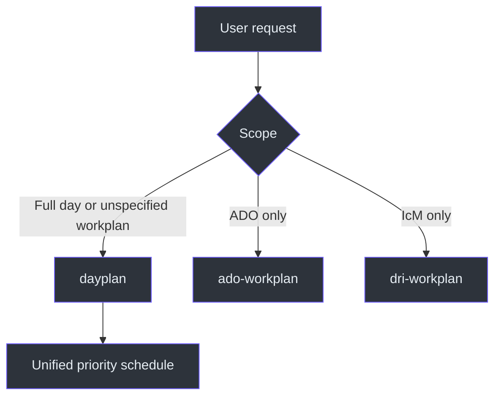
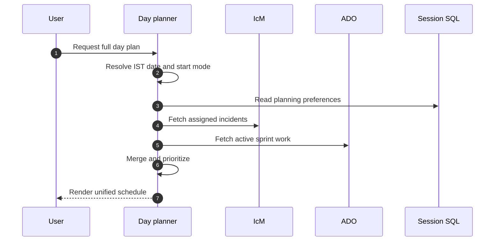

# Dayplan

## Purpose

`dayplan` creates one time-blocked schedule that interleaves DRI livesite work
and ADO sprint work. It is the combined route for users who want the full picture
rather than separate incident and engineering plans. Source:
[SKILL.md](SKILL.md#day-plan-generator-combined-dri--ado), `SKILL.md:L7-L11`.

The skill resolves competing work through an explicit priority model: active
Sev2 incidents always lead, active Sev3/4 incidents occupy early blocks as
needed, In Progress ADO tasks fill focus blocks, In Review work follows, and
mitigated incidents plus To Do ADO work move to the footer queue.
Source: [SKILL.md](SKILL.md#workflow), `SKILL.md:L128-L143`.

## At a glance

| Concern | Contract |
|---|---|
| Scope | Combined DRI/IcM and ADO |
| Default start | 11:00 IST |
| Explicit override | Start now/current time |
| Workday | 11:00-18:00 IST |
| Weekend | No work schedule |
| DRI-week capacity | About 50 percent allocated to IcM |
| Non-DRI behavior | Omit IcM section when no incidents are assigned |
| Live sources | IcM MCP and ADO MCP |
| Preferences/cache | Session SQL |
| File side effects | None specified in this snapshot |

Sources: [SKILL.md](SKILL.md#-critical-rules--date--time), `SKILL.md:L13-L17`;
[SKILL.md](SKILL.md#data-sources), `SKILL.md:L26-L31`;
[SKILL.md](SKILL.md#important-notes), `SKILL.md:L145-L155`.

## Routing architecture

Generic "workplan" requests route here when the user does not specify DRI or ADO.
Source: [SKILL.md](SKILL.md#when-to-use-this-skill), `SKILL.md:L19-L24`.

## End-to-end lifecycle

Source: [SKILL.md](SKILL.md#workflow), `SKILL.md:L128-L143`.

## Documentation map

| Document | Focus |
|---|---|
| [Architecture](docs/ARCHITECTURE.md) | Combined data model, boundaries, and integrations |
| [Workflow](docs/WORKFLOW.md) | Detailed routing, merge, and scheduling control flow |
| [Reference](docs/REFERENCE.md) | Rules, priorities, URLs, formatting, and quick reference |
| [Examples](docs/EXAMPLES.md) | DRI week, non-DRI week, current-time, forecast, and failure examples |
| [Operations and Testing](docs/OPERATIONS-AND-TESTING.md) | Runbook, validation matrix, troubleshooting, and maintenance |

## Core invariants

1. Fetch the date; never guess it.
2. Display all current times in IST.
3. Start at 11:00 unless the user explicitly requests current-time planning.
4. Put active Sev2 incidents ahead of all other work.
5. Reduce ADO expectations during DRI week.
6. Do not schedule weekend work.
7. Keep clickable links outside code fences.
8. Mark stale incident data if the IcM source times out.

Sources: [SKILL.md](SKILL.md#-critical-rules--date--time),
`SKILL.md:L13-L17`; [SKILL.md](SKILL.md#workflow), `SKILL.md:L128-L143`;
[SKILL.md](SKILL.md#important-notes), `SKILL.md:L145-L155`.

## Evidence boundary

This documentation is limited to the checked-in `SKILL.md`. It does not assume
that the sibling skills are invoked internally, that ADO notes are persisted, or
that an unspecified MCP retry mechanism exists. The source describes combined
behavior and named data sources, but no file-writing step.

