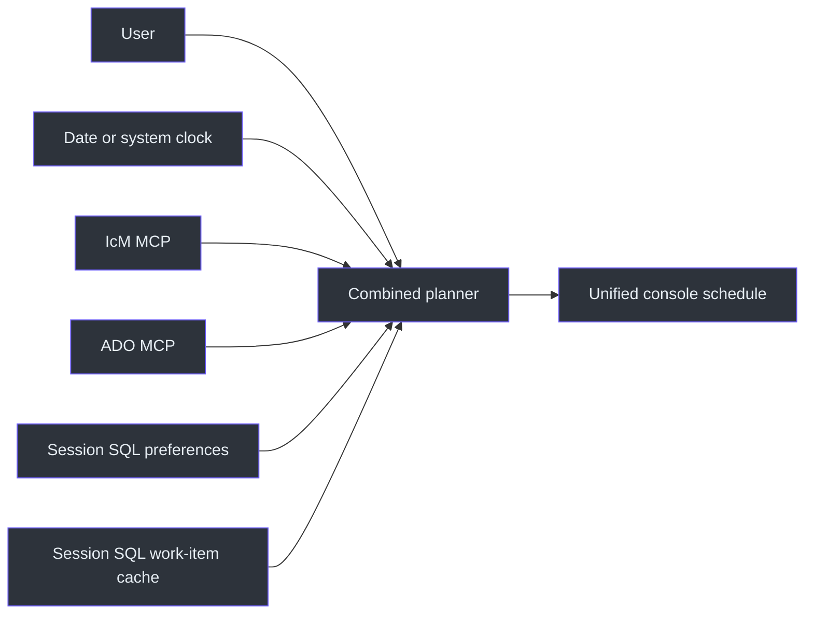
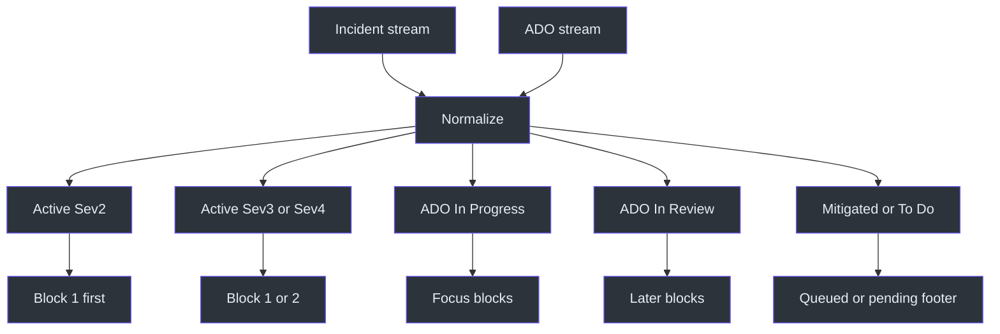
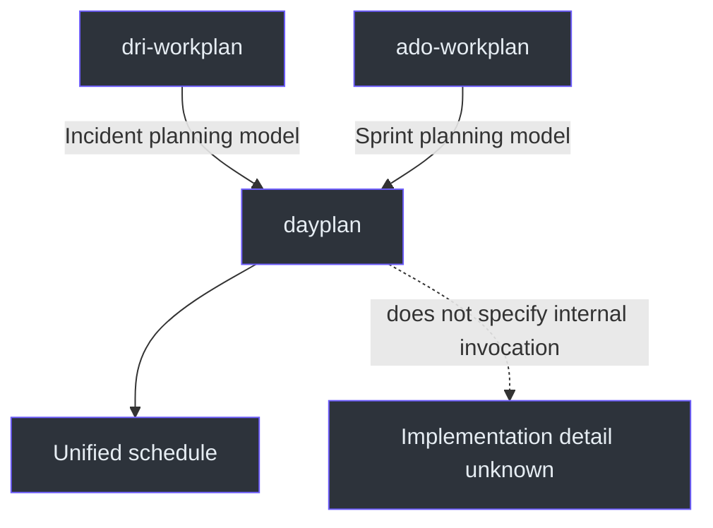

# Dayplan Architecture

## Overview

The combined planner exists because incident response and sprint execution
compete for the same day. Separate lists would hide that contention. `dayplan`
normalizes both domains into one schedule and resolves contention through
severity, state, DRI-week capacity, and block timing.
Source: [SKILL.md](../SKILL.md#day-plan-generator-combined-dri--ado),
`SKILL.md:L7-L11`; [SKILL.md](../SKILL.md#workflow), `SKILL.md:L128-L143`.

## System context

The source lists four operational data dependencies and one date/time dependency.
Source: [SKILL.md](../SKILL.md#data-sources), `SKILL.md:L26-L31`;
[SKILL.md](../SKILL.md#-critical-rules--date--time), `SKILL.md:L13-L17`.

## Component model

| Component | Responsibility | Evidence |
|---|---|---|
| Trigger router | Select combined planning for full-day or unspecified workplan requests | `SKILL.md:L19-L24` |
| IST resolver | Fetch date, display IST, apply start override | `SKILL.md:L13-L17` |
| Preference loader | Read routine, style, hierarchy, and DRI context | `SKILL.md:L33-L42` |
| Incident reader | Fetch assigned Sev2/3/4 Active, Mitigating, and Mitigated incidents | `SKILL.md:L26-L29` |
| ADO reader | Fetch current ADO work | `SKILL.md:L29-L31` |
| Merger | Normalize and interleave work by priority | `SKILL.md:L128-L143` |
| Renderer | Emit the shared two-column schedule | `SKILL.md:L44-L88` |
| Staleness handler | Use last known IcM data and disclose staleness on timeout | `SKILL.md:L151-L153` |

## Domain merge

Source: [SKILL.md](../SKILL.md#workflow), `SKILL.md:L134-L140`.

## Time architecture

The default schedule is anchored to 11:00 IST even if the request arrives later.
Only explicit language such as "starting now" or "from current time" changes the
start point. The workday template ends at 18:00. Source:
[SKILL.md](../SKILL.md#-critical-rules--date--time), `SKILL.md:L13-L17`;
[SKILL.md](../SKILL.md#schedule-template-ist--combined), `SKILL.md:L115-L126`.

DRI week adds a capacity partition: about half of the day is allocated to IcM,
reducing ADO expectations. Outside DRI week, the incident section is minimal or
absent when no assigned incidents exist. Source:
[SKILL.md](../SKILL.md#workflow), `SKILL.md:L140-L141`;
[SKILL.md](../SKILL.md#important-notes), `SKILL.md:L149-L153`.

## Rendering architecture

The output consists of multiple fenced box segments interrupted by clickable
Markdown bullets. This avoids sacrificing terminal alignment for link behavior.
The box uses a time column and a content column, short lines, dashed separators,
sub-item markers, an insight footer, and a queued section.
Source: [SKILL.md](../SKILL.md#key-rules), `SKILL.md:L78-L88`.

## Sibling integration

The source calls `dayplan` the combined output of the two sibling skills, but
does not specify whether it invokes them, copies their results, or independently
implements the same policies. Source:
[SKILL.md](../SKILL.md#day-plan-generator-combined-dri--ado),
`SKILL.md:L7-L11`.

## Persistence boundary

Unlike the ADO-only snapshot, this `dayplan` snapshot does not define a
Zettelkasten path, note-reconciliation step, or any file update. Its workflow
ends with rendering and an actionable insight. Therefore, file side effects are
not part of the documented `dayplan` contract.
Source: [SKILL.md](../SKILL.md#workflow), `SKILL.md:L128-L143`.

## Safety boundaries

- Never guess the date.
- Never display current time in a non-IST zone.
- Never plan weekend work.
- Never silently present stale fallback incidents as fresh.
- Never let sprint work displace an active Sev2 incident.
- Never invent assigned incidents on a non-DRI week.

Sources: `SKILL.md:L13-L17`; `SKILL.md:L134-L141`;
`SKILL.md:L145-L153`.

## References

The sole normative source is [SKILL.md](../SKILL.md). No implementation files,
schemas, or tests are included in this skill snapshot.

