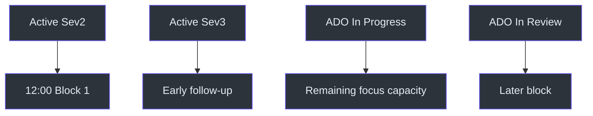
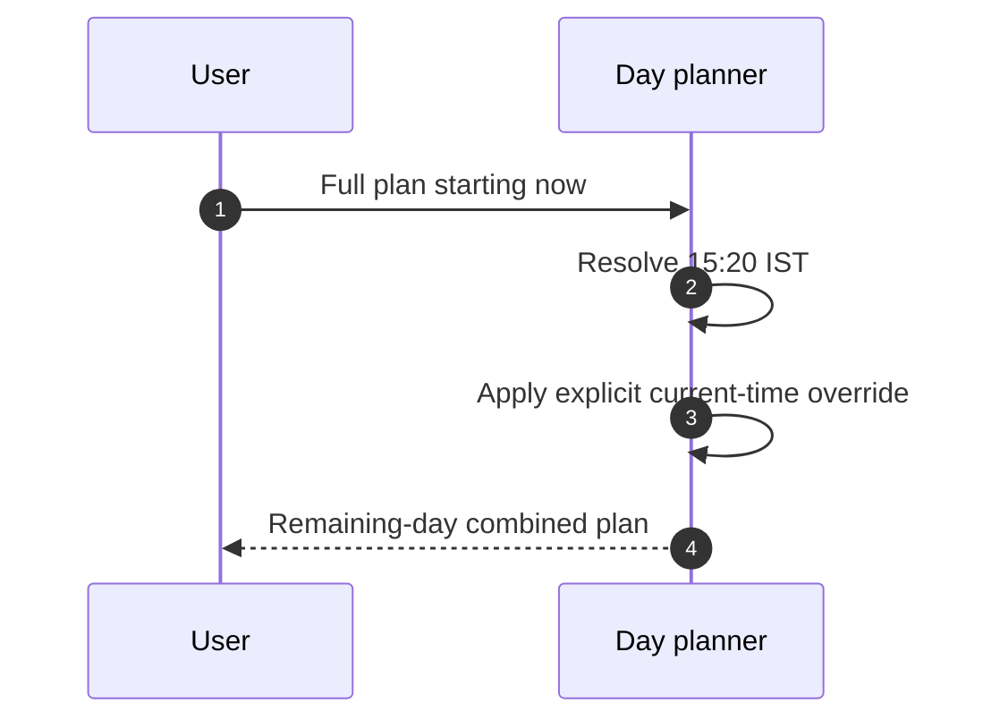

# Dayplan Examples

## Example conventions

IDs and titles below are fictional. Examples illustrate the rules in
[SKILL.md](../SKILL.md#workflow), `SKILL.md:L128-L143`, and do not represent
live incidents or work items.

## Example 1: Active DRI week with a Sev2

### Inputs

- Tuesday in an active DRI week, therefore Day 2.
- One active Sev2 incident.
- One active Sev3 incident.
- Two In Progress ADO tasks.
- One In Review ADO task.

### Allocation

| Time | Work |
|---|---|
| 11:00 | Triage and incident sweep |
| 11:30 | Standup |
| 12:00 | Active Sev2 investigation first |
| 15:00 | Sev3 follow-up or highest ADO task, depending on incident pressure |
| 16:30 | Remaining ADO work and incident close-out |
| 18:00 | ADO update and handoff |

The header should disclose active DRI context and reduced ADO capacity.
Source: [SKILL.md](../SKILL.md#workflow), `SKILL.md:L134-L141`;
[SKILL.md](../SKILL.md#important-notes), `SKILL.md:L149-L150`.



## Example 2: Non-DRI week with no incidents

If no assigned incidents exist and DRI week is inactive, omit or minimize the
incident section and use full ADO focus. Do not fabricate an IcM sweep result
beyond the source data. Source:
[SKILL.md](../SKILL.md#workflow), `SKILL.md:L140-L141`;
[SKILL.md](../SKILL.md#important-notes), `SKILL.md:L151-L153`.

## Example 3: Explicit current-time start

Request:

> Give me the full plan starting now.

At 15:20 IST, the explicit phrase overrides the normal 11:00 start. The plan
begins at current time and uses remaining blocks through 18:00.
Source: [SKILL.md](../SKILL.md#-critical-rules--date--time),
`SKILL.md:L15-L17`.



## Example 4: No current-time override

Request:

> Show my day plan.

Even if received at 15:20, the default contract starts at 11:00. This differs
from `ado-workplan`, whose source says to start at current time.
Source: `SKILL.md:L15-L17`.

## Example 5: IcM timeout

If the IcM query times out:

1. Use the last known incident data.
2. Mark that incident data as stale.
3. Continue the merge with that disclosure.
4. Do not describe stale values as freshly fetched.

Source: [SKILL.md](../SKILL.md#important-notes), `SKILL.md:L151-L153`.

The source does not define where last-known data resides or how old it may be.

## Example 6: Related incidents

Three incidents tied to one root cause should be grouped rather than scattered
across unrelated blocks. Source:
[SKILL.md](../SKILL.md#important-notes), `SKILL.md:L152-L153`.

```text
12:00  Root-cause group: service dependency failure
       - Incident #51001
       - Incident #51002
       - Incident #51003
```

The exact grouping algorithm is not specified.

## Example 7: Mitigated and To Do items

Given a mitigated incident and a To Do ADO task, put both in queued/pending
output rather than consuming the primary investigation block.
Source: [SKILL.md](../SKILL.md#workflow), `SKILL.md:L139-L140`.

## Example 8: PBI hierarchy

```text
PBI 52000 - Improve operational diagnostics
|- #52001 - Add correlation output
`- #52002 - Review alert metadata
```

When children exist, show them under the PBI. A childless PBI is standalone.
Only the number is hyperlinked in actual output.
Source: [SKILL.md](../SKILL.md#ado-display-rules), `SKILL.md:L109-L113`.

## Example 9: Friday planning

On Friday:

- put the critical incident or active ADO task first;
- reduce unnecessary context switching;
- leave buffer for follow-up and handoff;
- mention expected lower energy and focus.

Source: [SKILL.md](../SKILL.md#important-notes), `SKILL.md:L149-L150`.

## Example 10: Weekend

On Saturday or Sunday:

> It's the weekend! Time to recharge. No work scheduled.

No normal schedule should follow. Source:
[SKILL.md](../SKILL.md#important-notes), `SKILL.md:L145-L147`.

## Example 11: Forecast for next Monday

A request made before next Monday may produce a forecast based on currently
known schedules and typical patterns. It must state that the plan is a forecast
and may change. Source:
[SKILL.md](../SKILL.md#important-notes), `SKILL.md:L147-L149`.

Suggested disclaimer:

> Forecast only: this plan uses currently known work and may change before Monday.

## Example 12: User reports completed work

If the user mentions items completed today, show a `Completed today` section.
Do not invent completion from status categories not provided by the user or live
data. Source: [SKILL.md](../SKILL.md#important-notes), `SKILL.md:L154-L155`.

## Example 13: Abbreviated output shape

```text
+-----------+-----------------------------------------+
| 11:00     | Start Day                               |
|           | Email triage and incident sweep         |
+-----------+-----------------------------------------+
```

- [#53001](https://portal.microsofticm.com/imp/v5/incidents/details/53001/summary) - Active incident
- [#53002](https://msazure.visualstudio.com/One/_workitems/edit/53002) - Active sprint task

```text
+-----------+-----------------------------------------+
| 12:00     | Focus Block 1                           |
|           | Incident first, then sprint work        |
+-----------+-----------------------------------------+
| Insight: protect capacity for the active incident.  |
| QUEUED                                              |
```

- [#53003](https://msazure.visualstudio.com/One/_workitems/edit/53003) - To Do item

```text
+-----------------------------------------------------+
```

This ASCII sample demonstrates segmentation. The normative source uses the
shared box characters and marker legend in `SKILL.md:L48-L107`.

## Edge-case matrix

| Scenario | Expected handling |
|---|---|
| Same-priority incidents | Tie-break is unspecified |
| Current-time request after 18:00 | Unspecified |
| ADO query fails | No fallback specified |
| SQL preference read fails | No fallback specified |
| IcM query times out | Last-known data plus stale disclosure |
| Future Monday | Forecast with change disclaimer |
| User asks only for incidents | Route to `dri-workplan` |
| User asks only for sprint tasks | Route to `ado-workplan` |
| User requests generic workplan | Route to `dayplan` |
| No file requested | No file side effect is specified |

