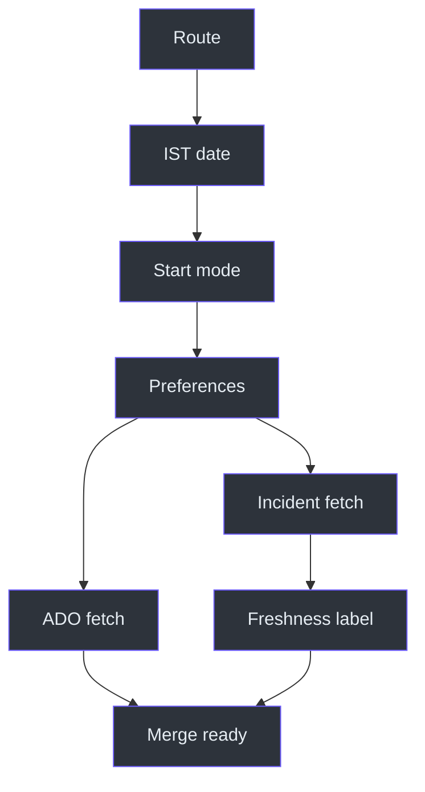
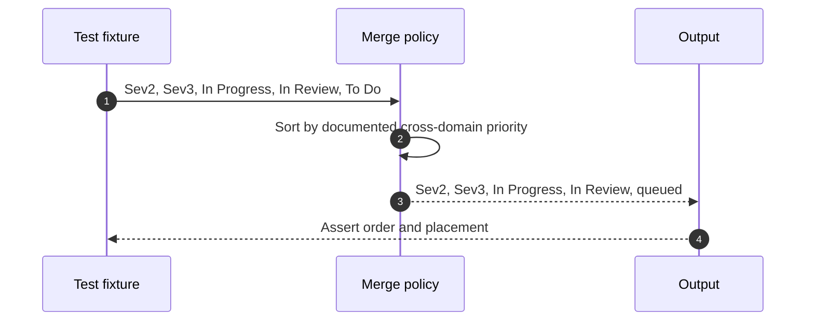

# Dayplan Operations and Testing

## Operational objective

A successful run produces a truthful, readable, unified schedule that protects
incident priority without erasing sprint commitments. Source:
[SKILL.md](../SKILL.md#day-plan-generator-combined-dri--ado),
`SKILL.md:L7-L11`; [SKILL.md](../SKILL.md#workflow),
`SKILL.md:L128-L143`.

## Pre-run checklist

1. Confirm the request needs both domains or is an unspecified workplan.
2. Fetch the current date and time in IST.
3. Stop on weekends.
4. Determine whether the user explicitly requested current-time start.
5. Read all four preference keys.
6. Fetch incident state.
7. Fetch ADO state.
8. Record whether incident data is live or stale.

Source: [SKILL.md](../SKILL.md#when-to-use-this-skill),
`SKILL.md:L19-L24`; [SKILL.md](../SKILL.md#workflow),
`SKILL.md:L128-L143`.

## Post-run validation

- Date and all current-time labels are IST.
- Default output begins at 11:00 unless explicitly overridden.
- Active Sev2 appears before every other work item.
- DRI-week plans visibly reduce ADO capacity.
- Non-DRI plans do not show an empty incident section unnecessarily.
- Related incidents are grouped.
- Stale fallback data is labeled stale.
- Standup uses Yesterday/Today/Blocker.
- Friday or forecast guidance appears only when applicable.
- Box lines remain short and links remain outside fences.
- No undocumented file was created or modified.

Sources: `SKILL.md:L13-L17`; `SKILL.md:L78-L88`;
`SKILL.md:L128-L155`.

## Test matrix

| ID | Scenario | Expected result |
|---|---|---|
| T01 | Generic "workplan" request | Routes to combined plan |
| T02 | ADO-only request | Routes away to `ado-workplan` |
| T03 | Incident-only request | Routes away to `dri-workplan` |
| T04 | Weekday, no start override | Starts at 11:00 |
| T05 | "Starting now" at 15:20 | Starts at current IST time |
| T06 | Saturday | Recharge message only |
| T07 | Active Sev2 plus ADO work | Sev2 occupies first investigation block |
| T08 | Active Sev3/4 without Sev2 | Incidents occupy Block 1 or 2 |
| T09 | Active DRI week | About 50 percent incident capacity |
| T10 | Non-DRI, no incidents | Minimal or omitted incident section |
| T11 | IcM timeout | Last-known data shown as stale |
| T12 | Related incidents | Grouped by root cause |
| T13 | Mitigated incident and To Do ADO | Queued/pending |
| T14 | Friday | Critical-first plan with buffer note |
| T15 | Future Monday | Forecast disclaimer |
| T16 | User reports completion | Completed-today section |
| T17 | PBI with children | Nested display |
| T18 | Output links | Clickable bullets outside fences |

## Priority regression test

Source: [SKILL.md](../SKILL.md#workflow), `SKILL.md:L134-L140`.

## Troubleshooting

| Symptom | Likely cause | Correction |
|---|---|---|
| ADO task precedes active Sev2 | Merge priority violated | Put Sev2 first in Block 1 |
| Plan starts at current time without explicit request | Default start misapplied | Restore 11:00 default |
| Plan starts at 11:00 despite "starting now" | Override ignored | Use current IST time |
| Empty incident section appears off DRI week | Non-DRI omission rule ignored | Omit/minimize when no incidents |
| Stale incidents look current | Timeout disclosure missing | Add clear staleness note |
| Related incidents appear in separate areas | Grouping skipped | Group by root cause |
| Links are plain text | Links placed inside fence or malformed | Emit Markdown bullets between fences |
| Plan includes weekend work | Weekend gate skipped | Return recharge message |
| Files were written | Sibling behavior was inferred | Remove side effect; source specifies none |

## Failure handling

The only source-defined live-data fallback is for frequent IcM timeouts: use the
last known data and note staleness. No equivalent fallback is defined for ADO,
SQL, or date lookup. Source:
[SKILL.md](../SKILL.md#important-notes), `SKILL.md:L151-L153`.

A safe operator response when an undefined required source fails is to state
what could not be verified and avoid presenting invented live state. This is a
safety interpretation, not a new source-defined retry policy.

## Data freshness checks

| Data | Freshness action |
|---|---|
| Current date/time | Resolve for every request |
| Incidents | Prefer live query; label last-known fallback stale |
| ADO work | Fetch for the request; no stale fallback is defined |
| DRI context | Read from preferences before rendering |
| Completed today | Show when user mentions completed items |

Source: `SKILL.md:L13-L17`; `SKILL.md:L33-L42`;
`SKILL.md:L151-L155`.

## Maintenance guidance

1. Keep generic workplan routing aligned with sibling trigger definitions.
2. Test the 11:00 default and current-time override separately.
3. Treat the cross-domain priority table as a regression contract.
4. Keep DRI-week and non-DRI behavior distinct.
5. Preserve the incident timeout disclosure when changing data access.
6. If persistence is added later, document paths, mutation rules, and ownership
   explicitly rather than inheriting them silently from `ado-workplan`.
7. Update marker, URL, and hierarchy tables together when display rules change.

Relevant source sections:
[SKILL.md](../SKILL.md#when-to-use-this-skill), `SKILL.md:L19-L24`;
[SKILL.md](../SKILL.md#workflow), `SKILL.md:L128-L143`;
[SKILL.md](../SKILL.md#important-notes), `SKILL.md:L145-L155`.

## Release acceptance checklist

- [ ] `SKILL.md` remains unchanged.
- [ ] Citations still match source lines.
- [ ] Generic routing selects `dayplan`.
- [ ] Domain-specific routing selects the sibling skill.
- [ ] IST date and time tests pass.
- [ ] Default and override start tests pass.
- [ ] Weekend and forecast tests pass.
- [ ] Sev2-first ordering passes.
- [ ] DRI capacity behavior passes.
- [ ] Stale incident disclosure passes.
- [ ] Formatting and link placement pass.
- [ ] No undocumented file side effect occurs.

