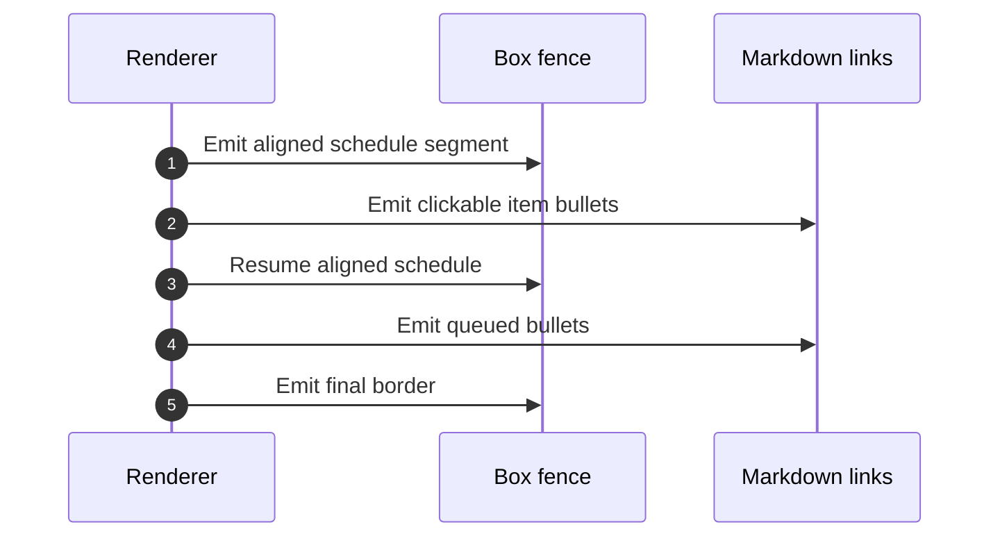

# Dayplan Reference

## Trigger routing

| Request intent | Route |
|---|---|
| Full plan, day plan, plan my day | `dayplan` |
| Everything today, complete schedule | `dayplan` |
| Generic workplan without domain | `dayplan` |
| ADO or sprint only | `ado-workplan` |
| DRI, livesite, or incidents only | `dri-workplan` |

Source: [SKILL.md](../SKILL.md#when-to-use-this-skill), `SKILL.md:L19-L24`;
`SKILL.md:L9-L11`.

## Data sources

| Source | Purpose | Specified selector |
|---|---|---|
| IcM MCP | Assigned incidents | `assignedTo: "mishrad"`, Sev2/3/4, Active/Mitigating/Mitigated |
| ADO MCP | Active sprint work | Named work-item operations |
| SQL `user_preferences` | Routine, display, and DRI context | Four keys below |
| SQL `work_items` | Cached item state | No schema given |

Source: [SKILL.md](../SKILL.md#data-sources), `SKILL.md:L26-L31`.

## Preference keys

| Key | Purpose |
|---|---|
| `daily_routine` | Work hours and 11:00-18:00 blocks |
| `workplan_style` | Exact visual format |
| `ado_display_rule` | PBI/task hierarchy |
| `dri_week` | Whether and where the user is in DRI week |

Source: [SKILL.md](../SKILL.md#user-preferences-from-sql),
`SKILL.md:L33-L42`.

## Date and time rules

| Question | Contract |
|---|---|
| Date source | Internet or system clock |
| Zone | IST, UTC+05:30 |
| Default start | 11:00 IST |
| Current-time start | Only when explicitly requested |
| End | 18:00 IST |
| Weekend | No work schedule |
| Future Monday | Allowed as a forecast with disclaimer |

Source: [SKILL.md](../SKILL.md#-critical-rules--date--time),
`SKILL.md:L13-L17`; [SKILL.md](../SKILL.md#important-notes),
`SKILL.md:L145-L150`.

## Unified priority matrix

| Rank | Work class | Placement |
|---|---|---|
| 1 | Active Sev2 IcM | Block 1, always first |
| 2 | Active Sev3/4 IcM | Block 1 or Block 2 |
| 3 | In Progress ADO | Focus blocks |
| 4 | In Review ADO | Later blocks |
| 5 | Mitigated IcM | Queued/pending |
| 5 | To Do ADO | Queued/pending |

Source: [SKILL.md](../SKILL.md#workflow), `SKILL.md:L134-L140`.

## Schedule reference

| Time | Block | Content |
|---|---|---|
| 11:00 | Start Day | Email/Teams triage and incident sweep |
| 11:30 | Standup | Yesterday, Today, Blocker |
| 12:00 | Focus Block 1 | Incident fires first, then sprint tasks |
| 14:00 | Lunch | Break |
| 15:00 | Focus Block 2 | Sprint work and code reviews |
| 16:00 | Break | Break |
| 16:30 | Focus Block 3 | Remaining work and incident close-out |
| 18:00 | Wrap Up | Update ADO and prepare handoff notes |

Source: [SKILL.md](../SKILL.md#schedule-template-ist--combined),
`SKILL.md:L115-L126`.

## DRI context rules

| Context | Behavior |
|---|---|
| Active DRI week | Allocate about 50 percent to incidents and reduce ADO expectations |
| DRI day label | Monday Day 1 through Friday Day 5 |
| Non-DRI with incidents | Include incident section |
| Non-DRI with no incidents | Omit or minimize incident section |

Source: [SKILL.md](../SKILL.md#workflow), `SKILL.md:L140-L141`;
[SKILL.md](../SKILL.md#important-notes), `SKILL.md:L149-L153`.

## Status marker meanings

| Marker meaning | Domain |
|---|---|
| Active Sev2 | IcM |
| Active Sev3 | IcM |
| Active Sev4 | IcM |
| Mitigated, pending close | IcM |
| Active/In Progress | ADO |
| In Review | ADO |
| Queued/To Do/low priority | ADO |
| Parked | ADO |
| Done | Either completion display context |

The exact emoji characters are listed in
[SKILL.md](../SKILL.md#link-emoji-legend-all-combined),
`SKILL.md:L90-L102`.

## URL formats

| Domain | URL |
|---|---|
| IcM | `https://portal.microsofticm.com/imp/v5/incidents/details/{id}/summary` |
| ADO | `https://msazure.visualstudio.com/One/_workitems/edit/{id}` |

Source: [SKILL.md](../SKILL.md#url-formats), `SKILL.md:L104-L107`.

## ADO hierarchy display

- PBI with child tasks: parent header plus nested tasks.
- PBI without children: standalone.
- Only the numeric `#id` is linked; the title is plain text.

Source: [SKILL.md](../SKILL.md#ado-display-rules), `SKILL.md:L109-L113`.

## Rendering contract

| Rule | Requirement |
|---|---|
| Layout | Shared two-column time/content box |
| Fencing | Box segments inside code fences |
| Width | Approximately 55 characters per line |
| Separators | Dashed |
| Sub-items | Source-defined arrow prefix |
| Link placement | Outside code fences |
| Footer | Insight plus queued section |
| Final border | Own code fence after links |

Source: [SKILL.md](../SKILL.md#key-rules), `SKILL.md:L78-L88`.

## Failure handling

| Failure | Defined response |
|---|---|
| IcM MCP timeout | Use last known incidents and state that data is stale |
| No assigned incidents outside DRI week | Omit/minimize incident section |
| Weekend | Return recharge message |
| ADO fetch failure | No fallback specified |
| SQL failure | No fallback specified |
| Date source failure | No fallback specified |

Source: [SKILL.md](../SKILL.md#important-notes), `SKILL.md:L145-L153`.

## File side effects

None are specified. The source defines console rendering but no file path or
write step. Source: [SKILL.md](../SKILL.md#workflow), `SKILL.md:L128-L143`.

## Complete quick reference

| Question | Answer |
|---|---|
| What is combined? | Assigned IcM incidents and ADO sprint tasks |
| What starts first? | Active Sev2 |
| Default start time? | 11:00 IST |
| Can it start now? | Yes, only when explicitly requested |
| What changes in DRI week? | About half the capacity goes to incidents |
| What happens off DRI week? | Incident content appears only if assigned incidents exist |
| How are related incidents handled? | Group by root cause |
| What if IcM times out? | Use last known data and mark it stale |
| What is queued? | Mitigated incidents and To Do ADO items |
| Are future plans allowed? | Next-week plans are forecasts and require a disclaimer |
| Are weekends planned? | No |
| Are files written? | Not by the documented snapshot |

## Known limitations

The snapshot does not define:

- tool schemas, authentication, pagination, or retry counts;
- how "last known" incident data is stored or selected;
- ADO completion reconciliation with daily notes;
- file persistence;
- behavior after 18:00 for a current-time request;
- tie-breaking among multiple incidents of equal severity;
- the exact algorithm for root-cause grouping.

Do not infer those details from sibling skills unless `SKILL.md` is updated.

