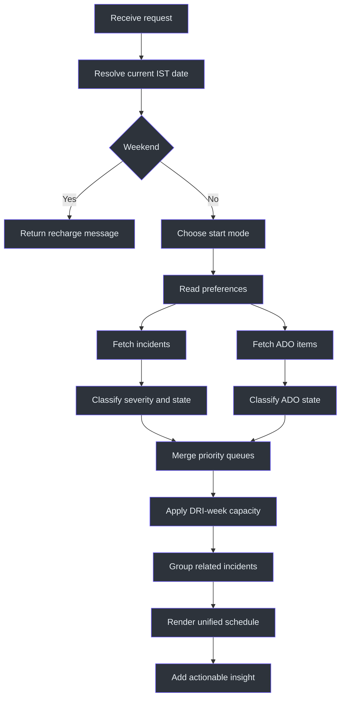
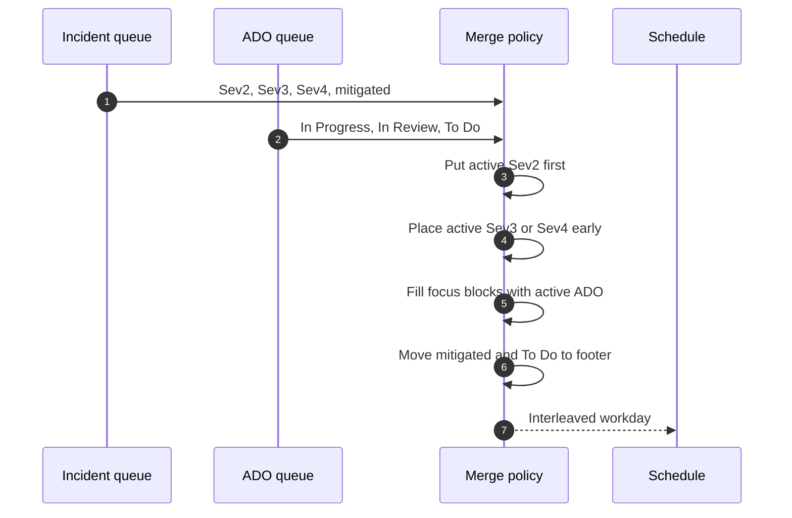
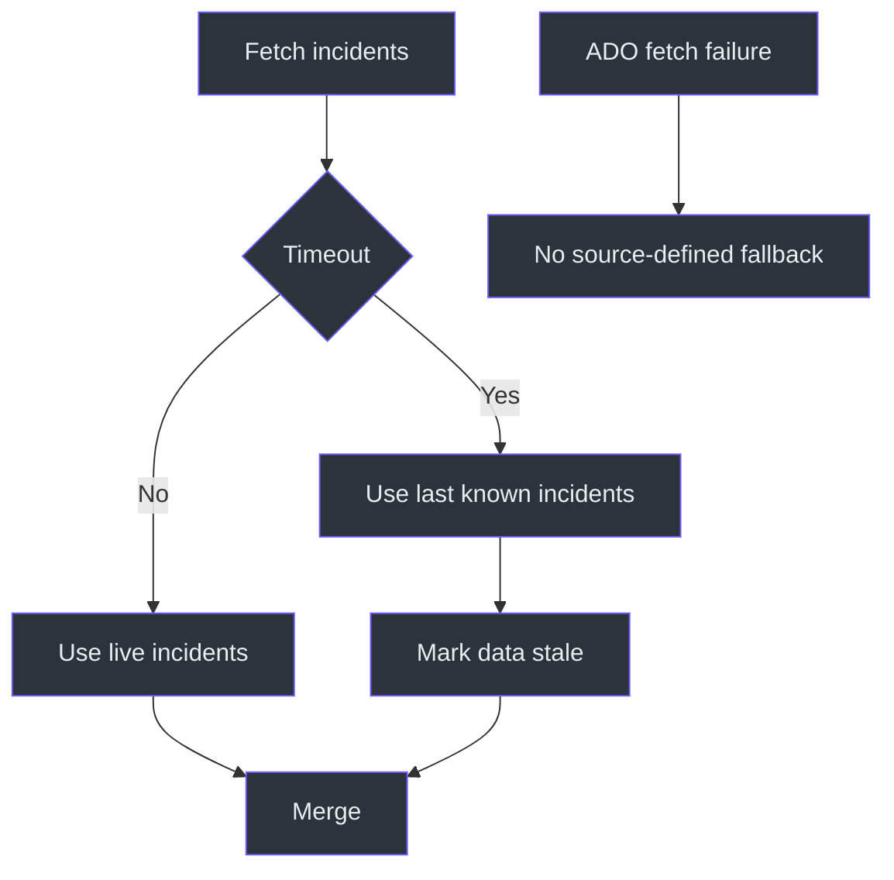

# Dayplan Workflow

## Overview

The workflow gathers live incident and sprint state, applies context-sensitive
capacity rules, and renders one schedule. The controlling idea is not simple
concatenation: both work streams are merged by urgency and state.
Source: [SKILL.md](../SKILL.md#workflow), `SKILL.md:L128-L143`.

## Full control flow



### 1. Route the request

Use `dayplan` for "day plan", "full plan", "plan my day", "everything today",
and generic "workplan" requests without an explicit DRI-only or ADO-only scope.
Morning planning and end-of-day summaries are also included.
Source: [SKILL.md](../SKILL.md#when-to-use-this-skill), `SKILL.md:L19-L24`.

### 2. Resolve date and weekend status

Fetch the date from a web source or system clock, interpret it in IST, and never
guess. Every displayed current time is IST. On Saturday or Sunday, return the
recharge message and do not build a normal plan.
Source: [SKILL.md](../SKILL.md#-critical-rules--date--time),
`SKILL.md:L13-L17`; [SKILL.md](../SKILL.md#important-notes),
`SKILL.md:L145-L150`.

### 3. Select the start mode

Default:

- Start at 11:00 IST.
- Include the full standard day even when requested later.

Override:

- If the user explicitly says "starting now" or "from current time", start from
  current IST time.

Source: [SKILL.md](../SKILL.md#-critical-rules--date--time),
`SKILL.md:L15-L17`.

### 4. Read preferences

Read `daily_routine`, `workplan_style`, `ado_display_rule`, and `dri_week`.
These values supply the time-block pattern, output contract, PBI/task hierarchy,
and DRI context. Source:
[SKILL.md](../SKILL.md#user-preferences-from-sql), `SKILL.md:L33-L42`.

### 5. Fetch incident state

Use the named incident search with:

- assignee `mishrad`;
- severities 2, 3, and 4;
- states Active, Mitigating, and Mitigated.

Source: [SKILL.md](../SKILL.md#data-sources), `SKILL.md:L26-L29`.

If the IcM source times out, use last known data and disclose staleness. Group
related incidents by root cause. Source:
[SKILL.md](../SKILL.md#important-notes), `SKILL.md:L151-L153`.

### 6. Fetch ADO state

Use one of the named ADO MCP operations to retrieve the active sprint work.
The snapshot does not define request parameters, result schemas, reconciliation
with daily notes, or an ADO outage fallback. Source:
[SKILL.md](../SKILL.md#data-sources), `SKILL.md:L29-L31`.

### 7. Merge by priority



Priority rules:

1. Active Sev2 always occupies Block 1 first.
2. Active Sev3/4 goes to Block 1 or 2.
3. In Progress ADO fills focus blocks.
4. In Review ADO goes to later blocks.
5. Mitigated incidents and To Do ADO go to queued/pending output.

Source: [SKILL.md](../SKILL.md#workflow), `SKILL.md:L134-L140`.

### 8. Apply DRI context

If DRI week is active, reserve about 50 percent of time for incident work and
reduce ADO expectations. DRI weekdays map Monday to Day 1 through Friday to Day
5. If DRI week is inactive, include the incident section only when incidents are
assigned. Source: [SKILL.md](../SKILL.md#workflow), `SKILL.md:L140-L141`;
[SKILL.md](../SKILL.md#important-notes), `SKILL.md:L149-L153`.

### 9. Fill standard blocks

| Time | Combined intent |
|---|---|
| 11:00 | Email/Teams triage and IcM sweep |
| 11:30 | Standup with Yesterday/Today/Blocker |
| 12:00 | Incident fires first, then sprint work |
| 14:00 | Lunch |
| 15:00 | Sprint work and code reviews |
| 16:00 | Break |
| 16:30 | Remaining work and incident close-out |
| 18:00 | ADO update and handoff notes |

Source: [SKILL.md](../SKILL.md#schedule-template-ist--combined),
`SKILL.md:L115-L126`; `SKILL.md:L154-L154`.

### 10. Apply day-specific rules

- Friday: acknowledge lower expected energy, prioritize critical tasks, and
  leave buffer.
- Next-week request: a future Monday plan is allowed, but it must be labeled as
  a forecast that may change.
- User-reported completions: show a "Completed today" section.

Source: [SKILL.md](../SKILL.md#important-notes), `SKILL.md:L147-L155`.

### 11. Render

Use the shared two-column box, short lines, dashed separators, and sub-item
markers. Keep Markdown links outside code fences, split the box into multiple
fenced segments, and end with an insight plus queued section and a separately
fenced closing border. Source:
[SKILL.md](../SKILL.md#key-rules), `SKILL.md:L78-L88`.

## Pseudocode

```text
date_time = resolve_ist()
if date_time is weekend:
    return recharge_message

start = 11:00
if request explicitly says starting now:
    start = date_time.current_time

preferences = read_preferences()
incidents = fetch_incidents()
ado_items = fetch_ado_items()

if incident_fetch_timed_out:
    incidents = last_known_incidents
    mark_stale()

groups = group_incidents_by_root_cause(incidents)
queue = merge_by_priority(groups, ado_items)
queue = apply_dri_capacity(queue, preferences.dri_week)
render(queue, start, end=18:00)
```

The pseudocode restates source behavior; it does not define unavailable tool
schemas or persistence.

## File side effects

No file write appears in the `dayplan` workflow or source list. Do not infer the
ADO-only Zettelkasten update as part of this skill without an explicit source
change. Source: [SKILL.md](../SKILL.md#workflow), `SKILL.md:L128-L143`.

## Failure paths



Only the incident timeout fallback is specified. The safe response to other
unverified live data is to disclose the limitation rather than invent state.

