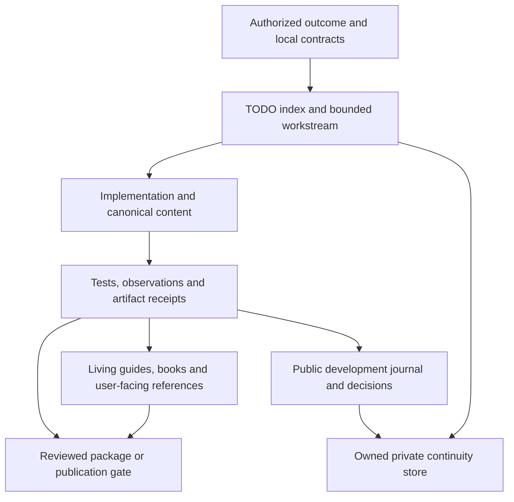
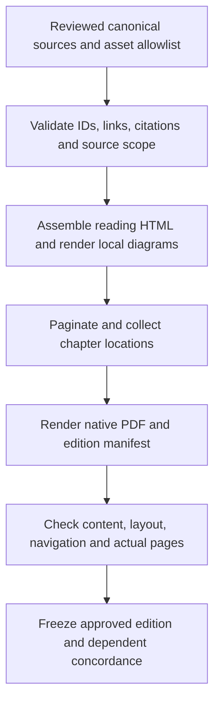

# The Living Development and Documentation Manual

Version 1.0 - 2026-11-03

**Purpose:** make the portfolio's accumulated working techniques understandable
and repeatable by a new agent without pretending that every project uses every
technique. This manual describes the work system as well as the documents it
produces. It is not a grant of access, a publication instruction or a replacement
for a project's local contracts.

## Contents

1. [Read the evidence before choosing a system](#1-read-the-evidence-before-choosing-a-system)
2. [The artifact architecture](#2-the-artifact-architecture)
3. [Numbered TODO workstreams](#3-numbered-todo-workstreams)
4. [The bounded development loop](#4-the-bounded-development-loop)
5. [Journals, decisions and historical truth](#5-journals-decisions-and-historical-truth)
6. [Living engineering documentation](#6-living-engineering-documentation)
7. [Chaptered books and teaching systems](#7-chaptered-books-and-teaching-systems)
8. [Source atlases and exhaustive explanation](#8-source-atlases-and-exhaustive-explanation)
9. [Rendered editions and publishing pipelines](#9-rendered-editions-and-publishing-pipelines)
10. [Visual documentation and bounded image review](#10-visual-documentation-and-bounded-image-review)
11. [Documentaries, clips, audio and creative production](#11-documentaries-clips-audio-and-creative-production)
12. [Reports, investigations and operational runbooks](#12-reports-investigations-and-operational-runbooks)
13. [Context, knowledge recovery and documentation graphs](#13-context-knowledge-recovery-and-documentation-graphs)
14. [Packaging, handoff and completion](#14-packaging-handoff-and-completion)
15. [Growing the manual without inventing consensus](#15-growing-the-manual-without-inventing-consensus)

Source IDs such as **TR-01** resolve in [the source register](docs/SOURCES.md).
The case studies in [Examples](docs/EXAMPLES.md) explain what may and may not be
transferred. Copyable forms live in [Templates](templates/README.md).

## 1. Read the evidence before choosing a system

### 1.1 Four kinds of statement

Use these labels when adopting a technique:

| Label | Meaning | Example |
|---|---|---|
| Observed pattern | Supported by actual project artifacts; prevalence must not be exaggerated | Several application projects use numbered TODO workstreams |
| Project-specific contract | Required by that project's current instructions | One image-first README has a fixed approved image count |
| Proposed reusable default | This manual's recommendation when no local contract decides | Keep a concise decision record for a consequential architectural choice |
| Not verified | Evidence is absent, restricted, stale or not examined | A build guide exists, but clean-machine reproduction was not performed |

A directory inventory proves presence. Reading a contributor guide establishes
its written policy, not compliance by every implementation. A completion log is
historical reported evidence; it does not rerun the test today. Hash equality
establishes identical bytes, not correctness, rights or approval.

Do not turn this first edition into an unsupported universal rulebook. Some
projects have extensive numbered TODOs; some have prose roadmaps or another
tracking structure. Several front pages intentionally contain only showcase
images. Some books are designed but not yet built; another source in the same
base may describe a later implemented pipeline. Read dates and current output
manifests before deciding what exists.

### 1.2 Authority and conflict resolution

First obey applicable platform/safety requirements and the current user's scope.
Within that scope, read local contributor instructions and explicit artifact
contracts before borrowing the manual's defaults. Current implementation and
actual outputs establish what the system does; instructions establish what it
should do. Neither automatically cancels the other when they disagree.

If a local contract says "seven-image front page," do not add a prose summary
because a generic documentation convention favors one. If the task says
"styling only," do not rewrite report facts or restructure its sections. If the
existing book has frozen page references, a new layout needs a new edition,
not silent replacement. Ask for a decision when the conflict changes behavior
or scope; otherwise document a narrow compatibility choice.

### 1.3 Audit procedure for an unfamiliar project

1. Resolve the real base, repository/worktree relationship and allowed outputs.
2. Read instructions, current state, TODO index and navigation entry points.
3. Inventory documentation by role, not just extension: README, guides, chapters,
   `.todo` workstreams, ledgers, manifests, diagrams, generated readers, PDF
   receipts, source maps and version/release notes.
4. Read the governing contract and one substantive artifact for each apparent
   mode. Read additional examples where a technique or exception is unclear.
5. Separate canonical authoring sources from copies, generated output, fixtures,
   frozen snapshots and embedded origins. Deduplicate identical bytes only for
   reading efficiency; keep every logical source path in the private inventory.
6. Record what was actually read and what was only discovered. Identify dates,
   hashes or revision IDs when a claim depends on exact bytes.
7. Construct a change-to-document map before editing.

Traversal must be bounded and privacy-aware. Do not recursively ingest caches,
raw media, dependency trees, private archives or entire chat histories merely
to increase a file count. Restricted content must not be recovered through a
different tool or inferred from neighboring files.

## 2. The artifact architecture

### 2.1 One system, several audiences

The layers below answer different questions. Combining them into a single
`TODO.md` or enormous README destroys useful separation.



Arrows mean information/dependency flow, not automatic permission. Evidence can
block a release; it cannot grant publication approval by itself.

| Artifact | Primary question | Should not become |
|---|---|---|
| README | What is this, what does it look like, where do I start? | A dump of private troubleshooting history |
| TODO index | What workstreams exist and what is their current status? | A second, drifting implementation narrative |
| Workstream | What outcome, dependencies and evidence define this bounded unit? | A claim of user approval |
| Development ledger | What happened across workstreams and why? | Raw transcripts |
| Focused guide | How do I perform one task or resolve one failure? | An unbounded architecture book |
| Engineering book | How does the whole system work and why is it designed this way? | A list of filenames without explanation |
| Source atlas | How is every in-scope source region accounted for? | Hash-only coverage theater |
| Private continuity | What must the next session know to resume honestly? | A public export or social feed |
| Release manifest | Which exact approved bytes are included? | Proof of deployment or legal clearance |

### 2.2 Canonical and derived material

For every artifact family, identify one canonical editable source. Markdown may
generate HTML/PDF; a palette JSON may generate application themes; a scene script
and `.blend` may generate cover PNGs; transcript/time maps may generate captions.
Document the direction of derivation and the owning command. Do not patch a
generated output and leave its source unchanged unless the project explicitly
uses an independent derived edition.

Maintain a small dependency map. A source API change can affect its handbook
chapter, source-atlas hashes, GUI labels, screenshots, installer help, README
metadata and packaged PDF. A cover-only change should not alter audio masters.
Use a checklist driven by actual dependencies, not a command that rebuilds
everything without authorization.

### 2.3 Navigation and catalogues

A document must be discoverable from an appropriate entry point. Use a human
index and, where useful, a machine-readable catalogue with stable titles/IDs,
paths, intended reader and hierarchy. Avoid overlapping competing indexes.
An engineering book may offer both a beginner sequence and a fast maintainer
route. A visual reference may offer search, theme and surface filters. Navigation
is part of the deliverable: a correct orphan chapter is still hard to use.

## 3. Numbered TODO workstreams

Basis: **TR-01, CF-01, CF-02, ET-02, PF-01**. The user's reusable preference is a
`TODO` folder, a numbered index, numbered `.todo` files and a development ledger.
Keep an existing explicit alternative rather than silently migrating it.

### 3.1 Layout and stable identity

Recommended starting layout:

```text
TODO\
  00_INDEX.todo
  01_PRODUCT_DECISIONS.todo
  02_FOUNDATION.todo
  03_FIRST_VERTICAL_SLICE.todo
  04_TESTING_AND_DELIVERY.todo
  05_DEVELOPMENT_LEDGER.todo
  WORKFLOWS\
    01_SOURCE_REVIEW.todo
```

Names and counts are illustrative, not required milestones. Do not renumber
completed workstreams to insert a new task. Append a new stable number and
record its dependency. Keep file references stable across documents and commits.
Follow local rules about allowing only `.todo` files inside `TODO`; put images,
code, PDFs and supporting prose in their proper directories.

The index is a compact table of contents and status map. A workstream is the
detailed contract. The ledger records development history. Avoid copying all
tasks into the index; that creates two truth sources.

### 3.2 The eight required fields

| Field | Write this | Avoid this |
|---|---|---|
| Status | One defined current state | "Basically finished" |
| Milestone | Outcome the work advances | A vague category such as "misc" |
| Dependencies | Actual prerequisite IDs or `None` | Assuming file order implies dependency |
| Purpose | User/system reason and scope | Restating the filename |
| Tasks | Bounded actions, with completion markers | Unbounded aspirations |
| Acceptance criteria | Observable pass/fail outcomes, including exclusions | "Looks good" as the only criterion |
| Completion evidence | Actual commands/results, artifacts, revisions and limits | A list of tasks repeated in past tense |
| Completion log | Dated history, failed approaches and supersession where relevant | Rewriting prior decisions to appear linear |

The fields may be headings or plain labels according to the existing parser and
house style. Required information matters more than imposing a new formatter.
Include a blocker reason when blocked. Explain "not applicable" rather than
leaving a required gate ambiguously empty.

### 3.3 Status transitions

`NOT_STARTED` means no implementation work begun. `IN_PROGRESS` means active work
with incomplete criteria. `BLOCKED` means a named prerequisite, environment or
decision prevents completion. `DONE` means the defined criteria have actual
evidence. Project status vocabularies may differ; document the mapping.

Do not mark DONE just because code exists. Conversely, do not mislabel a
technically completed bounded local artifact as unimplemented solely because
publication was never in scope. State "locally verified; publication not requested"
and keep that distinction in evidence.

When a criterion explicitly requires human approval, approval absence blocks
that criterion. When it does not, preserve human acceptance as a separate field
or note rather than fabricating it or silently expanding the task.

### 3.4 Procedure definition is not execution progress

Reusable workflows such as "source review" or "animated explainer production"
describe how to perform a class of work. Their own status can be DONE when the
procedure is complete; that does not mean every future video has passed it.
Each run needs a separate receipt with input, revision, completed steps and
remaining gates. Never check off a reusable master procedure as if it were the
only production instance.

### 3.5 A meaningful completion entry

Weak: "Added export. Tests pass."

Better: "Exported a synthetic two-page document; missing destination reports an
explicit error; cancellation preserves the current file. Focused export tests
passed. Opened the actual exported file and confirmed both pages and links.
Remote upload and recipient access were not part of this task."

Record command/output locations and revision when available. Do not invent
timestamps, page counts or interactive observations to make evidence look full.
Use [the workstream template](templates/02_WORKSTREAM.todo).

## 4. The bounded development loop

Basis: **TR-01, PF-01, SC-01, ET-01**.

### 4.1 Start with a concrete user outcome

Translate "fix the preview" into an observable result: opening the specified
screen under the failing condition produces a usable preview without altering
unrelated state. Identify input/output, expected behavior, failure behavior,
scope exclusions and the smallest responsible subsystem.

Read the affected implementation and its callers/contracts. Prefer resolved
code intelligence for relationships where available. Do not infer execution
paths from filename similarity. Inspect current working changes before edits;
integrate directly relevant existing work without reverting other authors.

### 4.2 Implement the smallest complete change

Reuse local helpers and prior art. Fix the root cause, not a screenshot or a
single assertion proxy. Keep dependent call sites and user-facing behavior
consistent. Surface failures in the project's established way; never turn an
exception into success-shaped empty output.

Add focused tests for the changed behavior and its important edge cases.
Avoid tests that merely assert a constant or duplicate the implementation.
Run the smallest existing command covering the change; broaden when failures
or unresolved risk justify it. Restore dependencies only when required by
changed manifests or an actual missing-dependency failure.

### 4.3 Validate at the right boundary

A direct function call may prove data transformation while missing a GUI signal
connection. A UI callback test may miss a native file-picker behavior. A PDF
build may miss cropped text. A transcript string match may miss an incoherent
video join. Choose evidence that crosses the boundary the user cares about.

For an input widget, exercise the actual event path and resulting state. For a
static site, inspect the generated artifact and browser behavior. For an
installer, distinguish packaged files from an installed application and actual
launch. For a remote workflow, distinguish submitted, running, completed and
verified deployed bytes.

### 4.4 Update documentation as part of implementation

Use a change-impact table:

| Change | Typical documentation impact |
|---|---|
| Public option, command or input behavior | Usage/setup/reference, examples, tests |
| Ownership, persistence or concurrency | Architecture, sequence/state diagrams, failure recovery |
| Algorithm or data format | Dedicated algorithm/data-model chapter, complexity and invariants |
| UI controls/layout | User guide, tutorial, surface inventory, relevant screenshots |
| Dependency/build/release process | Prerequisites, exact commands, portability/release receipt |
| Privacy or rights boundary | Contributor rules, data handling and publication checklist |
| Source lines covered by an atlas | Explanations, source ranges, reviewed hashes and reader output |
| Frozen edition | New edition identity, concordance and dependent companion references |

Do not regenerate unrelated large artifacts automatically. Explain why a
dependent rebuild is necessary, and preserve old editions where required.

### 4.5 Promotion and commits are local contracts

EntropyTag's small-first gate and KardboardCode's earlier per-TODO commit request
are examples of scoped policies, not universal authorization. Some projects
request planning before implementation. Some require recorded-footage testing.
Others do not authorize any commit. Read the active task and repository rules.

When commits are authorized, commit coherent reviewed work and leave unrelated
changes alone. Do not interpret "update the docs" as permission to push, create
a release or upload private materials.

## 5. Journals, decisions and historical truth

Basis: **ET-03, TR-02, CF-02, KC-04**.

### 5.1 Four different logs

| Layer | Audience | Appropriate content |
|---|---|---|
| Workstream completion log | Maintainer following one outcome | Dated attempts, blockers, completion/supersession |
| Development ledger/journal | Reader reconstructing the product's development | Actions, immediate effects, reasoning, mechanisms and evidence |
| Decision record | Future engineer revisiting a consequential choice | Context, alternatives, trade-offs, decision and revisit trigger |
| Private continuity journal | Next authorized agent session | Exact current state, interrupted commands, risks and next steps |

These may cross-reference one another; they should not contain identical
transcript dumps. A daily plan/checklist is another layer: it records intended
and reconciled work for a day, not the complete engineering history.

### 5.2 Write a causal development narrative

For each meaningful entry, capture: **action -> immediate effect -> why ->
mechanism -> evidence -> next consequence**. An error that changed the design
belongs in the story. Record what failed, what observation ruled out the
hypothesis and why the eventual change was different.

EntropyTag's ledger explicitly values this explanatory record. Session opening
and closing times may be recorded when observed; do not reconstruct precise
times from imagination. Screenshots require captions explaining the visible
evidence, and original captures should be retained under the local policy.

Do not claim to know the developer's thoughts or emotions unless explicitly
recorded and authorized for that audience. "The test reported X" is evidence;
"we knew the architecture was doomed" is invented drama unless sourced.

### 5.3 Decision records

Use a decision record for expensive-to-reverse choices, not every variable name.
Include scope, evidence, alternatives, selected approach, rejected trade-offs,
consequences and revisit conditions. Give it a stable ID.

When superseded, preserve the original decision and append the new relationship.
Do not rewrite old dates or statements so history appears to have anticipated
later knowledge. A current architecture guide may describe the new design while
linking to the decision that explains the transition.

### 5.4 Public and private journals

A repository development journal must be independently safe to publish. The
private context store may contain local paths and resumption details, but it
must still exclude secrets and avoid unnecessary personal/third-party data.
Ignored files are not encrypted; untracking a file does not erase Git history.
Do not export a private journal into a book or release by default.

## 6. Living engineering documentation

Basis: **SC-02, PF-02, KC-01, PF-03**.

### 6.1 Reader questions, not file lists

A useful architecture chapter answers:

- What problem does the subsystem solve and where does it sit?
- Which component owns state and which contracts cross the boundary?
- What happens on a normal request, a failure, cancellation and restart?
- What invariants and trade-offs shape the implementation?
- Which source files/symbols support the explanation?
- How can a maintainer verify or safely change it?

A chapter that lists classes without explaining their collaboration is a source
inventory, not an engineering explanation. An attractive diagram with undefined
arrows is not a design contract.

### 6.2 Recommended book structure

Use only chapters appropriate to the project:

```text
docs\
  README.md
  catalogue.json
  01-overview\
  02-foundations\
  03-architecture\
  04-data-and-algorithms\
  05-design-principles\
  06-subsystems\
  07-user-interface\
  08-testing-and-quality\
  09-development-and-delivery\
  10-roadmap-and-decisions\
  reference\
```

This is a proposed layout, not a migration command. Preserve existing stable
chapter identifiers and links. Keep dedicated algorithm/data-structure and
design-principle explanations when those concepts genuinely illuminate the code.
Explain complexity, invariants, examples and why simpler alternatives were
insufficient. Do not add ceremonial pattern chapters with no implementation basis.

### 6.3 Diagram discipline

Prefer top-to-bottom diagrams for box-and-arrow flows. Choose a sequence diagram
for interaction timing, a state diagram for lifecycle, a data-flow diagram for
transformation and a component diagram for ownership. One diagram need not
explain all four.

Label arrows with their actual relationship. Define units, ordering, uncertainty
and simulated/proposed elements. Use stable figure IDs in long books, captions
and text equivalents. Inspect readability at final scale and in the output
format; parsing successfully does not establish legibility.

Keep editable diagram source. Use local rendering for private/project content.
Do not send confidential diagrams to external services. If rendering is not
available, retain source and report the missing rendered artifact honestly.

### 6.4 Citations and source maps

Reference exact files and symbols, with line spans or revision/hash when useful.
A line number can drift; a symbol can have several overloads. State the source
revision when the explanation depends on exact code. Use source maps or automated
symbol resolution where the project supports them, but verify the resolved
target rather than treating any matching name as correct.

TrickRoom's book uses Python AST-based symbol citation resolution. That is a
language-specific implementation technique, not proof that arbitrary C#, Rust
or generated code can be resolved by that same script.

### 6.5 Focused guides and front pages

Keep setup, operations, troubleshooting and API reference close to their task.
Write prerequisites, exact commands, expected observations, failure signs and
recovery. Explain placeholders and destructive boundaries. A maintainer should
not need to infer which commands merely build and which modify external state.

Respect visual front pages. Some projects intentionally keep the README to
showcase images and navigate through linked gallery/docs. Others use a detailed
source-linked overview. Use captions/provenance in the appropriate guide/gallery
without violating an explicit image-only front-page contract.

## 7. Chaptered books and teaching systems

Basis: **KL-01, KL-02, KL-03, SA-01, SA-02, BM-01**.

### 7.1 Engineering reference versus curriculum

A reference optimizes lookup; a curriculum optimizes learning sequence. A
technical book can provide both routes, but exercises and prerequisite teaching
must be deliberately authored, not attached as decorative questions.

The KnowledgeLedger pattern is:

**locate -> picture -> explain -> worked example -> retry -> exercises ->
connect -> record demonstrated evidence**.

Place the concept in the larger system before diving into implementation.
Introduce prerequisites as needed; do not repeatedly ask a beginner to choose
among unfamiliar tracks when the teaching contract delegates sequencing to the
agent. A curriculum progress entry should identify what the learner actually
demonstrated, not equate opening a chapter with understanding it.

### 7.2 A substantive teaching chapter

1. State a motivating question and observable learning outcome.
2. Explain prerequisite concepts in plain language and locate the topic in a map.
3. Define terms and ownership precisely.
4. Show the successful behavior with a diagram and worked example.
5. Explain the mechanism, invariants, trade-offs and alternative choices.
6. Show a counterexample or failure and why it fails.
7. Give a retry variant with changed conditions, not the same example renamed.
8. Provide exercises with explained answers or a rubric.
9. Connect the concept to later topics and cite the evidence/version boundary.

An analogy must include where it stops matching the real system. AI-related
chapters should show prompt/data, retrieval, identity, approvals and tool
boundaries rather than an unexplained "AI cloud" box.

### 7.3 Stable learning identifiers

The service-agnostic book uses stable chapter, worked-example, retry, figure and
question/answer IDs. Stable IDs survive pagination. Numeric budgets such as 48
chapters, two examples/retries and ten question/answer pairs per chapter belong
to that edition's authoring contract, not every future book.

Use a matched question/answer inventory. Detect missing/duplicate IDs and broken
cross-references. Maintain bidirectional navigation where possible. A
questions-only workbook should derive from the same canonical set, not a second
manually maintained copy.

### 7.4 Evidence and assessment

Separate exposure, attempted activity, self-report, scaffolded success and
independent demonstrated understanding. For an exercise, record the prompt,
expected reasoning, observed answer and remaining misconception. Do not invent
learner performance or progress because the book contains solutions.

Simulation fixtures teach contracts but are not cloud deployment evidence.
Public documentation should label version/region/preview limits. Public books
need independent public sources and genuinely fictional examples; anonymizing
private incidents is not independent public support.

### 7.5 Audio/podcast companions

An audio-direction manuscript is not the textbook and not generated audio. Bind
it to a frozen textbook fingerprint and actual chapter page ranges. Translate
visual diagrams into spoken events and ownership. Include chapter-specific
misconceptions, analogies with limits, exercises and source references.

A separate audio tool may not honor requested voices or duration exactly.
Do not guarantee those properties or claim an upload/audio generation when
only a local direction PDF was produced. A new illustrated edition with new
pagination needs its own concordance; old companion ranges must not be relabeled.
The source companion's exact 100-page contract is edition-specific.

## 8. Source atlases and exhaustive explanation

Basis: **PF-03, PF-02**.

### 8.1 What an atlas adds

A handbook explains the system selectively. An annotated source atlas accounts
for every physical line of an explicitly defined first-party source set. It
needs an allowlist/scope, source hashes and contiguous, nonoverlapping coverage
ranges, plus meaningful explanations associated with those ranges.

"Everything is documented" is a much stronger claim than "core architecture is
explained." Do not use the former without scope and completeness checks.

### 8.2 Authoring procedure

1. Freeze or fingerprint the in-scope source inventory.
2. Group related regions into meaningful authored explanation blocks.
3. For each block, explain purpose, inputs/outputs, important branches,
   state/ownership, errors and relevant callers/readers.
4. Attach source ranges and excerpts; account for imports, comments and
   declarations without pretending every line merits the same prose length.
5. Validate no missing or duplicate coverage and no out-of-range references.
6. Review the prose against the actual code, not just against range arithmetic.
7. Generate the searchable reader and any PDF excerpts.
8. Reconcile atlas/handbook dependencies according to the project contract.

Phantom Fudge's maintenance order puts atlas review before handbook production.
That is useful when the atlas is the detailed source truth. It is not permission
to impose a whole-source atlas on an unrelated small script.

### 8.3 Drift and dishonest shortcuts

If a source hash changes, identify affected blocks and review their meaning.
Do not update the hash merely to silence a stale-source failure. A source line
can change behavior without changing a nearby symbol name. Conversely, a pure
line shift may require range repair without new conceptual prose.

Mechanical line coverage is necessary for an exhaustive claim but insufficient
for explanation quality. A block saying "this code handles things" can cover
200 lines numerically while teaching nothing.

### 8.4 Output forms

A searchable HTML atlas can embed full source, annotations, filters and links.
A printed PDF may use excerpts because full source becomes unreadable at
print scale. State which reader contains the complete source. Keep publication
rights and source disclosure separate from the ability to generate a reader.

## 9. Rendered editions and publishing pipelines

Basis: **KC-02, TR-03, KL-02, KL-03, SA-02, SA-03, BM-01**.

### 9.1 The general pipeline



Keep commands and stage boundaries explicit. A check may validate manuscript
structure without rendering. A build may produce HTML but not PDF. A render may
need a second pass for accurate page maps and TOC. A finalize step should verify
the actual output rather than merely rename a file.

### 9.2 Source inclusion strategies

Observed systems use different contracts. Some discover numbered chapter
folders, then apply explicit ordering and append unlisted chapters rather than
silently omit them. Newer public-safe teaching pipelines use a strict allowlist
and fail on missing/unapproved input. These are not interchangeable defaults.

For a publication boundary, an explicit reviewed allowlist is the safer proposed
default. For a living local engineering book, preserve its documented discovery
policy and test against accidental omission. Never recurse through an entire
workspace and call the result a reviewed edition.

### 9.3 Print design

Use readable body/code type, restrained colors, generous margins and purposeful
part/chapter openings. Figures need captions and should remain legible at final
size. Meaning must survive grayscale. Tables need repeatable headers where they
span pages; long code should wrap or be broken into meaningful blocks.

A project may choose a page budget. Do not shrink text, repeat paragraphs or add
decorative chapter-only pages to satisfy it. Distinguish instructional body,
front matter, solutions, dividers and appendices when the contract does.

Original cover design may take inspiration from professional publishing but
must not reproduce publisher logos, distinctive artwork or implied endorsement.
Record image/font origin and rights. A selected cover's title-panel overlap is
a scoped design direction, not a universal technical-book rule.

### 9.4 Validate the actual edition

Check source completeness, duplicate anchors, unresolved citations, missing
assets, diagram failures and broken links. Fail explicitly; do not replace
missing links with styled nonlinks and report success.

Then inspect the native PDF: existence, native page count, geometry, searchable
text, required sections/learning markers, clickable destinations/bookmarks and
all-direction clipping. Check overlap, orphans, cropped diagrams, tiny labels,
long tables/code, headers and captions. DOM page counts alone are insufficient.
Contact sheets give broad visual coverage, not sentence-level review of every
page. Retain the review limitations.

### 9.5 Edition identity and portability

Emit source/asset hashes, builder/tool versions, chapter IDs/page ranges,
generation time and output hashes as appropriate. Preserve older approved
editions. New presentation may adapt a frozen canonical reader while preserving
article bodies, but needs a distinct manifest and concordance.

Older pipelines sometimes relied on another project's dependency directory or
shared stylesheet. Record that historical coupling honestly; do not prescribe
it as a portable prerequisite. Prefer declared locked dependencies and an
explicit supported local browser. Do not disable TLS, permissions or trust checks
to make a clean-machine claim pass.

## 10. Visual documentation and bounded image review

Basis: **BB-01, BB-02, KC-05, SC-02, BM-01**.

### 10.1 Screenshots as evidence

Inventory the surfaces first: pages, tabs, disclosures, menus, selectors,
dialogs, tutorial steps, operating states and scrolling portions. Map them to
themes and fixture conditions. A screenshot count is not completeness unless
the surface inventory is accounted for.

Use owned widgets and public/synthetic fixtures. Never capture private desktop
content, live cameras, personal calibration, user folders or endpoints just to
make documentation realistic. Label illustrative states, native-picker
specimens and simulated conditions explicitly. A fixture should not display
text implying a real successful connection when none occurred.

Keep source hashes/citations and capture metadata. Decode/size/hash checks catch
corruption; they do not prove that the correct control is visible. Inspect the
actual capture. Where long sections scroll, document each necessary portion,
not only the top of the panel.

### 10.2 A complete portable visual reference

One observed pattern is a self-contained HTML catalogue with embedded screenshot
bytes, captions, coverage receipt, search/filter, theme controls, expansion and
full-image viewing. It can be copied without breaking adjacent assets.

Verify a standalone copy with no network: both themes, all images, filters,
keyboard controls, desktop/mobile containment and no unexpected horizontal
page overflow. Long code may scroll inside its own bounded region. Use sun/moon
icons for a theme toggle. Do not add runtime app features merely to improve
the documentation reader.

KardboardCode's complete reference accounts for both themes and every declared
surface/control. Its exact counts are historical evidence of that reference,
not a quota for future products.

### 10.3 Bounded contact-sheet review

1. Inventory candidates and exact-byte duplicates; retain all logical paths.
2. Build small labeled sheets with stable image IDs and enough resolution to
   identify each item.
3. Reserve the remaining image-view budget before opening a sheet.
4. Inspect the sheet and persist item-level decisions before the next sheet.
5. Open individual images only when the decision requires detail.
6. Stop before the applicable limit; save reviewed IDs, unresolved IDs, shortlist
   and next sheet so a new session can resume.

Use the strictest applicable local budget. B-Bakery uses sheets around 15-20
tiles and a below-20-view session contract with an early stop reservation;
other global guidance permits a larger budget. Do not universalize the number
or reset it merely by compaction. Failed views count when the local contract
counts them. A decoded image is not visually reviewed. A shortlist is not approval.

### 10.4 Asset captions and originals

Explain what an image demonstrates rather than only naming it. Retain original
captures/art sources and distinguish cropped/resized/annotated derivatives.
Keep rights/provenance. Where the front page is deliberately image-only, put
explanatory captions in the linked gallery/handbook without silently changing
that contract.

## 11. Documentaries, clips, audio and creative production

Basis: **KC-03, KC-04, CF-03, SW-01, SL-01**.

### 11.1 Frozen development documentary

A retrospective documentary has a different truth model from living docs.
Establish a cutoff, freeze the selected sanitized corpus, assign stable record
IDs/line spans and preserve original source hashes and historical task states.
The narrative may explain subsequent understanding, but must label it as such.

Keep a source-to-chapter coverage map and omission accounting. A narrative
chapter is not a substitute for complete evidence appendices when the contract
requires them. A PDF record-text audit should examine text inside each record's
marker span, not merely find the record ID somewhere in the document.

Use two-pass page mapping/TOC where needed. Never silently re-freeze the corpus
or rewrite unfinished historical work as completed. Do not invent dialogue,
inner thoughts or a triumphant ending. An ignored local documentary package
is not automatically public.

### 11.2 Video-production package

A production package can contain a timed narration script, setup-organized shot
list, edit/humor guide, fact-check sheet, music cues, rights/attribution, title,
thumbnail direction and description. Keep target duration distinct from observed
encoded runtime.

A shot list organized by camera/setup can reduce production effort even when
the final script is chronological. Make required assets and source evidence
traceable. Planned jokes or visual metaphors cannot justify false factual claims.

### 11.3 Reviewed coding/system-design clips

Understand the complete source transcript before selecting moments. Track source
times through trims, captions, cuts and variants. Keep a coverage/action ledger
showing what was retained, removed, corrected or uncertain.

Use immutable output revisions. Run fresh output ASR when required; source
transcription does not prove rendered captions/audio. Inspect actual encoded
motion, joins and caption timing; a single representative still cannot validate
a transition. Distinguish vertical topic clips, horizontal full solves and
combined variants according to the actual editorial contract.

Record source rights, credits and publication gates. A working one-off animated
producer is evidence of that run, not proof that a reusable shared feature is
complete. Route actual ClipFarm work to its dedicated skill rather than replacing
its detailed procedure with this overview.

### 11.4 Music and artwork provenance

Separate composition/source, native editable projects, rendered masters,
distribution derivatives and site copies. Keep direction notes, candidate
versions, selected output and source/art hashes. Preserve immutable experiments
when the project uses them.

Measured audio metrics or algorithmic rankings do not establish that someone
listened or aesthetically approved a track. Playback in a browser is not proof
that an entire album was critically reviewed. Similarly, a successful render
does not prove an image matches its artistic direction.

### 11.5 Procedural 3D artwork handoffs

A useful creative runbook explains the actual medium and pipeline. SongsWorkspace
records headless Blender scene authoring, editable `.blend` sources, PNG renders,
a separate finishing stage, typography, derivatives, gallery and manifest.
This is neither text-to-image generation nor photography nor animation merely
because the subjects suggest motion.

Record tool acquisition/checksum, renderer version/backend, seeds, fonts,
dependency versions, scene/module ownership, shared interfaces, camera/light/
material conventions and recovery from actual failures. Distinguish preview,
final native source and finished cover. Preserve title-safe composition and
inspect the actual final crop/lettering, not only the raw scene.

One bounded renderer at a time may be a machine-specific operating rule; it is
not universal GPU advice. Deterministic seeds aid controlled iteration but do
not promise bit-identical output across GPUs, renderers or fonts. Documentation
of a completed run is not an instruction to rerender it.

### 11.6 Canonical design systems and application ports

DeepSeaFoam documents semantic roles, canonical palette values, derived mappings,
format generation and host-specific limitations. A target count must not imply
universal compatibility. A manual preset, native importer, unofficial client
modification and site starter are distinct product types.

Generated target files should be changed through their canonical source/emitter.
Document which surfaces are exact mappings, derived approximations or
host-controlled fallback. Representative contrast checks do not prove universal
accessibility or an installed-application visual audit.

## 12. Reports, investigations and operational runbooks

This chapter captures **process only** from restricted/private operational
workspaces. It deliberately omits service identifiers, incident histories,
customer data, topology and deployment commands. See **OP-01**.

### 12.1 Separate collection from presentation

Some production access exists only on a separate constrained machine. In that
pattern, an authorized read-only collector emits CSV/TXT and a separate local
process builds HTML/Markdown. Do not assume the authoring machine has production
access or use an unapproved local cloud CLI to fill the gap.

Document collector inputs, permissions, time window, exact queried scope,
rate/cost boundaries, output schema, failure behavior and sensitive fields.
Keep read-only collection separate from mutation/repair commands. A collector
must not silently remediate something to make the report look healthy.

For the established constrained PowerShell pattern, use PowerShell 5.1/CLM-safe
arrays and ordered hashtables, avoiding generic .NET collections and explicit
custom-object casts that fail in that environment. Keep required ASCII `.ps1`
and pasteable `.txt` twins byte-identical where the project requires them.
These are environment contracts, not reasons to degrade unrelated scripts.

### 12.2 Interactive report UX

The recurring report language uses cards, dark/light themes with sun/moon
icons, bounded glowing controls, search/filter, collapsible sections,
expand/collapse and scoped export controls. Use the same visual language across
reports while preserving their semantics and section structure.

State three different times: data snapshot/collection time, report generation
time and browser reload time. "Refresh" must say whether it reloads embedded data,
reruns a local collector or fetches a live source. An offline self-contained
report is not live-on-open.

Preserve original data/provenance according to privacy scope. Show empty,
partial and failed collection states explicitly. Do not represent a failed query
as zero incidents or healthy resources. Scope exports to the visible/selected
data when that is the declared behavior.

### 12.3 Investigation records

Record the question, observations, source/time window, hypotheses, tests,
negative evidence, timeline, current conclusion and uncertainty. Distinguish
correlation from causation and proposed mitigation from executed action.

A runbook needs prerequisites, role/authority, read-only diagnosis, dry-run
behavior, expected observations, explicit stop conditions, rollback/recovery
and evidence to collect after action. Never claim a rollback was performed
because its command appears in the document.

### 12.4 Communication artifacts and environment qualification

A draft HTML, EML or MSG file is not a sent email. Opening an Outlook draft is
not recipient delivery. A local connection probe is not recipient-side
connectivity. A successful synthetic test is not qualification on a secured
production workstation.

Use explicit states: drafted, locally rendered, opened, submitted, sent,
delivered/received when actually evidenced. Keep recipient lists, customer data
and incident details out of public examples. Route real incident communications
to the relevant authorized workflow; this manual does not replace it.

## 13. Context, knowledge recovery and documentation graphs

Basis: **CTX-01, CTX-02, DM-01, CH-01**.

### 13.1 Per-base continuity

The established store has fixed `STATE.md`, `MEMORY.md`, `JOURNAL.md` and
`README.md` roles under `.agent-context`. STATE is the resumption snapshot;
MEMORY holds durable constraints/decisions; JOURNAL preserves dated development
events; README explains hydration and ownership.

Resolve the current base from the context index. Only the current base's store
is writable; sibling stores are read-only references. Outside a designated
base, do not create or adopt one against the user's active restriction.
Follow the installed context skill for exact schema, persona registration,
freshness, zmem persistence and mesh refresh.

Before offload, reconcile actual files, unfinished commands and known failures.
Record a successful persistence timestamp only after the required writes succeed.
An offload is not complete because an in-chat summary was generated.

### 13.2 Public development history versus private resumption

The public book explains the product. The private store explains where the next
agent should resume. Store exact full paths and incomplete work privately when
appropriate; do not force them into public chapters. A summary should not claim
ownership of another session's changes, persona or observations.

### 13.3 Context Mesh versus Documentation Mesh

Context Mesh models bases, sessions/personas, memory, freshness and artifact
provenance. Documentation Mesh models documents, links, entities, health and
Git provenance. Both use evidence-backed relationships, but operate on different
source models and outputs.

Keep source roots read-only and generated outputs separate. Record skipped and
restricted files, deterministic index metadata and evidence confidence. A
filename mention is weaker than a creation record. "Likely origin" should remain
qualified unless the provenance evidence establishes it.

Graph completeness is bounded by discovery/indexing policy. Do not interpret
an absent edge as proof of no relationship when inputs were excluded or stale.

### 13.4 Evidence recovery and daily planning

Career-style knowledge recovery distinguishes source artifacts, inference and
user recall. Keep confidence and source attribution; do not turn a remembered
story into independently verified history. Append corrections/deltas rather
than erase the origin of an interpretation.

Planning skills reconcile daily notes/checklists with live work-item status.
A checked daily task does not necessarily mean its external ticket is closed.
Time-block schedules are proposals tied to current capacity, not proof of work
performed. Use dedicated skills for actual authenticated planning/data updates.

### 13.5 Social layers are not work ledgers

A shared persona board is a conversation surface. It must not become the
implementation journal or imply that inactive agents have awakened. Sessions
write only their owned persona file; source identity and historical messages
must be preserved. Follow the dedicated context protocols, not a simplified
schema copied from this manual.

## 14. Packaging, handoff and completion

Basis: **LIB-01, LIB-02, LIB-03, KC-05, DS-01**.

### 14.1 Exact artifact receipts

For a delivered artifact, record full resolved path, type, scope/edition,
inputs/revision, generation command, time, size/hash when relevant and observed
verification. Keep originals and derivatives distinguishable.

Do not call a source archive a binary installer. Do not call a checksum-verified
runtime a tested installed application. A locally generated HTML page is not
a deployed static website. A release upload is not a successful site build.

### 14.2 Public/private packaging boundary

Use an explicit allowlist for public source/runtime/assets. Exclude context
stores, real conversations, recordings, personal evidence, secrets, private
configuration, authentication/trust state and proprietary third-party code.
Preserve licenses/notices and distinguish independently authored code from
copied snapshots and sanitized derivatives.

Scans help identify risk but do not grant disclosure/rights clearance.
`.gitignore` is neither encryption nor historical erasure. Hashes detect byte
changes/corruption; they do not authenticate an untrusted source.

### 14.3 Reproducible installation and migration

Document supported OS/tool versions, runtime/source boundaries, optional
dependency restoration, external credentials/providers and local configuration.
Do not copy a machine-bound virtual environment or old permission grants.
Guard existing differing installations; choose a fresh target or require
explicit replacement with backups.

For private state migration, preserve stable identities, original source paths,
duplicate mappings and immutable manifests where applicable. Restore into an
isolated new location and verify before activation. A file-by-file backup of
running applications is not necessarily a single transactional snapshot.

### 14.4 The completion ladder

| State | Evidence needed |
|---|---|
| Planned | Defined outcome and acceptance criteria |
| Implemented/authored | Actual changed source/content exists |
| Structurally checked | Required schema/links/IDs/hashes validate |
| Technically verified | Relevant behavior/output observed |
| Environment-qualified | Target machine/service scenario actually exercised |
| Human accepted | Explicit approval of the specified artifact/revision |
| Packaged | Exact approved file set and receipt |
| Published/deployed | Remote process completed and target artifact verified |

Not every task includes every rung. Name the achieved state and excluded rungs.
Do not silently expand local documentation work into publication or production
access to reach the final row.

### 14.5 Handoff

Lead with the result, identify meaningful limitations, and show full absolute
artifact paths. Mention the next action only if it is required. Do not claim
checks that were not performed, hide a failed render behind a source file, or
offer a summary that makes partial work sound complete.

## 15. Growing the manual without inventing consensus

This manual should become richer when a new project supplies a genuinely useful
technique, a better example, a counterexample or a superseding contract.
Do not append every project detail or private history.

Use [Evolution](docs/EVOLUTION.md): examine the actual artifact, record a safe
source receipt, classify authority, identify novelty, update the relevant
procedure/case/template, validate links and catalogue/hash registration, and
append an edition change entry. Keep removed/superseded guidance traceable.

The first edition is a broad synthesis of observed modes, not a permanent claim
of exhaustive coverage. A future agent should be able to say "this project adds
a new documentation technique" without pretending that it retroactively existed
in every earlier project.
