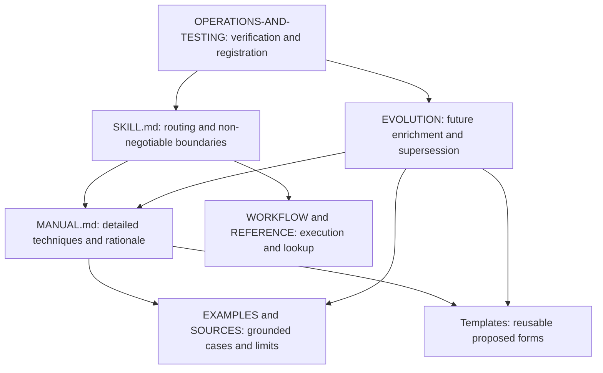

# Architecture: a manual, not a workflow engine

## Components and ownership

This package contains authored Markdown and `.todo` templates. It has no model
runner, source scraper, scheduler, collector, renderer or publication service.
Describing a technique does not implement its toolchain.

## Separation from neighboring skills

| Skill/system | Owns | This manual contributes |
|---|---|---|
| context-offload | Base hydration, persistence, personas and freshness | When continuity participates in the development loop |
| context-mesh | Base discovery, evidence-backed portfolio graph and social projection | How to use portfolio evidence without treating it as implementation proof |
| documentation-mesh | Documentation indexing/runtime, health and Git provenance | How indexed documents fit into an authored documentation system |
| clipfarm-leetcode | Actual editorial/production procedures and engine routing | Reusable production-documentation principles and case study |
| ado-workplan/dayplan | Authenticated planning and daily-note reconciliation | Distinction between daily plans, workstreams and historical evidence |
| career-forensics | Detailed evidence recovery and career knowledge protocol | Source/inference/recall distinctions, without importing private data |

Invoke those skills for their actual tasks. Do not copy their entire mutable
protocol into this package and create a stale competing source of truth.

## Authority model

The manual is a synthesis, not a superior repository policy. Local source
contracts remain authoritative for their project. A case becomes a proposed
general technique only with an explicit transfer boundary.

For example:

1. A local README is deliberately image-only.
2. The broader book preference includes explanatory captions.
3. Keep the approved front page; place captions and teaching detail in the
   linked gallery/book.

This is coexistence, not a reason to silently "fix" either instruction.

## Public and private data flows

Private source audit -> safe technique summary -> authored public guidance.

Do not copy the intermediate private inventory, context bodies, raw transcripts,
incident examples or real recordings into the public package. Source pointers
in SOURCES are references, not embedded copies or permission to redistribute.
The source register deliberately groups restricted operational evidence into
process-only categories.

## Installed skill support

The library installer installs `SKILL.md` and rewrites its canonical repository
root to the current checkout. It does not recursively copy this skill's manual
and templates into the user's skills directory. The checkout must remain
available. No new runtime or installer exception is needed.

Moving the clone later can invalidate installed support references; reinstall
through the normal guarded path or select a fresh skills directory. Do not
silently overwrite edited skills or weaken permissions to repair a path.

## Change impact

| Edited surface | Reconcile |
|---|---|
| SKILL.md | Exact source-inventory hash, generated portable checksum catalogue, installed-copy policy |
| MANUAL.md | Contents/anchors, mode reference, affected cases/templates |
| Template | Manual field definitions, examples and template index |
| Source/case | Authority, reviewed scope, public-safety boundary and evolution log |
| New mode | Manual, reference routing, case/source, operations gates |
| Package name/path | Both catalogues, root README, relationships, provenance, all local links |

Historical externally sourced skills retain their own byte-copy policy. This
repository-authored skill is edited canonically here, then rehashed.
