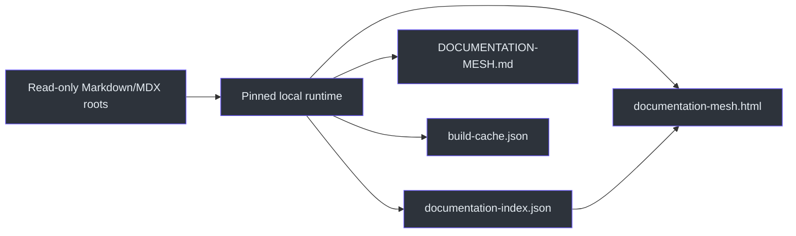
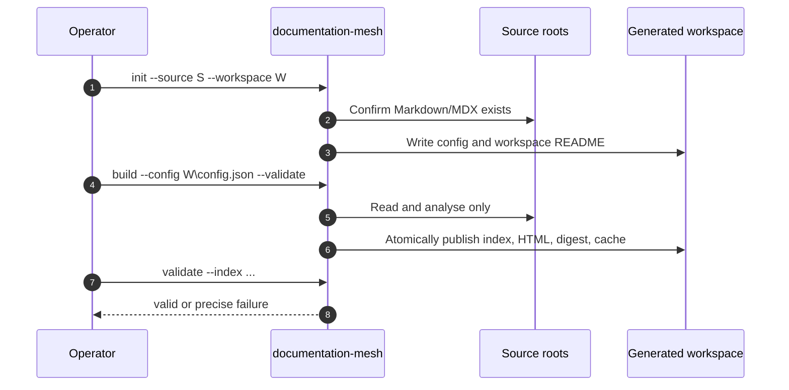

# Documentation Mesh Skill

## Overview

Documentation Mesh builds an offline, evidence-backed intelligence layer over one or more Markdown/MDX collections. It produces a deterministic JSON index, searchable catalogue, force-directed graph, documentation-health findings, Git-backed timeline, provenance view, compact startup digest, and incremental cache (`C:\devdesk\Copilot\CopilotSessions\documentation-mesh-plugin\README.md:L1-L14`).

The skill is intentionally conservative:

- Source roots are read-only.
- Generated workspaces remain separate from source roots.
- Relationships require explicit persisted evidence; generic word similarity is forbidden.
- Restricted, malformed, skipped, or unreadable files must be surfaced.
- The operator must not install runtimes or package managers as recovery (`SKILL.md:L10-L17`).



## Supported delivery

Version `0.1.0` ships a Windows x64 self-contained single-file .NET executable. End users do not need Python, npm packages, graph libraries, build tools, or a .NET installation. Python remains a portable development/reference implementation; Linux and macOS payloads are not included (`C:\devdesk\Copilot\CopilotSessions\documentation-mesh-plugin\README.md:L5-L14`, `C:\devdesk\Copilot\CopilotSessions\documentation-mesh-plugin\README.md:L58-L70`).

The plugin manifest declares Copilot as its engine and Windows as its platform (`C:\devdesk\Copilot\CopilotSessions\documentation-mesh-plugin\agency.json:L1-L15`). The runtime project targets `net8.0`, `win-x64`, single-file, self-contained publication and embeds the default config, workspace README, dashboard CSS/JS, and vendor bundle (`C:\devdesk\Copilot\CopilotSessions\documentation-mesh-plugin\src\DocumentationMesh.Runtime\DocumentationMesh.Runtime.csproj:L1-L28`).

## Fast path

### Initialize

```powershell
documentation-mesh init `
  --source "C:\path\to\markdown-collection" `
  --workspace "C:\path\to\markdown-collection-documentation-mesh"
```

### Build and validate

```powershell
documentation-mesh build `
  --config "C:\path\to\markdown-collection-documentation-mesh\config.json" `
  --validate
```

### Validate independently

```powershell
documentation-mesh validate `
  --index "C:\path\to\markdown-collection-documentation-mesh\output\documentation-index.json"
```

### Open offline

```powershell
Start-Process "C:\path\to\markdown-collection-documentation-mesh\output\documentation-mesh.html"
```

The required skill sequence is initialization/build for a new workspace, build for refresh, independent validation, and opening the offline HTML through `file://` (`SKILL.md:L33-L79`).



## Runtime resolution order

1. Run `documentation-mesh --version`.
2. If unavailable, resolve the loaded skill’s plugin root and use `runtime\windows-x64\documentation-mesh.exe`.
3. If present, `$AGENCY_PLUGIN_DIR\runtime\windows-x64\documentation-mesh.exe` is valid.
4. If no pinned runtime exists, stop with an acquisition error; do not install a language runtime or package manager (`SKILL.md:L26-L31`).

The native runtime exposes `init`, `build`, `validate`, and `open`, returns structured JSON on success, prints prefixed errors to stderr, and exits `1` for handled failures (`C:\devdesk\Copilot\CopilotSessions\documentation-mesh-plugin\src\DocumentationMesh.Runtime\Program.cs:L47-L112`).

## Generated workspace

```text
workspace\
  config.json
  README.md
  output\
    documentation-index.json
    documentation-mesh.html
    DOCUMENTATION-MESH.md
    build-cache.json
```

The JSON index is authoritative; the digest is deliberately compact for future session hydration (`C:\devdesk\Copilot\CopilotSessions\documentation-mesh-plugin\README.md:L107-L120`).

## Output meaning

| Output | Role |
|---|---|
| `documentation-index.json` | Source of truth for documents, evidence, graph, timeline, health, provenance, warnings, and skips |
| `documentation-mesh.html` | Fully offline dashboard with embedded assets and data |
| `DOCUMENTATION-MESH.md` | Compact startup summary |
| `build-cache.json` | Parsed-document cache keyed by canonical path and file signature |

The index schema requires source roots, statistics, documents, sections, entities, graph, timeline, health findings, warnings, and skipped files (`C:\devdesk\Copilot\CopilotSessions\documentation-mesh-plugin\schemas\documentation-index.schema.json:L1-L45`).

## What success means

A build is successful only when required outputs exist, IDs are unique, every edge resolves to existing nodes, evidence line ranges are valid, and outputs cannot escape the workspace (`SKILL.md:L50-L58`). Implementation validation enforces unique node/edge IDs, document-node presence, no dangling edges, allowed relationship classes/confidences, and valid evidence ranges (`C:\devdesk\Copilot\CopilotSessions\documentation-mesh-plugin\src\DocumentationMesh.Runtime\Program.cs:L1097-L1124`).

## Documentation map

| Page | Purpose |
|---|---|
| [Architecture](docs/ARCHITECTURE.md) | Plugin/runtime components, pipeline, evidence graph, safety, cache, dashboard |
| [Workflow](docs/WORKFLOW.md) | Input resolution, runtime discovery, init/build/validate/open/report |
| [Reference](docs/REFERENCE.md) | CLI, configuration, index, evidence, outputs, errors |
| [Examples](docs/EXAMPLES.md) | New workspace, refresh, multi-root config, and failure examples |
| [Operations and Testing](docs/OPERATIONS-AND-TESTING.md) | Build, package, test, release, troubleshooting, and limitations |

## Reporting contract

After generation, report source roots/workspace, indexed/skipped counts, node/edge counts, default versus optional relationships, broken links/anchors/orphans, cache reuse/reparse counts, output paths, restrictions, and unknown provenance (`SKILL.md:L60-L77`).

