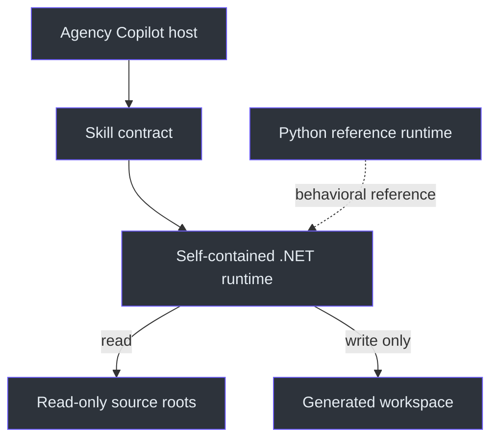
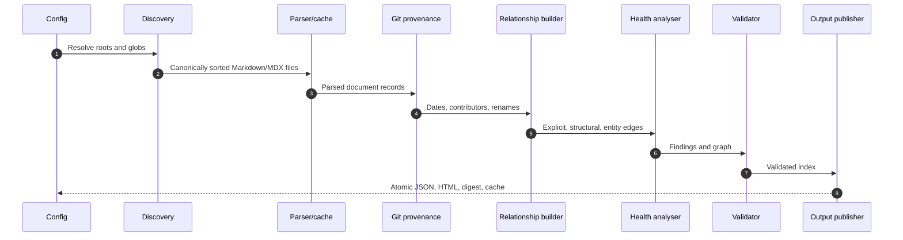
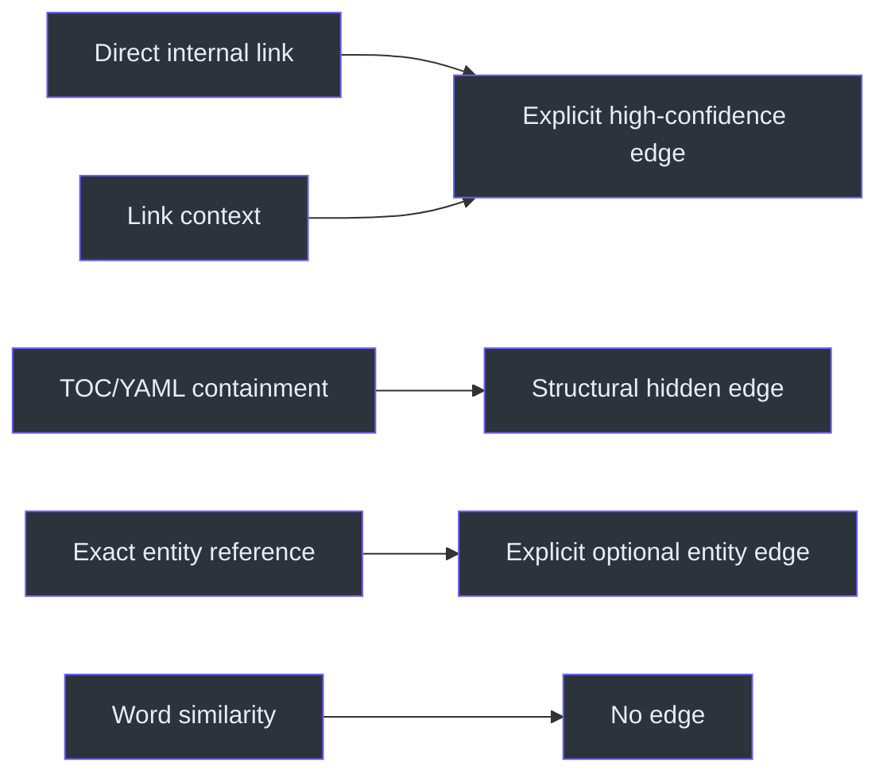

# Documentation Mesh Architecture

## Overview

Documentation Mesh exists to make a documentation estate searchable and inspectable without mutating it, executing its code, following external URLs, or inventing semantic relationships. The architecture separates a host-facing skill contract from a pinned runtime and a generated workspace (`SKILL.md:L6-L17`).

The distributable runtime is the native .NET implementation. A standard-library Python implementation mirrors the behavior for development and testing (`C:\devdesk\Copilot\CopilotSessions\documentation-mesh-plugin\README.md:L14-L14`, `C:\devdesk\Copilot\CopilotSessions\documentation-mesh-plugin\README.md:L209-L231`).

## Component model

| Component | Responsibility | Evidence |
|---|---|---|
| `SKILL.md` | Safety, input resolution, runtime fallback, operator sequence, reporting | `SKILL.md:L10-L79` |
| `Program.cs` | Packaged CLI, full native build pipeline, validation, offline rendering | `C:\devdesk\Copilot\CopilotSessions\documentation-mesh-plugin\src\DocumentationMesh.Runtime\Program.cs:L47-L112`, `C:\devdesk\Copilot\CopilotSessions\documentation-mesh-plugin\src\DocumentationMesh.Runtime\Program.cs:L168-L239` |
| `documentation_mesh\cli.py` | Python reference CLI and workspace initialization | `C:\devdesk\Copilot\CopilotSessions\documentation-mesh-plugin\src\documentation_mesh\cli.py:L15-L98` |
| `documentation_mesh\core.py` | Python reference parser, graph, health, cache, validation, rendering | `C:\devdesk\Copilot\CopilotSessions\documentation-mesh-plugin\src\documentation_mesh\core.py:L128-L166`, `C:\devdesk\Copilot\CopilotSessions\documentation-mesh-plugin\src\documentation_mesh\core.py:L1283-L1380` |
| Schemas | Public config and index structural contracts | `C:\devdesk\Copilot\CopilotSessions\documentation-mesh-plugin\schemas\config.schema.json:L1-L50`, `C:\devdesk\Copilot\CopilotSessions\documentation-mesh-plugin\schemas\documentation-index.schema.json:L1-L45` |
| Dashboard resources | Embedded CSS, JS, and pinned force-graph vendor code | `C:\devdesk\Copilot\CopilotSessions\documentation-mesh-plugin\src\DocumentationMesh.Runtime\DocumentationMesh.Runtime.csproj:L21-L27` |
| Packaging scripts | Build single executable and versioned ZIP/checksum | `C:\devdesk\Copilot\CopilotSessions\documentation-mesh-plugin\packaging\build-runtime.ps1:L1-L47`, `C:\devdesk\Copilot\CopilotSessions\documentation-mesh-plugin\packaging\create-zip.ps1:L1-L30` |

## Build pipeline

The native build performs config validation, discovery, cached parsing, Git provenance, owner inheritance, internal-link resolution, navigation parsing, entity extraction, health analysis, graph construction, timeline creation, optional validation, and atomic output writes (`C:\devdesk\Copilot\CopilotSessions\documentation-mesh-plugin\src\DocumentationMesh.Runtime\Program.cs:L168-L239`).

## Read-only and path safety

The skill forbids source mutation and requires the workspace outside the source (`SKILL.md:L10-L25`). Runtime initialization refuses a workspace inside the source, and config validation confines output and cache paths to the workspace while rejecting a workspace inside any configured source root (`C:\devdesk\Copilot\CopilotSessions\documentation-mesh-plugin\src\DocumentationMesh.Runtime\Program.cs:L139-L165`, `C:\devdesk\Copilot\CopilotSessions\documentation-mesh-plugin\src\DocumentationMesh.Runtime\Program.cs:L241-L265`).

Discovery applies include/exclude globs, canonical ordering, and an inside-root check; escaped paths are recorded as skipped rather than processed (`C:\devdesk\Copilot\CopilotSessions\documentation-mesh-plugin\src\DocumentationMesh.Runtime\Program.cs:L268-L297`). The Python reference implements the same boundary (`C:\devdesk\Copilot\CopilotSessions\documentation-mesh-plugin\src\documentation_mesh\core.py:L434-L459`).

Security/privacy behavior also includes:

- External URLs are parsed but not followed.
- Markdown code is not executed.
- Secret-like assignments are redacted in excerpts.
- Complete source bodies/transcripts are not embedded.
- JSON embedded in HTML escapes `<`, U+2028, and U+2029.
- Outputs remain local (`C:\devdesk\Copilot\CopilotSessions\documentation-mesh-plugin\README.md:L199-L207`, `C:\devdesk\Copilot\CopilotSessions\documentation-mesh-plugin\src\DocumentationMesh.Runtime\Program.cs:L1213-L1216`).

## Parsing architecture

The parser handles:

- Basic YAML frontmatter.
- ATX and Setext headings/anchors.
- Inline Markdown, reference-style, HTML, and wiki links.
- Images and Mermaid fences.
- Code-file paths, commands, work items, pull requests, and IcM incidents.
- Status, owner, tags, family, summary, purpose, hashes, and warnings.

Links and entities inside fenced code are excluded because the parser toggles fence state before extraction (`C:\devdesk\Copilot\CopilotSessions\documentation-mesh-plugin\src\documentation_mesh\core.py:L217-L365`). Frontmatter support is intentionally a common-shape parser, not full YAML (`C:\devdesk\Copilot\CopilotSessions\documentation-mesh-plugin\src\documentation_mesh\core.py:L169-L205`, `C:\devdesk\Copilot\CopilotSessions\documentation-mesh-plugin\README.md:L256-L264`).

## Relationship evidence architecture

Default-visible graph edges are not generated from word similarity. Direct internal links create high-confidence explicit edges; link heading/label context can classify them as `see-also`, `prerequisite`, `next-step`, or `replacement` (`C:\devdesk\Copilot\CopilotSessions\documentation-mesh-plugin\src\documentation_mesh\core.py:L674-L792`).

Structural navigation edges are high-confidence but hidden by default. Exact code-path, command, work-item, PR, and incident references become optional entity edges, also hidden by default (`C:\devdesk\Copilot\CopilotSessions\documentation-mesh-plugin\src\documentation_mesh\core.py:L795-L940`).

Every edge carries stable IDs, source/target, type/class, confidence, reason, source line evidence, directionality, extraction method, default visibility, and caveat (`C:\devdesk\Copilot\CopilotSessions\documentation-mesh-plugin\README.md:L133-L159`).

## Provenance and ownership

When enabled, Git is queried once per source root. First/last events establish high-confidence creation/update dates, contributors and commit counts are retained, and rename evidence is recorded. Files without Git history fall back to filesystem modification time with lower confidence (`C:\devdesk\Copilot\CopilotSessions\documentation-mesh-plugin\src\documentation_mesh\core.py:L507-L620`).

Documents lacking explicit ownership search upward for `owners.txt` within the repository/root boundary and record inherited owner evidence (`C:\devdesk\Copilot\CopilotSessions\documentation-mesh-plugin\src\documentation_mesh\core.py:L623-L671`).

Session provenance is represented in config/index/UI but is not implemented in version `0.1.0`; enabling it emits a warning and Git remains the implemented provenance source (`C:\devdesk\Copilot\CopilotSessions\documentation-mesh-plugin\src\documentation_mesh\core.py:L1325-L1365`, `C:\devdesk\Copilot\CopilotSessions\documentation-mesh-plugin\README.md:L256-L264`).

## Cache architecture

The cache key is the canonical collection path. Reuse requires matching file size and nanosecond modification timestamp plus a valid cached document. Version/schema mismatch or unreadable cache resets to an empty cache (`C:\devdesk\Copilot\CopilotSessions\documentation-mesh-plugin\src\documentation_mesh\core.py:L462-L504`).

Only parsed document records are reused. Git history, relationships, aggregate health, graph, timeline, and outputs are recomputed, preventing cross-document changes from leaving stale edges or findings (`C:\devdesk\Copilot\CopilotSessions\documentation-mesh-plugin\README.md:L252-L255`).

## Health architecture

Health findings include unresolved links/anchors/assets, missing titles/owners, orphans, missing inbound/outbound connectivity, malformed frontmatter/Markdown, exact duplicates, and conservative near duplicates. Near duplicates use a 64-bit SimHash and a Hamming-distance threshold of three within coarse buckets (`C:\devdesk\Copilot\CopilotSessions\documentation-mesh-plugin\src\documentation_mesh\core.py:L943-L1089`).

## Validation and atomic publication

Validation checks graph identity/integrity, relationship enums, confidence enums, and evidence line ranges (`C:\devdesk\Copilot\CopilotSessions\documentation-mesh-plugin\src\DocumentationMesh.Runtime\Program.cs:L1097-L1124`). Outputs are written through same-directory temporary files and moved over final paths, limiting partial replacement (`C:\devdesk\Copilot\CopilotSessions\documentation-mesh-plugin\src\DocumentationMesh.Runtime\Program.cs:L1184-L1198`).

## Offline dashboard architecture

The runtime reads embedded CSS, application JS, and vendor JS resources, serializes the index into the page, and renders Catalogue, Knowledge graph, Health, Timeline, and Provenance tabs (`C:\devdesk\Copilot\CopilotSessions\documentation-mesh-plugin\src\DocumentationMesh.Runtime\Program.cs:L1126-L1145`). No CDN, server, external font, or network API is required (`C:\devdesk\Copilot\CopilotSessions\documentation-mesh-plugin\README.md:L122-L132`).

Browser tests verify `file://` loading, catalogue search/filter, health findings, ForceGraph loading, finite coordinates, strong default edges, edge evidence inspection, node pin/unpin, detail/evidence/local-depth controls, animation, and responsive layout (`C:\devdesk\Copilot\CopilotSessions\documentation-mesh-plugin\tests\browser_smoke.mjs:L1-L118`).

## Architectural limitations

- Packaged payload is Windows x64 only.
- Marketplace artifact publication awaits an authorized feed.
- Session-state provenance is not implemented.
- YAML/TOC parsing covers common shapes, not full YAML.
- Mermaid fences are checked structurally, not rendered for validation.
- SimHash may miss heavily rewritten duplicates.
- External-link availability is not checked (`C:\devdesk\Copilot\CopilotSessions\documentation-mesh-plugin\README.md:L256-L264`).
