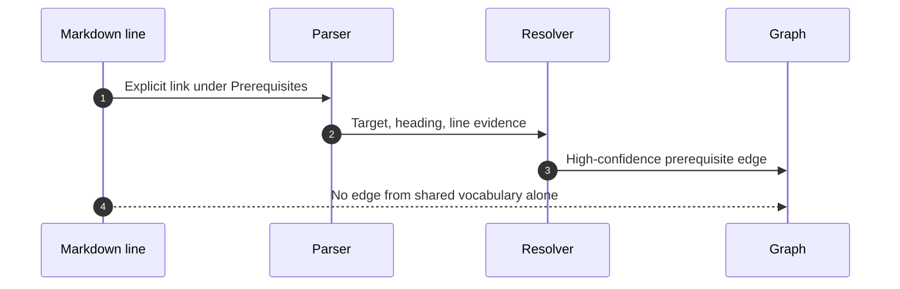

# Documentation Mesh Examples

## Example 1: new sibling workspace

Source:

```text
C:\docs\ProductGuide
```

Workspace:

```text
C:\docs\ProductGuide-documentation-mesh
```

Commands:

```powershell
documentation-mesh init `
  --source "C:\docs\ProductGuide" `
  --workspace "C:\docs\ProductGuide-documentation-mesh"

documentation-mesh build `
  --config "C:\docs\ProductGuide-documentation-mesh\config.json" `
  --validate

documentation-mesh validate `
  --index "C:\docs\ProductGuide-documentation-mesh\output\documentation-index.json"

Start-Process "C:\docs\ProductGuide-documentation-mesh\output\documentation-mesh.html"
```

This follows the required new-workspace sequence (`SKILL.md:L33-L66`).


## Example 2: refresh

```powershell
documentation-mesh build `
  --config "C:\docs\ProductGuide-documentation-mesh\config.json" `
  --validate

documentation-mesh validate `
  --index "C:\docs\ProductGuide-documentation-mesh\output\documentation-index.json"
```

An unchanged refresh should report reused documents; modified documents should reparse while unchanged documents reuse the cache. The packaged consumer contract verifies `3 reparsed/0 reused` on the first build and `0 reparsed/3 reused` on the second (`C:\devdesk\Copilot\CopilotSessions\documentation-mesh-plugin\tests\consumer-contract.ps1:L21-L35`).

## Example 3: multi-root config

```json
{
  "schemaVersion": 1,
  "sourceRoots": [
    "C:\\docs\\Platform",
    "C:\\docs\\Operations"
  ],
  "includeGlobs": [
    "**/*.md",
    "**/*.mdx"
  ],
  "excludeGlobs": [
    "**/.git/**",
    "**/node_modules/**",
    "**/output/**"
  ],
  "generatedDocumentGlobs": [
    "**/generated/**"
  ],
  "archivedDocumentGlobs": [
    "**/archive/**",
    "**/deprecated/**"
  ],
  "outputDirectory": "output",
  "cachePath": "output/build-cache.json",
  "gitHistoryEnabled": true,
  "sessionProvenanceEnabled": false,
  "historyWindowDays": 365,
  "freshDays": 180,
  "agingDays": 365,
  "staleDays": 730,
  "maximumOptionalEntityNodes": 2500,
  "defaultEvidenceLevel": "strong",
  "defaultDetailLevel": "documents",
  "browserExecutablePath": "",
  "workspaceLocation": "C:\\docs\\portfolio-documentation-mesh",
  "runtimeVersion": "0.1.0",
  "pluginVersion": "0.1.0",
  "allowWorkspaceInitialization": true
}
```

All keys must conform to the closed schema (`C:\devdesk\Copilot\CopilotSessions\documentation-mesh-plugin\schemas\config.schema.json:L1-L50`).

## Example 4: evidence-backed relationships

Source line:

```markdown
## Prerequisites

Read [Identity setup](identity.md) before deployment.
```

Expected graph interpretation:

- Type: `prerequisite`.
- Class: `explicit`.
- Confidence: `high`.
- Default-visible: `true`.
- Evidence: source file and exact line excerpt.

The resolver uses heading/label context for prerequisite classification (`C:\devdesk\Copilot\CopilotSessions\documentation-mesh-plugin\src\documentation_mesh\core.py:L754-L789`).

By contrast, two documents containing the same product term but no persisted relationship produce no default edge (`SKILL.md:L15-L16`, `C:\devdesk\Copilot\CopilotSessions\documentation-mesh-plugin\README.md:L133-L159`).



## Example 5: code-fence exclusion

````markdown
```text
[Illustrative missing link](not-real.md)
```
````

The link is ignored because extraction does not run inside fenced code. Unit tests assert this behavior (`C:\devdesk\Copilot\CopilotSessions\documentation-mesh-plugin\tests\unit\test_runtime.py:L80-L87`).

## Example 6: safe cache change

Initial state:

```text
README.md unchanged
Guide.md changed
FAQ.md unchanged
```

Expected parse statistics:

```json
{
  "cacheReused": 2,
  "cacheReparsed": 1
}
```

The unit suite verifies this precise incremental pattern after changing one of three documents (`C:\devdesk\Copilot\CopilotSessions\documentation-mesh-plugin\tests\unit\test_runtime.py:L55-L78`).

## Example 7: workspace violation

Invalid:

```text
Source:    C:\docs\ProductGuide
Workspace: C:\docs\ProductGuide\generated-mesh
```

Expected error:

```text
documentation-mesh: Generated workspace must remain outside the source collection
```

Both initialization and unit tests enforce the boundary (`C:\devdesk\Copilot\CopilotSessions\documentation-mesh-plugin\src\DocumentationMesh.Runtime\Program.cs:L139-L150`, `C:\devdesk\Copilot\CopilotSessions\documentation-mesh-plugin\tests\unit\test_runtime.py:L89-L95`).

## Example 8: output escape violation

Invalid config:

```json
{
  "outputDirectory": "../escape",
  "cachePath": "output/cache.json"
}
```

Expected result: config validation fails. The unit test explicitly covers this case (`C:\devdesk\Copilot\CopilotSessions\documentation-mesh-plugin\tests\unit\test_runtime.py:L97-L117`).

## Example 9: skipped or unreadable source

Do not omit it from the report:

```text
Files skipped: 2
- C:\docs\...\restricted.md — access denied
- C:\docs\...\escape.md — path escaped configured source root
```

The skill requires explicit surfacing (`SKILL.md:L16-L16`, `SKILL.md:L68-L77`), and the runtime includes discovery and parse skips in the index and warning count (`C:\devdesk\Copilot\CopilotSessions\documentation-mesh-plugin\src\DocumentationMesh.Runtime\Program.cs:L186-L225`).

## Example 10: final report

```text
Documentation Mesh completed.

Source roots:
- C:\docs\ProductGuide

Workspace:
- C:\docs\ProductGuide-documentation-mesh

Indexed: 842 documents
Skipped: 3 files
Graph: 1,024 nodes / 1,688 edges
Default strong relationships: 711
Optional relationships: 977
Broken links: 14
Broken anchors: 6
Orphans: 31
Cache: 801 reused / 41 reparsed

Outputs:
- ...\documentation-index.json
- ...\documentation-mesh.html
- ...\DOCUMENTATION-MESH.md
- ...\build-cache.json

Limitations:
- External URLs were not checked.
- Session provenance is unavailable in runtime 0.1.0.
- Three restricted files were not indexed.
```

These categories implement the reporting checklist at `SKILL.md:L68-L77`; numeric values above are illustrative only.
