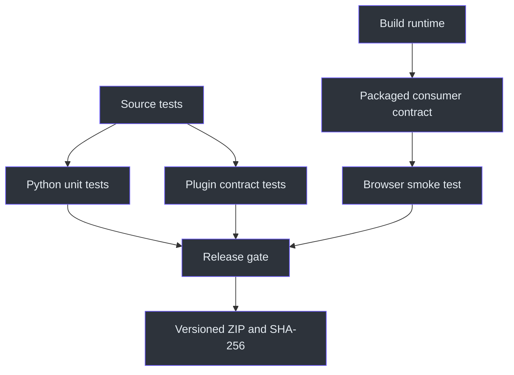
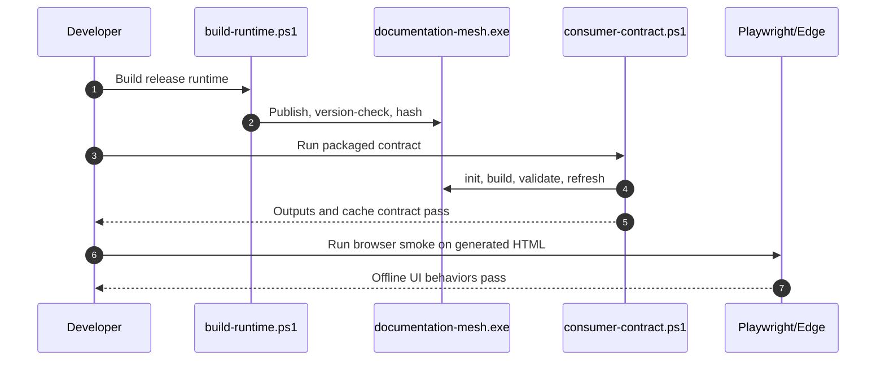

# Documentation Mesh Operations and Testing

## Overview

Operations are split into consumer validation and plugin development. Consumers use the pinned executable and must not install dependencies as part of skill recovery (`SKILL.md:L26-L31`). Developers may run the repository’s declared Python, Node/browser, .NET build, consumer-contract, and packaging procedures (`C:\devdesk\Copilot\CopilotSessions\documentation-mesh-plugin\README.md:L209-L250`).



## Development prerequisites

Browser-test dependencies:

```powershell
npm ci --ignore-scripts --no-audit --no-fund
```

The package pins `force-graph` and `playwright-core`, and exposes `npm run test:browser` (`C:\devdesk\Copilot\CopilotSessions\documentation-mesh-plugin\package.json:L1-L16`).

Python reference implementation:

- Python 3.11+.
- Standard-library runtime dependencies.
- Console entry point `documentation-mesh = documentation_mesh.cli:main` (`C:\devdesk\Copilot\CopilotSessions\documentation-mesh-plugin\pyproject.toml:L1-L21`).

Native build:

- .NET 8 SDK.
- Windows x64 target (`C:\devdesk\Copilot\CopilotSessions\documentation-mesh-plugin\packaging\build-runtime.ps1:L1-L28`).

## Test commands

### Python unit tests

```powershell
$env:PYTHONPATH = "$PWD\src"
python -m unittest discover -s tests\unit
```

Coverage includes first build/cache refresh, one-file reparse, code-fence link exclusion, workspace isolation, output-path confinement, secret redaction, and safe script embedding (`C:\devdesk\Copilot\CopilotSessions\documentation-mesh-plugin\tests\unit\test_runtime.py:L16-L128`).

### Plugin contract tests

```powershell
$env:PYTHONPATH = "$PWD\src"
python -m unittest discover -s tests\plugin_contract
```

Coverage includes manifest consistency, trigger/safety language, no installer commands in the skill, required payload files, version agreement, and .NET—not PyInstaller—official runtime publication (`C:\devdesk\Copilot\CopilotSessions\documentation-mesh-plugin\tests\plugin_contract\test_plugin_contract.py:L10-L79`).

### Build runtime

```powershell
.\packaging\build-runtime.ps1
```

The script:

1. Requires `dotnet`.
2. clears the publish workspace and old executable/manifest;
3. publishes Release `win-x64`, self-contained, compressed single-file without debug symbols;
4. copies the executable;
5. runs `--version`;
6. computes SHA-256;
7. writes `version-manifest.json` (`C:\devdesk\Copilot\CopilotSessions\documentation-mesh-plugin\packaging\build-runtime.ps1:L1-L47`).

### Packaged consumer contract

```powershell
.\tests\consumer-contract.ps1
```

This is the critical distributable gate. It verifies:

- Runtime exists and reports `0.1.0`.
- `init` works.
- Initial fixture build parses exactly three documents.
- Independent validation succeeds.
- Refresh reuses all three documents.
- All four outputs exist.
- HTML embeds the index and ForceGraph assets (`C:\devdesk\Copilot\CopilotSessions\documentation-mesh-plugin\tests\consumer-contract.ps1:L1-L61`).

### Browser smoke test

```powershell
$env:DOCUMENTATION_MESH_HTML = "C:\path\to\workspace\output\documentation-mesh.html"
npm run test:browser
```

The test launches installed Edge headlessly with file access enabled and validates catalogue, filters, health, graph canvas, strong default edges, finite coordinates, evidence inspector, pin/unpin, graph controls, timeline animation, responsive sizing, and absence of browser errors (`C:\devdesk\Copilot\CopilotSessions\documentation-mesh-plugin\tests\browser_smoke.mjs:L1-L118`).



## Packaging

```powershell
.\packaging\create-zip.ps1
```

The packaging script requires the runtime, excludes development/build/cache directories, stages the plugin, creates `dist\documentation-mesh-plugin-0.1.0.zip`, and writes a SHA-256 sidecar (`C:\devdesk\Copilot\CopilotSessions\documentation-mesh-plugin\packaging\create-zip.ps1:L1-L30`).

The current artifact template contains placeholder Azure Artifacts feed segments and must not be activated unchanged (`C:\devdesk\Copilot\CopilotSessions\documentation-mesh-plugin\packaging\agency.artifact.template.json:L1-L11`). The README explicitly states that an authorized feed is pending and a fake feed would break local loading (`C:\devdesk\Copilot\CopilotSessions\documentation-mesh-plugin\README.md:L66-L70`).

## Release checklist

- [ ] `plugin.json`, runtime, default config, and Python version all agree.
- [ ] Unit tests pass.
- [ ] Plugin-contract tests pass.
- [ ] Native runtime builds from clean output.
- [ ] Runtime `--version` is correct.
- [ ] Runtime SHA-256 manifest regenerated.
- [ ] Consumer contract passes first build, validation, refresh, and output checks.
- [ ] Browser smoke test passes on generated `file://` HTML.
- [ ] ZIP and checksum regenerated.
- [ ] ZIP contents exclude `node_modules`, build output, dist output, `.git`, and `__pycache__`.
- [ ] Artifact feed placeholders are not published as real configuration.
- [ ] Documentation limitations remain accurate.

## Consumer operational checks

After every real build:

1. Confirm source/workspace separation.
2. Confirm runtime version.
3. Run build with validation.
4. Run independent validation.
5. Confirm four outputs.
6. Review warning/skipped counts.
7. Open dashboard offline.
8. Check strong/default versus optional edges.
9. Report cache and health counts.
10. Record limitations and restricted/unknown provenance (`SKILL.md:L50-L79`).

## Troubleshooting

| Symptom | Likely cause | Action |
|---|---|---|
| `command not found` | Runtime not on PATH | Use plugin-local or `$AGENCY_PLUGIN_DIR` executable |
| Runtime absent | Incomplete plugin/artifact | Stop; report acquisition failure |
| No Markdown/MDX | Wrong source root | Select valid source |
| Workspace rejected | Nested under source | Move to sibling/outside path |
| Output/cache rejected | Config escapes workspace | Restore workspace-relative paths |
| Zero matched files | Include/exclude mismatch | Review globs |
| Many reparsed files | mtime/size changed or cache/version reset | Inspect file signatures/runtime version |
| Git warnings | Root not in Git or Git command failed | Report fallback provenance |
| Session provenance warning | Toggle enabled in unsupported version | Disable or report limitation |
| Dashboard does not load | Missing/corrupt embedded assets or browser issue | Rebuild runtime; run consumer/browser tests |
| Validation fails | Duplicate/dangling/invalid evidence graph | Do not publish success; inspect index/source evidence |

## Security regression checks

- Secret-like assignments are redacted.
- Embedded JSON contains no literal `<` script terminator.
- U+2028/U+2029 are escaped.
- Source files remain unchanged.
- External URLs are not requested.
- Output/cache remain inside workspace.
- Workspace remains outside sources.
- Links inside code fences do not create relationships.

Unit coverage for redaction/escaping/path boundaries appears at `C:\devdesk\Copilot\CopilotSessions\documentation-mesh-plugin\tests\unit\test_runtime.py:L80-L124`.

## Known limitations and honest reporting

Always report:

- Only Windows x64 is packaged.
- Marketplace publication awaits an authorized feed.
- Session provenance is not implemented.
- YAML/frontmatter/TOC parsing is intentionally partial.
- Mermaid is not executed for semantic validation.
- SimHash is conservative.
- External link availability is not checked (`C:\devdesk\Copilot\CopilotSessions\documentation-mesh-plugin\README.md:L256-L264`).

Do not convert “parsed external URL” into “working URL,” filesystem mtime into a creation date, optional structural edges into semantic relationships, or a successful build into proof that every source file was readable.
