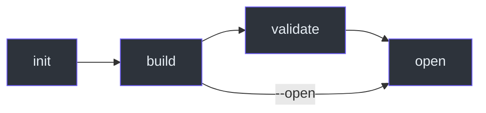
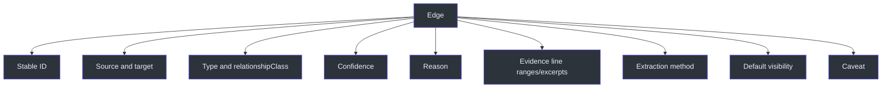

# Documentation Mesh Reference

## CLI

| Command | Required options | Optional flags | Result |
|---|---|---|---|
| `--version` | None | None | Prints `documentation-mesh 0.1.0` |
| `init` | `--source`, `--workspace` | `--force` | Writes/returns workspace config |
| `build` | `--config` | `--validate`, `--open` | Builds outputs and prints statistics/paths |
| `validate` | `--index` | None | Validates persisted index |
| `open` | `--html` | None | Opens report through shell |

The native parser accepts only `--force`, `--validate`, and `--open` as valueless flags; all other options require values (`C:\devdesk\Copilot\CopilotSessions\documentation-mesh-plugin\src\DocumentationMesh.Runtime\Program.cs:L47-L137`).



## Runtime resolution

Resolution order and installation prohibition are normative at `SKILL.md:L26-L31`. The bundled executable path is:

```text
runtime\windows-x64\documentation-mesh.exe
```

The runtime manifest records name, version, platform, executable, SHA-256, and build timestamp (`C:\devdesk\Copilot\CopilotSessions\documentation-mesh-plugin\runtime\windows-x64\version-manifest.json:L1-L8`).

## Configuration reference

### Required

| Key | Type | Meaning |
|---|---|---|
| `schemaVersion` | integer, exactly `1` | Config schema |
| `sourceRoots` | non-empty string array | Read-only collections |
| `includeGlobs` | string array | Included documents |
| `excludeGlobs` | string array | Excluded paths |
| `outputDirectory` | string | Workspace-relative output |
| `cachePath` | string | Workspace-relative cache |
| `runtimeVersion` | semver string | Expected runtime |
| `pluginVersion` | semver string | Expected plugin |

### Optional/current

| Key | Type/default concept | Meaning |
|---|---|---|
| `generatedDocumentGlobs` | array | Marks generated status |
| `archivedDocumentGlobs` | array | Marks archive/deprecated status |
| `gitHistoryEnabled` | boolean | Enables Git provenance |
| `sessionProvenanceEnabled` | boolean | Schema/UI toggle; runtime only warns in 0.1.0 |
| `sessionStateRoot` | string | Reserved provenance root |
| `historyWindowDays` | integer ≥1 | History horizon configuration |
| `freshDays`, `agingDays`, `staleDays` | integers ≥0 | Freshness thresholds |
| `maximumOptionalEntityNodes` | integer ≥0 | Entity graph cap |
| `defaultEvidenceLevel` | strong/inferred/incidental | Dashboard default |
| `defaultDetailLevel` | documents/sections/entities/full | Dashboard default |
| `browserExecutablePath` | string | Browser override metadata |
| `workspaceLocation` | string | Workspace identity |
| `allowWorkspaceInitialization` | boolean | Initialization policy metadata |

The schema disallows additional properties (`C:\devdesk\Copilot\CopilotSessions\documentation-mesh-plugin\schemas\config.schema.json:L1-L50`). Generated defaults are listed in `C:\devdesk\Copilot\CopilotSessions\documentation-mesh-plugin\templates\config.default.json:L1-L43`.

## Discovery and parsing reference

| Feature | Behavior |
|---|---|
| Root names | Duplicate basename roots receive numeric suffixes |
| Ordering | Canonical collection-path order |
| Path escape | Skipped with explicit reason |
| Encoding | UTF-8 with BOM support; replacement on invalid bytes |
| Frontmatter | Common scalar/list/boolean shapes |
| Headings | ATX and Setext |
| Links | Markdown, reference, HTML, wiki |
| Code fences | Extraction skipped inside fences |
| Entities | Code paths, commands, ADO work items/PRs, IcM incidents |
| Mermaid | Counts fenced Mermaid blocks |
| Status | Frontmatter/path/generated/archive rules |
| Stable IDs | SHA-256-derived 16-hex suffix |
| Secret evidence | Assignment value redacted |

Implementation evidence: `C:\devdesk\Copilot\CopilotSessions\documentation-mesh-plugin\src\documentation_mesh\core.py:L23-L95`, `C:\devdesk\Copilot\CopilotSessions\documentation-mesh-plugin\src\documentation_mesh\core.py:L169-L431`, `C:\devdesk\Copilot\CopilotSessions\documentation-mesh-plugin\src\documentation_mesh\core.py:L434-L459`.

## Index reference

Required top-level properties:

```text
schemaVersion
generatedAt
generatorVersion
sourceRoots
statistics
documents
sections
entities
graph { nodes, edges }
timeline
healthFindings
warnings
skippedFiles
```

Optional/public properties include Git provenance and artifact provenance (`C:\devdesk\Copilot\CopilotSessions\documentation-mesh-plugin\schemas\documentation-index.schema.json:L1-L45`).

### Statistics

| Statistic | Meaning |
|---|---|
| `documentCount` | Parsed documents |
| `sectionCount` | Navigation sections |
| `entityCount` | Included optional entities |
| `graphNodeCount` / `graphEdgeCount` | Full graph totals |
| `defaultEdgeCount` | Default-visible relationships |
| `optionalEdgeCount` | Hidden structural/entity relationships |
| `healthFindingCount` | Health records |
| `externalLinkCount` | Parsed external URLs |
| `cacheReused` / `cacheReparsed` | Incremental parse outcome |
| `buildSeconds` | Measured build duration |

These values are populated by the native build (`C:\devdesk\Copilot\CopilotSessions\documentation-mesh-plugin\src\DocumentationMesh.Runtime\Program.cs:L193-L225`).

## Edge evidence reference



### Classes and default visibility

| Source | Class | Confidence | Default |
|---|---|---|---|
| Direct internal document link | `explicit` | high | yes |
| Contextual see-also/prerequisite/next-step/replacement | `explicit` | high | yes |
| TOC/navigation containment | `structural` | high | no |
| Exact referenced entity | `explicit` | high | no |
| Generic word similarity | none | none | never generated |

Evidence policy: `C:\devdesk\Copilot\CopilotSessions\documentation-mesh-plugin\README.md:L133-L159`; implementation: `C:\devdesk\Copilot\CopilotSessions\documentation-mesh-plugin\src\documentation_mesh\core.py:L674-L940`.

## Health findings

| Type | Meaning |
|---|---|
| `broken-link` | Missing internal document |
| `broken-anchor` | Missing local/target anchor |
| `missing-asset` | Missing non-Markdown target |
| `missing-title` | No usable title |
| `missing-owner` | No explicit/inherited owner |
| `orphan` | No default incoming/outgoing relationship |
| `no-inbound-links` | No strong inbound edge |
| `no-outbound-links` | No strong outbound edge |
| `invalid-frontmatter` / `invalid-markdown` | Parser warning |
| `duplicate-document` | Identical normalized content hash |
| `near-duplicate-document` | Conservative SimHash match |

See `C:\devdesk\Copilot\CopilotSessions\documentation-mesh-plugin\src\documentation_mesh\core.py:L954-L1089`.

## Cache

Cache reuse requires:

```text
same canonical collection path
+ same byte size
+ same mtimeNs
+ cached document object
+ matching cache schema/generator version
```

Changed/new inputs are reparsed; deleted documents disappear because a new cache is built from current discovery. Aggregate graph/health/provenance is recomputed (`C:\devdesk\Copilot\CopilotSessions\documentation-mesh-plugin\src\documentation_mesh\core.py:L462-L504`, `C:\devdesk\Copilot\CopilotSessions\documentation-mesh-plugin\README.md:L252-L255`).

## Validation

Validation rejects:

- Missing required index fields.
- Duplicate node IDs.
- Duplicate edge IDs.
- Documents without nodes.
- Dangling edges.
- Unknown relationship classes.
- Unknown confidence values.
- Evidence line starts below one.
- End lines before start lines (`C:\devdesk\Copilot\CopilotSessions\documentation-mesh-plugin\src\DocumentationMesh.Runtime\Program.cs:L1097-L1124`).

## Dashboard

The HTML embeds CSS, application JavaScript, pinned vendor JavaScript, and escaped JSON. Tabs are Catalogue, Knowledge graph, Health, Timeline, and Provenance (`C:\devdesk\Copilot\CopilotSessions\documentation-mesh-plugin\src\DocumentationMesh.Runtime\Program.cs:L1126-L1145`).

## Exit/error behavior

Handled native failures print:

```text
documentation-mesh: <message>
```

and return exit code `1`; success returns `0` (`C:\devdesk\Copilot\CopilotSessions\documentation-mesh-plugin\src\DocumentationMesh.Runtime\Program.cs:L47-L112`).

## Limitations

Normative limitations are documented at `C:\devdesk\Copilot\CopilotSessions\documentation-mesh-plugin\README.md:L256-L264`; do not claim unsupported OS payloads, session provenance, full YAML parsing, Mermaid execution, exhaustive near-duplicate discovery, or external-link health checks.
