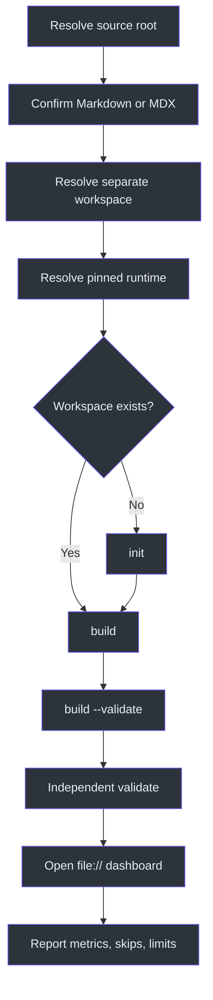
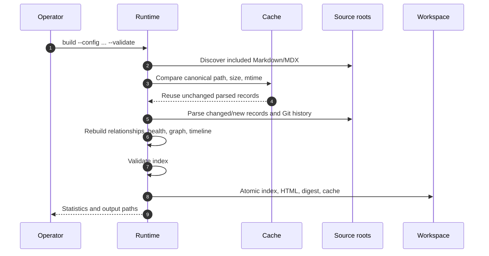

# Documentation Mesh Workflow

## Overview

The workflow is designed to fail closed: choose a valid Markdown source, keep generation outside it, resolve a pinned runtime without installing dependencies, build with validation, independently validate the resulting index, open the offline dashboard, and report limitations as well as successes (`SKILL.md:L19-L79`).



## 1. Resolve the source

1. Prefer an explicit user-supplied source path.
2. Otherwise use the current directory.
3. Confirm at least one `.md` or `.mdx` file exists.
4. If unrelated roots are equally plausible and a wrong choice would invalidate the report, ask once (`SKILL.md:L19-L23`).

The runtime itself rechecks source existence and Markdown/MDX presence during `init` (`C:\devdesk\Copilot\CopilotSessions\documentation-mesh-plugin\src\DocumentationMesh.Runtime\Program.cs:L139-L150`).

## 2. Resolve the workspace

Use the user’s explicit workspace if supplied. Otherwise create a sibling named `<source-name>-documentation-mesh`. The workspace must not be inside the source unless the user explicitly selected an existing generated workspace (`SKILL.md:L23-L25`).

Runtime config validation is stricter for ordinary generation: output and cache must remain inside the workspace, and the workspace must remain outside every configured source root (`C:\devdesk\Copilot\CopilotSessions\documentation-mesh-plugin\src\DocumentationMesh.Runtime\Program.cs:L241-L265`).

## 3. Resolve the runtime

```powershell
documentation-mesh --version
```

Expected packaged response:

```text
documentation-mesh 0.1.0
```

If the command is unavailable:

1. Resolve the loaded `SKILL.md` directory.
2. Walk up two levels to the plugin root.
3. Use `runtime\windows-x64\documentation-mesh.exe`.
4. Alternatively use `$AGENCY_PLUGIN_DIR\runtime\windows-x64\documentation-mesh.exe`.
5. If absent, stop; do not install Python, npm, .NET, package managers, or curl installers (`SKILL.md:L26-L31`).

The consumer contract asserts the exact version string before testing the packaged workflow (`C:\devdesk\Copilot\CopilotSessions\documentation-mesh-plugin\tests\consumer-contract.ps1:L10-L24`).

## 4. Initialize a new workspace

```powershell
documentation-mesh init `
  --source "<source-root>" `
  --workspace "<workspace>"
```

Initialization:

- Resolves absolute paths.
- Confirms source and Markdown/MDX presence.
- Refuses workspace-inside-source.
- Returns an existing config unless `--force` is supplied.
- Writes versioned default config and workspace README atomically (`C:\devdesk\Copilot\CopilotSessions\documentation-mesh-plugin\src\DocumentationMesh.Runtime\Program.cs:L139-L165`).

Use `--force` only when deliberately regenerating the generated workspace metadata; it does not authorize source modification.

## 5. Review configuration

The generated defaults include Markdown/MDX globs, common build/output exclusions, generated/archive status globs, output/cache paths, Git history, disabled session provenance, freshness thresholds, 2,500 optional entities, strong/document defaults, and version `0.1.0` (`C:\devdesk\Copilot\CopilotSessions\documentation-mesh-plugin\templates\config.default.json:L1-L43`).

Before building:

- Add/remove source roots deliberately.
- Keep `outputDirectory` and `cachePath` inside the workspace.
- Avoid including the generated workspace through a source root.
- Keep entity limits appropriate for offline browser performance.
- Do not enable session provenance expecting implemented records; version `0.1.0` warns instead (`C:\devdesk\Copilot\CopilotSessions\documentation-mesh-plugin\src\DocumentationMesh.Runtime\Program.cs:L186-L190`).

## 6. Build or refresh

```powershell
documentation-mesh build `
  --config "<workspace>\config.json" `
  --validate
```

For an existing workspace, this is the normal refresh command (`SKILL.md:L33-L48`).



The native pipeline and returned statistics are defined at `C:\devdesk\Copilot\CopilotSessions\documentation-mesh-plugin\src\DocumentationMesh.Runtime\Program.cs:L168-L239`.

## 7. Inspect build output

The build command emits JSON containing:

- Document, section, entity, node, and edge counts.
- Default and optional relationship counts.
- Health and external-link counts.
- Cache reused/reparsed counts.
- Build duration.
- Exact output paths (`C:\devdesk\Copilot\CopilotSessions\documentation-mesh-plugin\src\DocumentationMesh.Runtime\Program.cs:L193-L238`).

Review warnings and `skippedFiles`; a nonzero skipped count is not silently discarded.

## 8. Validate independently

```powershell
documentation-mesh validate `
  --index "<workspace>\output\documentation-index.json"
```

Expected success JSON:

```json
{
  "valid": true,
  "index": "C:\\...\\documentation-index.json"
}
```

Validation is mandatory even if build used `--validate` because the skill explicitly requires the independent command and defines success in terms of output/integrity/path guarantees (`SKILL.md:L50-L58`).

## 9. Open offline

```powershell
Start-Process "<workspace>\output\documentation-mesh.html"
```

The HTML must work through `file://` without a server or network (`SKILL.md:L60-L79`). The packaged runtime also exposes:

```powershell
documentation-mesh open --html "<workspace>\output\documentation-mesh.html"
```

Native `open` checks file existence and delegates to Windows shell execution (`C:\devdesk\Copilot\CopilotSessions\documentation-mesh-plugin\src\DocumentationMesh.Runtime\Program.cs:L91-L101`, `C:\devdesk\Copilot\CopilotSessions\documentation-mesh-plugin\src\DocumentationMesh.Runtime\Program.cs:L1169-L1174`).

## 10. Review dashboard evidence

Use:

- **Catalogue** for document search/filter and evidence cards.
- **Knowledge graph** for default high-confidence links, optional detail, and edge evidence.
- **Health** for broken links/anchors, orphans, ownership/connectivity, malformed content, and duplicates.
- **Timeline** for Git-backed dates and low-confidence fallbacks.
- **Provenance** for path/title/author/commit lookup (`C:\devdesk\Copilot\CopilotSessions\documentation-mesh-plugin\README.md:L171-L180`).

Do not promote optional structural/entity edges into semantic claims without reading their evidence/caveat.

## 11. Report

Use this structure:

```text
Source roots:
Workspace:
Runtime/version:
Documents indexed:
Files skipped/restricted/unreadable:
Graph nodes/edges:
Default strong relationships:
Optional relationships:
Broken links:
Broken anchors:
Orphans:
Cache reused/reparsed:
Outputs:
Limitations and unknown provenance:
```

These fields implement `SKILL.md:L68-L77`.

## Failure paths

| Failure | Response |
|---|---|
| No Markdown/MDX | Stop and report selected root |
| Workspace inside source | Choose separate sibling workspace |
| Runtime missing | Stop with plugin/artifact acquisition error |
| Output/cache escapes workspace | Fix config; do not bypass |
| No files match globs | Correct include/exclude scope |
| Invalid/dangling graph | Do not report success; investigate generated index/config/source syntax |
| Skipped/restricted file | Report explicitly; do not reconstruct |
| Browser unavailable | Outputs remain valid; report dashboard not interactively smoke-tested |

## Implementation parity note

The Python CLI provides the same command surface (`init`, `build`, `validate`, `open`) and error prefix in the reference implementation (`C:\devdesk\Copilot\CopilotSessions\documentation-mesh-plugin\src\documentation_mesh\cli.py:L59-L98`), but consumer operation should prefer the pinned packaged executable.
