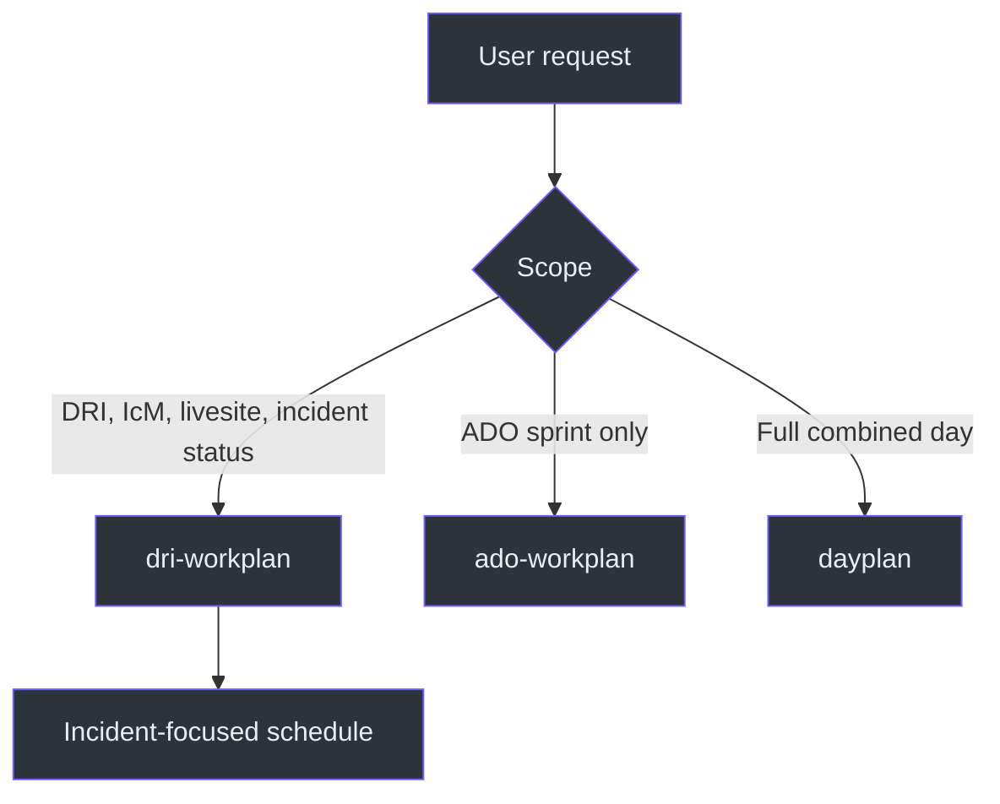
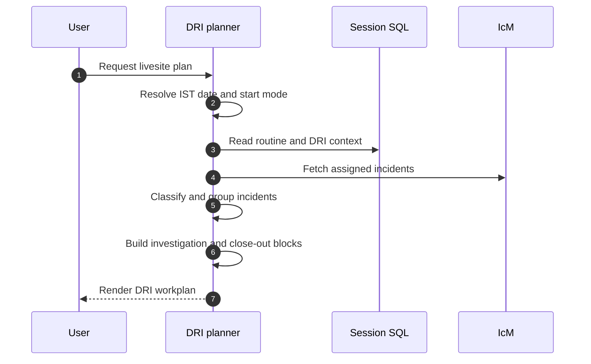

# DRI Workplan

## Purpose

`dri-workplan` produces a time-blocked plan for DRI livesite responsibilities:
incident review, investigation, mitigation, close-out, and handoff. It excludes
ADO sprint work. ADO-only work belongs to `ado-workplan`; combined work belongs
to `dayplan`. Source:
[SKILL.md](SKILL.md#dri-workplan-generator-icm--livesite-only),
`SKILL.md:L7-L11`.

Unlike the ADO and combined snapshots, this skill does not stop on weekends.
Its source explicitly says not to question working hours or say "it's weekend,"
which is consistent with on-call livesite responsibilities.
Source: [SKILL.md](SKILL.md#important-notes), `SKILL.md:L126-L132`.

## At a glance

| Concern | Contract |
|---|---|
| Scope | IcM and livesite duties only |
| Default start | 11:00 IST |
| Explicit override | Start now/current time |
| Workday template | 11:00-18:00 IST |
| Live source | IcM MCP |
| Incident selector | Assigned to `mishrad`, Sev2/3/4, Active/Mitigating/Mitigated |
| DRI context | Session SQL `dri_week` |
| Highest priority | Active Sev2 |
| Fallback | Last known incidents with staleness note |
| File side effects | None specified |

Sources: [SKILL.md](SKILL.md#-critical-rules--date--time), `SKILL.md:L13-L17`;
[SKILL.md](SKILL.md#data-sources), `SKILL.md:L26-L29`;
[SKILL.md](SKILL.md#workflow), `SKILL.md:L113-L124`;
[SKILL.md](SKILL.md#important-notes), `SKILL.md:L126-L132`.

## Routing architecture

Source: [SKILL.md](SKILL.md#when-to-use-this-skill), `SKILL.md:L19-L24`;
`SKILL.md:L9-L11`.

## End-to-end lifecycle

Source: [SKILL.md](SKILL.md#workflow), `SKILL.md:L113-L124`.

## Documentation map

| Document | Focus |
|---|---|
| [Architecture](docs/ARCHITECTURE.md) | Boundaries, incident model, control flow, and sibling integration |
| [Workflow](docs/WORKFLOW.md) | Detailed fetch, classification, grouping, scheduling, and rendering |
| [Reference](docs/REFERENCE.md) | Complete date, priority, format, URL, and quick-reference contract |
| [Examples](docs/EXAMPLES.md) | Active incidents, mitigation, timeout, handoff, and start-mode examples |
| [Operations and Testing](docs/OPERATIONS-AND-TESTING.md) | Runbook, safety checks, tests, troubleshooting, and maintenance |

## Core invariants

1. Resolve the date accurately in IST; never guess.
2. Default to 11:00 IST unless the user explicitly asks to start now.
3. Keep ADO sprint work out of this output.
4. Put active Sev2 incidents in Investigation Block 1.
5. Group incidents that share a root cause.
6. Put mitigated incidents in `PENDING CLOSE`.
7. Label last-known fallback data as stale.
8. Mention a DRI handoff when it is within 24 hours.

Sources: `SKILL.md:L13-L17`; `SKILL.md:L9-L11`;
[SKILL.md](SKILL.md#workflow), `SKILL.md:L113-L124`;
[SKILL.md](SKILL.md#important-notes), `SKILL.md:L126-L132`.

## Evidence boundary

This suite is based only on `SKILL.md`. It does not invent IcM schemas, retry
counts, root-cause grouping algorithms, persistence stores for last-known data,
or file writes.

