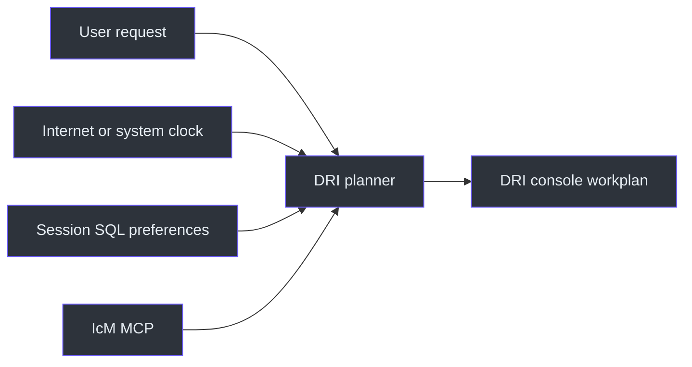
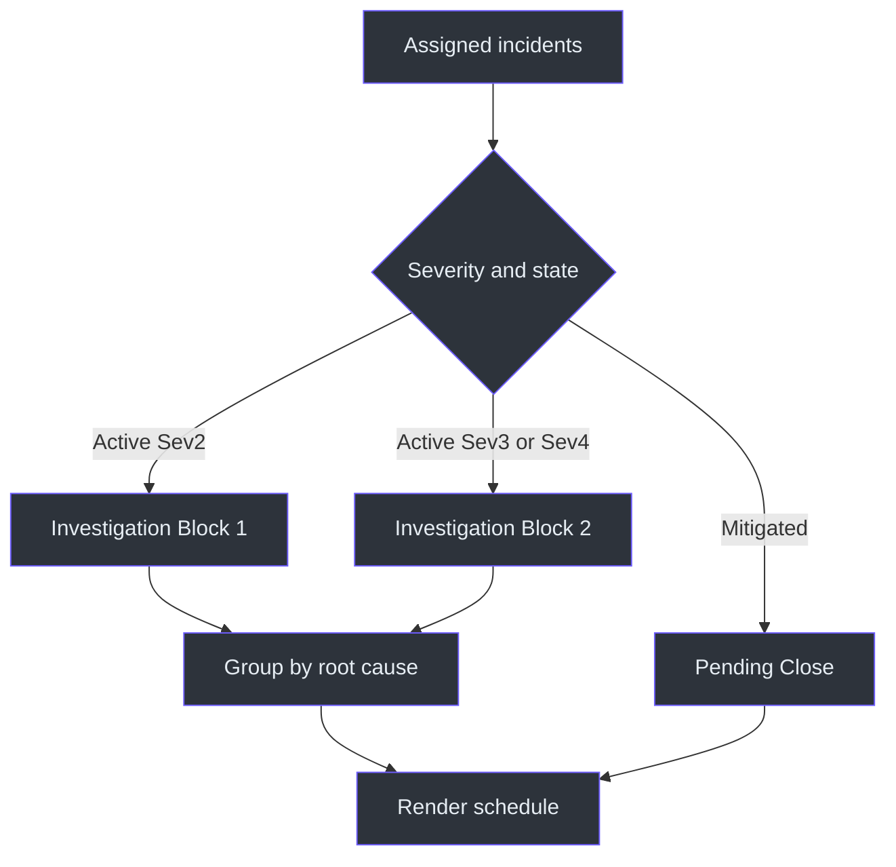
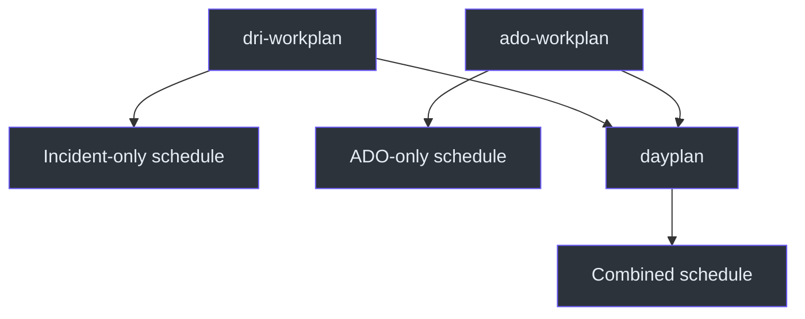

# DRI Workplan Architecture

## Overview

The architecture converts assigned incident state into an operational shift plan.
It separates urgent investigation, lower-severity follow-up, and mitigated
close-out so the DRI can focus on response order rather than scan a flat incident
list. Source: [SKILL.md](../SKILL.md#workflow), `SKILL.md:L113-L124`.

## System context

Source: [SKILL.md](../SKILL.md#-critical-rules--date--time),
`SKILL.md:L13-L17`; [SKILL.md](../SKILL.md#data-sources),
`SKILL.md:L26-L29`.

## Component model

| Component | Responsibility | Evidence |
|---|---|---|
| Trigger router | Select for DRI, livesite, IcM, and incident-status requests | `SKILL.md:L19-L24` |
| IST resolver | Resolve date, display IST, select default or current-time start | `SKILL.md:L13-L17` |
| Preference loader | Read daily routine, workplan style, and DRI week | `SKILL.md:L31-L40` |
| Incident reader | Fetch assigned Sev2/3/4 in relevant states | `SKILL.md:L26-L29` |
| Classifier | Separate active Sev2, active Sev3/4, and mitigated work | `SKILL.md:L117-L121` |
| Root-cause grouper | Keep related incidents together | `SKILL.md:L122-L123`, `L130-L131` |
| Scheduler | Map incident classes into DRI blocks | `SKILL.md:L100-L111` |
| Renderer | Emit the shared two-column box and link segments | `SKILL.md:L41-L85` |
| Timeout fallback | Use last-known data and disclose staleness | `SKILL.md:L130-L130` |
| Handoff annotator | Note a handoff inside the next 24 hours | `SKILL.md:L132-L132` |

## Incident-state pipeline

Source: [SKILL.md](../SKILL.md#workflow), `SKILL.md:L117-L124`.

## Time model

The default plan begins at 11:00 IST and ends with an 18:00 wrap-up. It does not
start at request time unless the user explicitly says "starting now" or "from
current time." Every current-time value displayed is IST.
Source: [SKILL.md](../SKILL.md#-critical-rules--date--time),
`SKILL.md:L13-L17`; [SKILL.md](../SKILL.md#schedule-template-ist--dri-blocks),
`SKILL.md:L100-L111`.

DRI weekday numbering is Monday Day 1 through Friday Day 5. The source also says
not to challenge working hours or reject a plan merely because it is a weekend.
Source: [SKILL.md](../SKILL.md#important-notes), `SKILL.md:L126-L132`.

## Data freshness model

The normal path uses the live incident query. If the IcM MCP times out, the
planner uses last known data and labels it stale. The source does not identify
the storage, timestamp threshold, or selection algorithm for last-known data.
Source: [SKILL.md](../SKILL.md#important-notes), `SKILL.md:L130-L130`.

## Rendering architecture

The schedule is a series of code-fenced box fragments. Clickable incident links
appear as Markdown bullets between those fragments. The footer contains an
actionable insight and a `PENDING CLOSE` section; its closing border is isolated
in the final fence. Source:
[SKILL.md](../SKILL.md#key-rules), `SKILL.md:L75-L85`.

## Integration with sibling skills

The source defines the routing boundary but does not specify internal code reuse.
Source: [SKILL.md](../SKILL.md#dri-workplan-generator-icm--livesite-only),
`SKILL.md:L7-L11`.

## Persistence boundary

No file path or write step appears in the DRI source. The documented side effect
is console output only. The presence of SQL as a read source does not imply SQL
writes. Source: [SKILL.md](../SKILL.md#data-sources), `SKILL.md:L26-L40`;
[SKILL.md](../SKILL.md#workflow), `SKILL.md:L113-L124`.

## Safety boundaries

- Do not include ADO sprint work.
- Do not guess date/time.
- Do not present stale incidents as current.
- Do not downgrade active Sev2 priority.
- Do not split related root-cause incidents without reason.
- Do not omit an imminent handoff note.
- Do not refuse a plan solely because it is a weekend.

Sources: `SKILL.md:L9-L17`; `SKILL.md:L117-L132`.

## References

The sole normative source is [SKILL.md](../SKILL.md). No implementation code,
test suite, schemas, or persistence definitions are included.

