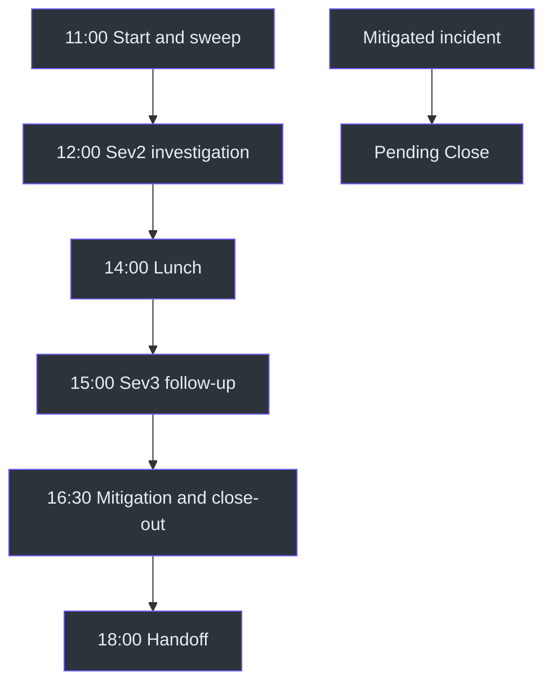
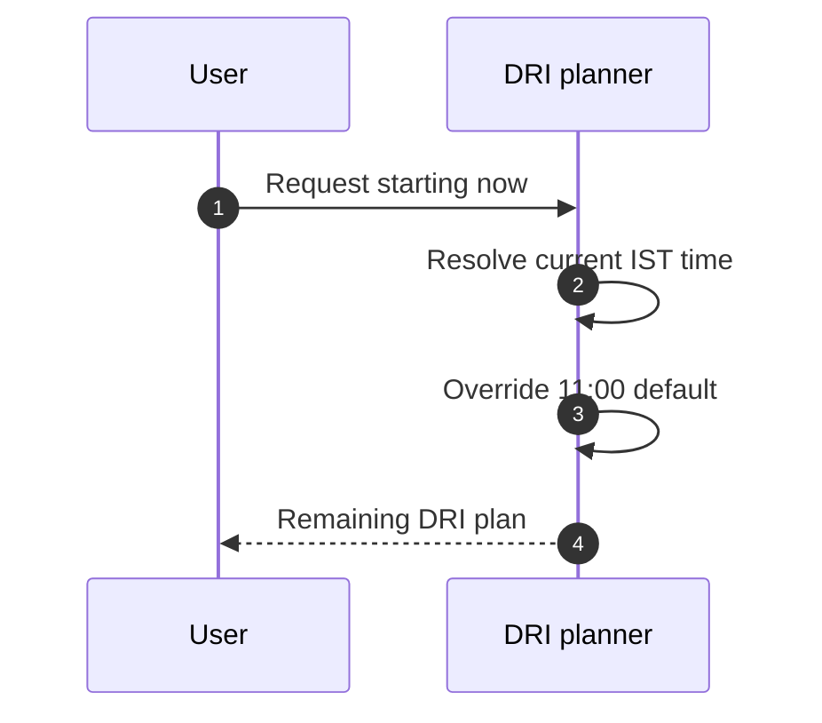

# DRI Workplan Examples

## Example conventions

All incident IDs and titles are fictional. These examples illustrate
[SKILL.md](../SKILL.md#workflow), `SKILL.md:L113-L124`, without claiming live
incident state.

## Example 1: Active Sev2 and Sev3

### Inputs

- One active Sev2.
- One active Sev3.
- One mitigated incident.
- Request does not say "starting now."

### Expected placement

| Work | Placement |
|---|---|
| Active Sev2 | 12:00 Investigation Block 1 |
| Active Sev3 | 15:00 Investigation Block 2 |
| Mitigated incident | `PENDING CLOSE` |
| Start | 11:00 IST |

Source: `SKILL.md:L15-L17`; [SKILL.md](../SKILL.md#workflow),
`SKILL.md:L117-L121`.



## Example 2: Explicit current-time start

Request:

> Show my DRI plan starting now.

At 15:10 IST, use 15:10 as the start instead of 11:00. The source does not say
to reconstruct past blocks when this override is present.
Source: [SKILL.md](../SKILL.md#-critical-rules--date--time),
`SKILL.md:L15-L17`.



## Example 3: Default start on a late request

Request:

> Give me the DRI workplan.

Even if it arrives later in the day, the source says the plan starts at 11:00
unless current-time language is explicit. Source: `SKILL.md:L15-L17`.

## Example 4: Root-cause grouping

Suppose incidents 61001, 61002, and 61003 are known to share one root cause.
Show one investigation group with the three incident links, rather than three
unrelated blocks. Source:
[SKILL.md](../SKILL.md#workflow), `SKILL.md:L122-L123`.

```text
12:00  Investigation Block 1
       Root-cause group: shared dependency
       - Incident 61001
       - Incident 61002
       - Incident 61003
```

The source does not define how shared root cause is detected.

## Example 5: IcM timeout

Expected behavior:

1. Read last-known incidents.
2. Render them.
3. Add an explicit stale-data note.
4. Do not claim the query succeeded.

Source: [SKILL.md](../SKILL.md#important-notes), `SKILL.md:L130-L130`.

Example disclosure:

> Incident data is last known because the live IcM query timed out.

## Example 6: Handoff inside 24 hours

If the next DRI handoff is within 24 hours, include its day/time in the plan,
especially near the wrap-up block. Source:
[SKILL.md](../SKILL.md#important-notes), `SKILL.md:L132-L132`.

The snapshot does not define the handoff schedule source, so the example should
only be used when that context is actually available.

## Example 7: DRI weekday label

| Weekday | Label |
|---|---|
| Monday | Day 1/5 |
| Tuesday | Day 2/5 |
| Wednesday | Day 3/5 |
| Thursday | Day 4/5 |
| Friday | Day 5/5 |

Source: [SKILL.md](../SKILL.md#important-notes), `SKILL.md:L128-L129`.

## Example 8: Weekend request

Do not answer with the ADO/dayplan recharge message merely because the date is
Saturday or Sunday. The DRI source explicitly says never to question working
hours or say it is the weekend. Continue with the DRI workflow if the required
incident data is available. Source:
[SKILL.md](../SKILL.md#important-notes), `SKILL.md:L126-L129`.

## Example 9: Abbreviated rendering

```text
+-----------+-----------------------------------------+
| 11:00     | Start Day                               |
|           | Incident sweep and email triage         |
+-----------+-----------------------------------------+
```

- [#62001](https://portal.microsofticm.com/imp/v5/incidents/details/62001/summary) - Active service incident

```text
+-----------+-----------------------------------------+
| 12:00     | Investigation Block 1                   |
|           | Work active Sev2 first                  |
+-----------+-----------------------------------------+
| Insight: capture mitigation and handoff evidence.   |
| PENDING CLOSE                                       |
```

- [#62002](https://portal.microsofticm.com/imp/v5/incidents/details/62002/summary) - Mitigated incident

```text
+-----------------------------------------------------+
```

This ASCII rendering demonstrates fence/link segmentation. The normative source
uses its shared box characters and status markers at `SKILL.md:L41-L98`.

## Example 10: No ADO contamination

If an active sprint task is also known, do not place it in this plan. Either:

- leave it out for an incident-only request; or
- route a combined request to `dayplan`.

Source: `SKILL.md:L9-L11`.

## Example 11: Mitigating state

The fetch includes `Mitigating`, but the classification bullets name Active
Sev2, Active Sev3/4, and Mitigated. A safe example should avoid claiming a
separate fixed block for Mitigating incidents because the source does not define
one. Source: `SKILL.md:L28-L29`; `SKILL.md:L117-L121`.

## Edge-case matrix

| Scenario | Expected handling |
|---|---|
| Weekend | Continue DRI flow; do not reject based on weekend |
| User says starting now | Use current IST time |
| User omits start instruction | Use 11:00 IST |
| Live IcM timeout | Last-known data plus stale note |
| No last-known data after timeout | Not defined |
| No assigned incidents | Not defined |
| Multiple related incidents | Group by root cause |
| Handoff within 24 hours | Include handoff context |
| Handoff farther away | No special note required by source |
| ADO task appears in context | Exclude from DRI-only output |
| Request needs both domains | Route to `dayplan` |

