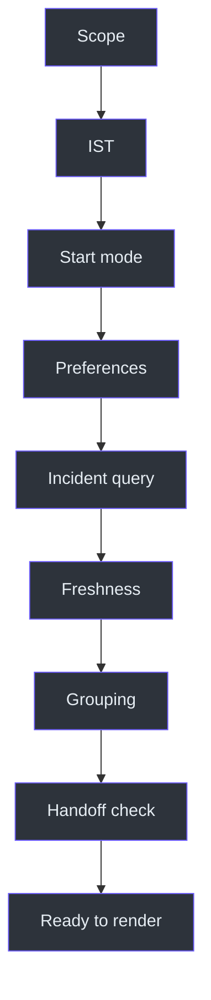
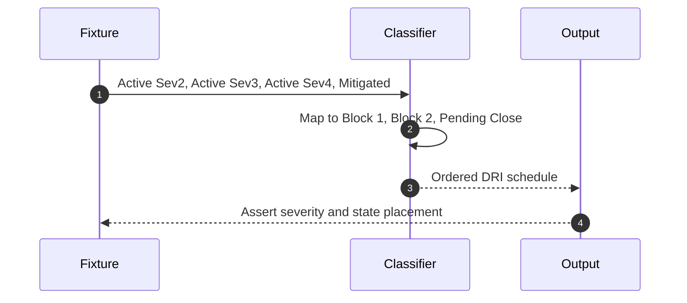

# DRI Workplan Operations and Testing

## Operational objective

A successful run gives the DRI a truthful, severity-aware incident schedule,
clearly separates active investigation from pending close-out, and preserves
data-freshness context. Source:
[SKILL.md](../SKILL.md#dri-workplan-generator-icm--livesite-only),
`SKILL.md:L7-L11`; [SKILL.md](../SKILL.md#workflow),
`SKILL.md:L113-L124`.

## Pre-run checklist

1. Confirm the request is incident/livesite-only.
2. Resolve the accurate IST date and current time.
3. Determine whether current-time start was explicitly requested.
4. Read `daily_routine`, `workplan_style`, and `dri_week`.
5. Query assigned Sev2/3/4 incidents in the documented states.
6. Record whether the result is live or last-known.
7. Identify related root-cause groups.
8. Check whether handoff is within 24 hours.

Sources: `SKILL.md:L13-L17`; `SKILL.md:L26-L40`;
`SKILL.md:L113-L132`.

## Post-run validation

- Date is accurate and current-time labels are IST.
- Start is 11:00 unless explicitly overridden.
- No ADO task appears.
- Active Sev2 is in Investigation Block 1.
- Active Sev3/4 is in Investigation Block 2.
- Mitigated incidents are under `PENDING CLOSE`.
- Related incidents are grouped.
- Timeout fallback is labeled stale.
- Handoff is noted when inside 24 hours.
- Links are outside code fences.
- Box lines are short enough for terminal display.
- No undocumented file was written.

Sources: [SKILL.md](../SKILL.md#key-rules), `SKILL.md:L75-L85`;
[SKILL.md](../SKILL.md#workflow), `SKILL.md:L113-L124`;
[SKILL.md](../SKILL.md#important-notes), `SKILL.md:L126-L132`.

## Test matrix

| ID | Scenario | Expected result |
|---|---|---|
| T01 | "DRI plan" | Routes to `dri-workplan` |
| T02 | ADO-only request | Routes to `ado-workplan` |
| T03 | Combined request | Routes to `dayplan` |
| T04 | Weekday without override | Starts at 11:00 |
| T05 | "Starting now" | Starts at current IST time |
| T06 | Weekend incident request | Does not reject due to weekend |
| T07 | Active Sev2 | Investigation Block 1 |
| T08 | Active Sev3 and Sev4 | Investigation Block 2 |
| T09 | Mitigated incident | `PENDING CLOSE` |
| T10 | Related incidents | One root-cause group |
| T11 | IcM query timeout | Last-known data with stale note |
| T12 | Handoff within 24 hours | Handoff context included |
| T13 | Monday through Friday | Correct Day 1-5 label |
| T14 | Link formatting | Clickable bullet outside fence |
| T15 | Long title | Shortened box text avoids wrapping |
| T16 | ADO task present in context | Excluded |

## Severity-order regression test

Source: [SKILL.md](../SKILL.md#workflow), `SKILL.md:L117-L121`.

## Troubleshooting

| Symptom | Likely violation | Correction |
|---|---|---|
| Plan starts at current time by default | Start rule misread | Restore 11:00 start |
| Weekend recharge message appears | Sibling weekend rule leaked in | Continue DRI workflow |
| Sprint task appears | Scope boundary violated | Remove it or route combined request to `dayplan` |
| Sev3 precedes active Sev2 | Priority classification failed | Move Sev2 to Block 1 |
| Mitigated incident uses investigation block | State mapping failed | Move to `PENDING CLOSE` |
| Related incidents are scattered | Grouping skipped | Consolidate by root cause |
| Stale data appears current | Timeout note missing | Add explicit staleness disclosure |
| Handoff is imminent but absent | 24-hour check skipped | Add handoff day/time |
| Link is not clickable | It is inside a fence | Move link bullet outside |
| Terminal wraps | Box line too long | Shorten title and sub-items |

## Failure handling

The IcM timeout fallback is explicit: use last-known data and note staleness.
Source: `SKILL.md:L130-L130`.

No fallback is defined for:

- date resolution failure;
- SQL preference failure;
- missing last-known incident data;
- a successful query returning no incidents.

For those cases, do not invent operational state. State what could not be
verified. This is conservative safety guidance, not a source-defined retry
algorithm.

## Freshness and disclosure checks

| Condition | Required wording behavior |
|---|---|
| Live query succeeds | May describe incident set as current |
| Query times out, last-known exists | Must label data stale |
| Query times out, no fallback known | Must not fabricate an incident list |
| Handoff data unavailable | Must not invent a handoff time |

Only the second row is explicitly defined by `SKILL.md:L130-L130`; the remaining
rows enforce the source's "never guess" safety principle for unverifiable facts.

## Maintenance guidance

1. Keep incident-only routing separate from ADO and combined routing.
2. Regression-test default and explicit start modes independently.
3. Preserve Sev2-first classification.
4. Document any future rule for `Mitigating` before implementing it.
5. Keep root-cause grouping and timeout disclosure visible in tests.
6. If last-known storage is introduced, document freshness thresholds and source.
7. If file output is introduced, define paths, overwrite policy, and ownership.
8. Keep marker meanings, URL template, and rendering tests synchronized.

Relevant sources:
[SKILL.md](../SKILL.md#data-sources), `SKILL.md:L26-L29`;
[SKILL.md](../SKILL.md#workflow), `SKILL.md:L113-L124`;
[SKILL.md](../SKILL.md#important-notes), `SKILL.md:L126-L132`.

## Release acceptance checklist

- [ ] `SKILL.md` remains unchanged.
- [ ] Citations still match source lines.
- [ ] DRI-only routing passes.
- [ ] 11:00 default passes.
- [ ] Current-time override passes.
- [ ] Weekend non-rejection passes.
- [ ] Sev2/3/4 classification passes.
- [ ] Mitigated placement passes.
- [ ] Root-cause grouping passes.
- [ ] Timeout staleness disclosure passes.
- [ ] Handoff annotation passes.
- [ ] Formatting and link placement pass.
- [ ] No undocumented file side effect occurs.

