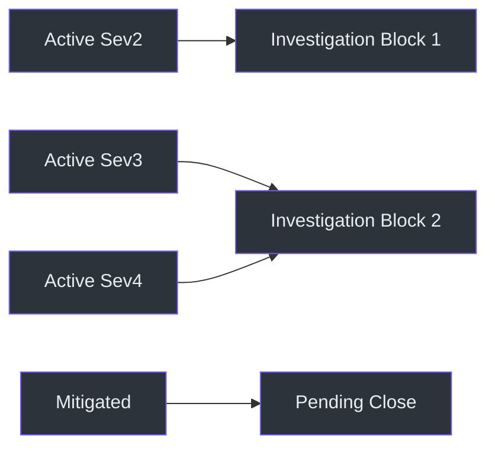
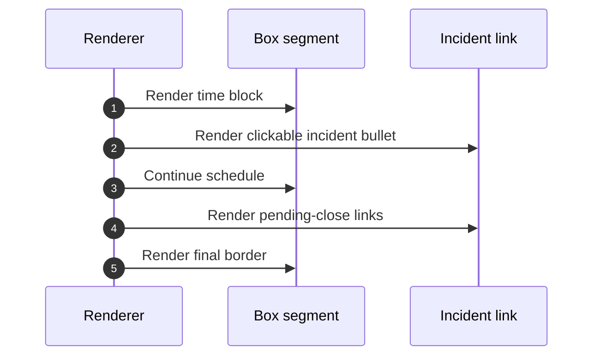

# DRI Workplan Reference

## Trigger routing

| Request | Route |
|---|---|
| DRI plan | `dri-workplan` |
| Livesite plan | `dri-workplan` |
| IcM workplan | `dri-workplan` |
| Show incidents or what's active | `dri-workplan` |
| ADO/sprint-only plan | `ado-workplan` |
| Combined full day | `dayplan` |

Source: [SKILL.md](../SKILL.md#when-to-use-this-skill), `SKILL.md:L19-L24`;
`SKILL.md:L9-L11`.

## Data-source reference

| Source | Purpose | Selector |
|---|---|---|
| IcM MCP | Incident workload | Assignee `mishrad`; Sev2/3/4; Active/Mitigating/Mitigated |
| SQL `user_preferences` | Routine, format, DRI context | Keys below |

Source: [SKILL.md](../SKILL.md#data-sources), `SKILL.md:L26-L29`.

## Preference keys

| Key | Purpose |
|---|---|
| `daily_routine` | Work hours and blocks, 11:00-18:00 IST |
| `workplan_style` | Exact visual format |
| `dri_week` | DRI dates and day count |

Source: [SKILL.md](../SKILL.md#user-preferences-from-sql),
`SKILL.md:L31-L40`.

## Date and time contract

| Rule | Requirement |
|---|---|
| Date | Fetch from internet or system clock |
| Zone | IST, UTC+05:30 |
| Default start | 11:00 IST |
| Current-time override | Only on explicit request |
| Template end | 18:00 IST |
| Weekend | Do not refuse or question hours |
| DRI day count | Monday Day 1 through Friday Day 5 |

Source: [SKILL.md](../SKILL.md#-critical-rules--date--time),
`SKILL.md:L13-L17`; [SKILL.md](../SKILL.md#important-notes),
`SKILL.md:L126-L132`.

## Incident classification

| Severity/state | Placement | Meaning in output |
|---|---|---|
| Active Sev2 | Investigation Block 1 | Highest priority |
| Active Sev3 | Investigation Block 2 | Active investigation |
| Active Sev4 | Investigation Block 2 | Active lower-severity follow-up |
| Mitigated | `PENDING CLOSE` | Close-out work remains |
| Mitigating | Fetched; separate placement not specified | Treat cautiously; no invented rule |

Source: [SKILL.md](../SKILL.md#workflow), `SKILL.md:L117-L121`;
[SKILL.md](../SKILL.md#data-sources), `SKILL.md:L26-L29`.

## Schedule reference

| Time | Block |
|---|---|
| 11:00 | Start Day: IcM sweep and email triage |
| 11:30 | Standup: DRI update |
| 12:00 | Investigation Block 1: active Sev2/3 |
| 14:00 | Lunch |
| 15:00 | Investigation Block 2: follow-ups |
| 16:00 | Break |
| 16:30 | Mitigation, RCA, close-out |
| 18:00 | Wrap up and handoff notes |

Source: [SKILL.md](../SKILL.md#schedule-template-ist--dri-blocks),
`SKILL.md:L100-L111`.

## Marker meanings

| Meaning | Status |
|---|---|
| Active Sev2 | Highest-severity active incident |
| Active Sev3 | Active incident |
| Active Sev4 | Active incident |
| Mitigated | Pending close |

The exact source emoji characters are listed in
[SKILL.md](../SKILL.md#link-emoji-legend), `SKILL.md:L87-L95`.

## URL contract

`https://portal.microsofticm.com/imp/v5/incidents/details/{id}/summary`

Source: [SKILL.md](../SKILL.md#url-format), `SKILL.md:L96-L98`.

## Rendering contract

| Element | Requirement |
|---|---|
| Layout | Two-column time/content box |
| Box | Inside code fences |
| Width | Approximately 55 characters |
| Separator | Dashed rows |
| Sub-item | Source-defined arrow prefix |
| Incident links | Markdown bullets outside fences |
| Footer | Actionable insight plus `PENDING CLOSE` |
| Final border | Separate final code fence |

Source: [SKILL.md](../SKILL.md#key-rules), `SKILL.md:L75-L85`.

## Grouping and handoff

| Concern | Rule |
|---|---|
| Related incidents | Group by root cause |
| Example family | SFRP-ACIS |
| Handoff | Note day/time when within 24 hours |

Source: [SKILL.md](../SKILL.md#workflow), `SKILL.md:L122-L124`;
[SKILL.md](../SKILL.md#important-notes), `SKILL.md:L130-L132`.

## Failure handling

| Failure | Defined behavior |
|---|---|
| IcM MCP timeout | Use last-known data and note staleness |
| Date lookup failure | No fallback specified |
| SQL preference failure | No fallback specified |
| No incidents | Output behavior not explicitly defined |

Source: [SKILL.md](../SKILL.md#important-notes), `SKILL.md:L130-L130`.

## File side effects

None are specified. Session SQL is read for preferences; no write is described.
Source: `SKILL.md:L26-L40`; `SKILL.md:L113-L124`.

## Complete quick reference

| Question | Answer |
|---|---|
| What does it plan? | IcM and livesite work only |
| What does it exclude? | ADO sprint work |
| Default start? | 11:00 IST |
| Can it start now? | Yes, only by explicit request |
| Highest priority? | Active Sev2 |
| Where do Sev3/4 go? | Investigation Block 2 |
| Where do mitigated incidents go? | `PENDING CLOSE` |
| How are related incidents shown? | Grouped by root cause |
| What happens on timeout? | Last-known data with stale label |
| What happens on weekends? | Do not reject or question working hours |
| When is handoff shown? | When within 24 hours |
| Are files written? | Not in the documented snapshot |

## Known limitations

The source does not define:

- IcM MCP schema, authentication, pagination, or retry count;
- placement of the fetched `Mitigating` state;
- root-cause grouping criteria;
- last-known data storage or age;
- no-incident output;
- handoff data source;
- after-hours current-time behavior;
- file persistence.

These limitations should remain visible until the source contract changes.

