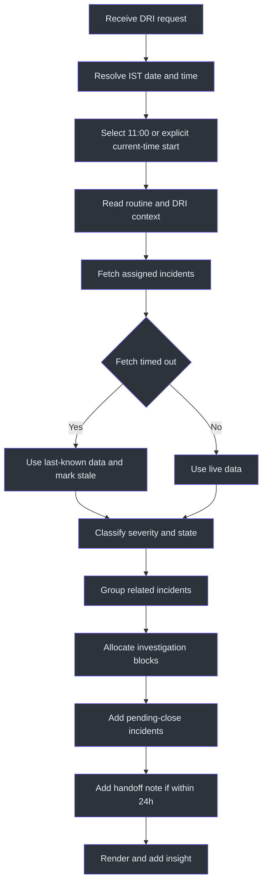
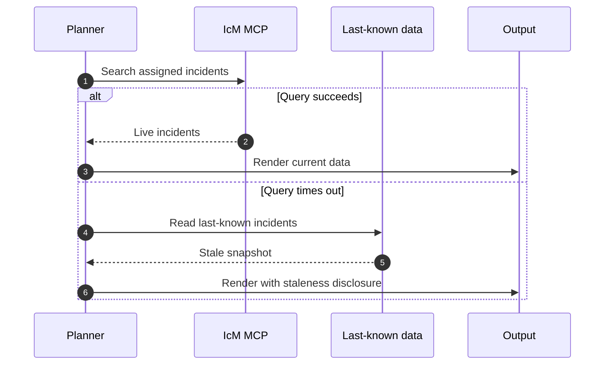

# DRI Workplan Workflow

## Overview

The workflow turns incident state into an ordered shift plan. It establishes
time context, retrieves assigned incidents, groups related failures, schedules
active investigation ahead of close-out, and renders the result.
Source: [SKILL.md](../SKILL.md#workflow), `SKILL.md:L113-L124`.

## Full control flow



### 1. Route the request

Use this skill for DRI plans, livesite plans, IcM workplans, incident status,
active incident reviews, and DRI-week incident overviews. Source:
[SKILL.md](../SKILL.md#when-to-use-this-skill), `SKILL.md:L19-L24`.

Exclude ADO work. Route ADO-only requests to `ado-workplan` and combined requests
to `dayplan`. Source: `SKILL.md:L9-L11`.

### 2. Establish IST context

Fetch the date from the internet or system clock and ensure it is correct in IST.
Do not guess. Display any current time in IST. Source:
[SKILL.md](../SKILL.md#-critical-rules--date--time),
`SKILL.md:L13-L17`.

### 3. Select start mode

- Default: start at 11:00 IST.
- Override: use current IST time only when the user explicitly asks to start now
  or from current time.

Source: `SKILL.md:L15-L17`.

The source explicitly says not to question working hours or say it is the
weekend, so there is no weekend stop in this workflow.
Source: [SKILL.md](../SKILL.md#important-notes), `SKILL.md:L126-L129`.

### 4. Read preferences

Read:

- `daily_routine` for 11:00-18:00 blocks;
- `workplan_style` for exact visual format;
- `dri_week` for dates and day count.

Source: [SKILL.md](../SKILL.md#user-preferences-from-sql),
`SKILL.md:L31-L40`.

### 5. Fetch incidents

Use the named IcM search with assignee `mishrad`, severities 2/3/4, and states
Active, Mitigating, and Mitigated. Source:
[SKILL.md](../SKILL.md#data-sources), `SKILL.md:L26-L29`.

### 6. Handle source timeout

If the IcM MCP times out, use last-known incident data and state that it is stale.
The source does not specify a retry count, cache path, or maximum acceptable age.
Source: [SKILL.md](../SKILL.md#important-notes), `SKILL.md:L130-L130`.



### 7. Classify incidents

| Class | Destination |
|---|---|
| Active Sev2 | Investigation Block 1 |
| Active Sev3/4 | Investigation Block 2 |
| Mitigated | `PENDING CLOSE` |

Source: [SKILL.md](../SKILL.md#workflow), `SKILL.md:L117-L121`.

The source fetch also includes the `Mitigating` state but does not separately
define its placement. Do not invent a new category; placement needs contextual
interpretation consistent with active investigation.

### 8. Group root causes

Keep incidents sharing a root cause together, such as the source's example of
SFRP-ACIS incidents. The exact matching method is not defined.
Source: [SKILL.md](../SKILL.md#workflow), `SKILL.md:L122-L123`;
`SKILL.md:L130-L131`.

### 9. Populate standard blocks

| Time | Block |
|---|---|
| 11:00 | Start day: incident sweep and email triage |
| 11:30 | Standup with DRI update |
| 12:00 | Investigation Block 1 for active Sev2/3 |
| 14:00 | Lunch |
| 15:00 | Investigation Block 2 and follow-ups |
| 16:00 | Break |
| 16:30 | Mitigation, RCA, and close-out |
| 18:00 | Wrap-up and handoff notes |

Source: [SKILL.md](../SKILL.md#schedule-template-ist--dri-blocks),
`SKILL.md:L100-L111`.

### 10. Add DRI context and handoff

Label the DRI day Monday through Friday as Day 1 through Day 5. If the handoff is
within 24 hours, include its day/time context. Source:
[SKILL.md](../SKILL.md#important-notes), `SKILL.md:L128-L132`.

### 11. Render

Use the shared two-column box with short lines, dashed separators, and sub-item
markers. Keep incident link bullets outside code fences. End with an actionable
insight, the `PENDING CLOSE` area, and a separately fenced closing border.
Source: [SKILL.md](../SKILL.md#key-rules), `SKILL.md:L75-L85`.

## Pseudocode

```text
now = resolve_ist_datetime()
start = 11:00
if request explicitly asks for current time:
    start = now.time

preferences = read(daily_routine, workplan_style, dri_week)
incidents = search_icm(assignee=mishrad, severities=[2,3,4],
                       states=[Active, Mitigating, Mitigated])

if search_timed_out:
    incidents = read_last_known()
    stale = true

groups = group_by_root_cause(incidents)
block1 = active_sev2(groups)
block2 = active_sev3_or_sev4(groups)
pending_close = mitigated(groups)

render(start, block1, block2, pending_close, handoff_context)
```

This is a source-derived outline, not a tool signature.

## File side effects

No file creation or modification is specified. The workflow ends with rendering.
Source: [SKILL.md](../SKILL.md#workflow), `SKILL.md:L113-L124`.

## Ambiguities to preserve

- `Mitigating` is fetched but not separately classified.
- Root-cause grouping criteria are not defined.
- "Last known" storage and age are not defined.
- Handoff source and exact formatting are not defined.
- Behavior after 18:00 for "starting now" is not defined.

These gaps should be documented, not filled with invented behavior.

