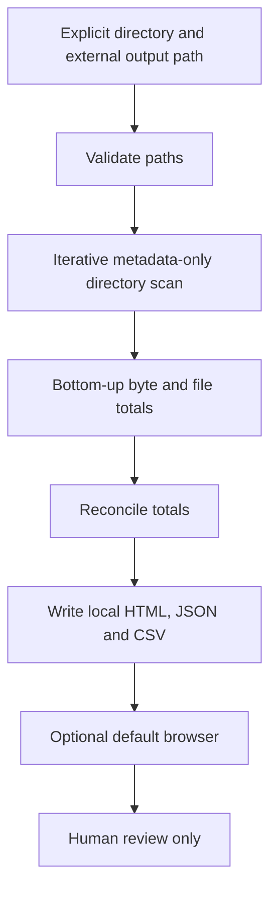

# Architecture

The normative routing and safety contract is `SKILL.md` (sections Runtime and
routing, Execution, Report contract). The implementation is
`scripts\folder_heatmap.py`: `scan`, the embedded `HTML`, `save` and `main`.

`scan` uses `os.scandir` and non-following stat calls. A stack avoids Python
recursion limits. Parent IDs precede children; a reverse pass aggregates every
descendant. A bounded heap retains the 20 largest direct files per folder.
Read errors and link skips remain explicit in the snapshot.

The self-contained HTML embeds JSON with `<` escaped to prevent file names
closing the data script. Names enter the document through `textContent`, never
HTML interpretation. A content security policy disallows external resources.
Binary treemap subdivision renders the selected folder's immediate items.
Direct files occupy one aggregate tile. The table retains zero-byte folders.

Each table owns an independent sort state, initially Size descending.
Header buttons use name comparison or raw numeric comparison. Selecting another
column starts ascending; repeated clicks reverse. Filtering and percentage
calculation precede sorting; sorting precedes the display limit. Sorting does
not modify measured data or treemap area.

Memory scales with folder count and retained direct-file metadata, not contents.
The JSON is embedded in HTML as well as saved separately. Very large trees can
produce large reports; this implementation is not a streaming billion-file tool.
