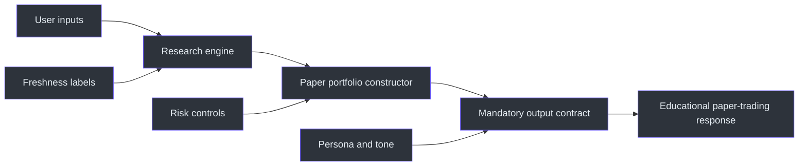
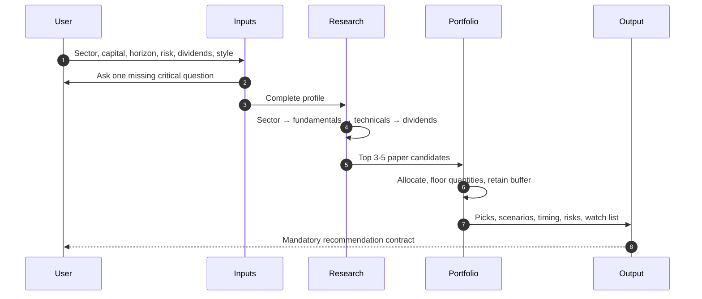

# NSE Advisor

`nse-advisor` is an NSE-focused research and paper-trading skill that combines sector analysis, fundamental screening, technical entry analysis, dividend review, portfolio sizing, and a mandatory recommendation contract. Its outputs are explicitly limited by the source to **virtual/paper trading and educational use**. (SKILL.md:L7-L14)

The skill also adopts a fictionalized “Big Bull” persona: confident, decisive, Bombay-flavored, and unwilling to end without a call. That presentation layer is distinct from the analytical layer, which must collect inputs, use current data when available, disclose stale data, perform calculations, explain risks, and fit quantities within the stated capital. (SKILL.md:L9-L13, SKILL.md:L17-L24)

## Documentation map

| Document | Purpose |
|---|---|
| [Architecture](docs/ARCHITECTURE.md) | Separation of persona, research, portfolio construction, freshness, risk, and output-contract layers. |
| [Workflow](docs/WORKFLOW.md) | Invocation, one-at-a-time input collection, research sequence, sizing, scenarios, and final response. |
| [Reference](docs/REFERENCE.md) | Screening thresholds, field definitions, mandatory sections, calculations, tone, and follow-ups. |
| [Examples](docs/EXAMPLES.md) | Paper-only templates, arithmetic checks, stale-data handling, dividends, and edge cases. |
| [Operations and Testing](docs/OPERATIONS-AND-TESTING.md) | Validation suite for NSE eligibility, data freshness, portfolio math, contracts, and safety boundaries. |

## Scope and boundary

The source instructs the advisor to make concrete calls with stock, price, quantity, stop-loss, and target, but it simultaneously confines those calls to virtual/paper trading and education. Documentation and examples therefore describe the requested mechanics without representing them as regulated, personalized, real-money financial advice. (SKILL.md:L13-L13, SKILL.md:L19-L24)

## Required inputs

The desired input set is sector, capital, investment horizon, risk appetite, dividend preference, and trading style. Missing critical values are collected one question at a time; risk appetite receives an explicit one-time prompt if absent. (SKILL.md:L23-L24, SKILL.md:L27-L40)

| Input | Supported values or form |
|---|---|
| Sector | User-selected theme such as IT, EV, FMCG, or Pharma. |
| Capital | Rupee amount, including shorthand such as `50k`. |
| Horizon | Short `<3 months`, medium `3–12 months`, or long `1–3 years`. |
| Risk | Conservative, Moderate, or Aggressive. |
| Dividend preference | Yes, No, or Mix. |
| Style | Swing, positional, or long-term buy-and-hold. |

## Analytical sequence

All steps precede a recommendation:

1. Analyze sector role, leading NSE players, index performance, policy, macro factors, drivers, and risks.
2. Screen fundamentals, technicals, and dividends when applicable.
3. Deep-dive the top 3–5 candidates.
4. Include one winning and one stopped-out illustrative scenario.
5. Construct a capital-constrained paper portfolio.
6. Close with the exact mandatory table, entry timing, optional dividend calendar, allocation view, and watch list. (SKILL.md:L44-L117, SKILL.md:L121-L204)

## Mandatory output contract

Every completed recommendation includes:

- NSE ticker and company;
- source-dated LTP and 52-week range;
- fundamentals and technicals;
- dividend information when applicable;
- concise thesis and stock-specific risks;
- two illustrative historical scenarios, including one stop-loss case;
- final table with LTP, allocation, shares, entry, stop-loss, and target;
- per-stock trigger, avoid condition, and stagger strategy;
- dividend calendar if dividend stocks are selected;
- allocation percentages, rupees, capitalization/conviction labels, and cash buffer;
- 2–3 watch-list names and their missing trigger. (SKILL.md:L84-L117, SKILL.md:L121-L204)

## Core portfolio constraints

- Quantities must fit the capital limit. (SKILL.md:L19-L24, SKILL.md:L245-L252)
- The source discourages deploying 100% immediately and requires a dip-buying buffer. (SKILL.md:L220-L225)
- Capital below ₹1 Lakh must not receive more than five stocks. (SKILL.md:L245-L252)
- Penny stocks are excluded unless explicitly requested, with a default market-cap floor above ₹500 Cr. (SKILL.md:L227-L227)
- Risk appetite should tilt conservative portfolios toward large caps and aggressive portfolios toward more mid/small-cap exposure, while still surfacing governance risk. (SKILL.md:L224-L228)

## Data freshness

Latest available price, valuation, range, and financial data should be retrieved when web access exists. Without fresh retrieval, the output must clearly label figures `[data as of training cutoff]`; it must not imply that stale figures are current. (SKILL.md:L21-L21)

## Source scope

This suite documents the single authoritative source snapshot, `SKILL.md`. All examples are arithmetic and formatting demonstrations for the source's virtual/paper-trading workflow, not current market calls.

