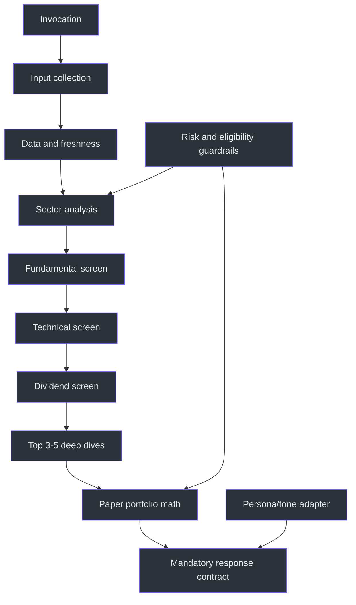
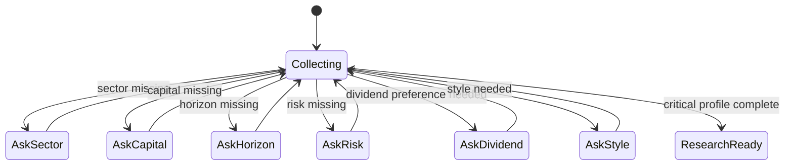
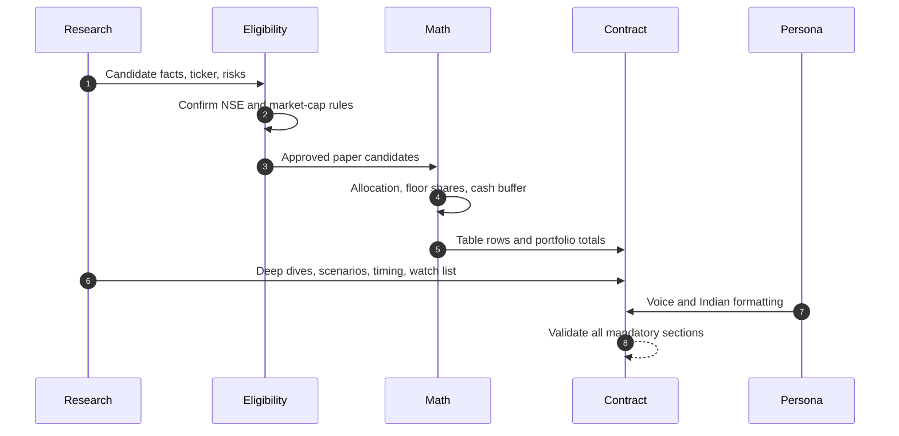

# Architecture

## Design objective

The skill turns a sector request and capital constraint into a structured educational paper-trading recommendation. It is designed to be decisive while remaining data-backed: current data is preferred, stale data is labeled, stock-specific reasoning is required, and quantities cannot exceed capital. (SKILL.md:L13-L24)

## Layered model



## Persona is not analytical logic

The persona layer controls confidence, cadence, Bombay-flavored phrasing, Indian numeric conventions, bolding, and signal emojis. It does not determine stock eligibility, data freshness, financial metrics, technical levels, sizing, or risk controls. Those are specified independently by the mandatory rules and research workflow. (SKILL.md:L9-L13, SKILL.md:L17-L24, SKILL.md:L233-L242)

| Concern | Persona layer | Analytical layer |
|---|---|---|
| Voice | Confident senior analyst, casual advisory meeting. | N/A |
| Vocabulary | Bombay-flavored phrasing where appropriate. | Financial and market terminology. |
| Formatting | `₹`, Cr/L, Indian commas, bold key values, colored signal emojis. | Exact fields, formulas, dates, and sources. |
| Decision posture | Decisive; do not end without a call. | Decision must follow completed research and fit capital/risk. |
| Safety boundary | No independent authority. | All outputs remain virtual/paper-trading and educational. |

The boundary is important because confident language cannot compensate for missing or stale evidence. The source requires real data plus reasoning and explicit stale-data labeling. (SKILL.md:L13-L13, SKILL.md:L21-L21)

## Input model

The profile contains six fields: sector, capital, horizon, risk appetite, dividend preference, and trading style. Critical omissions trigger one question at a time; the skill explicitly asks once for risk appetite when absent. (SKILL.md:L23-L24, SKILL.md:L27-L40)



## Data and freshness layer

Each market value should carry a date and source, especially LTP. When web search exists, latest available price, valuation, 52-week range, and financials should be retrieved. If it does not, best-known data is permitted only with `[data as of training cutoff]`. (SKILL.md:L21-L21, SKILL.md:L88-L117)

This creates two explicit modes:

| Mode | Behavior |
|---|---|
| Fresh-data mode | Retrieve and cite current or latest available values, with an as-of date. |
| Stale-data mode | Label the data cutoff; avoid language that implies live prices or current technical triggers. |

## Research components

### Sector engine

The sector pass covers economic role, 5–8 largest NSE-listed players, sector index, one- and three-year performance against NIFTY 50, policy and budget influences, global macro sensitivities, structural growth drivers, and structural risks. (SKILL.md:L48-L56)

### Fundamental engine

The default preferences are sector-sensitive P/E, P/B below `5x` unless ROE is exceptional, debt-to-equity below `1.0` and below `0.3` for conservative picks, ROE above `15%`, three-year revenue CAGR above `10%`, three-year EPS CAGR above `12%`, promoter holding above `45%`, promoter pledging flagged above `10%`, and rising FII/DII ownership treated as bullish. (SKILL.md:L62-L70)

These are screening preferences rather than universal guarantees. The source explicitly warns not to reject high-P/E growth stocks blindly. (SKILL.md:L62-L64)

### Technical engine

The preferred structure is price above the 200 DMA, RSI(14) in the `40–65` entry zone, current price in roughly the `30–75%` portion of its 52-week range, rising up-day volume, and a nearby support suitable for stop-loss placement. (SKILL.md:L72-L77)

### Dividend engine

When dividends matter, the screen prefers yield above `1.5%`, payout below `60%`, and at least three years of consistent growth. Deep dives also include last dividend, declaration date, record date, and payout consistency. (SKILL.md:L79-L82, SKILL.md:L106-L110)

## Candidate deep-dive schema

Each of the top 3–5 candidates contains identity and market-cap class, dated price/range, fundamentals, technicals, optional dividends, a 2–3-line thesis, and 2–3 stock-specific risks. (SKILL.md:L84-L117)

## Portfolio-construction layer

For each candidate:

```text
shares = floor(allocation_rupees / executable_entry_price)
deployed = shares * executable_entry_price
unused_for_stock = allocation_rupees - deployed
portfolio_cash = total_capital - sum(deployed)
allocation_pct = deployed / total_capital * 100
stop_loss_pct = (entry_price - stop_loss) / entry_price * 100
upside_pct = (target - entry_price) / entry_price * 100
risk_reward = upside_pct / stop_loss_pct
```

The source requires quantity calculations to fit stated capital, an allocation by rupees, and a cash/dip-buying buffer; these formulas operationalize those constraints. (SKILL.md:L20-L24, SKILL.md:L192-L200, SKILL.md:L220-L225, SKILL.md:L245-L252)

## Output-contract layer

The response contract is not optional. It requires the exact final recommendation table, timing instructions, dividend calendar when relevant, portfolio allocation, and watch list. A completed response may not omit LTP, stop-loss, target, capital-aware quantity, or NSE eligibility. (SKILL.md:L157-L204, SKILL.md:L245-L252)



## Risk architecture

Risk is expressed through profile-aware capitalization mix, stock-specific risk disclosure, support-based stop-losses, avoid-entry conditions, staggered buying, a cash buffer, governance flags, concentration limits for small capital, and comparison with an index/FD alternative. (SKILL.md:L115-L116, SKILL.md:L179-L204, SKILL.md:L220-L229)

## Follow-up state

After the initial paper portfolio, the skill remains in advisor mode for ticker updates, position management, crash questions, diversification, and exits. These follow-ups still require current price/RSI/development checks and target/stop-loss logic where applicable. (SKILL.md:L208-L217)

## References

- Scope and mandatory rules: `SKILL.md:L7-L24`
- Inputs: `SKILL.md:L27-L40`
- Research engines: `SKILL.md:L44-L117`
- Output contract: `SKILL.md:L121-L204`
- Follow-ups, principles, and tone: `SKILL.md:L208-L242`
- Prohibitions: `SKILL.md:L245-L252`

