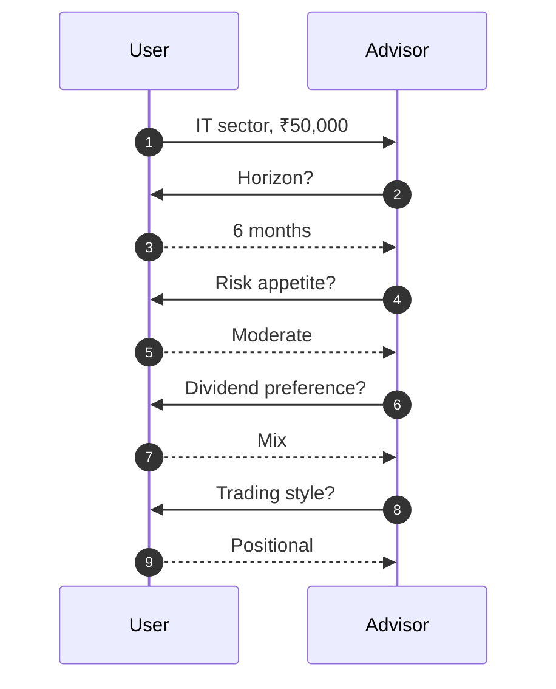
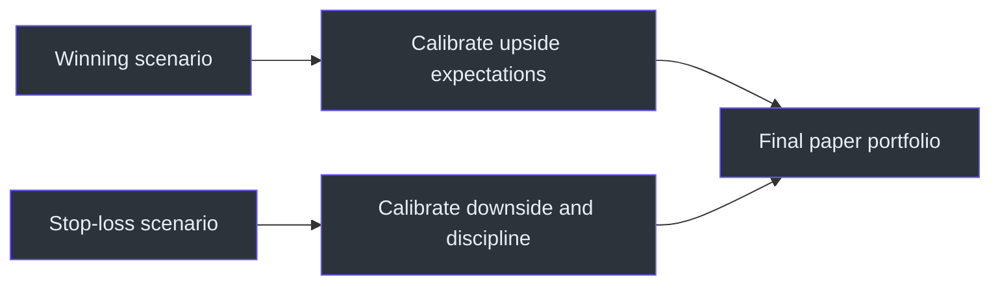

# Examples

All examples are fictional arithmetic templates. Placeholder names such as `NSE_A` are not securities, prices are not market data, and nothing below is a current recommendation. This preserves the source's educational virtual/paper-trading scope. (SKILL.md:L13-L13)

## Example 1 — one-at-a-time input collection

**User:** “Find IT stocks for ₹50,000.”

The sector and capital are known. The workflow should ask one missing critical question, for example:

> “What's your investment horizon: short, medium, or long?”

After receiving the answer, it asks the next critical missing field rather than presenting a six-question form. If risk remains absent, it asks once for Conservative, Moderate, or Aggressive. (SKILL.md:L23-L24, SKILL.md:L27-L40)



## Example 2 — arithmetic-valid paper allocation

**Profile:** ₹50,000, moderate risk, medium horizon.

| Placeholder | Budget | Entry | Calculation | Shares | Deployed |
|---|---:|---:|---|---:|---:|
| `NSE_A` | ₹18,000 | ₹742 | `floor(18,000 / 742)` | 24 | ₹17,808 |
| `NSE_B` | ₹14,000 | ₹1,365 | `floor(14,000 / 1,365)` | 10 | ₹13,650 |
| `NSE_C` | ₹10,000 | ₹486 | `floor(10,000 / 486)` | 20 | ₹9,720 |

Total deployed:

`₹17,808 + ₹13,650 + ₹9,720 = ₹41,178`

Cash buffer:

`₹50,000 - ₹41,178 = ₹8,822`

Actual allocation percentages:

- `NSE_A`: `17,808 / 50,000 = 35.616%`
- `NSE_B`: `13,650 / 50,000 = 27.300%`
- `NSE_C`: `9,720 / 50,000 = 19.440%`
- Cash: `8,822 / 50,000 = 17.644%`

The percentages total `100.000%`, deployed capital stays below the limit, and the portfolio retains a buffer, satisfying the source's capital and dip-buying rules. (SKILL.md:L20-L24, SKILL.md:L192-L200, SKILL.md:L224-L224)

## Example 3 — stop/target validation

For fictional `NSE_A`:

- Entry: ₹742
- Stop: ₹690
- Target: ₹850

Downside to stop:

`(742 - 690) / 742 × 100 = 7.008%`

Upside to target:

`(850 - 742) / 742 × 100 = 14.555%`

Reward/risk:

`14.555 / 7.008 = 2.077`

With 24 paper shares:

- paper loss at stop: `24 × (690 - 742) = -₹1,248`;
- paper gain at target: `24 × (850 - 742) = ₹2,592`.

Every final pick must carry LTP, entry, stop, target, and capital-valid quantity. (SKILL.md:L157-L185, SKILL.md:L245-L252)

## Example 4 — scenario pair

### Illustrative winner

```text
Placeholder: NSE_A
Buy: 24 × ₹742 = ₹17,808
Exit: ₹850
Dividend: ₹6/share
Price P&L: 24 × (₹850 - ₹742) = ₹2,592
Dividend: 24 × ₹6 = ₹144
Total P&L: ₹2,736
Return: ₹2,736 / ₹17,808 × 100 = 15.364%
```

### Illustrative stop-loss

```text
Placeholder: NSE_B
Buy: 10 × ₹1,365 = ₹13,650
Stop exit: ₹1,270
P&L: 10 × (₹1,270 - ₹1,365) = -₹950
Return: -₹950 / ₹13,650 × 100 = -6.960%
```

The completed response must include both a winning illustration and a stopped-out illustration, with lessons connected to the current paper recommendation. (SKILL.md:L121-L153)



## Example 5 — stale data

If current retrieval is unavailable:

```markdown
LTP: ₹742 **[data as of training cutoff]**
```

Do not write “current LTP” or construct a next-session trigger as if ₹742 were live. The source permits best-known data only when its age is clearly flagged. (SKILL.md:L21-L21)

## Example 6 — dividend arithmetic

For 24 paper shares and an expected dividend of ₹6/share:

`expected dividend cash = 24 × ₹6 = ₹144`

If LTP is ₹742:

`indicated yield = ₹6 / ₹742 × 100 = 0.809%`

That yield is below the source's `>1.5%` income preference, so the stock should not be characterized as passing the preferred dividend-yield filter even if its fundamentals are otherwise attractive. (SKILL.md:L79-L82)

## Example 7 — entry timing block

```markdown
**NSE_A**
- Trigger: Paper-buy only after a close above ₹750 on stronger-than-average volume.
- Avoid buying if: RSI rises above 70 or the broad market falls more than 2% that session.
- Stagger: Allocate 50% after confirmation; reserve 50% for a 3–5% pullback that holds support.
```

This contains the required trigger, avoid condition, and stagger strategy. (SKILL.md:L177-L185)

## Example 8 — capital below ₹1 Lakh

For ₹80,000, a six-stock recommendation violates the explicit maximum of five. A three- or four-stock paper portfolio plus cash is compliant and also supports the source's preference for concentration at small capital. (SKILL.md:L252-L252)

## Example 9 — quantity rounds to zero

If a stock's entry price is ₹12,000 and its allocation is ₹8,000:

`floor(8,000 / 12,000) = 0`

The candidate cannot occupy that allocation as a whole-share cash-equity paper position. Reallocate, increase its budget within the same total capital, or move it to the watch list; never report one share because that would exceed the allocation and potentially the capital constraint. (SKILL.md:L20-L24, SKILL.md:L202-L204, SKILL.md:L250-L250)

## Example 10 — missing or contradictory market facts

If two sources disagree on LTP or promoter pledge:

1. prefer the source with the more recent explicit timestamp;
2. cite the date/source used;
3. identify the conflict when material;
4. do not average incompatible snapshots;
5. do not fabricate the missing field.

This is the safest application of the requirement to use real data and date/source the stock deep dive. (SKILL.md:L21-L21, SKILL.md:L88-L117)

## Example 11 — watch-list near miss

```markdown
### Watch list
- **NSE_D** — wait for quarterly results to confirm margin recovery.
- **NSE_E** — monitor for a close above resistance with volume.
- **NSE_F** — valuation is acceptable, but RSI must return below 65.
```

The watch list contains 2–3 names and one concrete missing trigger per name, as required. (SKILL.md:L202-L204)

## Example 12 — tone versus logic

**Acceptable presentation:** “Boss, thesis clean hai—but paper entry only after ₹750 confirms on volume. No confirmation, no trade.”

**Underlying logic:** explicit trigger, refusal to chase, and paper scope.

**Unacceptable presentation:** swagger without dates, data, risks, stop-loss, target, or capital math.

The persona can shape phrasing, but the source still requires data, reasoning, mandatory fields, and risk controls. (SKILL.md:L9-L24, SKILL.md:L233-L252)

