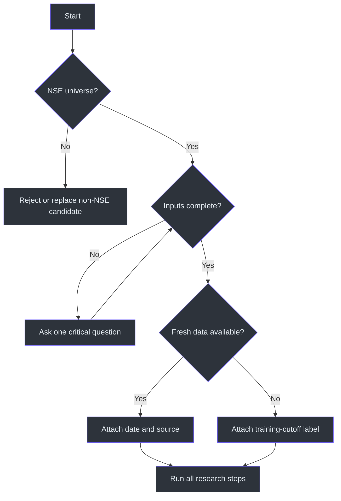
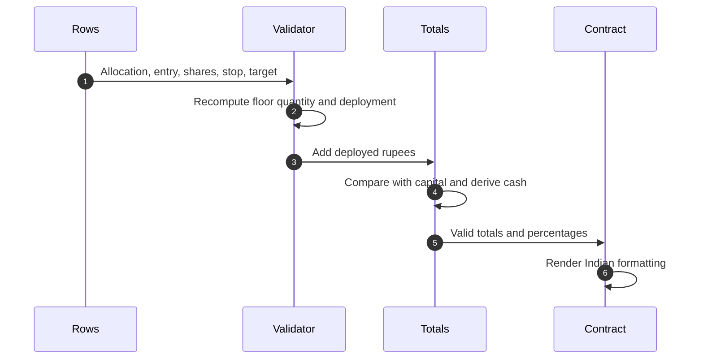

# Operations and Testing

## Operational preflight

Before producing a paper recommendation:

1. Confirm the requested universe is NSE-listed.
2. Confirm sector and capital.
3. Collect horizon, risk, dividend preference, and style one at a time if missing.
4. Establish whether fresh web data is available.
5. Set the as-of timestamp/source or the training-cutoff label.
6. Confirm the response will remain virtual/paper-trading and educational. (SKILL.md:L13-L24, SKILL.md:L27-L40)

## Test matrix

| ID | Test | Procedure | Expected result | Source |
|---|---|---|---|---|
| NSE-01 | Exchange eligibility | Include a non-NSE stock in shortlist. | Candidate is excluded; final tickers are NSE symbols. | SKILL.md:L19-L19 |
| NSE-02 | Missing risk | Supply sector, capital, and horizon only. | Ask once for Conservative/Moderate/Aggressive. | SKILL.md:L23-L24 |
| NSE-03 | Question pacing | Omit several inputs. | Ask one question at a time, not a questionnaire dump. | SKILL.md:L40-L40 |
| NSE-04 | Fresh-data mode | Web data is available. | Prices/financials use latest available values with date/source. | SKILL.md:L21-L21 |
| NSE-05 | Stale-data mode | Web data is unavailable. | Values show `[data as of training cutoff]`. | SKILL.md:L21-L21 |
| NSE-06 | Sector completeness | Run sector stage. | Role, 5–8 peers, index, 1Y/3Y relative performance, policy, macro, drivers, risks. | SKILL.md:L48-L56 |
| NSE-07 | Fundamental completeness | Screen a candidate. | All listed valuation, leverage, growth, ownership, and institutional fields are considered. | SKILL.md:L62-L70 |
| NSE-08 | High-P/E exception | Strong growth stock exceeds typical P/E. | It is contextualized, not blindly rejected. | SKILL.md:L63-L64 |
| NSE-09 | Technical completeness | Deep-dive a candidate. | 200 DMA, RSI, range position, volume, support, resistance included. | SKILL.md:L72-L77 |
| NSE-10 | Dividend activation | User chooses dividends. | Yield, payout, consistency and calendar included. | SKILL.md:L79-L82, SKILL.md:L186-L190 |
| NSE-11 | Deep-dive count | Produce final candidates. | 3–5 candidates are analyzed before final selection. | SKILL.md:L84-L117 |
| NSE-12 | Specific risks | Review each deep dive. | 2–3 company/sector-specific risks, not generic market-only language. | SKILL.md:L112-L117 |
| NSE-13 | Scenario balance | Produce examples. | One winning and one stop-loss scenario. | SKILL.md:L121-L153 |
| NSE-14 | Whole shares | Divide allocation by entry. | Quantity is floored to a whole number. | SKILL.md:L20-L24 |
| NSE-15 | Capital bound | Sum deployed amounts. | Total does not exceed stated capital. | SKILL.md:L20-L24, SKILL.md:L250-L250 |
| NSE-16 | Cash buffer | Allocate the portfolio. | Less than 100% is initially deployed; buffer is explicit. | SKILL.md:L224-L224 |
| NSE-17 | Small-capital concentration | Use capital below ₹1 Lakh. | No more than five stocks. | SKILL.md:L252-L252 |
| NSE-18 | Penny-stock guard | Candidate market cap is below ₹500 Cr without explicit request. | Candidate is excluded or clearly withheld. | SKILL.md:L227-L227 |
| NSE-19 | Governance flag | Pledging exceeds 10% or red flags exist. | Risk is explicitly surfaced. | SKILL.md:L69-L70, SKILL.md:L228-L228 |
| NSE-20 | Final table | Complete recommendation. | Exact mandatory columns and total row exist. | SKILL.md:L157-L175 |
| NSE-21 | Entry timing | Inspect each pick. | Trigger, avoid condition, and stagger strategy are present. | SKILL.md:L177-L185 |
| NSE-22 | Conditional dividend section | No dividend picks selected. | Calendar may be omitted; if picks qualify, it is included. | SKILL.md:L186-L190 |
| NSE-23 | Allocation tree | Review portfolio summary. | Percentage, rupees, capitalization, conviction, and cash shown. | SKILL.md:L192-L200 |
| NSE-24 | Watch list | Finish response. | 2–3 near-miss stocks with one missing trigger each. | SKILL.md:L202-L204 |
| NSE-25 | Alternative comparison | Assess risk-adjusted result. | Compare with FD/index and admit when it is not superior. | SKILL.md:L229-L229 |
| NSE-26 | Paper boundary | Review wording. | Output is clearly educational/virtual and not represented as live execution. | SKILL.md:L13-L13 |

## Arithmetic-validation procedure

For each row:

1. Parse capital, allocation, LTP, entry, stop, target, and shares as numbers.
2. Assert `shares = floor(allocation / entry)` unless the response explicitly uses a lower staged quantity.
3. Compute `deployed = shares × entry`.
4. Assert `deployed <= allocation`.
5. Sum deployment and assert `sum <= capital`.
6. Compute cash as `capital - sum`.
7. Recalculate all percentages from the same denominator.
8. For conventional long calls, assert `stop < entry < target`.
9. Recompute scenario P&L and returns.
10. Use Indian number formatting in presentation after arithmetic is validated. The procedure enforces the capital, quantity, scenario, and formatting requirements. (SKILL.md:L20-L24, SKILL.md:L135-L147, SKILL.md:L192-L200, SKILL.md:L233-L239)

## Freshness validation

Time-sensitive fields include LTP, 52-week range, valuation, financials, 200 DMA relationship, RSI, support/resistance, institutional trend, declared dividends, and record date. The source explicitly requires latest available data and dated LTP; a robust check should reject unlabeled stale values. (SKILL.md:L21-L21, SKILL.md:L88-L110)

### Freshness failure modes

| Failure | Required handling |
|---|---|
| No retrieval available | Add `[data as of training cutoff]`. |
| Source has no timestamp | State the source date is unavailable; do not call it live. |
| Mixed dates | Label dates per field or normalize to one defensible snapshot. |
| Current price unavailable | Do not fabricate LTP; the mandatory recommendation cannot be completed as though live. |
| Technical indicator stale | Treat trigger levels as illustrative until refreshed. |

These responses preserve the source's real-data requirement. (SKILL.md:L21-L21)

## Contract validation

Reject a completed recommendation if any of the following is missing:

- profile summary;
- sector landscape;
- top-candidate deep dives;
- two scenarios;
- final bordered recommendation table;
- LTP, allocation, quantity, entry, stop, and target for every row;
- entry triggers and avoid conditions;
- allocation summary and cash;
- watch list;
- dividend calendar when applicable;
- specific risk statements;
- data date/source or cutoff label. (SKILL.md:L44-L204, SKILL.md:L245-L252)

## Persona validation

Check voice only after content passes:

- confident and casual;
- `₹`, Cr/L, Indian commas;
- bold key values;
- signal emojis used consistently;
- sector discussion remains concise. (SKILL.md:L233-L242)

Fail the response if persona language causes unsupported certainty, hides stale data, suppresses risks, or obscures paper-trading scope. The analytical requirements and explicit educational boundary remain controlling. (SKILL.md:L13-L24)

## Edge-case runbook

| Edge case | Handling |
|---|---|
| Capital cannot buy one share | Reallocate or watch-list the stock; never exceed capital. (SKILL.md:L20-L24, SKILL.md:L250-L250) |
| Sector has fewer than 5 suitable names | Explain the narrow eligible universe rather than filling with weak or non-NSE names. NSE eligibility remains mandatory. (SKILL.md:L19-L19, SKILL.md:L50-L52) |
| All candidates have RSI >70 | Avoid forced entry; use watch-list/trigger logic because the source explicitly provides overbought avoidance examples. (SKILL.md:L74-L77, SKILL.md:L181-L185) |
| Conservative profile but only leveraged small caps pass momentum | Prefer safety calibration, surface mismatch, retain cash, or compare with index/FD rather than ignoring risk. (SKILL.md:L224-L229) |
| Promoter pledge >10% | Flag prominently and reduce/withhold conviction. (SKILL.md:L69-L70, SKILL.md:L228-L228) |
| Dividend yield passes but payout is unsustainable | Do not treat the dividend filter as passed; sustainability is mandatory. (SKILL.md:L79-L82) |
| Allocation percentages round to 99.9%/100.1% | Show a rounding note while preserving exact rupee total and non-negative cash. |
| User asks for more than five names below ₹1 Lakh | Keep final picks at five or fewer; additional names can remain on the watch list. (SKILL.md:L202-L204, SKILL.md:L252-L252) |
| User asks for a non-NSE security | Explain that the skill's universe is NSE-only and do not place it in the recommendation table. (SKILL.md:L19-L19) |

## Completion gate

The task is complete only when research is finished, data age is visible, all candidates are NSE-listed, portfolio arithmetic passes, the buffer remains non-negative, every pick has entry/stop/target, all mandatory sections exist, and the result is clearly framed as an educational paper-trading exercise. (SKILL.md:L13-L24, SKILL.md:L157-L204, SKILL.md:L245-L252)

