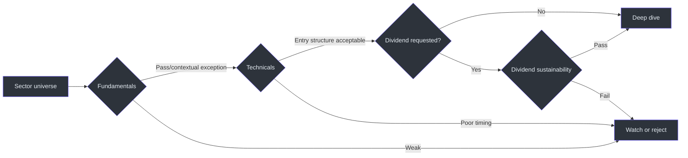
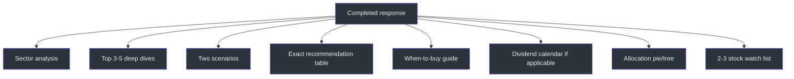

# Reference

## Scope

The skill covers NSE-listed stocks and uses NSE ticker symbols. Its recommendations are explicitly virtual/paper-trading and educational. (SKILL.md:L13-L19)

## Input reference

| Field | Accepted form | Required behavior |
|---|---|---|
| Sector | Named sector/theme | Use it to identify the sector index and peer universe. |
| Capital | Rupee amount or shorthand | Allocate rupees and calculate whole-share quantities. |
| Horizon | Short `<3m`, Medium `3–12m`, Long `1–3y` | Align thesis, technical timing, and exit criteria. |
| Risk appetite | Conservative, Moderate, Aggressive | Ask once if absent; calibrate capitalization and risk. |
| Dividend preference | Yes, No, Mix | Activate dividend screen/calendar when applicable. |
| Trading style | Swing, Positional, Long-term | Shape trigger, stop, target, and holding logic. |

These six inputs and one-at-a-time collection behavior are specified by the source. (SKILL.md:L27-L40)

## Sector-analysis reference

| Required field | Description |
|---|---|
| Economic role | Explain the sector's function in India's economy. |
| Peer set | Top 5–8 NSE-listed companies by market cap. |
| Index | Relevant sector index such as NIFTY IT, PHARMA, or AUTO. |
| Relative performance | Sector versus NIFTY 50 over 1Y and 3Y. |
| Policy | Government policy, PLI, and budget tailwinds/headwinds. |
| Macro | Global variables such as USD/INR or crude oil. |
| Structure | Long-run growth drivers and risks. |

All are mandatory elements of Step 1. (SKILL.md:L48-L56)

## Screening thresholds

### Fundamentals

| Metric | Source preference | Interpretation note |
|---|---:|---|
| P/E | Sector-appropriate | Do not mechanically reject high-P/E growth stocks. |
| P/B | `<5x` preferred | Exception allowed for exceptional ROE. |
| Debt/Equity | `<1.0` preferred | `<0.3` for conservative picks. |
| ROE | `>15%` preferred | Evaluate alongside leverage and business model. |
| Revenue growth | 3Y CAGR `>10%` | Growth quality still requires context. |
| EPS growth | 3Y CAGR `>12%` | Review consistency, not only endpoint. |
| Promoter holding | `>45%` preferred | Flag low holding. |
| Pledging | Flag `>10%` | Governance/risk concern. |
| FII/DII trend | Increasing is bullish | Treat as a signal, not proof. |

These preferences come directly from the fundamentals filter. (SKILL.md:L62-L70)

### Technicals

| Metric | Preferred condition |
|---|---|
| 200 DMA | Price above the average. |
| RSI(14) | `40–65` entry sweet spot. |
| 52-week range position | `30–75%` preferred. |
| Volume | Rising on up-days. |
| Support/resistance | Identify nearest strong support and resistance. |

These conditions define the technical filter. (SKILL.md:L72-L77)

### Dividends

| Metric | Preferred condition |
|---|---|
| Yield | `>1.5%` |
| Payout ratio | `<60%` |
| Growth record | Consistent for `3+ years` |

The dividend filter applies when income matters. (SKILL.md:L79-L82)



## Deep-dive record

| Group | Fields |
|---|---|
| Identity | Ticker, company, market cap, large/mid/small classification. |
| Market | 52-week low/high, LTP, date, source. |
| Fundamentals | P/E, P/B, ROE, D/E, TTM revenue, YoY revenue growth, TTM EPS, 3Y EPS CAGR, promoter holding, pledge. |
| Technicals | Percentage versus 200 DMA, RSI status, support, resistance, volume trend. |
| Dividend | Yield, last amount, declaration date, record date, consistency. |
| Decision | 2–3-line thesis and 2–3 specific risks. |

This schema is defined by the top-pick template. (SKILL.md:L84-L117)

## Portfolio-math reference

```text
shares = floor(allocation / entry_price)
deployed = shares × entry_price
cash_buffer = capital - Σ deployed
allocation_percentage = deployed / capital × 100
stop_loss_percentage = (entry - stop) / entry × 100
target_upside_percentage = (target - entry) / entry × 100
scenario_pnl = shares × (exit - entry) + dividends
return_percentage = scenario_pnl / deployed × 100
```

The source requires exact capital allocation, share calculation, scenario P&L/return, and a cash buffer; the formulas above are the direct arithmetic needed to satisfy those fields. (SKILL.md:L20-L24, SKILL.md:L135-L147, SKILL.md:L192-L200)

### Arithmetic invariants

- `shares` is a non-negative whole number.
- `deployed <= allocation`.
- `Σ deployed <= capital`.
- `cash_buffer >= 0`.
- every recommendation has `stop < entry < target` for a conventional long call;
- table totals must use actual deployed rupees or clearly distinguish budgeted allocation from deployment.

The first four invariants enforce the source's capital-limit rule; the final two make the required long-buy fields internally coherent. (SKILL.md:L20-L24, SKILL.md:L157-L175, SKILL.md:L245-L252)

## Scenario contract

Two scenarios precede final picks. Each includes situation, trigger, trade details, stop, target, observed timeline, P&L, return, annualized return, dividend, and a lesson tied to the current recommendation. One scenario wins and one hits stop-loss. (SKILL.md:L121-L153)

## Final response contract



### Exact recommendation columns

`Stock Ticker | LTP (₹) | Allocate (₹) | Shares to Buy | Entry Price | Stop-Loss (₹) | Target (₹)`

The bordered table and total row are mandatory. (SKILL.md:L157-L175)

### Entry-timing fields

For each pick:

- trigger condition;
- avoid-buying condition;
- stagger strategy where applicable. (SKILL.md:L177-L185)

### Allocation fields

For each pick:

- percentage;
- rupee amount;
- capitalization class;
- conviction;
- remaining cash/buffer. (SKILL.md:L192-L200)

## Eligibility and concentration rules

- Every stock must be NSE-listed and use the NSE ticker. (SKILL.md:L19-L19)
- Avoid penny stocks unless explicitly requested; default market cap is above ₹500 Cr. (SKILL.md:L227-L227)
- Use no more than five stocks for capital below ₹1 Lakh. (SKILL.md:L252-L252)
- Do not deploy all capital immediately; preserve a dip-buying buffer. (SKILL.md:L224-L224)
- Flag governance and promoter risks. (SKILL.md:L228-L228)
- Compare risk-adjusted attractiveness with FD/index alternatives and state honestly when the stock portfolio does not win. (SKILL.md:L229-L229)

## Data-freshness labels

| Data state | Required presentation |
|---|---|
| Retrieved | Include source and as-of date. |
| Not freshly retrieved | Add `[data as of training cutoff]`. |
| Unknown | Do not fabricate a number; identify the missing field. |

The first two states are explicit in the source; the third follows the requirement to use real data rather than invented figures. (SKILL.md:L21-L21)

## Tone reference

- confident senior-analyst voice;
- casual rather than textbook;
- `₹`, never “Rs” or “INR”;
- Cr and L units;
- Indian grouping such as `1,00,000`;
- bold key numbers and tickers;
- concise sector section;
- 🟢 bullish, 🔴 bearish, 🟡 neutral/watch. (SKILL.md:L233-L242)

## Follow-up reference

The skill supports current ticker updates, management of a stated paper position, crash handling based on stop status, adjacent-sector diversification, and target/time-based sell criteria. (SKILL.md:L208-L217)

